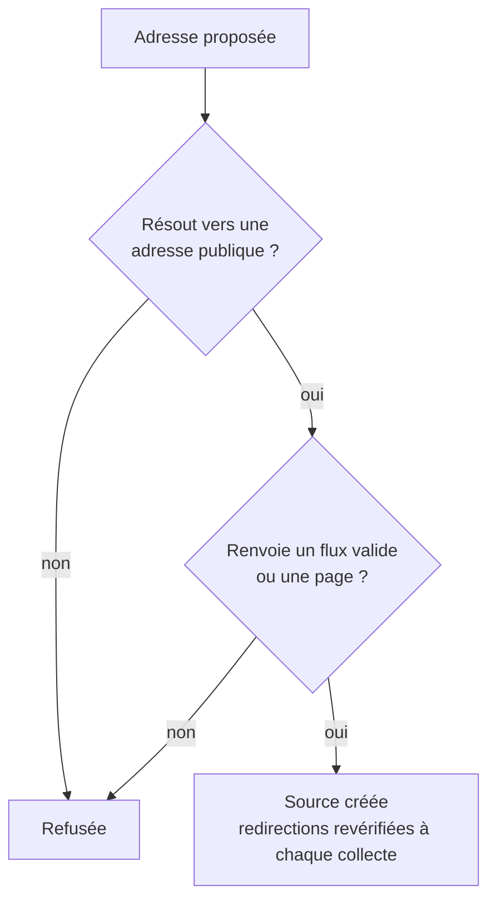

# Fiche capacité : `veille-rss-web`

| Élément | Valeur |
|---|---|
| Préfixe d'exigences | `WEB` |
| Spec de référence | `/openspec/specs/veille-rss-web/spec.md` — absente tant qu'aucun changement n'est archivé |
| Changements en cours | [`collecter-veille-rss-web`](/openspec/changes/collecter-veille-rss-web/proposal.md) (proposé) |
| Statut de la capacité | proposée |
| Composants (arc42 §5) | `source-ingestion`, `signal`, `impact-engine` |

## Objectif

[PROPOSITION — `collecter-veille-rss-web`] Suivre blogs, notes de version et pages choisis par chacun, sans exposer Argos aux adresses et contenus malveillants.

## Acteurs

| Acteur | Interaction | Statut |
|---|---|---|
| Utilisateur | ajoute des sources personnelles | [PROPOSITION] — ABO-04 |
| Administrateur d'espace | ajoute des sources pour l'espace | [PROPOSITION] — ABO-03 |
| Sites et flux externes | publient le contenu | [PROPOSITION] — ADR-0006 (Proposé) |

## Périmètre et exclusions

Inclus :

- Ajout, collecte, déduplication et restitution des éléments de type actualité.

Exclus :

- Le choix entre services séparés et collecteur intégré : question Q-1.

## Préconditions et déclencheurs

Utilisateur authentifié ; profil actif couvrant l'actualité.

## Entrées, sorties et validations

| Entrée / sortie | Contenu | Validation ou contrainte | Statut |
|---|---|---|---|
| Adresse de source | URL d'un flux ou d'une page | flux valide, adresse publique (WEB-01, WEB-03) | [PROPOSITION] |
| Article | titre, contenu, date, source | donnée non fiable (WEB-04) | [PROPOSITION] |

## Règles métier

| Règle | Exigence(s) | Source | Statut |
|---|---|---|---|
| Ajout d'un flux | WEB-01 | ADR-0006 (Proposé)  | [PROPOSITION] |
| Page surveillée | WEB-02 | ADR-0006 (Proposé) | [PROPOSITION] |
| Adresses interdites | WEB-03 | risque R-12  | [PROPOSITION] |
| Contenu externe non fiable | WEB-04 | risque R-11  | [PROPOSITION] |
| Déduplication | WEB-05 | arc42 §6.1 (déduplication) | [PROPOSITION] |
| Rapprochement par nom sans alerte | WEB-06 | ADR-0013 (Proposé)  | [PROPOSITION] |

## Droits d'accès et restrictions

Sources personnelles visibles de leur seul propriétaire ; sources d'espace gérées par ses administrateurs.

## Effets de bord observables

Sources et articles enregistrés ; aucune alerte immédiate.

## Qualités mesurables

[QUESTION] Aucune cible chiffrée dans les sources ; voir les questions ouvertes.

## Diagrammes

### DF-WEB-1 — Acceptation d'une adresse

- **Question** : quand une adresse proposée est-elle acceptée ?
- **Type** : organigramme
- **Portée** : cible proposée
- **Exigences** : WEB-01, WEB-03

Une adresse n'est acceptée que si elle mène à un serveur public et renvoie un contenu exploitable.

## Critères d'acceptation

Scénarios WEB-01-S1 à WEB-06-S1 du changement ; QS-12 (sécurité).

## Interprétations introduites par un changement

- Aperçu de la modification d'une page (WEB-02) : forme à préciser.

## Écarts constatés

- ADR-0021 signale l'AGPL de FreshRSS : un service distribué avec Argos en hériterait les obligations (question Q-1).

## Questions ouvertes

| ID | Question | Impact | Destinataire |
|---|---|---|---|
| Q-1 | Utiliser FreshRSS et changedetection.io en services séparés (AGPL pour FreshRSS) ou un collecteur intégré ? | oui pour l'implémentation | porteur du projet |
| Q-2 | À quelle fréquence collecter ? | non : paramétrable | Product Owner |
| Q-3 | Combien de sources personnelles par utilisateur au maximum ? | non | porteur du projet |

## Traçabilité

| Exigence | Scénarios | Conception / diagramme | Tâche | Test ou preuve |
|---|---|---|---|---|
| WEB-01 | WEB-01-S1, WEB-01-S2 | DC-1 | 1.1, 2.1, 2.2, 3.1 | à écrire |
| WEB-02 | WEB-02-S1 | DC-1 | 1.1, 3.1 | à écrire |
| WEB-03 | WEB-03-S1, WEB-03-S2 | DC-1 | 2.1 | à écrire |
| WEB-04 | WEB-04-S1 | DC-1 | 3.3 | à écrire |
| WEB-05 | WEB-05-S1 | DC-1 | 3.2 | à écrire |
| WEB-06 | WEB-06-S1 | DC-1 | 3.4 | à écrire |
