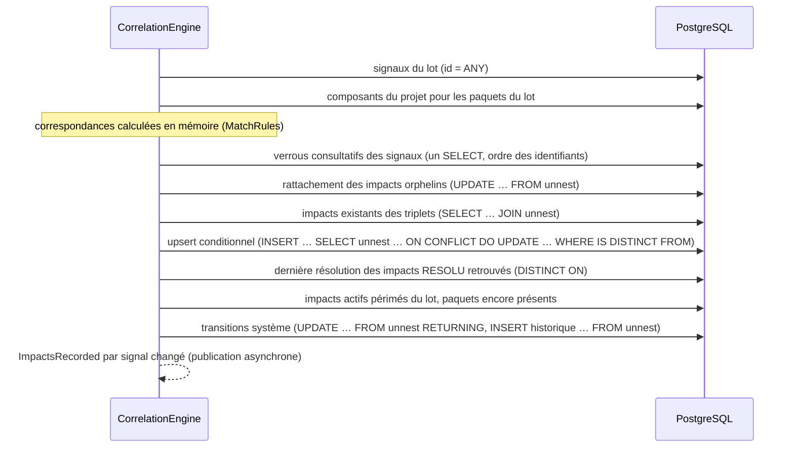

# Conception : accélérer les requêtes chaudes

<!-- Statuts : [EXIGENCE] [EXISTANT] [DÉCISION] [PROPOSITION] [QUESTION] — légende : /docs/specifications/README.md#statuts-des-informations. -->

**Niveau de conception** : complète — corrélation, alertes, radar, Ma veille et recherche changent leurs accès aux données ensemble, avec une migration d'index et une lecture technique qui touche le cloisonnement.

## Contexte technique

- [EXISTANT] Corrélation (`impact/CorrelationEngine.java`) : `correlateProject` ouvre une transaction par signal (`correlate` → `deterministic`), relit le signal (`signals.find`), cherche les composants du projet pour ses paquets, pose un verrou consultatif par signal, puis pour chaque composant exécute `reattach` (UPDATE), `precedent` (SELECT), `upsert` (INSERT … ON CONFLICT DO UPDATE sans condition, `updated_at = now()`, `component_id` dans le `SET`), et éventuellement `resoluParLeSysteme` + `systeme` ; `resolveStale` lit les impacts périmés puis appelle `packagePresent` et `systeme` par impact.
- [EXISTANT] Alertes (`alerting/MoteurAlertes.java`) : observateur `@ObservesAsync ImpactsRecorded` (sprint 8). Par destinataire : `espacesDe`, `impacts.forSignals` sous la RLS du destinataire, `abonnements.activeFor`, chacun dans `QuarkusTransaction.requiringNew()` ; `alerteExiste` par plan et canal ; `creerImmediate` et `ajouterAuResume` une transaction par écriture ; `envoi.envoyer(creees)` en fin d'observateur.
- [EXISTANT] Ma veille (`api/veille/VeilleProfilsResource.java`) : `impacts.forWorkspaces(…, 200)` (`ORDER BY updated_at DESC, id LIMIT 200` sur l'index V21 `(updated_at DESC, id)`), `signaux.findAll`, puis `SignauxAbonnements.pour` qui exécute `SignalQueries.search` par abonnement (OR d'expressions sur `signal_package` sans index).
- [EXISTANT] Radar (`impact/RadarProjets.java`, `releaseradar/CalendrierEndoflife.java`, `alerting/RappelsRadar.java`) : `componentsMatching(clés, Optional.empty())` puis filtre Java par espace ; `finDeSupport` par composant (référentiel + `cycle_vie`) ; `enregistrerDette` une instruction par dette ; `RappelsRadar` appelle `echeancesTouchant` pour chaque jour de rappel.
- [EXISTANT] Recherche (`impact/RechercheVeille.java`) : `WITH r AS MATERIALIZED (SELECT * FROM argos_rechercher_veille(…)) SELECT …, (SELECT count(*) FROM r) … LIMIT ? OFFSET ?`.
- [EXISTANT] Index de `project_impact` : PK, `project_impact_triplet_uk (signal_id, project_id, component_id)`, `project_impact_signal`, `project_impact_workspace`, `project_impact_project`, `project_impact_projet_etat`, `project_impact_signal_etat`, `project_impact_recents`.

## Exigences couvertes

| Exigence | Section(s) de conception | Diagramme(s) |
|---|---|---|
| COR-07 | D2, Transactions | DC-1 |
| COR-13 | D3, Traitements | DC-1 |
| ALR-09 | D4, D5, Sécurité | DC-2 |
| PRF-07 | D6, D7, Performance | — |
| RAD-08 | D8 | — |
| RCH-07 | D9, Contrats d'interface | — |
| PERF-02 | D10, Performance | — |

## Objectifs et non-objectifs

**Objectifs :**
- Un nombre de requêtes indépendant du nombre de signaux (corrélation, par lot), de membres (alertes) et de composants (radar).
- Aucune réécriture d'un impact inchangé.
- Index de `project_impact` sans redondance ; index manquants créés.
- Ma veille et la recherche indépendantes de la taille de la sélection et des autres espaces.

**Non-objectifs :**
- Corrélation d'inventaire en tâche de fond (l'observateur `InventoryReplaced` reste `AFTER_SUCCESS`, voir proposition).
- Rétention, import d'inventaire, pagination des listes d'exploitation (sprint 9).
- Cache applicatif.

## Composants impactés, responsabilités et frontières

| Composant | Responsabilité dans ce changement | Ne doit pas | Statut |
|---|---|---|---|
| correlation-engine (`impact`) | corrélation ensembliste par lots ; upsert conditionnel ; transitions système par lot | lire une table d'un autre module autrement que par ses services de lecture | modifié |
| alerting | évaluation groupée ; écritures par lot ; diffusion laissée à `EnvoiAlertes` | diffuser dans l'observateur | modifié |
| release-radar (`impact/RadarProjets`, `releaseradar`) | composants par espace en SQL, calendrier par espace, dettes par lot, rappels en une passe | — | modifié |
| search (`impact/RechercheVeille`) | classement borné, total plafonné | matérialiser toute la sélection | modifié |
| inventory (`InventoryQueries`) | `componentsMatching` filtrable par espace | — | modifié |
| signal (`SignalQueries`) | recherche des abonnements par sous-requêtes indexées | — | modifié |
| workspace-service (`SubscriptionService`) | abonnements actifs de plusieurs comptes en une requête | accorder un droit | modifié |
| API (`VeilleProfilsResource`, `SignauxAbonnements`) | lectures groupées ; pagination ADR-0040 | — | modifié |

Aucune frontière de module ne change : `impact` n'appelle pas `workspace` ; l'appartenance est lue par `alerting/Destinataires` comme aujourd'hui.

## Modèle de domaine et invariants

Aucun changement de modèle. Invariants testés :
- INV-1 : une recorrélation sans changement ne modifie ni `updated_at` ni aucune colonne de l'impact (COR-07-S2).
- INV-2 : les impacts obtenus par lot sont ceux de la corrélation unitaire (COR-13-S2) : mêmes créations, mises à jour, réouvertures (`DE_NOUVEAU_VERIFIE`), résolutions et motifs.
- INV-3 : une alerte ne cite que des projets des espaces dont le destinataire est membre au moment de l'évaluation (ALR-09-S3, ACC-04).

## Traitements et interactions

### DC-1 — Corrélation d'un lot de signaux (UML, séquence, cible ; COR-07, COR-13)



Neuf à onze instructions par lot, quel que soit le nombre de signaux et de composants. La corrélation globale d'un signal (`SignalChanged`) emprunte le même chemin avec un lot d'un signal et sans projet.

### DC-2 — Évaluation des alertes d'un signal (UML, séquence, cible ; ALR-09)

```mermaid
sequenceDiagram
    participant MA as MoteurAlertes
    participant DB as PostgreSQL
    participant EA as EnvoiAlertes (planifié)
    MA->>DB: membres des espaces touchés et tous leurs espaces (une requête)
    MA->>DB: impacts actifs du signal dans ces espaces (lecture technique)
    MA->>DB: abonnements actifs de ces membres (une requête)
    MA->>DB: alertes immédiates existantes du signal pour ces membres
    Note over MA: plans calculés en mémoire ; résumé IA si une alerte nouvelle
    MA->>DB: alertes immédiates (INSERT … SELECT unnest … ON CONFLICT … RETURNING)
    MA->>DB: éléments de résumé (INSERT … SELECT unnest … ON CONFLICT DO NOTHING)
    EA->>DB: alertes en attente (passage suivant)
```

## États et transitions

Non applicable — aucun cycle de vie ne change ; les transitions système de COR-11 sont seulement écrites par lot.

## Contrats d'interface

| Élément | Valeur |
|---|---|
| `GET /api/v1/recherche`, outil MCP `search_signals` | champ booléen `totalPlafonne` ajouté ; `total` vaut au plus 1 000 ; paramètres inchangés |
| `GET /api/v1/me/veille` | pagination ADR-0040 (`page`, `size` ; champs `page`, `size`, `total`) ajoutée à la réponse, qui garde `profilsActifs` et `elements` ; taille par défaut : Q-2 de la proposition |
| Événements CDI | `ImpactsRecorded` inchangé |

Compatibilité : champs ajoutés seulement ; l'IHM affiche « plus de 1 000 résultats » quand `totalPlafonne` est vrai.

## Persistance et intégrité

Migration `V26__index_requetes_chaudes.sql` (index seulement) :

| Index | Table | Constat |
|---|---|---|
| `project_impact_composant (component_id) WHERE component_id IS NOT NULL` | project_impact | AUD-PER-09 (clé étrangère `ON DELETE SET NULL`) |
| `dette_version_composant (component_id)` | dette_version | AUD-PER-09 (`ON DELETE CASCADE`) |
| `ingestion_failure_source (source_id, received_at)` | ingestion_failure | AUD-PER-09 |
| `ops_event_source (source_id, occurred_at)` | ops_event | AUD-PER-09 |
| `sync_attempt_run (run_id)` | sync_attempt | AUD-PER-09 |
| `inventory_import_failure_projet (project_id, received_at)` | inventory_import_failure | AUD-PER-09 |
| suppression `project_impact_signal`, `project_impact_project` | project_impact | AUD-PER-29 (couverts par `project_impact_signal_etat`, `project_impact_projet_etat`, `project_impact_triplet_uk`) |
| `project_impact_actifs_recents (workspace_id, updated_at DESC, id) WHERE state IN ('OUVERT','CONFIRME')`, suppression `project_impact_recents` | project_impact | AUD-PER-26 |
| `signal_package_ecosysteme (lower(ecosystem))`, `signal_package_type ((split_part(substr(package_key, 5), '/', 1)))`, `signal_package_nom ((lower(regexp_replace(package_key, '^.*/', ''))))` | signal_package | AUD-PER-06 |
| `signal_modifie (modified_at DESC, id)` | signal | AUD-PER-06 |

Aucune donnée, aucun droit ni aucune politique RLS ne change. Retour arrière : nouvelle migration qui recrée les index supprimés (arc42 §8.7).

## Transactions, concurrence et idempotence

- Corrélation : une transaction par lot (`argos.correlation.taille-lot`, 500 signaux par défaut, Q-1) ; les verrous consultatifs par signal sont pris en une instruction dans l'ordre des identifiants, ce qui évite l'interblocage entre une corrélation globale et une corrélation de projet ; la sérialisation par signal (COR-11) est conservée.
- Upsert conditionnel (D2) : une ligne inchangée n'est pas retournée par `RETURNING` ; son identifiant et son état viennent de la lecture des impacts existants faite juste avant, sous les mêmes verrous.
- Transitions système par lot : `UPDATE … WHERE state = départ` reste conditionnel ; seules les lignes modifiées reçoivent leur historique (concurrence optimiste inchangée avec `TraitementImpacts.transitionner`).
- Alertes : l'insertion par lot garde `ON CONFLICT (signal_id, compte_id, canal) WHERE nature = 'IMMEDIATE'` ; un rejeu ne duplique rien (ALR-03).

## Sécurité et isolation

- [DÉCISION] (porteur du projet, 2026-11-26) Alertes : les impacts du signal sont lus une fois par une lecture technique, sous l'utilisateur de connexion, jointe aux appartenances des destinataires (`appartenance.espace_id = project_impact.workspace_id`) : c'est la règle de `argos_espace_lisible` hors espace courant, exprimée comme filtre explicite. La relecture sous la RLS de chaque destinataire est retirée. Le traitement est technique (tâche de fond, ADR-0016 « traitements batch et comptes techniques ») ; un test vérifie qu'un destinataire ne reçoit jamais un projet d'un espace dont il n'est pas membre (ALR-09-S3).
- Les lectures d'API (Ma veille, recherche, impacts) restent sous `argos_app` avec le compte de l'appelant.

## Gestion des erreurs et reprise

- Corrélation : un lot en échec (panne d'accès aux données, `IllegalStateException`) est annulé et journalisé avec sa cause ; le marqueur de recorrélation reste posé et l'import planifié suivant relance (INV-09-S4, inchangé). Une erreur imprévue n'est pas absorbée.
- Alertes : une alerte non diffusée reste `EN_ATTENTE` et part au passage suivant d'`EnvoiAlertes` (comportement de reprise existant).

## Observabilité

Aucune métrique nouvelle ; les journaux d'échec gardent leur message et leur cause. La campagne de performance publie p50/p95 par opération et décrit le jeu de données par espace et par état.

## Performance et stratégie de mesure

- Cible : p95 < 500 ms (PERF-01, PRF-07, RCH-05).
- Nombre de requêtes : un compteur d'instructions JDBC de test (journal `FE=> Execute` du pilote PostgreSQL, fil courant) compare deux volumes différents (COR-13-S1, ALR-09-S1, RAD-08-S1).
- Campagne : jeu à plusieurs espaces (D10) ; appelant d'un petit espace (< 200 impacts actifs) dans une table d'au moins 500 000 impacts majoritairement résolus, avec abonnements par paquet et par technologie.

## Compatibilité, migration et retour arrière

Migration appliquée au démarrage (ADR-0032). Les suppressions d'index sont sûres : chaque requête qui les employait trouve un index de même préfixe. Contrats : champs ajoutés seulement.

## Décisions, alternatives et compromis

### D1 — Index d'expressions plutôt que colonnes normalisées

- **Statut** : [PROPOSITION]
- **Choix** : index sur les expressions exactes déjà employées par `SignalQueries.search` et `argos_rechercher_veille`.
- **Justification** : aucune réécriture de table ni colonne à maintenir ; les deux requêtes en profitent sans changer leurs expressions.
- **Alternatives écartées** : colonnes générées `ecosystem_lower`, `package_name` — réécriture de `signal_package` et requêtes à modifier ; passage de Ma veille par `RechercheVeille` — contrat et ordre différents.
- **Compromis** : les expressions des requêtes et des index doivent rester identiques (test de présence de l'index utilisé par `EXPLAIN`).
- **ADR** : non : décision locale.

### D2 — Upsert conditionnel

- **Statut** : [PROPOSITION]
- **Choix** : `ON CONFLICT … DO UPDATE SET signal_version_id, level, method, transitive, inventory_origin, inventory_date, provenance, updated_at = now() WHERE (colonnes) IS DISTINCT FROM (excluded.colonnes)` ; `component_id` hors du `SET` (égal par la clé de conflit), donc le déclencheur `UPDATE OF component_id` ne s'exécute plus.
- **Justification** : AUD-PER-25 ; mises à jour HOT possibles une fois `project_impact_recents` remplacé par un index partiel.
- **Alternatives écartées** : lecture puis mise à jour applicative — une instruction de plus par composant.
- **Compromis** : l'identifiant d'une ligne inchangée vient de la lecture préalable.
- **ADR** : non.

### D3 — Corrélation ensembliste par lots

- **Statut** : [PROPOSITION]
- **Choix** : DC-1 ; paramètres passés en tableaux (`unnest`) ; une transaction par lot ; publication d'`ImpactsRecorded` par signal changé après validation du lot ; analyse complémentaire IA seulement pour les signaux dont un impact a été publié.
- **Justification** : critère de sortie ; `executeBatch` envoie une instruction par ligne et ne réduit que les allers-retours.
- **Alternatives écartées** : transaction unique par projet — verrous et durée non bornés ; `executeBatch` — nombre d'instructions proportionnel aux composants.
- **Compromis** : SQL plus long ; un échec annule le lot entier (rejoué à l'import suivant).
- **ADR** : non.

### D4 — Évaluation des alertes groupée par signal

- **Statut** : [DÉCISION] (porteur, 2026-11-26) pour la lecture technique ; [PROPOSITION] pour le reste.
- **Choix** : DC-2 ; une transaction de lecture, une transaction d'écriture.
- **Alternatives écartées** : relecture sous la RLS par destinataire dans une transaction unique — N requêtes.
- **ADR** : non : application d'ADR-0016.

### D5 — Diffusion par la seule tâche d'envoi

- **Statut** : [PROPOSITION]
- **Choix** : l'observateur enregistre les alertes `EN_ATTENTE` ; `EnvoiAlertes.planifie` (cadence `argos.alerting.envoi.intervalle`) les diffuse.
- **Justification** : AUD-PER-04 ; l'envoi SMTP séquentiel ne retient plus le fil de l'observateur.
- **Compromis** : délai d'au plus un intervalle avant l'envoi d'une alerte immédiate.
- **ADR** : non.

### D6 — Ma veille lue espace par espace

- **Statut** : [PROPOSITION]
- **Choix** : `FROM unnest(?::uuid[]) e(id) CROSS JOIN LATERAL (SELECT … WHERE workspace_id = e.id AND state IN ('OUVERT','CONFIRME') ORDER BY updated_at DESC, id LIMIT ?)`, puis tri global et `LIMIT`, sur l'index partiel.
- **Justification** : chaque branche lit au plus 200 entrées d'index de son espace ; un petit espace ne parcourt plus les impacts des autres ni les impacts résolus (AUD-PER-26).
- **Alternatives écartées** : `UNION ALL` construit dynamiquement — texte SQL variable ; index non partiel — impacts résolus parcourus.
- **ADR** : non.

### D7 — Recherche des abonnements par sous-requêtes indexées

- **Statut** : [PROPOSITION]
- **Choix** : `s.id IN (SELECT signal_id FROM signal_package WHERE lower(ecosystem) = ANY … UNION SELECT … UNION …) OR s.source = ANY …`, tri `modified_at DESC, id` ; abonnements d'un appelant traités dans une seule transaction.
- **ADR** : non.

### D8 — Radar par espace

- **Statut** : [PROPOSITION]
- **Choix** : `componentsMatching(clés, projet, espace)` avec filtre `p.workspace_id = ?` ; `CalendrierSorties.finsDeSupport(clés, espaces)` lit le référentiel et `cycle_vie` une fois, puis évalue les versions en mémoire ; dettes insérées par `INSERT … SELECT unnest … ON CONFLICT DO NOTHING` ; `RappelsRadar` demande les échéances de l'intervalle [min, max] des jours de rappel et les répartit par jour.
- **ADR** : non.

### D9 — Recherche bornée

- **Statut** : [DÉCISION] (porteur, 2026-11-26) pour le total plafonné ; [PROPOSITION] pour le reste.
- **Choix** : `WITH c AS (SELECT … FROM argos_rechercher_veille(…) ORDER BY date_ref DESC NULLS LAST, id LIMIT 1001)` : seuls ces candidats sont comptés (total = min(n, 1000), `totalPlafonne` = n > 1000) et classés (`ORDER BY rang DESC, date_ref DESC, id LIMIT taille OFFSET …` sur 1 000 au plus). `ts_rank` n'est calculé que pour ces candidats : la fonction renvoie la date et l'identifiant, le rang est calculé ensuite.
- **Justification** : coût borné par 1 000 candidats, plus par la sélection.
- **Compromis** : un résultat très pertinent mais plus ancien que les 1 000 plus récents n'est pas classé ; les pages au-delà de 1 000 ne sont pas atteignables.
- **ADR** : non.

### D10 — Jeu de la campagne à plusieurs espaces

- **Statut** : [PROPOSITION]
- **Choix** : `donnees-performance.sql` reçoit une liste d'espaces (grand espace de référence d'alice, espace volumineux d'un autre compte, petit espace de bob) ; impacts résolus en masse dans l'espace volumineux pour dépasser 500 000 lignes ; abonnements `PERSONAL` par paquet et par technologie ; opération « Ma veille (petit espace) » mesurée avec le jeton de bob.
- **ADR** : non.

## Risques

- Plan d'exécution différent sur le NAS (PostgreSQL identique, matériel plus lent) → mesure à refaire sur le NAS (hors périmètre, R-16 du registre).
- SQL ensembliste plus difficile à relire → tests d'équivalence COR-13-S2 sur les cas de COR-11 existants.

## Écarts code / tests / specs / documentation

- `AlertesTest` vérifie la diffusion juste après l'évaluation : les tests appellent désormais `EnvoiAlertes.traiterEnAttente` (D5).
- Voir aussi la section « Écarts constatés » de la proposition.

## Stratégie de vérification

| Exigence / scénario | Niveau de test | Moyen de preuve | État |
|---|---|---|---|
| COR-07-S2, S3 | intégration | `CorrelationSansReecritureTest` | à écrire |
| COR-13-S1 | intégration | `RequetesConstantesTest` (compteur d'instructions) | à écrire |
| COR-13-S2 | intégration | tests de corrélation existants (`CorrelationTest`, `TraitementImpactsTest`…) verts | à exécuter |
| ALR-09-S1 | intégration | `RequetesConstantesTest` | à écrire |
| ALR-09-S2, S3 | intégration | `AlertesTest` adapté | à écrire |
| RAD-08-S1, S2 | intégration | `RequetesConstantesTest`, `RadarStandardsTest` | à écrire |
| RCH-07-S1, S2 | intégration | `RechercheBorneeTest` | à écrire |
| PRF-07-S2 | intégration | `VeilleLectureGroupeeTest` vert | à exécuter |
| PRF-07-S1, S3, PERF-02-S4 | campagne | `npm --prefix e2e run test:performance` | à exécuter |
| Index (V26) | intégration | `IndexRequetesChaudesTest` (pg_indexes) | à écrire |

## Documentation durable impactée

- `/docs/specifications/correlation-impact.md`, `alertes-digests.md`, `radar-standards.md`, `recherche-veille.md`, `profils-veille.md`, `performance-api-mcp.md`, `/docs/specifications/README.md` (couverture).
- arc42 §8.7 (inventaire des index et migrations).
- `/docs/architecture/quality/mesure-performance-api-mcp.md` (rapport de campagne).

## Questions ouvertes

Q-1 et Q-2 de la proposition ; aucune ne change l'approche.
