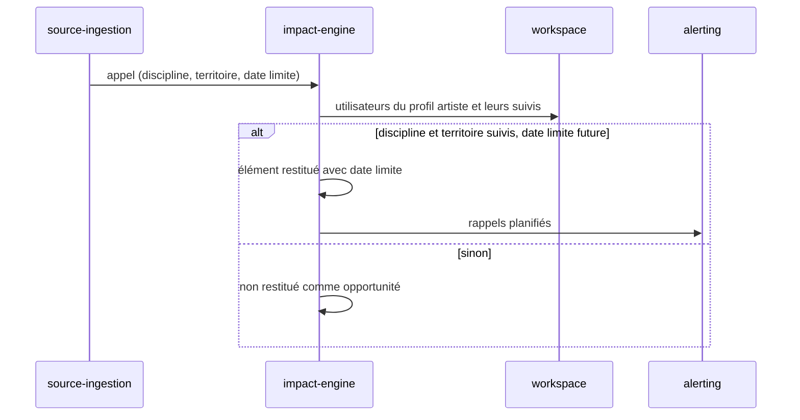

# Conception : ajouter le profil de veille « artiste »

<!-- Statuts : [EXIGENCE] [EXISTANT] [DÉCISION] [PROPOSITION] [QUESTION] (légende : /docs/specifications/README.md#statuts-des-informations). -->

**Niveau de conception** : Allégée : premier pack sur le modèle d'ADR-0024 ; seule la stratégie de rapprochement est nouvelle.

## Contexte technique

Aucun pack n'existe ; le format du manifeste est défini par `personnaliser-profils-et-affichage` (tâche 3.1). Les appels à projets n'ont pas d'identifiant de composant : le rapprochement est une nouvelle stratégie. Motivation : voir `proposal.md`.

## Exigences couvertes

| Exigence | Section(s) de conception | Diagramme(s) |
|---|---|---|
| ART-01 | Composants | Composants |
| ART-02 | Composants | Composants |
| ART-03 | Composants | DC-1 |
| ART-04 | Composants | DC-1 |
| ART-05 | Composants | Composants |
| ART-06 | Composants | Composants |

## Objectifs et non-objectifs

**Objectifs :**
- valider le modèle de pack sur un public non technique
- rapprochement explicable sans IA

**Non-objectifs :**
- candidature en ligne
- conseil sur l'éligibilité

## Composants impactés, responsabilités et frontières

| Composant | Responsabilité dans ce changement | Ne doit pas | Statut |
|---|---|---|---|
| `catalog` | manifeste du pack `artiste`, listes de disciplines et territoires | — | modifié |
| `impact-engine` | stratégie discipline + territoire + date limite | décider par l'IA | modifié |
| `source-ingestion` | sources du pack, vérification des conditions d'usage | collecter une source non vérifiée | modifié |

## Modèle de domaine et invariants

Non applicable — conception allégée ; à préciser avec les tâches d'implémentation correspondantes.

## Traitements et interactions

### DC-1 — Rapprochement d'un appel

- **Question** : comment un appel collecté est-il restitué à un artiste ?
- **Type** : UML séquence
- **Portée** : cible proposée
- **Exigences** : ART-03, ART-04

La stratégie compare des valeurs structurées ; l'IA peut seulement résumer l'appel, jamais décider de sa pertinence.

## États et transitions

Non applicable — conception allégée ; à préciser avec les tâches d'implémentation correspondantes.

## Contrats d'interface

API REST sous `/api/v1/profils/artiste` (`ProfilArtisteResource`, OIDC obligatoire, erreurs au format commun `Erreur`) :

- `GET /listes` : disciplines et territoires du pack ;
- `GET /suivis`, `PUT /suivis` : suivis du compte (disciplines, territoires, `rappelsJours` facultatif) ; valeur hors liste `400` avec la liste disponible, profil inactif `409` ; `rappelsJours` absent conserve les jours déjà enregistrés ;
- `GET /opportunites`, `GET /opportunites/{id}/resume` : appels ouverts rapprochés des suivis, résumé par gabarit ;
- `GET /sources`, `POST /sources`, `PUT /sources/{id}/conditions-usage`, `POST /collectes` : registre des sources et collecte, réservés à l'administrateur plateforme (refus journalisé).

`GET /api/v1/preferences/rubriques` (`RubriquesResource`) restitue les rubriques des profils actifs dans l'ordre du catalogue.

## Persistance et intégrité

Migration `V15__profil_artiste.sql` : `suivi_profil` et `suivi_rappels` (clé compte, profil, type ; RLS `USING` et `WITH CHECK` sur `argos_compte_courant()` sous `argos_app`) ; `source_profil` et `opportunite` (données publiques sans espace, dans `signal.opportunite`). Types `varchar` uniquement.

## Transactions, concurrence et idempotence

Le remplacement des suivis d'un compte (`SuivisProfil.remplacer`) supprime puis insère dans une transaction, sérialisée par un verrou transactionnel `pg_advisory_xact_lock` sur le couple compte et profil : deux `PUT /suivis` simultanés s'appliquent l'un après l'autre, la dernière requête l'emporte, sans violation de clé. Les rappels sont idempotents par (compte, canal, clé), comme ceux du radar. La collecte enregistre chaque opportunité en auto-commit : un échec en cours de lot laisse les opportunités déjà insérées et la source passe `EN_ERREUR`.

## Sécurité et isolation

Sources publiques et vérifiées seulement (ART-05) ; aucune donnée personnelle de tiers ; mention « aucun avis d'éligibilité » (ART-06).

## Gestion des erreurs et reprise

Non applicable — conception allégée ; à préciser avec les tâches d'implémentation correspondantes.

## Observabilité

Compteurs agrégés et journaux d'audit selon arc42 §8.6 ; aucun suivi individuel des utilisateurs.

## Performance et stratégie de mesure

[QUESTION] Aucune cible propre à ce changement dans les sources ; la cible de consultation de arc42 §10 (Q-05) s'applique quand elle est pertinente.

## Compatibilité, migration et retour arrière

Non applicable — aucune donnée ni aucun contrat existants.

## Décisions, alternatives et compromis

### D1 — Stratégie dédiée

- **Statut** : [PROPOSITION]
- **Choix** : discipline + territoire + date limite
- **Justification** : rapprochement explicable sans identifiant de composant
- **Alternatives écartées** : rapprochement par l'IA — non déterministe (ADR-0013)
- **Compromis** : listes de disciplines et territoires à maintenir
- **ADR** : ADR-0024 (Proposé)

## Risques

- Sources rares ou peu structurées → extraction de la date limite à valider, sinon « date à confirmer ».
- Conditions d'usage restrictives → source non activée (ART-05).

## Écarts code / tests / specs / documentation

Les écarts sont tenus dans la fiche [`profil-artiste`](/docs/specifications/profil-artiste.md#écarts-constatés) : correspondance des champs data.culture.gouv.fr à confirmer par jeu, aucun écran dans `argos-ui`, flux RSS sans date limite structurée, rappel calculé pour le jour exact. La restriction d'hôte des sources `DATA_CULTURE` ne porte que sur l'adresse initiale : une redirection vers un autre hôte public reste soumise au garde SSRF de la veille web.

## Stratégie de vérification

| Exigence / scénario | Niveau de test | Moyen de preuve | État |
|---|---|---|---|
| ART-01-S1 | intégration | catalogue et activation | `ManifesteArtisteTest`, `ProfilArtisteTest` |
| ART-02-S1, ART-02-S2 | intégration API | listes du pack | `ProfilArtisteTest` (RLS sous `argos_app`, remplacements simultanés) |
| ART-03-S1, ART-03-S2 | unitaire | stratégie | `StrategieDisciplineTerritoireTest`, `ProfilArtisteTest` |
| ART-04-S1 | intégration | horloge simulée | `RappelsOpportunitesTest` |
| ART-05-S1 | intégration | source non vérifiée | `ProfilArtisteTest` |
| ART-06-S1 | revue + intégration | gabarit de résumé | `ProfilArtisteTest`, `StrategieDisciplineTerritoireTest` |

## Documentation durable impactée

- `/docs/specifications/profil-artiste.md`, registre `/docs/specifications/README.md`
- fiche `profils-veille` (profil artiste)

## Questions ouvertes

Aucune autre que celles de la proposition.
