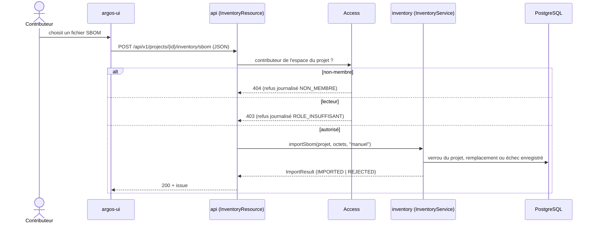
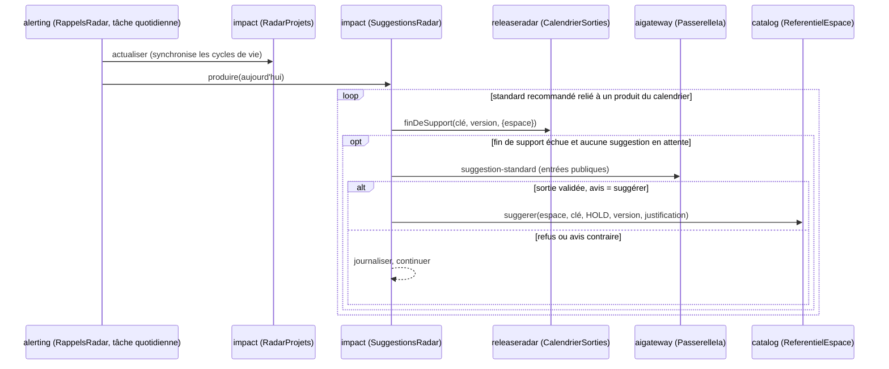

# Conception : Alimenter l'inventaire et compléter l'IHM

**Niveau de conception** : complète — nouvelles routes d'écriture avec contrôle de rôle, traitement planifié faisant appel à l'IA, format visible des liens des alertes, outillage de test de trois sous-projets.

## Contexte technique

- [EXISTANT] Les traitements d'inventaire (`InventoryService.importSbom`, `importManifests`, `importerProjet`, `detacherDepot` ; `ProjectDirectory.create`, `ajouterDepot`) écrivent hors contexte utilisateur, sous `argos_technique` (ADR-0035, politiques `<table>_technique`), sérialisés par le verrou du projet partagé avec l'import planifié (INV-08) ; la recorrélation suit l'événement `InventoryReplaced` après validation. Aucune route ne les appelle (`api/InventoryResource.java`, `api/ProjectResource.java` : GET seulement).
- [EXISTANT] `Access` (`api/security/Access.java`) offre `member`, `administrator`, `memberOfProject` ; le rôle `CONTRIBUTEUR` n'a pas de garde dédiée.
- [EXISTANT] `ReferentielEspace.suggerer` enregistre une suggestion en attente (traitement technique) ; `RappelsRadar.executer` (tâche `argos-radar-quotidien`) appelle `RadarProjets.actualiser`, qui synchronise les cycles de vie (`CyclesDeVie.synchroniser`) ; `CalendrierSorties.finDeSupport` donne la fin de support d'une version.
- [EXISTANT] Les liens des alertes sont construits en trois endroits (`MoteurAlertes:275`, `RappelsRadar:274`, `RappelsOpportunites:159`) en concaténant `argos.alerting.lien-base` ; l'IHM utilise `createWebHashHistory` ; `/` et `/index.html` sont publics.
- [EXISTANT] L'IHM se teste par `node --test` (logique, rendu SSR de composants via Vite) ; aucun test n'importe `src/api/client.ts` ni `src/views/`. Le desktop teste `preload.js` en le chargeant avec un `electron` factice (`test/electron-factice.js`), pas `main.js`.
- [EXISTANT] `TestDb.reset` vide une liste de tables codée en dur ; `ArtisteFixtures` en vide une seconde.

## Exigences couvertes

| Exigence | Section(s) de conception | Diagramme(s) |
|---|---|---|
| INV-12 | Contrats d'interface ; Sécurité ; D1, D2 | DC-1 |
| INV-13 | Contrats d'interface ; Transactions ; D1, D2 | DC-1 |
| RAD-08 | Traitements ; D4 | DC-2 |
| RAD-09 | IHM ; D6 | — |
| PIN-06 | Contrats d'interface ; D3 | — |
| ART-07 | IHM ; D6 | — |
| ALR-09 | D5 | DC-3 |

## Objectifs et non-objectifs

**Objectifs :**
- Brancher en production les traitements d'inventaire existants, sans second chemin d'écriture.
- Ne laisser aucune méthode publique de `src/main` atteinte seulement par les tests, et le vérifier en continu.
- Donner des tests aux vues, au client et à `main.js` sans navigateur réel ni réseau.

**Non-objectifs :**
- Modifier ou supprimer un projet ; webhooks de forge (INV-07-S3).
- Générer les types du client (option écartée par le porteur).
- Refaire le style des vues existantes.

## Composants impactés, responsabilités et frontières

| Composant | Responsabilité dans ce changement | Ne doit pas | Statut |
|---|---|---|---|
| `api` (REST) | nouvelles routes, contrôle de rôle par `Access`, validation des saisies | écrire en base directement | modifié |
| `inventory` | création de projet, rattachement et détachement de dépôt, imports | décider des droits | existant, branché |
| `projectintel` | collecte immédiate (`CollecteActivite.collecterProjet`) | — | existant, branché |
| `impact` | nouveau producteur `SuggestionsRadar` (fin de support → demande IA → suggestion) | modifier le référentiel | nouveau composant |
| `aigateway` | prompt `suggestion-standard` | — | modifié |
| `alerting` | gabarits de liens centralisés (`LiensIhm`), appel du producteur dans la tâche radar | — | modifié |
| `argos-ui` | vues Signal, Radar, Profil artiste ; formulaires d'inventaire ; activité | porter des règles métier | modifié |
| `argos-desktop` | tests de `main.js` (options factorisées dans un module pur) | changer de comportement | modifié |

## Modèle de domaine et invariants

Pas d'évolution du modèle persistant. Invariants testables :
- INV-A : une écriture d'inventaire déclenchée par l'API n'a lieu qu'après le contrôle de rôle ; un refus n'écrit rien.
- INV-B : au plus une suggestion `EN_ATTENTE` par espace et clé de technologie produite par la tâche.
- INV-C : tout lien produit par `alerting` commence par l'adresse publique suivie de `/#/` et correspond à une route de l'IHM.

## Traitements et interactions

### DC-1 — Import manuel d'une SBOM (UML, séquence, cible ; INV-13)

Question : qui contrôle les droits et qui écrit ? L'API contrôle, le traitement d'inventaire écrit (même chemin que l'import planifié) ; la recorrélation part après validation (INV-09).

### DC-2 — Production des suggestions de l'IA (UML, séquence, cible ; RAD-08)

Une erreur d'accès aux données d'un espace est journalisée avec sa cause et n'arrête que cet espace ; une erreur imprévue est retenue et relancée en fin de tâche (arc42 §8.5, comme `RappelsRadar`).

## États et transitions

Non applicable — aucun cycle de vie nouveau ; la suggestion garde ses états `EN_ATTENTE`, `ACCEPTEE`, `REFUSEE` (V12).

## Contrats d'interface

Le contrat exécutable est `/q/openapi` ; son instantané versionné `argos-ui/src/api/openapi.json` fait foi pour l'IHM (D7).

| Opération et chemin | Rôle | Corps | Réponses |
|---|---|---|---|
| `POST /api/v1/projects` | administrateur de `espaceId` | `{espaceId: uuid, nom: string (1..200), depot?: Depot}` | 201 `{id, espaceId, nom}` ; 400 ; 403 ; 404 |
| `POST /api/v1/projects/{projectId}/repositories` | administrateur | `Depot` | 201 `{id, principal}` ; 400 ; 403 ; 404 ; 409 (dépôt déjà rattaché) |
| `DELETE /api/v1/projects/{projectId}/repositories/{repositoryId}` | administrateur | — | 204 ; 403 ; 404 |
| `POST /api/v1/projects/{projectId}/inventory/sbom` | contributeur | document CycloneDX JSON brut | 200 `ImportResult` |
| `POST /api/v1/projects/{projectId}/inventory/manifests` | contributeur | `{manifestes: [{chemin, contenu}]}` (1..20) | 200 `ImportResult` ; 400 |
| `POST /api/v1/projects/{projectId}/inventory/refresh` | contributeur | — | 200 `{depots: [...]}` ; 409 sans dépôt |
| `POST /api/v1/projects/{projectId}/activite/collecte` | contributeur | — | 200 `{issue}` |

`Depot` : `{forge: "GITHUB"|"GITLAB", depot: string (1..200), branche?: string (défaut "main"), cheminSbom?: string, jobSbom?: string, manifestes?: string[]}`. Les erreurs suivent le schéma `Erreur` (`DONNEE_INVALIDE` avec `attribut`). Les imports ne sont pas idempotents par nature (chaque envoi remplace l'inventaire) ; la création de projet ne l'est pas (deux appels créent deux projets).

## Persistance et intégrité

Aucun changement de schéma. Le rattachement d'un dépôt déjà présent dans le projet (même forge, identifiant, branche) est refusé par 409 : vérifié par lecture avant insertion, sous le verrou du projet.

## Transactions, concurrence et idempotence

Les imports manuels prennent le verrou du projet, partagé avec l'import planifié (INV-08) ; la création de projet et le rattachement sont des transactions courtes. La collecte immédiate réutilise la transaction et les quotas de la collecte planifiée.

## Sécurité et isolation

- Contrôle de rôle avant tout appel d'écriture : `Access.administrator(espace)` pour projets et dépôts ; nouvelle garde `Access.contributor(espace)` (contributeur ou administrateur) pour imports et collecte ; non-membre : 404 journalisé, rôle insuffisant : 403 journalisé (ADR-0016).
- Les écritures s'exécutent hors contexte utilisateur, comme l'import planifié (D2) ; la RLS de lecture reste le garde-fou des consultations.
- Document importé : taille bornée par `argos.inventory.max-document-bytes` (refus `REJECTED`) et par la limite de corps HTTP de Quarkus ; contenu traité comme non fiable par les analyseurs existants.
- IA : seules des données publiques (nom de technologie, version, date de fin de support, source) sont envoyées ; la sortie passe par `ValidationSortie` ; aucune écriture du référentiel (RAD-02).
- Liens : seule l'adresse publique configurée sert de base ; l'IHM ne rend cliquables que les URL `http(s)` (`urlSure`).

## Gestion des erreurs et reprise

- Import refusé : motif enregistré dans les échecs d'import, inventaire conservé (INV-05).
- Producteur de suggestions : passerelle indisponible ou sortie invalide → journalisé, pas de suggestion ; reprise naturelle au passage suivant (pas de suggestion en attente créée).

## Observabilité

La production de suggestions s'exécute dans la tâche `argos-radar-quotidien` déjà observée (`@TacheObservee`) ; un journal `INFO` résume le nombre de suggestions créées. Les refus d'accès passent par le journal des refus existant.

## Performance et stratégie de mesure

Non applicable — aucune cible de performance dans les sources ; volumes bornés (référentiel d'un espace, documents bornés).

## Compatibilité, migration et retour arrière

- **BREAKING visible** : les liens des alertes passent à `<base>/#/…`. Les liens d'alertes déjà envoyés restent morts (comme avant). Retour arrière : revenir au commit précédent, sans donnée à migrer.
- Aucune migration de base.

## Décisions, alternatives et compromis

### D1 — Routes sous `/api/v1/projects`

- **Statut** : [PROPOSITION]
- **Choix** : création par `POST /api/v1/projects` avec `espaceId` dans le corps ; sous-ressources `repositories` et `inventory/*`.
- **Justification** : la ressource Projet existe déjà sous ce chemin ; un second contrôleur sous `/api/v1/espaces/{id}` partagerait le préfixe d'`EspacesResource`.
- **Alternatives écartées** : `POST /api/v1/espaces/{id}/projets` — cohérent avec la hiérarchie mais dédouble la ressource.
- **Compromis** : l'espace est validé dans le corps (400 s'il manque).
- **ADR** : non, décision locale.

### D2 — Écritures par les traitements d'inventaire existants après contrôle de rôle

- **Statut** : [PROPOSITION]
- **Choix** : les routes appellent `ProjectDirectory` et `InventoryService` tels quels, après `Access`.
- **Justification** : un seul chemin d'écriture, verrou et recorrélation partagés avec l'import planifié ; aucune politique RLS d'écriture à maintenir sur six tables dérivées.
- **Alternatives écartées** : politiques RLS d'écriture pour `argos_app` sur `project`, `project_repository`, `inventory`, `component`, `component_occurrence`, `repository_inventory` — défense en profondeur plus forte, mais second chemin d'écriture et recorrélation à adapter.
- **Compromis** : l'écriture n'est pas doublée par la RLS ; elle repose sur le contrôle du service, comme les traitements de plateforme (ADR-0035, conséquences négatives).
- **ADR** : application d'ADR-0016 et ADR-0035 ; non candidat.

### D3 — Collecte immédiate exposée plutôt que supprimée

- **Statut** : [PROPOSITION] (Q-1 de la proposition)
- **Choix** : `POST …/activite/collecte`, contributeur.
- **Justification** : PIN-05 prévoit la collecte ; le bouton rend la fonction utile dès le rattachement d'un dépôt.
- **Alternatives écartées** : supprimer `collecterProjet` — la première mesure attendrait la collecte planifiée.
- **ADR** : non.

### D4 — Producteur des suggestions dans `impact`, appelé par la tâche radar

- **Statut** : [DÉCISION] porteur, 2026-11-26 (producteur planifié) ; emplacement [PROPOSITION]
- **Choix** : `impact.SuggestionsRadar.produire(LocalDate)` appelé par `RappelsRadar.executer` après `actualiser` ; prompt `suggestion-standard` (sortie `{"avis": [1|2], "justification": "texte"}`, 1 = suggérer `HOLD`).
- **Justification** : `impact` dépend déjà de `catalog`, `releaseradar` et `aigateway` (frontières de `ModuleBoundariesTest`) ; la tâche radar suit la synchronisation des cycles de vie.
- **Alternatives écartées** : nouvelle tâche planifiée distincte — risque de tourner avant la synchronisation ; outil MCP en écriture — contraire à ADR-0014 (lecture seule).
- **Compromis** : la durée de la tâche radar s'allonge des appels IA (bornés par les quotas IAG-03).
- **ADR** : non (application d'ADR-0029).

### D5 — Gabarits de liens centralisés et vérifiés des deux côtés

- **Statut** : [PROPOSITION]
- **Choix** : classe `alerting.LiensIhm` (gabarits `#/signaux/{id}`, `#/espaces/{id}/radar`, `#/profils/artiste/opportunites/{id}`), utilisée par les trois producteurs ; un test de l'IHM lit ces gabarits dans le source Java et vérifie qu'une route de `router.ts` correspond.
- **Justification** : une seule source pour le format ; dérive détectée à la suite de tests.
- **Alternatives écartées** : liens vers `/#/alertes/:id` — l'identifiant de l'alerte n'existe pas quand l'élément est construit, et le résumé périodique ne crée pas d'alerte par signal.
- **ADR** : non.

### D6 — Vues ajoutées à l'IHM

- **Statut** : [PROPOSITION]
- **Choix** : `SignalView` (`/signaux/:id`), `RadarView` (`/espaces/:id/radar`), `ProfilArtisteView` (`/profils/artiste`, `/profils/artiste/opportunites/:id`) ; formulaires de création de projet, de rattachement de dépôt et d'import, et section Activité dans `InventaireView`. Appels par de nouveaux modules `src/api/*.ts` passant par `appelerApi`.
- **ADR** : non (ADR-0019, ADR-0023 appliqués).

### D7 — Contrat client par test de contrat

- **Statut** : [DÉCISION] porteur, 2026-11-26
- **Choix** : instantané `argos-ui/src/api/openapi.json` ; test serveur `ContratOpenApiTest` qui compare le document de `/q/openapi?format=json` à l'instantané (régénération documentée par une propriété système) ; test IHM qui extrait de `src/api/*.ts` chaque appel `appelerApi(méthode, chemin)` et vérifie son existence dans l'instantané.
- **Alternatives écartées** : génération openapi-typescript.
- **ADR** : non.

### D8 — Outillage de test de l'IHM et du desktop

- **Statut** : [DÉCISION] porteur, 2026-11-26 (Vitest) ; desktop [PROPOSITION]
- **Choix** : Vitest, `@vue/test-utils`, happy-dom (MIT) en dépendances de développement ; `npm test` enchaîne `node --test` et `vitest run`. Desktop : options de `BrowserWindow`, de session et de navigation extraites dans `src/fenetre.js` (pur, testé) ; `main.js` chargé en test avec l'`electron` factice pour vérifier qu'il les applique.
- **ADR** : non ; mention dans arc42 §8 (tests).

### D9 — Méthodes publiques sans appelant de production

- **Statut** : [PROPOSITION]
- **Choix** : supprimer `EtatImpact.peutAller`, `TextesOfficiels.parIdentifiant`, `ImportProjet.importe` ; test ArchUnit `MethodesAtteintesEnProductionTest` : toute méthode publique d'une classe de `io.argos` doit être appelée ou référencée depuis `src/main`, sauf points d'entrée de cadre (JAX-RS, observateurs CDI, `@Scheduled`, outils MCP, producteurs CDI), accesseurs de record, redéfinitions, méthodes d'`Object` et d'énumération.
- **ADR** : non.

### D10 — Nettoyage dérivé du catalogue et couverture par module

- **Statut** : [PROPOSITION] (Q-2 de la proposition pour le seuil)
- **Choix** : `TestDb.reset` lit `pg_tables` du schéma `public` et vide toutes les tables sauf une liste explicite de tables conservées (`flyway_schema_history`, comptes et espaces créés par jetons, référentiels de sources et prompts), avec un test qui échoue si une table n'est ni vidée ni déclarée conservée. Couverture : script `scripts/verifier-couverture-modules.mjs` qui agrège `target/site/jacoco/jacoco.csv` par module (paquet de premier niveau) et échoue sous le seuil ; appelé par la CI après `mvn verify`.
- **ADR** : non.

## Risques

- Détection des méthodes sans appelant trop large (faux positifs sur les appels réflexifs) → exemptions explicites par annotation et test des exemptions.
- Durée de la tâche radar avec IA → bornée par quotas et délai de la passerelle.
- Instantané OpenAPI instable (ordre des clés) → comparaison sur JSON normalisé.

## Écarts code / tests / specs / documentation

- Fiche `inventaire-sbom` : « aucune API ni écran n'administre les dépôts » devient faux ; à réécrire.
- Fiche `alertes-digests` : « la page correspondante de l'IHM reste à créer » ; à réécrire.
- `InventoryResource` Javadoc « Lecture seule » ; à réécrire.

## Stratégie de vérification

| Exigence / scénario | Niveau de test | Moyen de preuve | État |
|---|---|---|---|
| INV-12-S1 à S6 | intégration REST | `api/inventaire/AdministrationProjetsTest` | à écrire |
| INV-13-S1 à S6 | intégration REST | `api/inventaire/ImportManuelTest` | à écrire |
| PIN-06-S1 à S3 | intégration REST | `projectintel/CollecteImmediateTest` | à écrire |
| RAD-08-S1 à S4 | intégration | `impact/SuggestionsRadarTest` | à écrire |
| RAD-09, ART-07 | composant (Vitest) | `tests/vues/*.spec.ts` | à écrire |
| ALR-09-S1, S2 | intégration | `AlertesTest`, `RappelsRadarTest` adaptés | à écrire |
| ALR-09-S3 | contrat IHM | `tests/liens-alertes.test.mjs` | à écrire |
| Contrat client | contrat | `ContratOpenApiTest`, `tests/contrat-api.test.mjs` | à écrire |
| `main.js` | unitaire | `argos-desktop/test/main.test.js`, `fenetre.test.js` | à écrire |
| `appelerApi` | unitaire (Vitest) | `tests/vues/client.spec.ts` | à écrire |
| Modules sans test | unitaire/intégration | classes dédiées par module, script de couverture | à écrire |
| Nettoyage | intégration | `testsupport/NettoyageBaseTest` | à écrire |
| Méthodes sans appelant | architecture | `MethodesAtteintesEnProductionTest` | à écrire |

## Documentation durable impactée

- `/docs/specifications/inventaire-sbom.md`, `radar-standards.md`, `activite-projets.md`, `profil-artiste.md`, `alertes-digests.md`, `README.md` (couverture).
- arc42 §5 (composant `SuggestionsRadar`), §6 (séquence d'import manuel), §8 (stratégie de tests : Vitest, contrat, couverture par module).

## Questions ouvertes

- Q-1 et Q-2 de la proposition (non bloquantes : valeurs proposées appliquées).
