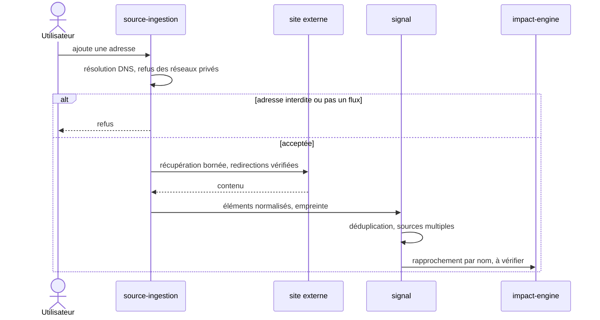

# Conception : collecter la veille RSS/Atom et les pages web surveillées

<!-- Statuts : [EXIGENCE] [EXISTANT] [DÉCISION] [PROPOSITION] [QUESTION] (légende : /docs/specifications/README.md#statuts-des-informations). -->

**Niveau de conception** : Complète : entrées non fiables fournies par des tiers et exposition aux risques R-11 et R-12.

## Contexte technique

Le module `ingestion` ne contient qu'un `package-info.java`. ADR-0006 propose FreshRSS et changedetection.io comme services séparés ; leur hébergement reste ouvert (Q-1). Motivation : voir `proposal.md`.

## Exigences couvertes

| Exigence | Section(s) de conception | Diagramme(s) |
|---|---|---|
| WEB-01 | Composants | DC-1 |
| WEB-02 | Composants | DC-1 |
| WEB-03 | Composants | DC-1 |
| WEB-04 | Composants | DC-1 |
| WEB-05 | Composants | DC-1 |
| WEB-06 | Composants | DC-1 |

## Objectifs et non-objectifs

**Objectifs :**
- aucune requête vers un réseau interne
- aucune consigne externe exécutée

**Non-objectifs :**
- moteur de recherche web
- contournement de murs payants

## Composants impactés, responsabilités et frontières

| Composant | Responsabilité dans ce changement | Ne doit pas | Statut |
|---|---|---|---|
| `source-ingestion` | valider les adresses, récupérer, normaliser, dédupliquer | suivre une redirection vers un réseau interne | modifié |
| `signal` | éléments de type actualité, empreinte de déduplication | — | modifié |
| `impact-engine` | rapprochement par nom au niveau « à vérifier » | créer un impact exact ou probable à partir d'un nom | modifié |

## Modèle de domaine et invariants

Non applicable — conception allégée ; à préciser avec les tâches d'implémentation correspondantes.

## Traitements et interactions

### DC-1 — Ajout puis collecte d'une source

- **Question** : quels contrôles s'appliquent à une adresse et à son contenu ?
- **Type** : UML séquence
- **Portée** : cible proposée
- **Exigences** : WEB-01, WEB-02, WEB-03, WEB-04, WEB-05, WEB-06

L'adresse est vérifiée à l'ajout et à chaque redirection ; le contenu n'est jamais traité comme une instruction.

## États et transitions

Non applicable — conception allégée ; à préciser avec les tâches d'implémentation correspondantes.

## Contrats d'interface

Non applicable — conception allégée ; à préciser avec les tâches d'implémentation correspondantes.

## Persistance et intégrité

Non applicable — conception allégée ; à préciser avec les tâches d'implémentation correspondantes.

## Transactions, concurrence et idempotence

Non applicable — conception allégée ; à préciser avec les tâches d'implémentation correspondantes.

## Sécurité et isolation

Liste de refus des plages privées, locales et de lien local, vérifiée après résolution DNS et à chaque redirection (R-12) ; délai et taille bornés ; contenu externe séparé des instructions (R-11) ; nombre de sources limité (Q-3).

## Gestion des erreurs et reprise

Source en erreur après plusieurs échecs : état visible, nouvelles tentatives espacées.

## Observabilité

Compteurs agrégés et journaux d'audit selon arc42 §8.6 ; aucun suivi individuel des utilisateurs.

## Performance et stratégie de mesure

[QUESTION] Aucune cible propre à ce changement dans les sources ; la cible de consultation de arc42 §10 (Q-05) s'applique quand elle est pertinente.

## Compatibilité, migration et retour arrière

Non applicable — aucune donnée ni aucun contrat existants.

## Décisions, alternatives et compromis

### D1 — Vérification après résolution DNS

- **Statut** : [PROPOSITION]
- **Choix** : refus selon l'adresse IP résolue, à chaque redirection
- **Justification** : un nom public peut pointer vers une adresse privée
- **Alternatives écartées** : filtrage sur le nom seulement — contournable
- **Compromis** : une résolution de plus par récupération
- **ADR** : non : décision locale

### D2 — Collecteur intégré au serveur

- **Statut** : [DÉCISION] — Q-1 répondue le 2026-11-16
- **Choix** : collecteur intégré au serveur, bibliothèques sous licence permissive (ROME Apache-2.0, jsoup MIT, quarkus-scheduler Apache-2.0)
- **Justification** : AGPL de FreshRSS (ADR-0021) et produit ouvert ; aucun service supplémentaire sur le Synology
- **Alternatives écartées** : FreshRSS et changedetection.io en services séparés (ADR-0006)
- **Compromis** : code de collecte à maintenir ; pas de rendu JavaScript des pages
- **ADR** : [ADR-0028](/docs/architecture/adr/0028-collecteur-veille-web-integre.md) (Proposé)

## Risques

- SSRF (R-12) → tests dédiés, refus par défaut.
- Injection d'instructions (R-11) → contenu marqué, tests dédiés.
- Abus d'un produit ouvert (sources en masse) → limite par utilisateur (Q-3).

## Écarts code / tests / specs / documentation

Aucun écart constaté.

## Stratégie de vérification

| Exigence / scénario | Niveau de test | Moyen de preuve | État |
|---|---|---|---|
| WEB-01-S1, WEB-01-S2 | intégration | flux de test | à écrire |
| WEB-02-S1 | intégration | page de test modifiée | à écrire |
| WEB-03-S1, WEB-03-S2 | intégration sécurité | adresses privées et redirections | à écrire |
| WEB-04-S1 | intégration | article piégé, ai-gateway réel en test | à écrire |
| WEB-05-S1 | intégration | doublons | à écrire |
| WEB-06-S1 | intégration | niveau et absence d'alerte | à écrire |

## Documentation durable impactée

- `/docs/specifications/veille-rss-web.md`, registre `/docs/specifications/README.md`
- arc42 §8.3

## Questions ouvertes

Aucune autre que celles de la proposition.
