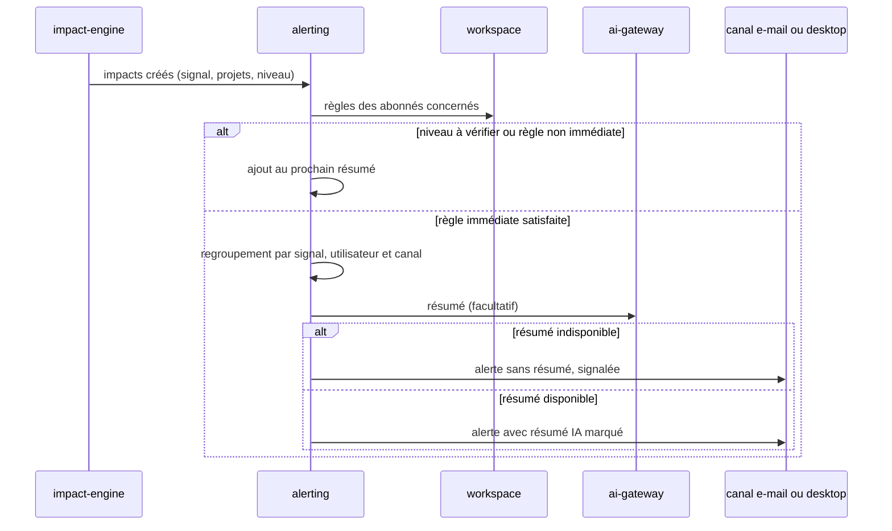

# Conception : diffuser les alertes ciblées et les résumés périodiques

<!-- Statuts : [EXIGENCE] [EXISTANT] [DÉCISION] [PROPOSITION] [QUESTION] (légende : /docs/specifications/README.md#statuts-des-informations). -->

**Niveau de conception** : Allégée : traitement asynchrone dans un module existant, sans nouvelle dépendance structurante hors du serveur de messagerie.

## Contexte technique

Le module `alerting` porte l'évaluation des règles, les résumés et la diffusion (D3 à D5). Dépend de `correlation-impact` (impacts et niveaux) et de `abonnements-veille` (règles). Motivation : voir `proposal.md`.

## Exigences couvertes

| Exigence | Section(s) de conception | Diagramme(s) |
|---|---|---|
| ALR-01 | Composants | DC-1 |
| ALR-02 | Composants | DC-1 |
| ALR-03 | Composants | DC-1 |
| ALR-04 | Composants | DC-1 |
| ALR-05 | Composants | DC-1 |
| ALR-06 | Composants | DC-1 |

## Objectifs et non-objectifs

**Objectifs :**
- limiter les alertes immédiates aux impacts établis
- ne jamais bloquer une alerte pour une raison d'IA

**Non-objectifs :**
- choisir le serveur d'e-mails (Q-1)
- intégrer une messagerie d'équipe (Q-2)

## Composants impactés, responsabilités et frontières

| Composant | Responsabilité dans ce changement | Ne doit pas | Statut |
|---|---|---|---|
| `alerting` | évaluer les règles, regrouper, planifier, envoyer | décider d'un impact ou accorder un droit | modifié |
| `impact-engine` | publier les impacts créés avec leur niveau | envoyer des messages | modifié |
| `workspace` | fournir les règles (abonnements, critère `SEVERITY`) et les comptes destinataires | — | modifié |

## Modèle de domaine et invariants

Non applicable — conception allégée ; à préciser avec les tâches d'implémentation correspondantes.

## Traitements et interactions

### DC-1 — Du nouvel impact à l'alerte

- **Question** : comment un impact devient-il une alerte ou une ligne de résumé ?
- **Type** : UML séquence
- **Portée** : cible proposée
- **Exigences** : ALR-01, ALR-02, ALR-03, ALR-04, ALR-05, ALR-06

Le résumé IA est demandé mais jamais attendu indéfiniment : son absence est signalée et l'alerte part quand même.

## États et transitions

Une alerte ou un résumé passe de `EN_ATTENTE` à `ENVOYEE` (envoi réussi, ou remise confirmée par le client desktop) ou à `EN_ECHEC` (nombre maximal de tentatives atteint, ou échec définitif). `EN_ATTENTE` porte le nombre de tentatives et l'échéance de la suivante.

## Contrats d'interface

API REST `/api/v1/alertes` (liste filtrée par canal et état, détail, remise) ; interface Java `CanalDiffusion` ; événements CDI `ImpactsRecorded` (publié par `impact-engine`) et `AlerteEmise` ; point d'extension `ResumeIa` (D4, D5).

## Persistance et intégrité

Migration `V8__alertes_et_resumes.sql` : table `alerte` (index unique partiel `(signal_id, compte_id, canal)` pour les alertes immédiates, `(compte_id, canal, nature, fin_periode)` pour les résumés) et table `resume_element` (clé `(compte_id, signal_id, frequence, canal)`) ; RLS sous `argos_app` : lecture de ses seules lignes, mise à jour limitée à l'état et à la date de remise de ses alertes `DESKTOP`.

## Transactions, concurrence et idempotence

Clé d'idempotence d'une alerte : (signal, utilisateur, canal) ; un rejeu des impacts ne renvoie pas une alerte déjà envoyée.

## Sécurité et isolation

Chaque message est construit pour un destinataire à partir des seules données autorisées (ACC-04) ; aucun secret dans les gabarits.

## Gestion des erreurs et reprise

Échec d'envoi : nouvelles tentatives bornées puis état « en échec » visible ; l'alerte reste consultable dans Argos.

## Observabilité

Compteurs agrégés et journaux d'audit selon arc42 §8.6 ; aucun suivi individuel des utilisateurs.

## Performance et stratégie de mesure

[QUESTION] Aucune cible propre à ce changement dans les sources ; la cible de consultation de arc42 §10 (Q-05) s'applique quand elle est pertinente.

## Compatibilité, migration et retour arrière

Non applicable — aucune donnée ni aucun contrat existants.

## Décisions, alternatives et compromis

### D1 — Alerte immédiate réservée aux impacts exact et probable

- **Statut** : [PROPOSITION]
- **Choix** : « à vérifier » ne déclenche jamais d'alerte immédiate
- **Justification** : réduire le bruit, premier risque produit
- **Alternatives écartées** : toutes correspondances — trop d'alertes
- **Compromis** : un article important sans identifiant structuré attend le résumé
- **ADR** : ADR-0013 (Proposé)

### D2 — Idempotence par signal, utilisateur et canal

- **Statut** : [PROPOSITION]
- **Choix** : clé unique d'alerte
- **Justification** : pas de doublon en cas de rejeu ou de plusieurs règles
- **Alternatives écartées** : par règle — doublons
- **Compromis** : —
- **ADR** : non : décision locale

### D3 — Règle d'alerte déduite d'un abonnement, gravité minimale par critère `SEVERITY`

- **Statut** : [PROPOSITION]
- **Choix** : canal `EMAIL` ou `DESKTOP`, fréquence `IMMEDIATE`, `DAILY` ou `WEEKLY` ; critères `PROJECT`, `PACKAGE`, `SOURCE`, `TECHNOLOGY` cumulatifs entre types ; gravité minimale portée par un nouveau type de critère `SEVERITY` (`LOW` à `CRITICAL`) ; une gravité inconnue n'atteint aucun seuil ; un élément non alerté par une règle immédiate entre dans le résumé quotidien du même canal
- **Justification** : réutiliser `abonnements-veille` sans nouvelle table de règles ; option la moins bruyante quand la gravité est inconnue
- **Alternatives écartées** : table de règles distincte — double saisie ; gravité inconnue traitée comme critique — bruit
- **Compromis** : une faille critique publiée avec un vecteur CVSS brut seulement attend le résumé
- **ADR** : non : décision locale

### D4 — Évaluation synchrone après la corrélation, diffusion découplée

- **Statut** : [PROPOSITION]
- **Choix** : `impact-engine` publie `ImpactsRecorded` après la validation des impacts ; `alerting` l'observe, relit les impacts sous le compte de chaque destinataire (RLS), enregistre les alertes, publie `AlerteEmise`, puis tente l'envoi ; une tâche planifiée (chaque minute) reprend les envois en attente ; le résumé IA passe par le point d'extension `ResumeIa` avec un délai borné (10 s), sur un exécuteur dédié (deux fils, file bornée) qui annule la demande expirée ; chaque tentative d'envoi réserve le message et compte la tentative dans une transaction courte, envoie hors transaction avec un délai SMTP de 10 s (`quarkus.mailer.timeout`), puis enregistre l'issue ; toute exception compte comme un échec
- **Justification** : aucune nouvelle dépendance de module (`alerting` → `impact`, `workspace`) ; un échec d'alerte n'affecte jamais la corrélation
- **Alternatives écartées** : file de messages — infrastructure supplémentaire ; appel direct de `ai-gateway` — interdit par les frontières de modules
- **Compromis** : une alerte perdue si le processus s'arrête entre la corrélation et l'enregistrement de l'alerte ; une nouvelle corrélation la rattrape. La collecte attend l'évaluation : au plus 10 s de résumé IA par signal alerté, puis au plus 10 s d'envoi SMTP par alerte e-mail ; un relais injoignable ralentit donc une collecte de nombreux signaux alertés. Un arrêt pendant un envoi laisse la tentative comptée ; le message est repris après un bail de 5 min
- **ADR** : non : décision locale

### D5 — Contrat desktop par lecture et confirmation de remise

- **Statut** : [PROPOSITION]
- **Choix** : `GET /api/v1/alertes?canal=DESKTOP&etat=EN_ATTENTE` puis `POST /api/v1/alertes/{id}/remise` ; l'interface `CanalDiffusion` et l'événement `AlerteEmise` permettent à `notifier-sur-le-poste` d'ajouter une poussée
- **Justification** : contrat simple, testable, sans connexion permanente imposée au client
- **Alternatives écartées** : flux SSE dès ce changement — relève de `notifier-sur-le-poste`
- **Compromis** : délai de remise égal à la période d'interrogation du client
- **ADR** : non : décision locale

## Risques

- Bruit malgré les règles → mesure du taux de pertinence (baseline v2.3 §6).
- Réputation d'envoi d'un serveur domestique → relais SMTP authentifié (Q-1).

## Écarts code / tests / specs / documentation

Aucun écart constaté.

## Stratégie de vérification

| Exigence / scénario | Niveau de test | Moyen de preuve | État |
|---|---|---|---|
| ALR-01-S1, ALR-01-S2 | intégration | règles et impacts de test | passe |
| ALR-02-S1 | intégration | impact à vérifier | passe |
| ALR-03-S1 | intégration | trois projets, une alerte | passe |
| ALR-04-S1, ALR-04-S2 | intégration | horloge simulée ; signaux de sécurité seulement (les actualités de la veille web n'entrent pas dans les résumés, [PROPOSITION]) | passe |
| ALR-05-S1 | intégration | ai-gateway simulé au plafond ; QS-10 | passe |
| ALR-06-S1, ALR-06-S2 | intégration | serveur SMTP de test ; port fermé ; relais muet (délai d'envoi) ; contenu illisible | passe |

## Documentation durable impactée

- `/docs/specifications/alertes-digests.md`, registre `/docs/specifications/README.md`
- arc42 §6.1

## Questions ouvertes

Aucune autre que celles de la proposition.
