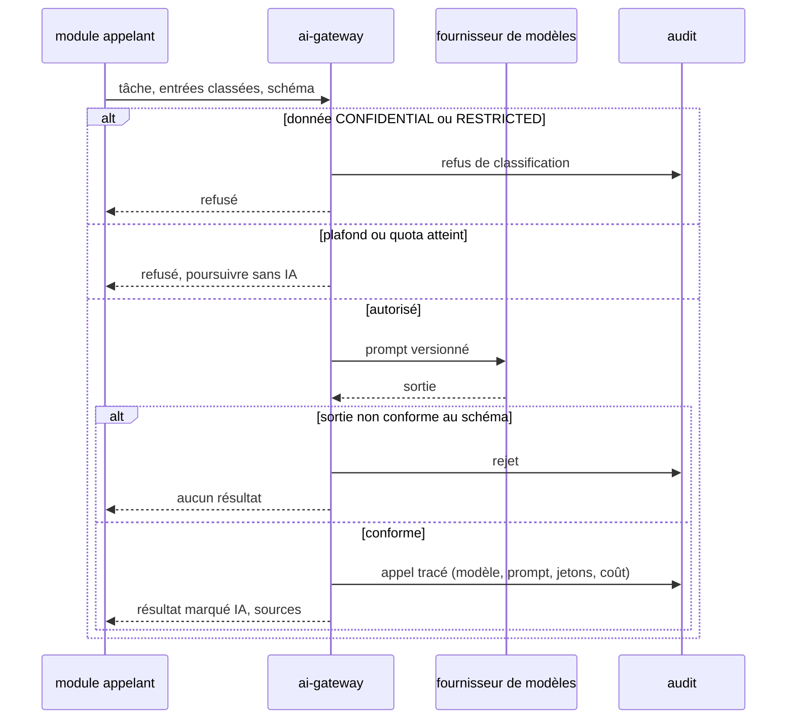

# Conception : encadrer tous les appels aux modèles d'IA par une passerelle unique

<!-- Statuts : [EXIGENCE] [EXISTANT] [DÉCISION] [PROPOSITION] [QUESTION] (légende : /docs/specifications/README.md#statuts-des-informations). -->

**Niveau de conception** : Complète : composant transverse, dépendance externe payante, enjeux de confidentialité et de coût.

## Contexte technique

Le module `aigateway` ne contient qu'un `package-info.java` ; `ModuleBoundariesTest` limite ses dépendances à `audit` [EXISTANT — test non exécuté]. Motivation : voir `proposal.md`.

## Exigences couvertes

| Exigence | Section(s) de conception | Diagramme(s) |
|---|---|---|
| IAG-01 | Composants | DC-1 |
| IAG-02 | Composants | DC-1 |
| IAG-03 | Composants | DC-1 |
| IAG-04 | Composants | DC-1 |
| IAG-05 | Composants | DC-1 |

## Objectifs et non-objectifs

**Objectifs :**
- un seul composant connaît le fournisseur de modèles
- aucun traitement métier bloqué par l'IA

**Non-objectifs :**
- embeddings et RAG (ADR-0015)
- fournisseur alternatif dès le MVP

## Composants impactés, responsabilités et frontières

| Composant | Responsabilité dans ce changement | Ne doit pas | Statut |
|---|---|---|---|
| `ai-gateway` | classer, borner, appeler, valider, tracer | être appelé autrement que par son contrat ; décider d'un impact | modifié |
| `audit` | journal des appels et des refus | — | modifié |
| modules appelants | fournir la tâche, les entrées classées, le schéma attendu | appeler le fournisseur directement | existant (proposé) |

## Modèle de domaine et invariants

Non applicable — conception allégée ; à préciser avec les tâches d'implémentation correspondantes.

## Traitements et interactions

### DC-1 — Traitement d'une demande à la passerelle

- **Question** : quelles vérifications précèdent et suivent un appel au modèle ?
- **Type** : UML séquence
- **Portée** : cible proposée
- **Exigences** : IAG-01, IAG-02, IAG-03, IAG-04, IAG-05

Chaque refus laisse le traitement métier continuer sans IA ; seule une sortie conforme et marquée revient au module appelant.

## États et transitions

Non applicable — conception allégée ; à préciser avec les tâches d'implémentation correspondantes.

## Contrats d'interface

Contrat interne : tâche (identifiant de prompt versionné), entrées avec leur classe, schéma de sortie, espace imputé ; réponse : résultat validé ou motif de refus.

## Persistance et intégrité

Tables des appels (modèle, version du prompt, jetons, coût, empreinte, validation, durée) et des compteurs mensuels par espace.

## Transactions, concurrence et idempotence

Non applicable — conception allégée ; à préciser avec les tâches d'implémentation correspondantes.

## Sécurité et isolation

Clé d'API hors dépôt (variable d'environnement, ADR-0026) ; contenu externe séparé des instructions dans les prompts (R-11) ; empreinte des entrées plutôt que leur copie dans le journal.

## Gestion des erreurs et reprise

Fournisseur indisponible ou délai dépassé : résultat absent, nouvel essai borné pour les tâches non urgentes, traitement métier poursuivi.

## Observabilité

Compteurs agrégés et journaux d'audit selon arc42 §8.6 ; aucun suivi individuel des utilisateurs.

## Performance et stratégie de mesure

[QUESTION] Aucune cible de latence ; les appels ne sont jamais sur le chemin critique d'une alerte (ALR-05).

## Compatibilité, migration et retour arrière

Non applicable — aucune donnée ni aucun contrat existants.

## Décisions, alternatives et compromis

### D1 — Refus plutôt que dégradation silencieuse

- **Statut** : [PROPOSITION]
- **Choix** : au-delà du plafond, aucun appel, traitement sans IA
- **Justification** : coût borné et visible
- **Alternatives écartées** : modèle moins cher automatique — coût imprévisible
- **Compromis** : certains éléments sans résumé
- **ADR** : ADR-0004 (Proposé)

### D2 — Empreinte des entrées dans le journal

- **Statut** : [PROPOSITION]
- **Choix** : hachage des entrées, pas de copie
- **Justification** : ne pas dupliquer de données dans les journaux
- **Alternatives écartées** : copie intégrale — risque de fuite
- **Compromis** : diagnostic moins direct
- **ADR** : non : décision locale

## Risques

- Fuite de données (R-01) → classification obligatoire et refus par défaut.
- Dérive des coûts (R-05) → plafond et quotas, tableau des coûts.
- Verrouillage fournisseur (R-08) → contrat interne indépendant du fournisseur.

## Écarts code / tests / specs / documentation

Aucun écart constaté.

## Stratégie de vérification

| Exigence / scénario | Niveau de test | Moyen de preuve | État |
|---|---|---|---|
| IAG-01-S1 | intégration | fournisseur simulé | à écrire |
| IAG-02-S1, IAG-02-S2 | intégration | entrées classées de test ; QS-09 | à écrire |
| IAG-03-S1 | intégration | quota bas de test ; QS-08 | à écrire |
| IAG-04-S1 | intégration | sortie invalide simulée ; QS-15 | à écrire |
| IAG-05-S1 | E2E | mention visible dans les quatre mises en page et via MCP | à écrire |

## Documentation durable impactée

- `/docs/specifications/passerelle-ia.md`, registre `/docs/specifications/README.md`
- arc42 §8.8

## Questions ouvertes

Aucune autre que celles de la proposition.
