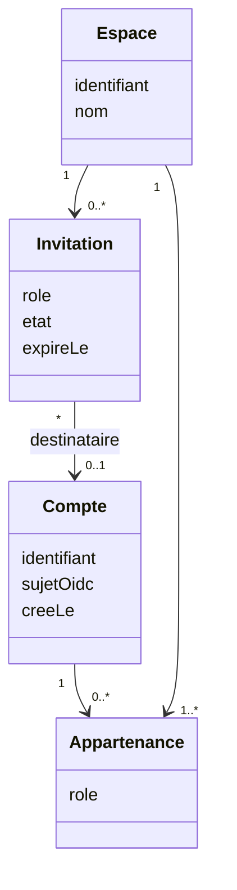
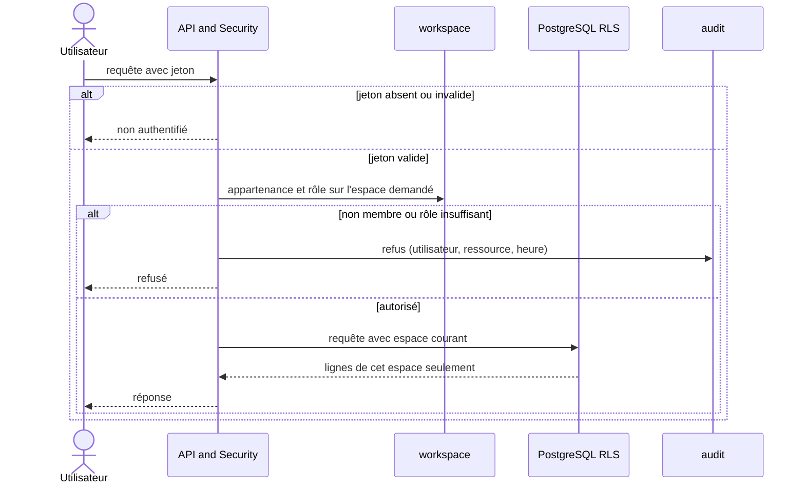

# Conception : gérer les comptes, les espaces et le contrôle d'accès

<!-- Statuts : [EXIGENCE] [EXISTANT] [DÉCISION] [PROPOSITION] [QUESTION] (légende : /docs/specifications/README.md#statuts-des-informations). -->

**Niveau de conception** : Complète : le changement porte la sécurité de toute l'application et introduit le modèle des comptes et des espaces.

## Contexte technique

Aucune authentification n'existe : `argos-server` expose seulement `/api/v1/system/info` [EXISTANT — `argos-server/src/main/java/io/argos/api/SystemInfoResource.java`]. Le module `workspace` ne contient qu'un `package-info.java`. Motivation : voir `proposal.md`.

## Exigences couvertes

| Exigence | Section(s) de conception | Diagramme(s) |
|---|---|---|
| ACC-01 | Composants | DC-1 |
| ACC-02 | Composants | DC-1 |
| ACC-03 | Composants | DC-1 |
| ACC-04 | Composants | DC-1, DC-2 |
| ACC-05 | Composants | DC-1 |
| ACC-06 | Composants | DC-2 |

## Objectifs et non-objectifs

**Objectifs :**
- un seul mécanisme d'autorisation partagé par l'API et le serveur MCP
- un cloisonnement vérifié deux fois : dans les services et par PostgreSQL (RLS)

**Non-objectifs :**
- choisir le fournisseur d'identité (Q-1)
- gérer la suppression de compte et l'export RGPD

## Composants impactés, responsabilités et frontières

| Composant | Responsabilité dans ce changement | Ne doit pas | Statut |
|---|---|---|---|
| `API & Security` | valider le jeton OIDC, établir l'utilisateur et l'espace courants | contenir une règle métier | modifié |
| `workspace` | comptes, espaces, appartenances, rôles, invitations | lire les préférences pour décider d'un droit | modifié |
| `audit` | journal des refus d'accès | stocker le contenu des ressources refusées | modifié |

## Modèle de domaine et invariants

### DC-1 — Comptes, espaces et rôles

- **Question** : comment un utilisateur est-il relié aux espaces et à ses droits ?
- **Type** : UML classes
- **Portée** : cible proposée
- **Exigences** : ACC-02, ACC-03, ACC-04, ACC-05

Un compte n'a aucun droit tant qu'il n'a pas d'appartenance. Un espace a toujours au moins un administrateur.

Invariants : **INV-1** un espace a au moins un administrateur ; **INV-2** toute donnée métier porte l'identifiant de son espace ; **INV-3** le rôle administrateur plateforme ne donne aucun accès implicite aux données d'un espace.

## Traitements et interactions

### DC-2 — Contrôle d'une requête

- **Question** : dans quel ordre l'authentification, le rôle et le cloisonnement s'appliquent-ils ?
- **Type** : UML séquence
- **Portée** : cible proposée
- **Exigences** : ACC-01, ACC-04, ACC-06

Le service vérifie le rôle, puis la base n'expose que les lignes de l'espace courant : une erreur dans un service ne suffit pas à fuiter des données.

## États et transitions

Non applicable — conception allégée ; à préciser avec les tâches d'implémentation correspondantes.

## Contrats d'interface

OpenAPI à écrire : session courante, espaces de l'utilisateur, création d'espace, membres et rôles, invitations (créer, accepter, révoquer). Erreurs : non authentifié, interdit, introuvable (Q-4).

## Persistance et intégrité

Tables `compte`, `espace`, `appartenance`, `invitation` (module `workspace`) et `refus_acces` (module `audit`) ; politique RLS sur toutes les tables portant un identifiant d'espace.

## Transactions, concurrence et idempotence

Non applicable — conception allégée ; à préciser avec les tâches d'implémentation correspondantes.

## Sécurité et isolation

Jeton OIDC vérifié à chaque requête (signature, émetteur, audience, expiration) ; espace courant transmis à PostgreSQL pour la RLS à chaque transaction ; aucun secret dans le dépôt (ADR-0026).

## Gestion des erreurs et reprise

IdP injoignable : connexion impossible, sessions valides conservées jusqu'à expiration ; message explicite à l'utilisateur.

## Observabilité

Compteurs agrégés et journaux d'audit selon arc42 §8.6 ; aucun suivi individuel des utilisateurs.

## Performance et stratégie de mesure

[QUESTION] Aucune cible propre à ce changement dans les sources ; la cible de consultation de arc42 §10 (Q-05) s'applique quand elle est pertinente.

## Compatibilité, migration et retour arrière

Non applicable — aucune donnée ni aucun contrat existants.

## Décisions, alternatives et compromis

### D1 — Double contrôle service + RLS

- **Statut** : [PROPOSITION]
- **Choix** : vérification du rôle dans `API & Security` et RLS PostgreSQL
- **Justification** : un oubli de filtre dans un service ne suffit pas à fuiter (R-17)
- **Alternatives écartées** : service seul — un oubli suffit ; une instance par espace — exploitation multipliée
- **Compromis** : complexité de transmission du contexte d'espace
- **ADR** : ADR-0016 (Proposé)

### D2 — Aucun accès par défaut

- **Statut** : [PROPOSITION]
- **Choix** : compte créé sans espace
- **Justification** : produit ouvert : aucun espace partagé implicite
- **Alternatives écartées** : espace commun par défaut — fuite entre inconnus
- **Compromis** : l'utilisateur crée son espace à la première visite
- **ADR** : non : décision locale

## Risques

- Transmission oubliée du contexte d'espace à la base → RLS qui renvoie zéro ligne plutôt que tout (INV-2), test dédié.
- Dépendance au fournisseur d'identité (R-18) → sessions conservées, procédure de secours administrateur.

## Écarts code / tests / specs / documentation

- ACC-04-S2 cite les impacts, dont la table appartient à `formaliser-chaine-securite-poc` : la RLS est vérifiée sur `espace`, `appartenance` et `invitation`, sur les impacts, et sur toute table accessible à `argos_app` (`CouvertureRlsTest`), hors cinq données de référence globales sans espace ni compte.
- La tâche 3.3 cite QS-02, qui porte sur la confidentialité des appels LLM et non sur le cloisonnement ; il est exécuté par les tests IAG-02 de la passerelle IA.

## Stratégie de vérification

| Exigence / scénario | Niveau de test | Moyen de preuve | État |
|---|---|---|---|
| ACC-01-S1, ACC-01-S2 | intégration API | tests avec et sans jeton (`AuthentificationTest`) | réussi |
| ACC-02-S1, ACC-02-S2 | intégration | Keycloak des Dev Services (`PremiereConnexionTest`) | réussi |
| ACC-03-S1, ACC-03-S2 | intégration API | tests de rôles (`EspacesEtRolesTest`) | réussi |
| ACC-04-S1, ACC-04-S2 | intégration + base | tests inter-espaces, test RLS sans contexte (`CloisonnementTest`), couverture RLS du schéma (`CouvertureRlsTest`) | réussi |
| ACC-05-S1, ACC-05-S2 | intégration API | invitation puis révocation (`InvitationsTest`) | réussi |
| ACC-06-S1 | intégration | lecture du journal (`JournalRefusTest`) | réussi |

## Documentation durable impactée

- `/docs/specifications/comptes-acces.md`, registre `/docs/specifications/README.md`
- arc42 §8.1 (identité et accès)
- ADR-0008 à compléter

## Questions ouvertes

Aucune autre que celles de la proposition.
