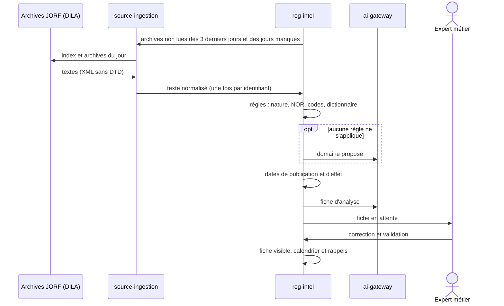
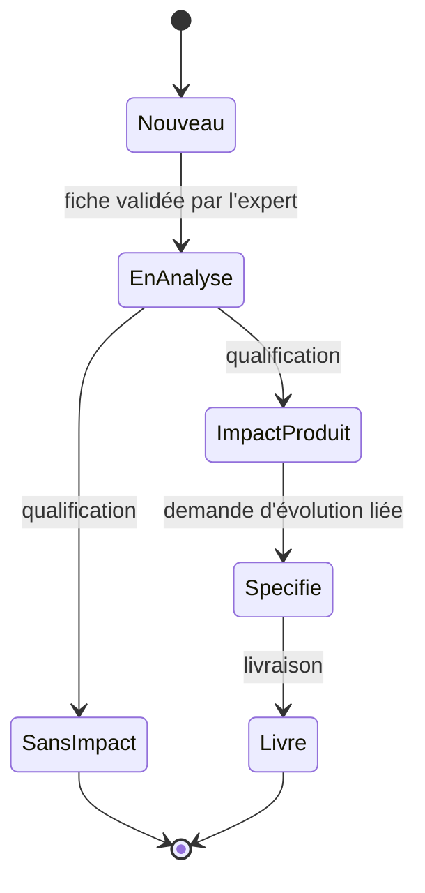

# Conception : suivre les évolutions réglementaires avec validation par un expert

<!-- Statuts : [EXIGENCE] [EXISTANT] [DÉCISION] [PROPOSITION] [QUESTION] (légende : /docs/specifications/README.md#statuts-des-informations). -->

**Niveau de conception** : Complète : nouveau cycle de vie (fiche), source externe à conditions d'usage, dépendance à la passerelle IA.

## Contexte technique

Avant ce changement, le module `regintel` ne contient qu'un `package-info.java`. La source est celle de Q-1 : jeux de données JORF de la DILA sous Licence Ouverte, sans l'API PISTE de Légifrance. La fiche dépend de `passerelle-ia` (IAG-04, IAG-05) et la visibilité de `profils-veille` (PRF-06). Motivation : voir `proposal.md`.

## Exigences couvertes

| Exigence | Section(s) de conception | Diagramme(s) |
|---|---|---|
| REG-01 | Composants | DC-1 |
| REG-02 | Composants | DC-1 |
| REG-03 | Composants | DC-1 |
| REG-04 | Composants | DC-1 |
| REG-05 | Composants | DC-1, DC-2 |
| REG-06 | Composants | DC-2 |
| REG-07 | Composants | DC-1 |
| REG-08 | Composants | DC-2 |

## Objectifs et non-objectifs

**Objectifs :**
- qualification déterministe d'abord, IA en appoint marqué
- aucune diffusion avant validation

**Non-objectifs :**
- avis juridique
- sources réglementaires hors Journal officiel

## Composants impactés, responsabilités et frontières

| Composant | Responsabilité dans ce changement | Ne doit pas | Statut |
|---|---|---|---|
| `reg-intel` | qualifier, préparer les fiches, porter le cycle de vie et la validation | produire un avis juridique | modifié |
| `source-ingestion` | connecteur des archives JORF de la DILA (`ingestion.legi.ArchivesJorf`), lecture XML bornée sans DTD | connaître les domaines | modifié |
| `catalog` | dictionnaire métier et domaines de l'espace | — | modifié |
| `ai-gateway` | fiche et proposition de domaine | décider de la validation | existant (proposé) |

## Modèle de domaine et invariants

- Texte officiel : donnée publique sans espace, enregistré une fois par identifiant `JORFTEXT…` (REG-01-S1).
- Fiche : une par texte et par espace, créée par la plateforme quand au moins un domaine de l'espace est rattaché ; état de validation `EN_ATTENTE_VALIDATION`, `VALIDEE` ou `REJETEE` ; le suivi quitte `NOUVEAU` seulement après validation (contrainte `fiche_reglementaire_suivi_ck`).
- Une fiche décidée ne change plus de contenu ni de décision ; la décision est attribuée au compte courant (déclencheur `fiche_reglementaire_garde`).
- Expert d'une fiche : expert désigné d'un de ses domaines, membre CONTRIBUTEUR ou ADMINISTRATEUR de l'espace ; seul un expert de la fiche lui rattache un domaine.
- Jour de collecte : `COLLECTE`, `EN_ECHEC` ou `ABANDONNE`, avec les archives déjà lues.

## Traitements et interactions

### DC-1 — Du texte publié à la fiche validée

- **Question** : comment un texte officiel devient-il une fiche visible ?
- **Type** : UML séquence
- **Portée** : existant
- **Exigences** : REG-01, REG-02, REG-03, REG-04, REG-05, REG-07

L'IA n'intervient que pour la fiche et pour un domaine incertain ; la diffusion attend la validation de l'expert.

## États et transitions

### DC-2 — Cycle de vie d'un texte

- **Question** : par quels états passe un texte jusqu'à la livraison ?
- **Type** : UML états
- **Portée** : existant
- **Exigences** : REG-05, REG-06, REG-08

Toute autre transition est refusée (REG-06-S2).

## Contrats d'interface

API REST `/api/v1/reglementaire` (`ReglementaireResource`, contrat OpenAPI vérifié par `VeilleReglementaireTest.contratOpenApi`) : dictionnaire et experts par espace, fiches (liste, détail, correction, validation, rejet, transitions, demande d'évolution), calendrier, rappels, état et rejeu de la collecte (administrateur plateforme). Serveur MCP : `get_regulatory_changes`, fiches validées seulement (MCP-07), par le point d'extension `FichesReglementaires`.

## Persistance et intégrité

Migration `V16__veille_reglementaire.sql` : textes (identifiant officiel unique), jours de collecte et état de la source, fiches, domaines rattachés et historique de validation, dictionnaire métier, experts et jours de rappel par espace. Politiques RLS sous `argos_app` (ADR-0016).

## Transactions, concurrence et idempotence

- Collecte : une exécution à la fois (`synchronized`, tâche planifiée `SKIP`) ; texte inséré par `ON CONFLICT DO NOTHING` ; archive téléchargée une seule fois par jour (`archives_lues`).
- Fiche : `ON CONFLICT (texte_id, espace_id) DO NOTHING` ; un rejeu ne crée aucun doublon.
- Travail de l'expert : une transaction par opération, historique écrit dans la même transaction ; dans une correction des domaines, les ajouts précèdent les retraits et toute ligne ignorée par la base annule la correction.
- Rappels : clé d'idempotence `REGLEMENTAIRE|fiche|date|J-n`.

## Sécurité et isolation

Fiche invisible hors experts avant validation (REG-05) ; textes externes traités comme données non fiables (R-11) ; mention « aucun avis juridique » sur chaque fiche.

## Gestion des erreurs et reprise

Source injoignable : source `DEGRADE`, jour en échec repris à la collecte suivante (REG-01-S2). Archive en erreur permanente : écartée, son jour reste collecté. Jour dont les archives échouent cinq fois de suite, ou en échec au-delà de 31 jours : abandonné, rejouable par l'administrateur plateforme. Archive publiée après le passage de la collecte : lue à l'exécution suivante tant que son jour reste dans la fenêtre de relecture de trois jours.

## Observabilité

Compteurs agrégés et journaux d'audit selon arc42 §8.6 ; aucun suivi individuel des utilisateurs.

## Performance et stratégie de mesure

[QUESTION] Aucune cible propre à ce changement dans les sources ; la cible de consultation de arc42 §10 (Q-05) s'applique quand elle est pertinente.

## Compatibilité, migration et retour arrière

Non applicable — aucune donnée ni aucun contrat existants.

## Décisions, alternatives et compromis

### D1 — Dictionnaire métier par espace

- **Statut** : [PROPOSITION]
- **Choix** : règles de rattachement configurées par chaque espace
- **Justification** : produit ouvert : chaque public a ses domaines
- **Alternatives écartées** : dictionnaire global — inadapté hors d'un éditeur
- **Compromis** : configuration initiale à fournir (Q-4)
- **ADR** : candidat à une mise à jour d'ADR-0018

### D2 — Validation obligatoire avant diffusion

- **Statut** : [PROPOSITION]
- **Choix** : fiche visible des seuls experts tant qu'elle n'est pas validée
- **Justification** : fiabilité d'une information à enjeu juridique
- **Alternatives écartées** : diffusion immédiate marquée IA — risque d'erreur diffusée
- **Compromis** : délai de diffusion
- **ADR** : ADR-0018 (Proposé)

## Risques

- Interprétation erronée d'un texte → validation obligatoire, lien vers le texte officiel.
- Conditions d'usage de l'API Légifrance (Q-1) → l'API PISTE n'est pas utilisée ; données ouvertes JORF sous Licence Ouverte, source et date de mise à jour mentionnées sur chaque fiche.
- Archive publiée plus de trois jours après sa date → lue seulement par un rejeu de l'administrateur plateforme.

## Écarts code / tests / specs / documentation

- Le connecteur lit les seules archives JORF de la DILA, sans l'API PISTE ni le repli prévus initialement (Q-1) ; les archives LEGI ne sont pas lues : le lien « version consolidée » pointe vers Légifrance.
- L'IHM n'a pas d'écran réglementaire : le parcours passe par l'API REST et le lien d'un rappel ouvre le texte officiel.

## Stratégie de vérification

| Exigence / scénario | Niveau de test | Moyen de preuve | État |
|---|---|---|---|
| REG-01-S1, REG-01-S2 | contrat + intégration | archives JORF composées au format DILA, servies par `StubServer` (`LecteurJorfTest`, `CollecteReglementaireTest`) | passe |
| REG-02-S1, REG-02-S2 | unitaire + intégration | dictionnaire de test, API Ollama simulée (`QualificationEtDatesTest`, `VeilleReglementaireTest`) | passe |
| REG-03-S1, REG-03-S2 | unitaire | textes de test (`QualificationEtDatesTest`) | passe |
| REG-04-S1 | intégration | ai-gateway simulé (`VeilleReglementaireTest`) | passe |
| REG-05-S1, REG-05-S2 | intégration | droits, visibilité et RLS sous `argos_app` (`VeilleReglementaireTest`, `ReglementaireMcpTest`) | passe |
| REG-06-S1, REG-06-S2 | unitaire + intégration | machine à états (`QualificationEtDatesTest`, `VeilleReglementaireTest`) | passe |
| REG-07-S1 | intégration | dates passées en paramètre (`VeilleReglementaireTest`) | passe |
| REG-08-S1 | intégration API | API GitHub simulée (`VeilleReglementaireTest`, `DemandesEvolutionTest`) | passe |

## Documentation durable impactée

- `/docs/specifications/veille-reglementaire.md`, registre `/docs/specifications/README.md`
- arc42 §6
- ADR-0018 (mise à jour)

## Questions ouvertes

Aucune autre que celles de la proposition.
