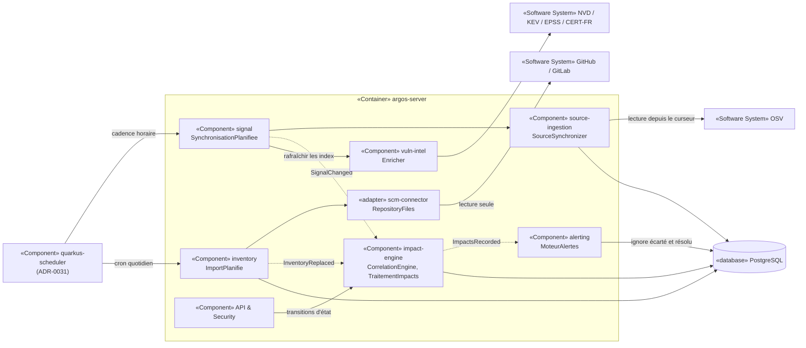
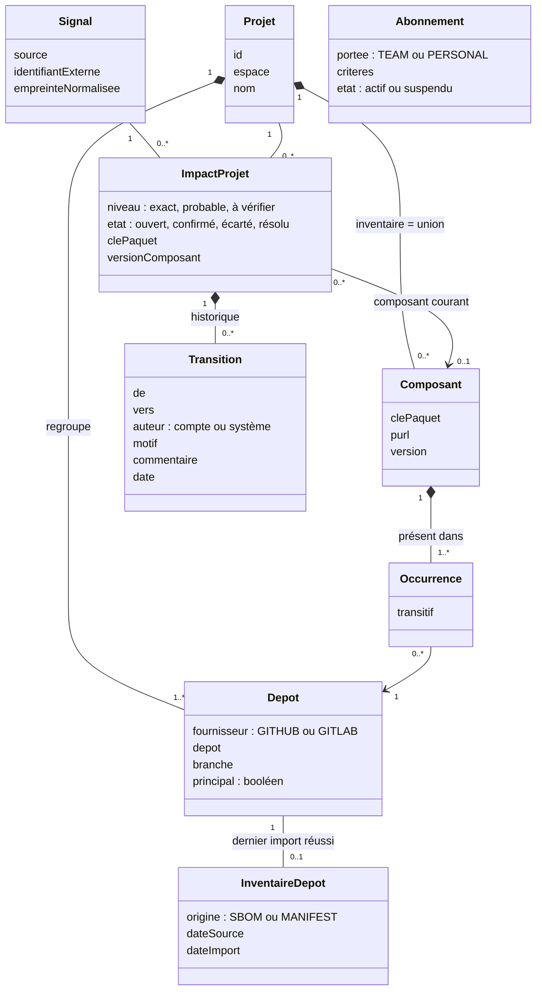
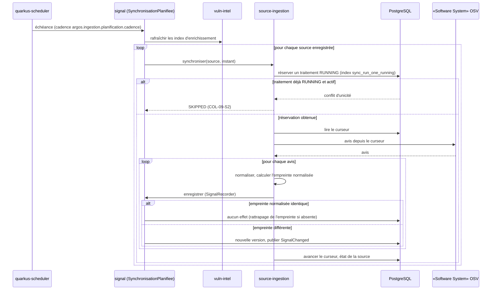
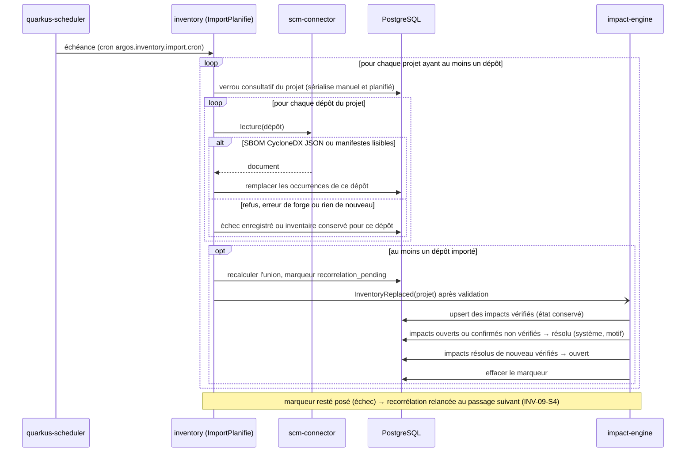
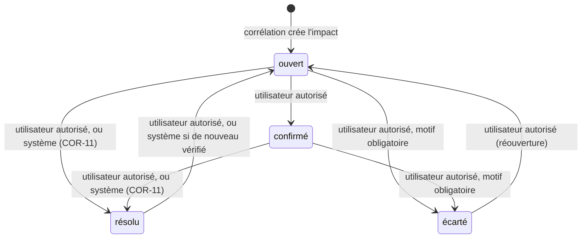
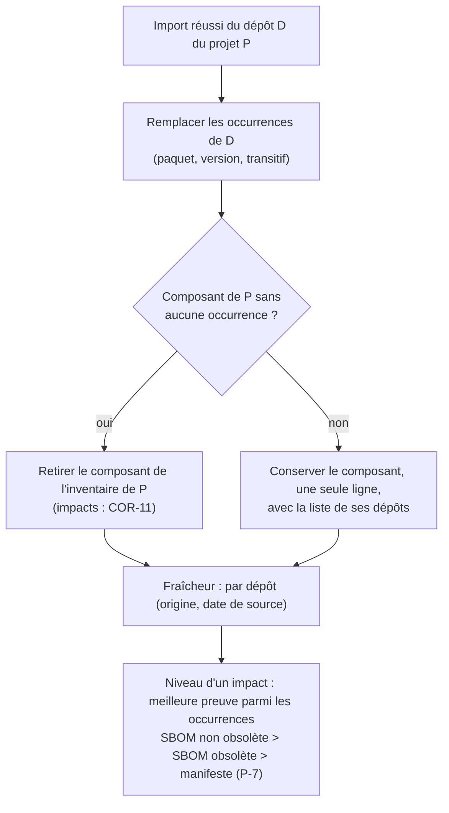
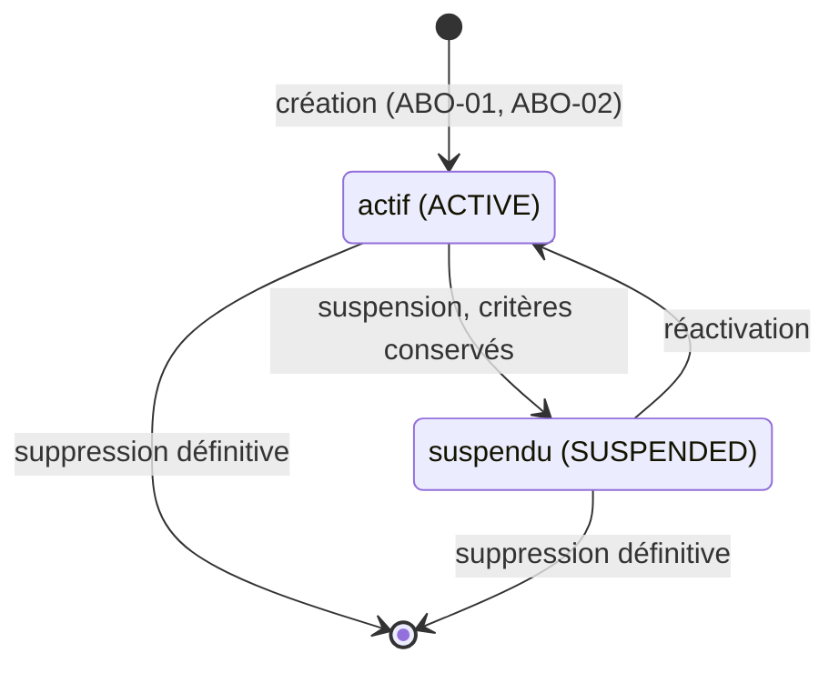
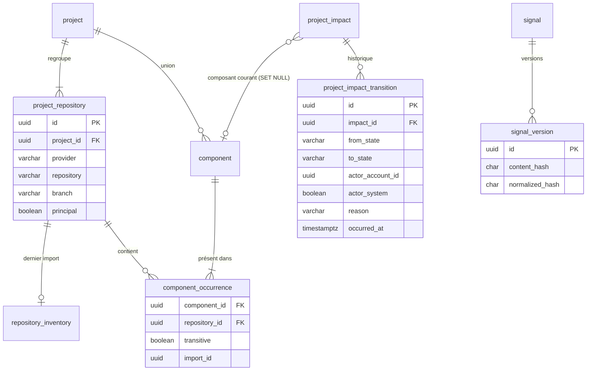
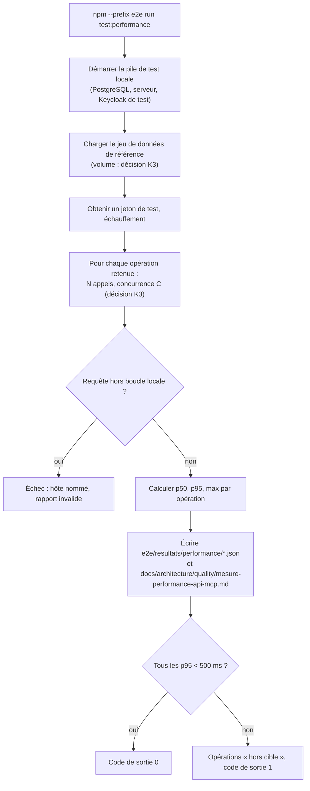

# Conception : automatiser la chaîne de veille sécurité

<!-- Statuts : [EXIGENCE] [EXISTANT] [DÉCISION] [PROPOSITION] [QUESTION] (légende : /docs/specifications/README.md#statuts-des-informations). Noms de composants : arc42 §5 ; termes : arc42 §12. -->

**Niveau de conception** : complète — trois migrations, deux cycles de vie, traitements planifiés concurrents d'actions à la demande, droits, mesure de performance (voir proposal.md, « Conception requise »).

## Contexte technique

État vérifié dans `argos-server` le 2026-11-19 (branche `lot18/base`, lots 1 à 17 fusionnés) :

- [EXISTANT] Synchronisation d'une source d'avis par `io.argos.ingestion.SourceSynchronizer` (curseur `sync_cursor`, traitement `sync_run` avec index unique `sync_run_one_running`, tentatives bornées, état `NOMINAL` / `FAILING` / `DEGRADED`) ; déclenchement par `POST /api/v1/ops/sources/{id}/synchronizations` (`io.argos.signal.SourceOperations`) ; une seule source enregistrée (`OSV`, migration V3). Les enrichissements NVD, KEV, EPSS, CERT-FR sont lus à la demande par `io.argos.vulnintel.Enricher` (index CERT-FR en cache `argos.sources.certfr.cache-ttl`, 6 h).
- [EXISTANT] L'empreinte `content_hash` de `signal` et `signal_version` est le SHA-256 du contenu brut (`NormalizedAdvisory#contentHash`) ; `SignalRecorder` compare l'empreinte courante puis l'existence d'une version de même empreinte (contrainte `signal_version_hash_uk`).
- [EXISTANT] `InventoryService.refresh` lit la SBOM ou les manifestes d'un projet par `io.argos.scm.RepositoryFiles` (un seul dépôt : colonnes `scm_*` de `project`), remplace l'inventaire (`InventoryStore.replace`) et publie `InventoryReplaced` ; `CorrelationEngine#onInventoryReplaced` recorrèle alors le projet. Aucun déclencheur de `refresh` en production.
- [EXISTANT] `CorrelationEngine#deterministic` insère ou met à jour l'impact du triplet (signal, projet, composant), puis **supprime** les impacts du signal qui ne sont plus vérifiés ; `project_impact.component_id` est en `ON DELETE CASCADE`. `project_impact` n'a ni état ni historique.
- [EXISTANT] `subscription.state` vaut `ACTIVE` ou `INACTIVE` ; `SubscriptionService#leave` désactive un `PERSONAL` ou enregistre le retrait d'un `TEAM` facultatif ; `activeFor` (abonnements actifs) sert à `alerting.MoteurAlertes`, `api.WatchResource`, `api.veille.VeilleProfilsResource` et `GET /api/v1/subscriptions`.
- [EXISTANT] Onze tâches `@Scheduled` suivent ADR-0031 (identité, cadence en configuration, `SKIP`, méthode testable recevant l'instant, `%test.quarkus.scheduler.enabled=false`) ; les parcours E2E désactivent les tâches qui joindraient une source externe (`e2e/README.md`). Treize tâches à l'intégration du changement, inventoriées en arc42 §8.5.
- [EXISTANT] Frontières de modules vérifiées par `io.argos.architecture.ModuleBoundariesTest` : `ingestion` et `scm` ne dépendent de rien ; `signal` → `ingestion` ; `vulnintel` → `signal` ; `inventory` → `scm`, `workspace`, `catalog` ; `impact` → `signal`, `vulnintel`, `inventory`… (jamais `workspace`) ; `alerting` → `impact`, `workspace` ; `api` → tous les modules métier.

## Exigences couvertes

| Exigence | Section(s) de conception | Diagramme(s) |
|---|---|---|
| COL-09 | D1 ; Traitements ; Transactions | DC-1, DC-3 |
| COL-10 | D2 ; Persistance (V18) | DC-2 |
| INV-07 | D3 ; Traitements ; Gestion des erreurs | DC-1, DC-4 |
| INV-08 | D3 ; Transactions | DC-4 |
| INV-09 | D4 ; Traitements | DC-4 |
| INV-10 | D6 ; Modèle de domaine ; Persistance (V19) | DC-2, DC-6 |
| COR-09 | D5 ; Modèle de domaine | DC-2, DC-5 |
| COR-10 | D5 ; Contrats ; Sécurité | DC-5 |
| COR-11 | D4, D5 ; Persistance (V20) | DC-4, DC-5 |
| COR-12 | D5 ; Contrats | DC-5 |
| ALR-07 | intégration | `alerting/AlertesImpactsTraitesTest` | passé le 2026-11-19 |
| ABO-07 | D7 ; Persistance (V18) | DC-7 |
| ABO-08 | D7 ; Contrats | DC-7 |
| PERF-01 | D8 ; Performance | DC-8 |
| PERF-02 | D8 ; Performance | DC-8 |

## Objectifs et non-objectifs

**Objectifs :**
- faire tourner seule la chaîne avis → inventaire → corrélation, aux cadences J1 et J3, sans perte ni doublon après un arrêt (QS-03, QS-07) ;
- tracer tout changement d'état d'un impact, humain ou système ;
- découper le travail en trois volets réalisables en parallèle, chacun avec ses migrations, ses tests et sa documentation.

**Non-objectifs :**
- webhook ou point d'entrée entrant (J3) ; nouvelle API d'import manuel (P-1) ; administration des dépôts d'un projet (P-7) ;
- rattrapage d'une exécution manquée pendant un arrêt du serveur (ADR-0031, option A : la prochaine échéance reprend depuis le curseur ou le marqueur persisté) ;
- grappe de plusieurs instances (ADR-0031, rouvrirait la décision).

## Composants impactés, responsabilités et frontières

| Composant (arc42 §5) | Paquet | Responsabilité dans ce changement | Ne doit pas | Statut | Volet |
|---|---|---|---|---|---|
| `source-ingestion` | `io.argos.ingestion` | empreinte du contenu normalisé (`NormalizedAdvisory`, `osv.OsvNormalizer`) ; synchronisation inchangée | dépendre d'un autre module | modifié | A |
| `signal` | `io.argos.signal` | tâche planifiée de synchronisation des sources (`SynchronisationPlanifiee`, nouveau) ; comparaison sur l'empreinte normalisée et rattrapage des empreintes (`SignalRecorder`) | appeler `vulnintel` directement | modifié | A |
| `vuln-intel` | `io.argos.vulnintel` | rafraîchissement des index d'enrichissement à chaque cadence (`CertFrSource#invalidate`, caches KEV/EPSS) sur l'événement de synchronisation planifiée | bloquer l'enregistrement d'un signal | modifié | A |
| `workspace` (abonnements) | `io.argos.workspace.subscription` | état `SUSPENDED`, suspension, réactivation, suppression (`SubscriptionService`) | lire des droits applicatifs : la RLS les applique | modifié | A |
| `scm-connector` | `io.argos.scm` | réutilisé tel quel (`RepositoryFiles.lecture`) pour chaque dépôt | être appelé par un autre module que `inventory` (et `projectintel`, `regintel` déjà autorisés) | inchangé | B |
| `inventory` | `io.argos.inventory` | tâche planifiée d'import (`ImportPlanifie`, nouveau) ; dépôts d'un projet (`ProjectDirectory`) ; occurrences par dépôt et union (`InventoryStore`, `InventoryQueries`) ; sérialisation des imports d'un projet | dépendre de `impact` (la recorrélation passe par l'événement `InventoryReplaced`) | modifié | B |
| `impact-engine` | `io.argos.impact` | recorrélation sur `InventoryReplaced` et reprise du marqueur (volet B) ; état de traitement, transitions, historique, résolution automatique (`CorrelationEngine`, `TraitementImpacts` nouveau, `ImpactQueries`) (volet C) | dépendre de `workspace` : le contrôle du rôle est fait par l'API et la RLS | modifié | B, C |
| `alerting` | `io.argos.alerting` | ignorer les impacts `écarté` / `résolu` à l'envoi et au résumé (`MoteurAlertes`, `ResumesPeriodiques`) | modifier un impact | modifié | C |
| `API & Security` | `io.argos.api` | `ImpactResource` (transitions, filtre `etat`) ; `SubscriptionResource` (suspension, réactivation, suppression, liste complète) ; `InventoryResource` (dépôts dans la synthèse) ; contrat OpenAPI | contourner la RLS | modifié | A, B, C |
| `argos-ui` | `argos-ui/src` | boutons de transition et historique d'un impact (`AlertesView.vue`), abonnements suspendus (`VeilleView.vue`, `api/veille.ts`), dépôts dans la synthèse (`InventaireView.vue`, `api/inventaire.ts`) | afficher un état non renvoyé par l'API | modifié | A, B, C |
| `e2e/` | `e2e/performance/` | campagne de mesure p95 (`mesurer-p95.mjs`, nouveau) | s'exécuter par `npm --prefix e2e test` | nouveau | C |

### DC-1 — Composants et flux de la chaîne automatisée

- **Question** : quels composants déclenchent quoi, et par quel moyen, une fois la chaîne automatisée ?
- **Type** : organigramme à stéréotypes C4 (niveau composant)
- **Portée** : cible ; les flèches pointillées sont existantes, les pleines nouvelles ou modifiées
- **Exigences** : COL-09, INV-07, INV-09, COR-11, ALR-07

Les deux tâches planifiées sont les seuls déclencheurs ajoutés : aucun flux n'entre depuis une forge ou une CI (INV-07-S3). `inventory` ne connaît pas `impact-engine` : la recorrélation passe par l'événement CDI existant, ce qui respecte `ModuleBoundariesTest`. Les transitions d'état passent par l'API, seule à résoudre le rôle de l'appelant.

## Modèle de domaine et invariants

### DC-2 — Modèle de domaine après le changement

- **Question** : quelles notions s'ajoutent (dépôts d'un projet, occurrences, état de traitement, état d'abonnement), avec quelles cardinalités ?
- **Type** : UML classes
- **Portée** : cible ; `Projet`, `Inventaire`, `Composant`, `Signal`, `ImpactProjet`, `Abonnement` existent
- **Exigences** : COL-10, INV-10, COR-09, COR-10, COR-12, ABO-07

Invariants testables :

- **INV-A1** (COL-10) : pour un signal, deux versions n'ont jamais la même empreinte normalisée ; la version courante porte l'empreinte normalisée du signal. Un avis dont le contenu redevient celui d'une version antérieure met à jour le signal, qui repointe vers cette version existante (J2).
- **INV-B1** (INV-10) : un composant d'un projet a au moins une occurrence ; un composant sans occurrence est retiré de l'inventaire du projet.
- **INV-B2** (INV-10) : l'identité d'un composant reste (projet, clé du paquet, version), comme dans V4 (`component_identity`).
- **INV-C1** (COR-09) : tout impact a exactement un niveau et un état ; un impact créé est `ouvert`.
- **INV-C2** (COR-10, COR-11) : l'état courant d'un impact est l'état d'arrivée de sa dernière transition, ou `ouvert` sans transition.
- **INV-C3** (COR-11) : un impact dont le composant a disparu (`component_id` nul) est `résolu` ou `écarté`. Invariant au repos : une transition utilisateur vers `ouvert` ou `confirmé` d'un tel impact est refusée (409) et n'est pas proposée ; la recorrélation qui résout l'impact suit la validation de l'import, et le contrôle d'intégrité (`GET /api/v1/ops/impacts/integrity`) signale tout écart. La contrainte `CHECK` prévue dans V20 n'est pas créée ([PROPOSITION] P-13, à valider par le porteur du projet).
- **INV-C4** (COR-07) : au plus un impact par (signal, projet, composant) ; un impact au composant disparu garde sa clé de paquet et sa version pour la traçabilité.
- **INV-A2** (ABO-07) : un abonnement suspendu garde ses filtres, son canal, sa fréquence et ses retraits ; seul `state` change.

## Traitements et interactions

### DC-3 — Synchronisation planifiée d'une source (volet A)

- **Question** : que se passe-t-il à chaque échéance horaire, y compris quand une synchronisation est déjà en cours ?
- **Type** : UML séquence
- **Portée** : cible
- **Exigences** : COL-09, COL-10, COL-05

La tâche délègue à une méthode publique `synchroniserToutes(Instant)` testée avec une horloge simulée (ADR-0031). L'exclusion avec un lancement à la demande repose sur l'index unique existant et le battement de cœur (`argos.ingestion.running-expiry`). Le rafraîchissement des index d'enrichissement est fait avant la boucle, et son échec n'empêche pas la synchronisation (COL-04-S3).

### DC-4 — Import quotidien et recorrélation (volets B et C)

- **Question** : comment le passage quotidien importe-t-il les dépôts d'un projet et déclenche-t-il la recorrélation, et que deviennent les impacts sans objet ?
- **Type** : UML séquence
- **Portée** : cible ; la recorrélation sur `InventoryReplaced` existe, la résolution remplace la suppression
- **Exigences** : INV-07, INV-08, INV-09, INV-10, COR-11

Le volet B livre le passage quotidien, les dépôts multiples, le marqueur et le déclenchement ; tant que le volet C n'est pas intégré, un impact sans objet garde le comportement existant (suppression), ce que les tests du volet B vérifient comme « absent des impacts ouverts » (INV-09-S2). Le volet C remplace la suppression par la résolution (COR-11) sans toucher au déclenchement.

## États et transitions

### DC-5 — État de traitement d'un impact (volet C)

- **Question** : quelles transitions sont permises, par qui, et lesquelles le système fait-il seul ?
- **Type** : UML états
- **Portée** : cible
- **Exigences** : COR-09, COR-10, COR-11, COR-12, ALR-07

« Utilisateur autorisé » : membre `CONTRIBUTEUR` ou `ADMINISTRATEUR` de l'espace du projet (P-5). Le système ne fait que deux transitions : vers `résolu` depuis `ouvert` ou `confirmé` (motifs `COMPOSANT_RETIRE`, `VERSION_HORS_PLAGE`, `AVIS_MODIFIE`, `AVIS_RETIRE`), et de `résolu` vers `ouvert` (`DE_NOUVEAU_VERIFIE`, P-6). Il ne touche jamais un impact `écarté` (COR-11-S4). Aucun état n'est terminal : l'historique garde chaque passage. Seuls `ouvert` et `confirmé` sont éligibles aux alertes (ALR-07).

### DC-6 — Dépôts d'un projet et union de l'inventaire (volet B)

- **Question** : comment l'inventaire d'un projet se déduit-il des imports de ses dépôts ?
- **Type** : organigramme
- **Portée** : cible
- **Exigences** : INV-10, INV-03, COR-02

Chaque dépôt garde son dernier import réussi : un refus sur un dépôt ne retire rien des autres (INV-10-S2). La meilleure preuve fonde le niveau : un composant trouvé dans une SBOM fraîche d'un des dépôts est présent avec certitude, même si un autre dépôt n'a que des manifestes (P-7).

### DC-7 — État d'un abonnement (volet A)

- **Question** : quels états et quelles actions un abonnement connaît-il, et qu'est-ce qui distingue la suppression ?
- **Type** : UML états
- **Portée** : cible ; `ACTIVE` existe, `INACTIVE` devient `SUSPENDED`
- **Exigences** : ABO-07, ABO-08

Un abonnement suspendu ne produit ni alerte ni mention dans un résumé, et ne contribue plus à « Ma veille » (P-4) : `activeFor` le filtre déjà par `state = 'ACTIVE'`. La suppression n'est pas un état : la ligne et ses retraits disparaissent (ABO-08).

## Contrats d'interface

Le contrat exécutable reste l'OpenAPI généré par le serveur (`/q/openapi`) ; chaque volet le met à jour et le vérifie par les tests de contrat existants.

| Élément | Valeur | Volet |
|---|---|---|
| `POST /api/v1/impacts/{id}/transitions` | corps `{ "vers": "CONFIRME" \| "ECARTE" \| "RESOLU" \| "OUVERT", "motif"?: string ≤ 1000, "commentaire"?: string ≤ 1000 }` ; jeton porteur ; 200 avec l'impact (état, historique) ; 400 `DONNEE_INVALIDE` (valeur inconnue, motif manquant pour `ECARTE`) ; 403 `ROLE_INSUFFISANT` (`LECTEUR`) ; 404 `INTROUVABLE` (autre espace, inconnu) ; 409 `TRANSITION_INTERDITE` avec les transitions possibles ; refus journalisés dans `refus_acces`. Idempotence : une transition vers l'état courant répond 409 sans historiser. | C |
| `GET /api/v1/impacts/{id}` | ajoute `etat` et `historique[]` (`de`, `vers`, `auteur` — compte ou `SYSTEME` —, `motif`, `commentaire`, `date`) ; `level` inchangé | C |
| Listes d'impacts (`GET /api/v1/signals/{id}/impacts` et listes de l'IHM) | paramètre `etat` répété (`OUVERT`, `CONFIRME`, `ECARTE`, `RESOLU`) ; défaut `OUVERT` + `CONFIRME` ; valeur inconnue : 400 `DONNEE_INVALIDE` ; pagination inchangée (`ParametresPagination`) | C |
| `GET /api/v1/subscriptions` | renvoie aussi les abonnements suspendus visibles de l'appelant, avec `state` (`ACTIVE` \| `SUSPENDED`) | A |
| `POST /api/v1/subscriptions/{id}/suspension`, `POST /api/v1/subscriptions/{id}/reactivation` | 200 avec l'abonnement ; 403 (TEAM, non administrateur) ; 404 (inconnu ou invisible) ; idempotentes (suspendre un suspendu répond 200 sans effet) | A |
| `DELETE /api/v1/subscriptions/{id}` | 204 ; 403 (TEAM, non administrateur) ; 404 (inconnu, invisible ou déjà supprimé) | A |
| `POST /api/v1/subscriptions/{id}/leave` | inchangé pour un `TEAM` facultatif ; pour un `PERSONAL`, équivaut à la suspension (P-8) | A |
| `GET /api/v1/projects/{id}/inventory/summary` | ajoute `repositories[]` (`provider`, `repository`, `branch`, `origin`, `sourceDate`, `importedAt`, `lastFailure`) ; champs existants inchangés (origine et date = dépôt principal, compatibilité) | B |
| `GET /api/v1/projects/{id}/inventory/components` | ajoute `repositories[]` par composant | B |
| Tâches planifiées | `signal-synchronisation-sources` (`every` `argos.ingestion.planification.cadence`, `PT1H`) ; `inventory-import-quotidien` (`cron` `argos.inventory.import.cron`, `0 0 3 * * ?`, fuseau `argos.alerting.fuseau`) ; `SKIP` | A, B |

Aucun point d'accès entrant non authentifié n'est ajouté (INV-07-S3). Aucun outil MCP ne change.

## Persistance et intégrité

Migrations prévues (ADR-0032), numéros réservés par volet (P-11), chacune ajoutée au tableau d'arc42 §8.7 par son volet :

| Migration | Volet | Contenu |
|---|---|---|
| `V18__automatisation_collecte_et_abonnements.sql` | A | `signal.normalized_hash char(64)` et `signal_version.normalized_hash char(64)`, nullables (rattrapage au premier passage, COL-10-S4), index unique partiel `(signal_id, normalized_hash) WHERE normalized_hash IS NOT NULL` ; `subscription.state` : `INACTIVE` → `SUSPENDED`, contrainte `CHECK (state IN ('ACTIVE','SUSPENDED'))` ; privilèges `argos_app` : `UPDATE (state)` et `DELETE` sur `subscription` ; politiques RLS `subscription_mise_a_jour` et `subscription_suppression` (propriétaire d'un `PERSONAL`, `ADMINISTRATEUR` de l'espace d'un `TEAM` via `argos_role_dans`) |
| `V19__depots_projet_et_occurrences.sql` | B | `project_repository(id, project_id, provider, repository, branch, sbom_job, sbom_path, manifest_paths, principal, created_at)` alimentée depuis `project.scm_*` (une ligne `principal` par projet configuré) ; `repository_inventory(repository_id, origin, source_date, spec_version, source_ref, import_id, imported_at, ignored_count, ignored_components)` ; `component_occurrence(component_id, repository_id, project_id, transitive, import_id)` (`project_id` pour la RLS) alimentée depuis `component` ; `inventory_import_failure.repository_id` ; `inventory.recorrelation_pending boolean` ; RLS de lecture par `argos_projet_lisible` sur les nouvelles tables |
| `V20__etat_traitement_impacts.sql` | C | `project_impact.state varchar(16) NOT NULL DEFAULT 'OUVERT' CHECK (state IN ('OUVERT','CONFIRME','ECARTE','RESOLU'))`, `package_key`, `component_version` (instantané pour la traçabilité, alimentés depuis `component`) ; `component_id` nullable, contrainte refaite en `ON DELETE SET NULL` ; INV-C3 vérifié au repos et par la garde de `TraitementImpacts`, sans contrainte `CHECK` ([PROPOSITION] P-13) ; `project_impact_transition(id, impact_id, from_state, to_state, actor_account_id, actor_system boolean, reason, comment, occurred_at)` ; privilèges `argos_app` : `UPDATE (state)` sur `project_impact`, `INSERT` sur `project_impact_transition` ; politiques RLS `project_impact_transition_lecture` (`argos_espace_lisible`) et `project_impact_etat` (`argos_role_dans(workspace_id) IN ('CONTRIBUTEUR','ADMINISTRATEUR')`) |

### Vue entité-association des nouvelles tables

- **Question** : comment les nouvelles tables se rattachent-elles aux tables existantes ?
- **Type** : entité-association
- **Portée** : cible (V18 à V20)
- **Exigences** : COL-10, INV-10, COR-09 à COR-12, ABO-07

`project.scm_*` reste en place et en lecture (compatibilité de `projectintel`, P-7) ; sa suppression relèvera d'un changement ultérieur. `inventory` reste la ligne de synthèse par projet (origine et date du dépôt principal, nombre de composants) pour la compatibilité de l'API.

## Transactions, concurrence et idempotence

- **Synchronisation (A)** : réservation par l'index `sync_run_one_running` ; une échéance qui trouve un traitement actif est sautée (COL-09-S2), un traitement expiré est repris (`running-expiry`) ; `concurrentExecution = SKIP` évite deux échéances dans l'instance.
- **Empreinte (A)** : comparaison et rattrapage dans la transaction d'enregistrement de l'avis ; l'index unique partiel garantit INV-A1 sous concurrence (COL-03-S3).
- **Import (B)** : verrou consultatif transactionnel par projet (`pg_advisory_xact_lock(hashtext('inventory:' || project_id))`) pris par l'import planifié et par l'import manuel (INV-08-S2) ; remplacement des occurrences d'un dépôt et recalcul de l'union dans une transaction ; `InventoryReplaced` publié après validation (`TransactionPhase.AFTER_SUCCESS`, existant).
- **Recorrélation (B)** : marqueur `recorrelation_pending` posé dans la transaction d'import, effacé dans la transaction de recorrélation ; le passage suivant traite d'abord les projets marqués (INV-09-S4, P-10).
- **Transitions (C)** : `UPDATE … SET state = :vers WHERE id = :id AND state = :de` puis insertion de la transition dans la même transaction ; zéro ligne mise à jour → 409 (concurrence optimiste, aucune transition perdue ni appliquée deux fois). La résolution système s'exécute sous le verrou existant `project_impact:<signal>` de `CorrelationEngine`, qui sérialise corrélation globale et corrélation par projet.

## Sécurité et isolation

- Transitions d'état : l'API résout l'appelant (`api.security`) ; la base applique la règle sous `argos_app` (politique `project_impact_etat`) : un `LECTEUR` ou un non-membre ne peut rien modifier même si la couche API se trompait ; 403 / 404 journalisés dans `refus_acces` (motifs `ROLE_INSUFFISANT`, `NON_MEMBRE`).
- Abonnements : politiques RLS de mise à jour et de suppression sous `argos_app` ; un abonnement n'élargit aucun droit (ABO-05, inchangé).
- Tâches planifiées : exécutées sous l'utilisateur de connexion, comme la collecte et la corrélation actuelles (traitement technique hors rôle applicatif) ; aucune donnée d'espace n'est exposée par elles.
- Forges : lecture seule, jetons en configuration, jamais journalisés (exigence existante de `scm-connector`) ; aucune redirection suivie.
- Entrées non fiables : avis et SBOM restent traités comme données non fiables (arc42 §8.3) ; motif et commentaire d'une transition sont bornés (1 000 caractères) et rendus comme texte dans l'IHM.
- Mesure de performance : la campagne refuse toute requête hors de la boucle locale (PERF-02-S3) ; elle utilise les comptes du royaume de test, jamais un secret réel.

## Gestion des erreurs et reprise

- Source en échec : règles existantes COL-06 et COL-07 ; l'échéance suivante retente (COL-09-S4).
- Forge en échec pour un dépôt : `ERROR` enregistré dans `inventory_import_failure` avec le dépôt, inventaire du dépôt conservé, passage poursuivi (INV-07-S2) ; un quota épuisé (`QuotaEpuise`) arrête le passage pour cette forge seulement, les autres forges continuent [PROPOSITION].
- Recorrélation en échec : marqueur conservé, journal d'erreur, reprise au passage suivant (P-10).
- Arrêt brutal : curseur, traitement `RUNNING` expirable et marqueur persistés ; aucune exécution manquée n'est rattrapée par le planificateur (ADR-0031), l'échéance suivante reprend.

## Observabilité

- Chaque exécution planifiée journalise un bilan (sources : créés, mis à jour, inchangés, rejetés, sautés ; import : projets, dépôts importés, conservés, refusés, en erreur ; recorrélations : impacts créés, résolus, rouverts).
- `GET /api/v1/ops/sources` expose déjà l'état et le curseur des sources ; la dernière synchronisation planifiée y apparaît par `lastSuccessAt` / `lastFailureAt`.
- Les transitions système portent l'auteur `SYSTEME` et un motif normalisé, consultables dans l'historique (COR-12).

## Performance et stratégie de mesure

Cible : « API/MCP p95 < 500 ms hors appels externes/IA » (arc42 §8, cibles initiales ; arc42 §10.2 Q-05) [PROPOSITION], vérifiée par J8.

### DC-8 — Campagne de mesure p95 (volet C)

- **Question** : comment la campagne produit-elle un verdict et un rapport sans quitter le poste ?
- **Type** : organigramme
- **Portée** : cible
- **Exigences** : PERF-01, PERF-02

Opérations retenues (lecture, sans appel externe ni IA) : `GET /api/v1/projects`, `/inventory/summary`, `/inventory/components`, `GET /api/v1/impacts/{id}`, liste des impacts d'un signal, `GET /api/v1/me/veille`, recherche `GET /api/v1/recherche`, `GET /api/v1/subscriptions`, `GET /api/v1/alertes`, et les sept outils MCP de consultation en lecture seule (`explain_change`, qui appelle l'IA, est exclu comme les autres appels IA). Exclues et listées : synthèses et résumés IA, synchronisations, collectes. L'arrêt de la pile suit le verrou E2E du dépôt et n'arrête qu'une pile lancée par la campagne.

## Compatibilité, migration et retour arrière

- **Ordre des volets** : les trois volets sont indépendants dans le code ; leurs migrations portent des numéros réservés (P-11). Ils sont intégrés tous les trois avant tout déploiement ; sur une base neuve (tests, E2E), Flyway applique V18 à V20 dans l'ordre quel que soit l'ordre de fusion.
- **Archivage OpenSpec** : les capacités `collecte-avis-securite`, `inventaire-sbom`, `correlation-impact` et `abonnements-veille` sont créées par `formaliser-chaine-securite-poc`. Ce changement ne contient que des exigences `ADDED` et la même section `Purpose` ; il s'archive après `formaliser-chaine-securite-poc`, ou avant (la section `Purpose` crée alors la spec, que l'archivage suivant complète). `alertes-digests` a une spec de référence : ALR-07 s'y ajoute.
- **Abonnements** : `INACTIVE` → `SUSPENDED` sans perte ; retour arrière : `SUSPENDED` → `INACTIVE` par migration inverse manuelle, critères intacts.
- **Empreinte** : colonnes ajoutées nullables ; l'ancienne empreinte reste ; retour arrière : ignorer `normalized_hash`.
- **Impacts** : les impacts existants deviennent `ouvert` ; l'instantané paquet/version est alimenté depuis `component`. Retour arrière : supprimer les impacts `résolu` au composant nul pour revenir au comportement de suppression.
- **Dépôts** : chaque projet configuré reçoit son dépôt `principal` ; `project.scm_*` reste lu par `projectintel`.

## Décisions, alternatives et compromis

### D1 — Synchronisation horaire planifiée des sources d'avis (J1)

- **Statut** : [DÉCISION] porteur du projet, 2026-11-19 (J1) ; modalités [PROPOSITION].
- **Choix** : une tâche `@Scheduled(identity = "signal-synchronisation-sources", every = "{argos.ingestion.planification.cadence}", concurrentExecution = SKIP)` dans `io.argos.signal`, qui rafraîchit les index d'enrichissement puis appelle `SourceSynchronizer` pour chaque source de la table `source`, depuis le curseur existant ; cadence par défaut `PT1H` ; désactivée dans le profil de test et dans la pile E2E.
- **Justification** : ADR-0031 (Accepté) impose ce mécanisme ; l'exclusion avec le lancement à la demande existe déjà en base ; `signal` dépend déjà d'`ingestion`, contrairement à `api`.
- **Alternatives écartées** : cron système ou n8n appelant l'API d'exploitation (ADR-0031 option C, ADR-0007) ; une tâche par source (configuration multipliée sans besoin, une seule source aujourd'hui) ; tâche dans `ingestion` (module sans dépendance : il ne connaît ni `signal` ni `vulnintel`).
- **Vérification** : tests d'intégration avec horloge simulée et OSV simulé par réponses enregistrées (COL-09-S1 à S5) ; `ModuleBoundariesTest` vert.
- **Impact ADR** : aucun nouvel ADR ; application d'ADR-0031 (sa table des tâches n'est pas modifiée, la liste à jour vit en arc42 §8).

### D2 — Empreinte du contenu normalisé (J2)

- **Statut** : [DÉCISION] J2 ; définition du contenu normalisé [PROPOSITION] P-2.
- **Choix** : `NormalizedAdvisory` porte `normalizedHash` = SHA-256 du JSON canonique (clés triées, sans espaces) des champs normalisés : identifiant externe, titre, résumé, gravité, alias triés, paquets affectés triés avec leurs plages, date de publication, retrait ; la date de modification déclarée par la source et la date de collecte en sont exclues. `SignalRecorder` compare `normalized_hash` ; si le signal n'en a pas (antérieur à V18), il calcule l'empreinte normalisée de la version courante à partir de son contenu brut, l'enregistre et ne crée une version que si elle diffère (COL-10-S4). L'empreinte du contenu brut reste enregistrée pour l'audit.
- **Justification** : J2 ; la corrélation ne lit que le contenu normalisé ; une date de modification seule ne change rien d'observable.
- **Alternatives écartées** : empreinte du contenu brut (existant, crée des versions sur une simple réorganisation) ; comparaison de la date de modification (Q-COL-2, écartée par J2) ; recalcul des empreintes dans la migration SQL (la normalisation est en Java ; un recalcul SQL dupliquerait la logique).
- **Vérification** : tests unitaires de canonicalisation (ordre des clés, espaces), tests d'intégration COL-10-S1 à S4 sur réponses OSV enregistrées.
- **Impact ADR** : aucun.

### D3 — Import quotidien des inventaires par interrogation des forges (J3)

- **Statut** : [DÉCISION] J3 ; heure par défaut et absence d'API d'import [PROPOSITION] P-1, P-12.
- **Choix** : tâche `@Scheduled(identity = "inventory-import-quotidien", cron = "{argos.inventory.import.cron}", timeZone = "{argos.alerting.fuseau}", concurrentExecution = SKIP)` dans `io.argos.inventory` ; pour chaque projet, pour chaque dépôt, réutilisation de `RepositoryFiles.lecture` et des règles existantes (SBOM CycloneDX JSON, repli sur les manifestes, refus nommé des autres formats) ; verrou consultatif par projet partagé avec l'import manuel ; aucune route entrante.
- **Justification** : J3 ; ADR-0031 ; aucune surface exposée aux forges ou aux CI.
- **Alternatives écartées** : webhook de forge ou de CI (exclu par J3) ; API REST d'import manuel (P-1 : non demandé, surface supplémentaire) ; cadence horaire (J3 fixe quotidien).
- **Vérification** : tests d'intégration avec forges simulées par réponses enregistrées (`fixtures/scm/enregistrees/`, aucun accès Internet) : INV-07-S1 à S4, INV-08-S1, S2 (deux fils concurrents).
- **Impact ADR** : aucun.

### D4 — Recorrélation à chaque import (J4)

- **Statut** : [DÉCISION] J4 ; marqueur de reprise [PROPOSITION] P-10.
- **Choix** : conserver le déclenchement existant (`InventoryReplaced` → `CorrelationEngine#correlateProject`) et l'étendre : la recorrélation d'un projet parcourt les signaux qui affectent un paquet de l'inventaire **et** ceux qui portent un impact `ouvert` ou `confirmé` sur ce projet, pour résoudre les impacts devenus sans objet ; un impact `résolu` dont le composant revient est retrouvé par le premier ensemble, et seul un impact résolu par le système redevient `ouvert` (J5 ; une résolution décidée par un utilisateur est respectée) ; marqueur `recorrelation_pending` repris au passage suivant.
- **Justification** : J4 ; l'existant ne parcourt que les paquets présents et ne voit donc pas un composant retiré (il disparaît aujourd'hui par cascade).
- **Alternatives écartées** : recorrélation globale de tous les signaux à chaque import (coût sans besoin) ; recorrélation différée en lot nocturne (J4 dit « à chaque import »).
- **Vérification** : INV-09-S1 à S4 ; COR-11-S1, S2 (volet C).
- **Impact ADR** : aucun ; applique ADR-0013 (Proposé).

### D5 — Deux axes : niveau de confiance et état de traitement (J5)

- **Statut** : [DÉCISION] J5 ; table des transitions, rôles, motifs [PROPOSITION] P-3, P-5, P-6.
- **Choix** : colonne `state` et table `project_impact_transition` (V20) ; `TraitementImpacts` (nouveau, `io.argos.impact`) applique les transitions demandées par l'API et les transitions système de `CorrelationEngine` ; la suppression des impacts sans objet est remplacée par leur résolution ; `component_id` passe en `ON DELETE SET NULL` avec instantané paquet/version ; `MoteurAlertes` et `ResumesPeriodiques` ignorent `ECARTE` et `RESOLU` (ALR-07).
- **Justification** : J5 ; traçabilité (arc42 §4.2 P3, §10.2 Q-01) ; `impact` ne dépendant pas de `workspace`, le rôle est contrôlé par l'API et garanti par la RLS.
- **Alternatives écartées** : un seul champ mêlant confiance et traitement (contraire à J5) ; état stocké dans `alerting` (les impacts sans alerte n'auraient pas d'état) ; suppression conservée avec journal à part (l'impact ne serait plus consultable) ; contrôle du rôle dans `impact` (dépendance interdite vers `workspace`).
- **Vérification** : tests d'intégration COR-09 à COR-12 et ALR-07 sous `argos_app` avec jetons réels du Keycloak des Dev Services ; test RLS : un `LECTEUR` ne peut pas mettre à jour `state` même en SQL direct sous `argos_app` ; `ModuleBoundariesTest`.
- **Impact ADR** : aucun nouvel ADR (règle métier, pas de choix d'architecture) ; ADR-0013 et ADR-0016 inchangés.

### D6 — Projet à plusieurs dépôts, inventaire = union (J6)

- **Statut** : [DÉCISION] J6 ; modèle et règle de niveau [PROPOSITION] P-7 ; cible de l'import manuel, synthèse et dernier échec d'un dépôt [PROPOSITION] P-B1 (volet B, 2026-11-19).
- **Choix** : `project_repository` (1..n par projet), `repository_inventory` (dernier import réussi par dépôt), `component_occurrence` (présence d'un composant dans un dépôt) ; `component` reste unique par (projet, paquet, version) ; le niveau d'un impact se calcule sur la meilleure occurrence ; les données existantes sont migrées vers un dépôt `principal`.
- **Justification** : J6 ; l'identité de composant existante et le triplet d'impact (COR-07) sont conservés, ce qui évite des impacts en double pour un même paquet présent dans deux dépôts.
- **Alternatives écartées** : un inventaire et des composants par dépôt (impacts dupliqués par dépôt, union recalculée à chaque lecture) ; un projet par dépôt (contraire à J6) ; suppression immédiate de `project.scm_*` (casse `projectintel`).
- **Vérification** : INV-10-S1 à S4 ; tests de migration (projet à un dépôt inchangé) ; RLS des nouvelles tables (`CouvertureRlsTest`).
- **Impact ADR** : aucun.

### D7 — Abonnement actif ou suspendu, suppression distincte (J7)

- **Statut** : [DÉCISION] J7 ; droits et réactivation sans rejeu [PROPOSITION] P-4, P-8.
- **Choix** : `state ∈ {ACTIVE, SUSPENDED}` ; `SubscriptionService#suspendre`, `#reactiver`, `#supprimer` ; `activeFor` inchangé (filtre `ACTIVE`) ; liste de l'appelant étendue aux suspendus ; `/leave` d'un `PERSONAL` = suspension.
- **Justification** : J7 ; `alerting` et la veille s'appuient déjà sur `activeFor`, donc la suspension arrête les notifications sans toucher `alerting`.
- **Alternatives écartées** : suppression logique (contraire à « suppression distincte ») ; suspension par critère (non demandé) ; rejeu des éléments manqués à la réactivation (rafale de notifications).
- **Vérification** : ABO-07-S1 à S4, ABO-08-S1 à S3 ; `SubscriptionIsolationTest` étendu.
- **Impact ADR** : aucun.

### D8 — Mesure automatisée de la latence p95 (J8)

- **Statut** : [DÉCISION] J8 ; outil et paramètres [PROPOSITION] P-9.
- **Choix** : script Node sans dépendance (`fetch`, `node:perf_hooks`) `e2e/performance/mesurer-p95.mjs`, lancé par `npm --prefix e2e run test:performance`, qui démarre la pile de test locale comme `e2e/scripts/lancer.mjs` (base de `compose.yaml`, serveur sur 8090, Keycloak des Dev Services) avec les tâches planifiées désactivées et le modèle d'IA absent ; garde réseau : toute URL hors de `localhost` / `127.0.0.1` fait échouer la campagne ; rapport JSON dans `e2e/resultats/performance/` et rapport Markdown dans `docs/architecture/quality/mesure-performance-api-mcp.md`.
- **Justification** : J8 ; aucun outil ni licence à ajouter (ADR-0021) ; réutilise la pile E2E existante ; `MesurePerformanceRechercheTest` (QS-13) montre la méthode côté serveur.
- **Alternatives écartées** : k6 (AGPL, exclu par J8) ; autocannon (MIT, acceptable, mais dépendance de plus pour un besoin couvert par `fetch`) ; Gatling (Apache-2.0, chaîne JVM supplémentaire) ; mesure dans `mvn verify` (J8 : hors build par défaut).
- **Vérification** : exécution de la campagne sur la pile locale, rapport versionné et daté ; `mvn verify`, `npm --prefix argos-ui test` et `npm --prefix e2e test` ne la lancent pas (PERF-02-S2) ; test de la garde réseau.
- **Impact ADR** : aucun.

## Risques

- Première synchronisation planifiée sans curseur : elle énumère tout l'index OSV des écosystèmes configurés (écart connu de la fiche `collecte-avis-securite`) ; en tâche de fond, elle ne bloque plus une requête, mais peut durer → bilan journalisé, `running-expiry` réglé en conséquence.
- Quotas des forges lors du passage quotidien sur beaucoup de dépôts → arrêt par forge sur `QuotaEpuise`, reprise au passage suivant ; cadence réglable.
- Volume des impacts conservés (`résolu`) → index `(project_id, state)` ; listes filtrées par défaut sur `ouvert` et `confirmé`.
- Divergence de l'ordre de fusion des volets → numéros de migration réservés (P-11) ; vérification d'intégration 4.1.
- Mesure de performance non représentative d'un projet réel → jeu de référence fixé par la décision K3 ; valeurs écrites dans le rapport.

## Écarts code / tests / specs / documentation

- Import manuel « existant » sans point d'accès (proposal.md, « Écarts constatés ») : consigné, P-1.
- COL-03 (`formaliser-chaine-securite-poc`) parle de « contenu identique » sans le définir ; COL-10 le précise sans le modifier.
- Le code supprime les impacts sans objet ; COR-11 le remplace par une résolution (volet C).
- Les fiches citaient la tâche 6.3 comme raison de l'absence de planification : corrigé dans les fiches par ce changement.

## Stratégie de vérification

| Exigence / scénario | Niveau de test | Moyen de preuve | État |
|---|---|---|---|
| COL-09-S1 à S5 | intégration (horloge simulée, OSV et CERT-FR simulés) + E2E | `chain/SynchronisationPlanifieeTest`, `e2e/tests/chaine-automatisee.spec.ts` | passé le 2026-11-19 (intégration) |
| COL-10-S1 à S4 | unitaire + intégration | `ingestion/EmpreinteNormaliseeTest`, `chain/CollecteTest` | passé le 2026-11-19 (contenu revenu à une version antérieure compris, J2) |
| ABO-07, ABO-08 | intégration + architecture + UI + E2E | `chain/SubscriptionTest`, `architecture/SubscriptionIsolationTest`, `argos-ui/tests/abonnements.test.mjs`, `e2e/tests/chaine-automatisee.spec.ts` | passé le 2026-11-19 (intégration) |
| INV-07-S1 à S4, INV-08 | intégration (forges simulées par réponses enregistrées) | `chain/ImportPlanifieTest` | passé le 2026-11-19 (volet B) |
| INV-09-S1 à S4 | intégration + E2E | `chain/RecorrelationImportTest`, `e2e/tests/chaine-automatisee.spec.ts` | passé le 2026-11-19 (intégration : impact sans objet résolu) |
| INV-10-S1 à S4 | intégration + migration + UI | `chain/ProjetMultiDepotsTest`, `chain/MigrationDepotsTest`, `argos-ui/tests/inventaire-depots.test.mjs` | passé le 2026-11-19 (volet B) |
| COR-09 à COR-12 | intégration (jetons réels, RLS sous `argos_app`) + UI + E2E | `chain/EtatTraitementImpactTest`, `chain/CorrelationTest`, `argos-ui/tests/traitement-impact.test.mjs`, `e2e/tests/chaine-automatisee.spec.ts` | passé le 2026-11-19 (intégration) |
| ALR-07 | intégration | `alerting/AlertesImpactsTraitesTest` | à écrire |
| PERF-01, PERF-02 | mesure | `npm --prefix e2e run test:performance`, rapport `docs/architecture/quality/mesure-performance-api-mcp.md` | exécutée le 2026-11-19 sur la branche intégrée : code 1, `GET /api/v1/me/veille` hors cible (P-18) |
| Chaîne complète | E2E (pile locale, sources et forges simulées, PI-1) | parcours `e2e/tests/chaine-automatisee.spec.ts` | passé le 2026-11-19 |

## Documentation durable impactée

- `/docs/specifications/collecte-avis-securite.md`, `inventaire-sbom.md`, `correlation-impact.md`, `abonnements-veille.md`, `alertes-digests.md`, `performance-api-mcp.md` (nouvelle) ; registre `/docs/specifications/README.md`.
- Glossaire (arc42 §12) : « Projet », « Repository », « Niveau d'impact », « État de traitement d'un impact », « Abonnement suspendu ».
- arc42 §6 (chaîne automatisée), §8.7 (V18 à V20), §8 performance et §10.2 Q-05 (résultat mesuré) ; `docs/architecture/quality/` ; `docs/architecture/diagrams/README.md` si D-xx change.

## Questions ouvertes

