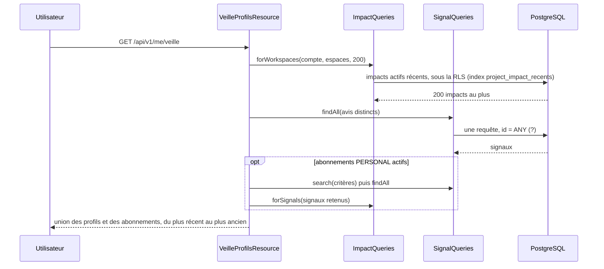

# Conception : optimiser la restitution de « Ma veille »

**Niveau de conception** : allégée — un seul flux de lecture, aucun nouveau composant, contrat ni cycle de vie ; la conception consigne le diagnostic mesuré, les choix et les alternatives écartées.

## Contexte technique

`GET /api/v1/me/veille` (`io.argos.api.veille.VeilleProfilsResource`) compose l'union des profils actifs de l'appelant et de ses abonnements `PERSONAL` (PRF-02) [EXISTANT]. Avec le profil `developpeur`, elle lit :

1. les préférences et le catalogue des profils ;
2. les avis de sécurité : `ImpactQueries.forWorkspaces` lit les 200 impacts actifs les plus récents des espaces de l'appelant (`ORDER BY updated_at DESC, id LIMIT 200`, sous la RLS du rôle `argos_app`), puis, pour chaque avis distinct, la gravité et la date de publication du signal ;
3. les fiches réglementaires validées, si un profil actif range des textes officiels (pas le profil `developpeur`) ;
4. les avis retenus par les abonnements `PERSONAL` (`SignauxAbonnements`, `SignalQueries.search`) et leurs impacts.

### Diagnostic mesuré

Mesures du 2026-11-20 sur une pile équivalente à celle de la campagne (PostgreSQL 18 jetable, `quarkus:dev` sur le port 8090, Keycloak des Dev Services, tâches externes et IA désactivées), base chargée par `e2e/performance/donnees-performance.sql` avec le jeu de référence K3 (20 projets × 100 composants, 1 000 avis, 20 000 impacts, un abonnement `PERSONAL` sur `pkg:maven/org.perf/lib-1`). La base de diagnostic écoute sur le port 55433 : le port 55432 de `e2e/compose.yaml` était occupé sur le poste par un autre processus. Appels mesurés par un script local équivalent à la campagne (200 appels, 4 clients, 20 appels d'échauffement) ; la réponse comporte 191 éléments.

| Mesure | p50 (ms) | p95 (ms) |
|---|---:|---:|
| Code de `lot19/base` (deux séries) | 498,3 ; 495,0 | 531,6 ; 536,4 |

Journal temporaire par phase (temps passé dans le serveur, 4 clients simultanés ; instrumentation retirée après la mesure) :

| Phase | Durée par requête |
|---|---:|
| Préférences et catalogue des profils | ≈ 6 ms |
| Avis de sécurité, dont : | ≈ 495 ms |
| — `ImpactQueries.forWorkspaces` (200 impacts) | ≈ 275 ms |
| — lecture des signaux un par un (`SignalQueries.find`, 184 avis distincts, une connexion et une transaction chacun) | ≈ 220 ms |
| Fiches réglementaires (profil `developpeur` : non lues) | < 0,1 ms |
| Abonnements `PERSONAL` (recherche, 10 signaux lus un par un, impacts) | ≈ 20 ms |

`EXPLAIN (ANALYZE, BUFFERS)` de la requête de `forWorkspaces`, exécutée sous `SET LOCAL ROLE argos_app` avec le compte de l'appelant :

- sans index adapté : 241 ms. Le plan lit les 20 000 impacts de l'espace (parcours par projet), évalue sur chaque ligne la politique `project_impact_lecture` (`argos_espace_lisible`, fonction `SECURITY DEFINER` que PostgreSQL n'intègre pas à la requête : environ 8 µs par ligne), lit les 2 000 composants en évaluant `argos_projet_lisible` (28 ms), puis trie pour ne garder que 200 lignes ;
- avec un index `(workspace_id, updated_at DESC, id)` : 219 ms, plan inchangé. Le filtre `workspace_id = ANY (?)` ne garantit pas l'ordre de l'index : le planificateur ne s'en sert pas pour ce tri, même tri désactivé ;
- avec un index `(updated_at DESC, id)` : 7 à 8 ms. Le parcours suit l'ordre de l'index et s'arrête aux 200 premières lignes visibles ; les jointures passent par les clés primaires (`Memoize`).

Hypothèses de départ, vérifiées :

| Hypothèse | Constat |
|---|---|
| (1) N+1 dans la composition des avis : une lecture de signal par avis | confirmée : ≈ 220 ms par requête |
| (2) tri `ORDER BY updated_at DESC` sous RLS sans index adapté | confirmée, précisée : le coût est l'évaluation de la RLS sur toutes les lignes avant le tri ; l'index utile ne commence pas par `workspace_id` |
| (3) autres coûts (fiches, catalogue, préférences, abonnements) | faibles : ≈ 26 ms au total, dont une petite lecture un par un dans `SignalQueries.search` |

## Exigences couvertes

| Exigence | Section(s) de conception | Diagramme(s) |
|---|---|---|
| PRF-07 | Diagnostic mesuré ; D1, D2 ; Performance et stratégie de mesure | DC-1 |
| PRF-02, PRF-05 (inchangées) | D1 (contenu inchangé) ; Sécurité et isolation | DC-1 |

## Objectifs et non-objectifs

**Objectifs :**
- p95 de `GET /api/v1/me/veille` sous 500 ms avec le jeu K3 ;
- contenu restitué identique, octet pour octet, pour le jeu K3 ;
- aucune requête de lecture de signal par avis restitué.

**Non-objectifs :**
- modifier les politiques RLS ou leurs fonctions ;
- optimiser les autres opérations de la campagne ;
- introduire un cache applicatif.

## Composants impactés, responsabilités et frontières

| Composant | Responsabilité dans ce changement | Ne doit pas | Statut |
|---|---|---|---|
| API & Security (`VeilleProfilsResource`, `SignauxAbonnements`) | lire les signaux de ses avis en une requête groupée | lire un signal par avis ; changer l'ordre, les champs ou le périmètre restitués | modifié |
| `signal` (`SignalQueries`) | fournir la lecture groupée `findAll`, de même vue que `find` ; l'utiliser dans `search` | exposer une donnée d'espace (les signaux restent globaux, ADR-0016) | modifié |
| `impact-engine` (`ImpactQueries.forWorkspaces`) | inchangé : même requête, servie par l'index V21 | — | existant |
| PostgreSQL | index `project_impact_recents` | changer une donnée, un droit ou une politique | modifié (V21) |

## Modèle de domaine et invariants

Non applicable — aucun modèle ne change. Invariant testable : INV-1, pour tout ensemble d'identifiants, `findAll(ids)` restitue, dans l'ordre des identifiants et sans doublon, exactement les vues que `find(id)` restitue pour chacun ; un identifiant inconnu est absent.

## Traitements et interactions

### DC-1 — Lecture de « Ma veille » avec le profil `developpeur`

- **Question** : quelles requêtes une restitution de « Ma veille » envoie-t-elle à la base ?
- **Type** : UML séquence
- **Portée** : cible (implémentée par ce changement)
- **Exigences** : PRF-07, PRF-02

Le nombre de requêtes ne dépend pas du nombre d'avis : la lecture des impacts suit l'ordre de l'index V21, et les signaux des avis sont lus en une requête.

## États et transitions

Non applicable — aucun cycle de vie.

## Contrats d'interface

Aucun changement : `GET /api/v1/me/veille` garde son schéma OpenAPI (`VeilleProfils`, `ElementVeilleProfils`) ; les outils MCP sont inchangés.

## Persistance et intégrité

Migration `V21__index_impacts_recents.sql` : `CREATE INDEX project_impact_recents ON project_impact (updated_at DESC, id)`. Aucune table, colonne, contrainte, donnée ni politique ne change. Coût en écriture : un index de plus à maintenir à chaque insertion ou mise à jour d'impact (corrélation, transitions), négligeable devant la lecture.

## Transactions, concurrence et idempotence

`findAll` est une lecture `@Transactional` sur une connexion, comme `find`. La restitution ouvre une seule connexion pour lire les signaux de tous ses avis, ce qui ménage aussi le pool de connexions sous concurrence.

## Sécurité et isolation

Inchangée : les impacts restent lus sous la RLS du rôle `argos_app` avec le compte de l'appelant (ADR-0016), filtrés en plus par `caller.memberOf` ; les signaux sont des données publiques lues hors RLS, comme avec `find`. L'index ne contourne aucune politique : la politique `project_impact_lecture` reste évaluée sur chaque ligne lue. PRF-07-S2 vérifie l'absence de projet d'un autre espace et d'impact écarté.

## Gestion des erreurs et reprise

Inchangée : une erreur SQL de `findAll` lève `IllegalStateException`, comme `find`.

## Observabilité

Aucune instrumentation ajoutée : le journal temporaire du diagnostic est retiré ; la preuve durable est la campagne de performance.

## Performance et stratégie de mesure

Cible : p95 < 500 ms (arc42 §8, §10.2 Q-05 ; PERF-01). Mesures du 2026-11-20 sur la pile de diagnostic, même protocole :

| Variante | p50 (ms) | p95 (ms) |
|---|---:|---:|
| `lot19/base` | 495,0 à 498,3 | 531,6 à 536,4 |
| lecture groupée seule | 300,8 | 332,8 |
| index seul | 254,2 | 288,1 (100 appels) |
| lecture groupée et index | 47,0 à 51,5 | 60,1 à 82,7 |

Aucune des deux corrections ne suffit seule à garantir une marge ; ensemble, elles placent l'opération près des autres consultations. La réponse JSON est identique, octet pour octet, dans les quatre variantes. Preuve de référence : la campagne `npm --prefix e2e run test:performance` (tâche 4.2).

## Compatibilité, migration et retour arrière

Déploiement : V21 s'applique au démarrage (Flyway) ; la création de l'index verrouille la table `project_impact` en écriture le temps de sa construction (quelques dizaines de millisecondes pour 20 000 lignes). Sur une base volumineuse, ce verrou bloque la corrélation et les transitions d'impacts pendant toute la construction : prévoir une fenêtre de déploiement, ou un `CREATE INDEX CONCURRENTLY` exécuté hors de la transaction Flyway. Retour arrière : `DROP INDEX project_impact_recents;` puis retrait de la ligne V21 de `flyway_schema_history` (ADR-0032 : migrations non réversibles automatiquement) ; le code de lecture groupée ne dépend pas de l'index et se retire indépendamment.

## Décisions, alternatives et compromis

### D1 — Lecture groupée des signaux

- **Statut** : [DÉCISION] (décision locale de ce changement)
- **Choix** : `SignalQueries.findAll(Collection<UUID>)`, une requête `WHERE id = ANY (?)` de même vue que `find`, utilisée par `VeilleProfilsResource`, `SignauxAbonnements` (critère `PROJECT`) et `SignalQueries.search`.
- **Justification** : ≈ 220 ms par requête mesurés pour 184 lectures unitaires ; une requête suffit.
- **Alternatives écartées** : joindre gravité et dates du signal dans la requête des impacts — ajoute des champs à `ImpactView`, sérialisée par d'autres opérations de l'API et du MCP (contrat modifié) ; cache des signaux — non nécessaire (D3).
- **Compromis** : une méthode de plus dans `SignalQueries`.
- **ADR** : non : décision locale.

### D2 — Index `project_impact_recents (updated_at DESC, id)` (V21)

- **Statut** : [DÉCISION] ; risque du cas à plusieurs espaces accepté par le porteur du projet (L1, 2026-11-20), puis levé par la mesure sur un jeu à plusieurs espaces (tâche 4.3, ci-dessous)
- **Choix** : index sur l'ordre exact de `forWorkspaces`, sans `workspace_id` en tête.
- **Justification** : `EXPLAIN ANALYZE` 241 ms → 7 ms ; le parcours s'arrête aux 200 premières lignes visibles.
- **Alternatives écartées** : index `(workspace_id, updated_at DESC, id)` — non retenu par le planificateur pour ce tri (219 ms mesurés) ; index `(workspace_id, state, updated_at)` de l'hypothèse (2) — non mesuré, écarté pour la même raison (le filtre `workspace_id = ANY (?)` ne garantit pas l'ordre d'un index dont `workspace_id` est en tête) ; index partiel `(updated_at DESC, id) WHERE state IN ('OUVERT', 'CONFIRME')`, aligné sur `EtatImpact.ACTIFS` — non mesuré ; à évaluer si la part d'impacts `ECARTE` ou `RESOLU` récents allonge le parcours ; réécrire `argos_espace_lisible` pour la rendre intégrable — modifie une règle de sécurité (ADR-0016), hors périmètre ; abaisser `LIMITE_IMPACTS` — change le contenu restitué.
- **Compromis** : le jeu K3 ne compte qu'un espace. Avec plusieurs espaces dont les impacts les plus récents ne sont pas ceux de l'appelant, le parcours de l'index lit les lignes de tous les espaces avant d'en trouver 200 visibles et évalue la politique RLS sur chacune. Ce cas est mesuré (tâche 4.3, ci-dessous) : l'index coûte moins que `lot19/base` pour tout jeu d'espaces issu de `memberWorkspaces`.
- **Mesure sur plusieurs espaces (tâche 4.3, 2026-11-20)** : PostgreSQL 18 jetable (port 55433), migrations V1 à V21 appliquées dans l'ordre, 5 espaces de 10 projets, 100 composants par projet et 1 000 signaux, soit 10 000 impacts par espace et 50 000 au total, 90 % ouverts et 10 % confirmés ; l'espace 1 porte les impacts les plus anciens (J-400), les espaces 2 à 5 les plus récents (dernières heures). Requête exacte de `forWorkspaces` (même `SELECT`, mêmes filtres, `LIMIT 200`), `EXPLAIN (ANALYZE, BUFFERS)` sous `SET LOCAL ROLE argos_app` avec le contexte RLS de `RlsSession.account`, quatre exécutions, cache chaud. « Sans index » reproduit `lot19/base` (index `project_impact_recents` supprimé, statistiques rafraîchies).

  | Appelant, et ensemble `workspace_id = ANY (?)` | Sans index (`lot19/base`) | Avec l'index V21 | `LATERAL` par espace (indicatif) |
  |---|---:|---:|---:|
  | Membre de l'espace 1 seul (le plus ancien) ; `{1}` | 255 à 267 ms | 22,4 à 23,8 ms | 7,6 à 7,9 ms |
  | Membre des espaces 1, 3 et 5 ; `{1, 3, 5}` | 375 à 443 ms | 7,2 à 7,8 ms | 18,4 à 19,5 ms |
  | Membre des cinq espaces ; `{1, 2, 3, 4, 5}` | 407 à 429 ms | 9,3 à 10,0 ms | 183 à 190 ms |

  Plan sans index : balayage par bitmap de tous les impacts des espaces demandés (jusqu'à 50 000 lignes), politique RLS évaluée sur chacune, jointure de toutes les lignes (composants lus un par un), tri par « top-N heapsort ». Plan avec l'index V21 : `Index Scan using project_impact_recents`, arrêt aux 200 lignes visibles ; cas le plus défavorable (appelant membre du seul espace le plus ancien) : 40 000 lignes des autres espaces lues et écartées par le filtre sur `workspace_id` (`Rows Removed by Filter: 40000`, 38 323 tampons), soit 22,9 ms contre 255 ms. Cas à un seul espace de K3 : 7 ms.

  Cas hors modèle d'accès : un ensemble d'espaces contenant des espaces que l'appelant ne lit pas (que `memberWorkspaces` ne produit pas) renverse le résultat : avec l'index, 335 ms pour `{1, 2, 3, 4, 5}` et un appelant membre du seul espace 1, contre 175 ms sans index, la politique RLS rejetant les 40 000 lignes visitées (la requête `LATERAL` n'y gagne rien, 331 à 334 ms, chaque espace non lisible étant lu en entier). Ce cas ne se produit que si `memberWorkspaces` cesse d'être l'ensemble des espaces dont l'appelant est membre ; il n'est pas couvert par un test.

  **Conclusion** : l'index V21 ne coûte pas plus que `lot19/base` dans les cas issus du modèle d'accès réel et le gain est maintenu à plusieurs espaces (×11 dans le cas le plus défavorable, ×40 à 55 sinon) ; PRF-07 est tenue hors du jeu K3 pour ce volume (50 000 impacts, 5 espaces). La variante par espace (`LATERAL`) n'est pas retenue (variante mesurée sans être intégrée) : plus lente dès que l'appelant lit plusieurs espaces (18,4 contre 7,2 ms ; 183 contre 9,3 ms), meilleure seulement pour un seul espace ancien (7,6 contre 22,9 ms), cas qui tient déjà dans la cible. Aucun changement de code ni de migration.
- **ADR** : non : décision locale.

### D3 — Aucun cache applicatif

- **Statut** : [DÉCISION]
- **Choix** : aucune mise en cache de la veille ni des signaux.
- **Justification** : D1 et D2 suffisent (p95 ≈ 60 à 83 ms) ; un cache introduirait une invalidation (signaux recollectés, impacts traités) sans nécessité démontrée.
- **ADR** : non.

### D4 — Exigence portée par `profils-veille`

- **Statut** : [DÉCISION] confirmée par le porteur du projet (L2, 2026-11-20)
- **Choix** : PRF-07 ajoutée à la capacité de référence `profils-veille`.
- **Justification** : `performance-api-mcp` n'existe que dans le changement actif `automatiser-chaine-veille` ; une exigence modifiée ou ajoutée à cette capacité lierait l'archivage de ce changement au sien. PRF-07 cite PERF-01 comme cible.
- **Alternatives écartées** : delta sur `performance-api-mcp` — dépendance d'archivage.
- **ADR** : non.

## Risques

- Plan instable si les statistiques de `project_impact` sont périmées → l'autovacuum de PostgreSQL les tient à jour ; la campagne relancée vérifie le plan effectif.
- Index sans `workspace_id` en tête (D2, Compromis) → mesuré sur 5 espaces et 50 000 impacts, l'espace de l'appelant portant les plus anciens (tâche 4.3) : 22,9 ms contre 255 ms sans index ; reste hors couverture un ensemble d'espaces contenant des espaces non lisibles de l'appelant (hors modèle d'accès), où le plan avec l'index coûte plus que `lot19/base` (335 contre 175 ms).
- Base de diagnostic sur un port autre que celui de la campagne → mêmes image, migrations et jeu de données ; la campagne de référence (tâche 4.2) est la preuve retenue.

## Écarts code / tests / specs / documentation

Aucun écart constaté entre le code, les tests et PRF-07 à l'issue de ce changement ; l'écart de la fiche `performance-api-mcp` (PERF-01-S1 non atteint) est traité par la tâche 4.2.

## Stratégie de vérification

| Exigence / scénario | Niveau de test | Moyen de preuve | État |
|---|---|---|---|
| PRF-07-S1 | mesure | campagne `npm --prefix e2e run test:performance` ; rapport `/docs/architecture/quality/mesure-performance-api-mcp.md` | tâche 4.2 |
| PRF-07-S1 (absence de N+1) | architecture | `architecture/LectureGroupeeSignauxTest` (ArchUnit) | écrit |
| PRF-07-S2 | intégration (jetons réels, RLS) | `api/veille/VeilleLectureGroupeeTest` | écrit |
| INV-1 | intégration | `VeilleLectureGroupeeTest#lectureGroupeeEgaleALaLectureUnitaire` | écrit |
| PRF-02, PRF-05 (non-régression) | intégration | `VeilleProfilsTest`, `VeilleAbonnementsPersonnelsTest`, `ProfilDemonstrationTest` | existants |

## Documentation durable impactée

- `/docs/specifications/profils-veille.md` (PRF-07), `/docs/specifications/performance-api-mcp.md` (écarts constatés), `/docs/specifications/README.md` (registre).
- `/docs/architecture/arc42/08-concepts-transverses.md` §8.7 (V21, prochaine migration V22, retour arrière) ; `/docs/architecture/diagrams/d-13-modele-physique.md` (liste des migrations).
- `/docs/architecture/quality/mesure-performance-api-mcp.md` et `e2e/resultats/performance/` (rapport régénéré).

## Questions ouvertes

Aucune.
