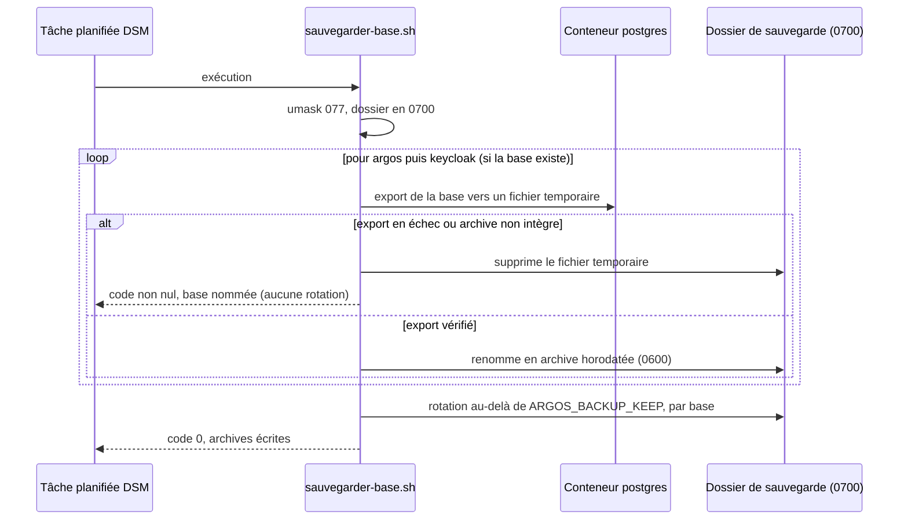
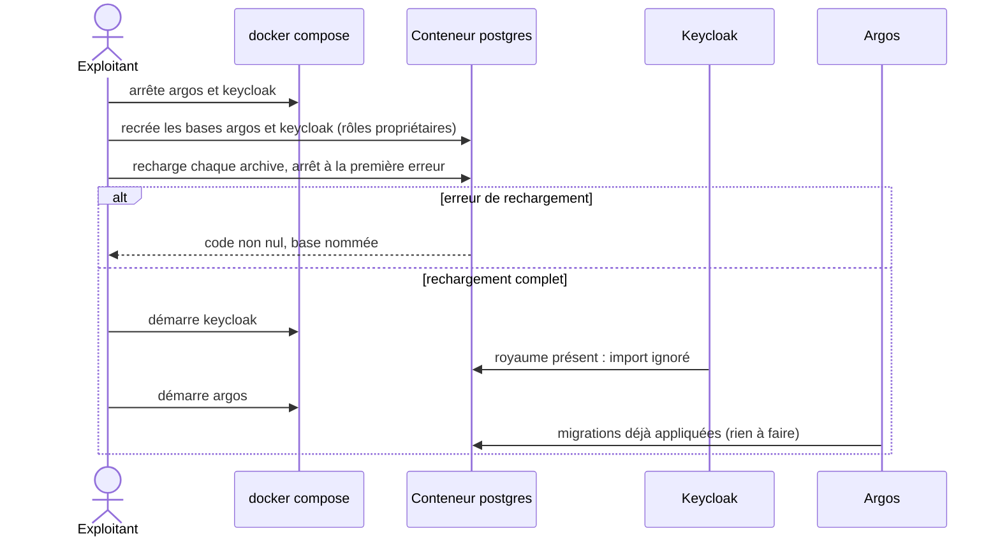

# Conception : fiabiliser la sauvegarde, la restauration et les rôles de base

<!-- Statuts : [EXIGENCE] [EXISTANT] [DÉCISION] [PROPOSITION] [QUESTION] (légende : /docs/specifications/README.md#statuts-des-informations). -->

**Niveau de conception** : complète — rôles et secrets PostgreSQL, procédure de migration d'installations existantes et séparation des comptes d'Argos qui touche ses migrations.

## Contexte technique

- [EXISTANT] `scripts/sauvegarder-base.sh` (POSIX `sh`, exécuté en root par la tâche planifiée DSM, `:4`) : `set -eu` (`:5`), un seul `pg_dump -d "$POSTGRES_DB" --no-owner` envoyé par un tube à `gzip` (`:22`), rotation par `ls -1t` (`:26-31`), message de succès inconditionnel (`:33`).
- [EXISTANT] `compose.yaml` : l'image `postgres:18` crée `POSTGRES_USER` (défaut `argos`) en superutilisateur (`:19-20`) ; le script d'initialisation `deploiement/postgres/creer-base-keycloak.sh` (`:4`, `CREATE DATABASE keycloak`) est monté dans `/docker-entrypoint-initdb.d` (`:28`) et ne s'exécute qu'à la création du volume ; Keycloak (`:50-51`) et Argos (`:91-92`) réutilisent ce compte et son repli `argos`.
- [EXISTANT] Argos applique ses migrations au démarrage (`application.properties:23`, ADR-0032) et pose la RLS par `SET LOCAL ROLE argos_app` (`V2__comptes_et_acces.sql:170-178`, `workspace/ContexteBase.java:78`, `impact/RlsSession.java:24`).
- [EXISTANT] Restauration documentée : `gunzip -c … | psql` sans `ON_ERROR_STOP`, base Argos seule (`/docs/deploiement/synology-et-pc.md:91-97`).
- Motivation : proposal.md.

## Exigences couvertes

| Exigence | Section(s) de conception | Diagramme(s) |
|---|---|---|
| EXP-01 | D1, « Gestion des erreurs et reprise » | DC-1 |
| EXP-02 | D1, D2 | DC-1 |
| EXP-03 | D1, « Sécurité et isolation » | DC-1 |
| EXP-04 | D3, « Compatibilité, migration et retour arrière » | DC-2 |
| EXP-05 | D4, « Persistance et intégrité », « Sécurité et isolation » | — |
| EXP-06 | D5 | — |

## Objectifs et non-objectifs

**Objectifs :**
- une sauvegarde dont l'échec se voit dans DSM, qui emporte les deux bases et ne s'expose pas ;
- une restauration écrite, rejouée et vérifiée sur une instance vierge ;
- des comptes PostgreSQL sans privilège superutilisateur pour les applications ;
- une migration documentée pour un volume existant.

**Non-objectifs :**
- chiffrement des sauvegardes (Q-2), copie hors site (DSM), RPO/RTO (arc42 §7.6) ;
- parité des variables et durcissement des conteneurs (`completer-configuration-conteneurs`).

## Composants impactés, responsabilités et frontières

| Composant | Responsabilité dans ce changement | Ne doit pas | Statut |
|---|---|---|---|
| PostgreSQL | héberge les bases `argos` et `keycloak`, porte les rôles distincts | accorder à une application le superutilisateur | modifié (initialisation, rôles) |
| Keycloak auto-hébergé | se connecte avec son propre compte | lire la base `argos` | modifié (configuration) |
| Quarkus Backend | se connecte avec un compte non superutilisateur | contourner la RLS | modifié (configuration seulement) |
| Script de sauvegarde (outillage) | exporte, vérifie, protège, fait tourner | supprimer une sauvegarde après un échec | modifié |
| Procédure de restauration (outillage) | recrée et recharge les bases | ignorer une erreur | nouveau |

## Modèle de domaine et invariants

Non applicable — aucun modèle métier ne change. Invariants d'exploitation testables :

- INV-1 : après toute exécution de la sauvegarde, le dossier ne contient que des archives dont l'intégrité a été vérifiée (EXP-01).
- INV-2 : le nombre de sauvegardes valides ne diminue jamais lors d'une exécution en échec (EXP-01-S3).
- INV-3 : aucun compte utilisé par une application n'a `rolsuper` ni `rolbypassrls` (EXP-05-S2).

## Traitements et interactions

### DC-1 — Une exécution de la sauvegarde

Question : dans quel ordre la sauvegarde exporte, vérifie et fait tourner, et que se passe-t-il en cas d'échec ? Type : UML séquence. État : cible ([PROPOSITION]). Exigences : EXP-01, EXP-02, EXP-03.

Le renommage n'a lieu qu'après la vérification de l'archive (`gzip -t` ou équivalent, plus une taille minimale si Q-3 la fixe) ; la rotation ne s'exécute qu'après l'export vérifié de toutes les bases. En cas d'échec de la seconde base, l'archive de la première, déjà vérifiée, peut rester : elle est valide (INV-1), mais la sauvegarde est signalée en échec (EXP-02-S1).

### DC-2 — Restauration sur une instance vierge

Question : comment restaurer les deux bases sans que Keycloak réimporte le royaume ni qu'une erreur passe inaperçue ? Type : UML séquence. État : cible ([PROPOSITION]). Exigences : EXP-04.

L'ordre « bases restaurées avant le premier démarrage de Keycloak » est la condition qui préserve les sujets OIDC (AUD-DEP-24) : `--import-realm` n'importe le royaume que s'il n'existe pas.

## États et transitions

Non applicable — aucun cycle de vie introduit.

## Contrats d'interface

Contrat d'exploitation seulement :

| Élément | Valeur |
|---|---|
| Variables nouvelles ou devenues obligatoires | `ARGOS_DB_PASSWORD` (obligatoire), mot de passe du compte Keycloak (nom proposé par l'audit : `ARGOS_KEYCLOAK_DB_PASSWORD`), mot de passe d'administration de l'instance si le superutilisateur est séparé du compte Argos (D4) |
| Codes de sortie | sauvegarde et restauration : 0 en succès, non nul sinon (lu par DSM) |
| Nommage des archives | une archive par base et par exécution, horodatage commun (format exact au choix de l'implémentation) |

## Persistance et intégrité

- Rôles cibles [DÉCISION — décision du porteur, 2026-11-24] : `keycloak` (LOGIN, NOSUPERUSER, propriétaire de la seule base `keycloak`, `REVOKE CONNECT … FROM PUBLIC`) ; propriétaire de la base `argos` (LOGIN, NOSUPERUSER), utilisé par Flyway seulement ; rôle de connexion applicatif d'Argos (LOGIN, NOSUPERUSER, NOBYPASSRLS, non propriétaire, membre de `argos_app`) ; superutilisateur d'administration distinct, utilisé par l'initialisation, la sauvegarde et la restauration depuis l'intérieur du conteneur.
- Export : `pg_dump` en format personnalisé (`-Fc`) restauré par `pg_restore --exit-on-error`, ou format texte avec `--clean --if-exists` rejoué par `psql -v ON_ERROR_STOP=1` (choix d'implémentation, D3).
- Flyway se connecte avec le compte propriétaire (identifiants de migration distincts de ceux de la datasource applicative, configuration Quarkus à vérifier) ; une migration accorde au rôle de connexion les droits nécessaires sur les objets existants et fixe les privilèges par défaut des objets futurs (tâche 3.3).

## Transactions, concurrence et idempotence

- La sauvegarde peut tourner pendant qu'Argos écrit : `pg_dump` lit un instantané cohérent par base ; les deux bases ne sont pas cohérentes entre elles à l'instant près (risque accepté : un compte créé entre les deux exports peut manquer d'un côté).
- La restauration est rejouable : elle recrée la base avant de la recharger (EXP-04-S3).

## Sécurité et isolation

- EXP-05 rétablit la frontière Argos / Keycloak (D-12) : une injection dans l'un ne donne plus la base de l'autre (clés de signature du royaume).
- EXP-03 : `umask 077` en tête du script, dossier `chmod 700`.
- EXP-06 : `${VAR:?message}` dans `compose.yaml`.
- Secrets : uniquement dans `.env` (non versionné) ; aucun mot de passe dans le script ni dans le dépôt.

## Gestion des erreurs et reprise

Toute commande de la sauvegarde qui échoue arrête le script sans rotation (DC-1). La restauration s'arrête à la première erreur (DC-2) ; l'exploitant corrige puis rejoue depuis le début (idempotence).

## Observabilité

Code de sortie et message sur la sortie d'erreur, repris par la notification de la tâche planifiée DSM. Pas d'autre instrumentation (changement `instrumenter-observabilite`).

## Performance et stratégie de mesure

Non applicable — aucune cible de performance ; la durée de la sauvegarde n'est pas mesurée.

## Compatibilité, migration et retour arrière

- **Volume neuf** : le script d'initialisation crée les rôles et les bases.
- **Volume existant** (installé avant ce changement) : les scripts d'initialisation ne sont pas rejoués. Le guide décrit une migration manuelle : sauvegarde (EXP-01), création du superutilisateur d'administration, création du rôle `keycloak` et transfert de propriété de sa base, retrait de `SUPERUSER` au compte Argos (qui devient le propriétaire des migrations), création du rôle de connexion applicatif, nouveaux mots de passe dans `.env`, redémarrage. Ordre exact et commandes : tâche 3.4, à valider sur une copie.
- **Retour arrière** : restaurer la sauvegarde prise avant migration sur un volume neuf avec l'ancien `compose.yaml` (procédure EXP-04).
- **BREAKING** : un `.env` sans mot de passe empêche le démarrage (EXP-06) — annoncé dans le guide.

## Décisions, alternatives et compromis

### D1 — Écrire dans un fichier temporaire, vérifier, puis renommer

- **Statut** : [PROPOSITION]
- **Choix** : export dans un fichier temporaire du même dossier, vérification d'intégrité, renommage atomique ; rotation après succès de toutes les bases ; reste en POSIX `sh` (pas de `pipefail` garanti), le code de `pg_dump` étant lu sans pipeline (export dans le conteneur vers la sortie standard puis compression locale séparée, ou `-Fc` déjà compressé).
- **Justification** : action d'AUD-QUA-02 ; le shell de DSM n'est pas garanti bash.
- **Alternatives écartées** : passer le script en bash avec `set -o pipefail` — dépend de bash sur le NAS ; `pg_dumpall` — une seule archive, restauration partielle d'une base moins simple.
- **Compromis** : un fichier temporaire de la taille de l'archive pendant l'export.
- **ADR** : non : décision locale.

### D2 — Base `keycloak` sauvegardée par `pg_dump` plutôt que par export du royaume

- **Statut** : [PROPOSITION]
- **Choix** : second export de base, même mécanisme que pour Argos.
- **Justification** : restaure tout l'état (sessions exclues sans conséquence), sujets OIDC compris ; même procédure pour les deux bases.
- **Alternatives écartées** : `kc.sh export` du royaume — demande d'arrêter Keycloak ou un second conteneur, et ne restaure pas les identifiants internes de la même façon que la base.
- **Compromis** : la sauvegarde dépend du schéma interne de Keycloak, restauré tel quel avec la même version d'image.
- **ADR** : non : décision locale.

### D3 — Restauration recréant la base, arrêt à la première erreur

- **Statut** : [PROPOSITION]
- **Choix** : `dropdb`/`createdb` (ou `--clean --if-exists`) puis rechargement avec arrêt sur erreur, services arrêtés ; script de restauration versionné, exercé par la tâche 5.1 sur une instance jetable.
- **Justification** : action d'AUD-DEP-03.
- **Alternatives écartées** : test Testcontainers dans la suite Maven — couvre le format mais pas Keycloak ni la procédure réelle ; peut compléter.
- **Compromis** : la restauration est destructive par nature : le guide demande une sauvegarde préalable.
- **ADR** : non : décision locale ; ADR-0026 point 6 reste la référence.

### D4 — Comptes PostgreSQL séparés

- **Statut** : [DÉCISION] — décision du porteur, 2026-11-24
- **Choix** : rôle dédié `keycloak` NOSUPERUSER, propriétaire de sa seule base, dans le PostgreSQL partagé ; dans Argos, propriétaire des migrations (Flyway) distinct d'un rôle de connexion applicatif NOSUPERUSER NOBYPASSRLS ; superutilisateur d'administration distinct (« Persistance et intégrité »).
- **Justification** : action d'AUD-SEC-30 ; un superutilisateur peut annuler `SET LOCAL ROLE argos_app` et contourner la RLS, un propriétaire peut modifier le schéma : le rôle de connexion n'est ni l'un ni l'autre.
- **Alternative écartée** : instance PostgreSQL dédiée à Keycloak — isolation plus forte, mais un conteneur, un volume et une sauvegarde de plus sur un NAS de 8 Go dont la mémoire est déjà comptée (AUD-PER-28).
- **Compromis** : l'instance reste un point de défaillance commun ; Flyway et l'application utilisent deux jeux d'identifiants.
- **ADR** : à rédiger au statut Proposé : « Comptes et isolation des bases de la plateforme » (tâche 3.1).

### D5 — Mots de passe obligatoires par interpolation stricte

- **Statut** : [PROPOSITION]
- **Choix** : `${ARGOS_DB_PASSWORD:?ARGOS_DB_PASSWORD obligatoire}` et équivalents pour chaque mot de passe de base.
- **Justification** : action d'AUD-SEC-06 ; Compose refuse alors `config` et `up`.
- **Alternatives écartées** : secrets Docker — non pris en charge de façon homogène par Container Manager (non vérifié), plus lourd.
- **Compromis** : `docker compose up -d postgres` en développement exige aussi le `.env`.
- **ADR** : non.

## Risques

- Migration d'un volume existant mal appliquée → Argos ou Keycloak ne démarre plus ; atténuation : sauvegarde préalable, procédure testée sur copie (tâche 3.4), retour arrière documenté.
- Incohérence entre les deux archives d'une même exécution (D3, « Transactions ») → compte créé entre les deux exports ; accepté, signalé dans le guide.
- R-10 « sauvegarde non restaurable » (`/docs/architecture/risks/register.md`) : traité par la tâche 5.1 ; la périodicité reste ouverte (Q-4).

## Écarts code / tests / specs / documentation

Repris de proposal.md (« Écarts constatés ») : ADR-0026 promet une restauration testée que rien ne prouve ; le guide `idp-local` ignore la sauvegarde ; la base `keycloak` existe sur tout volume neuf, profil actif ou non. Traitement : tâches 2.4, 4.1 et 5.1.

## Stratégie de vérification

| Exigence / scénario | Niveau de test | Moyen de preuve | État |
|---|---|---|---|
| EXP-01-S1, -S2, -S3 | script de test (shell) contre une pile jetable | script de test versionné sous `scripts/` (emplacement à fixer) : postgres arrêté, archive tronquée, 14 échecs | à écrire |
| EXP-02-S1, -S2 | idem | volume avec et sans base `keycloak` | à écrire |
| EXP-03-S1, -S2 | idem | `stat` des archives et du dossier sous `umask 000` | à écrire |
| EXP-04-S1 | exercice de restauration | instance vierge, connexion réelle d'un utilisateur, espace retrouvé | à exécuter |
| EXP-04-S2, -S3 | script de test | archive tronquée ; restauration sur base migrée | à écrire |
| EXP-05-S1 à -S5 | intégration (SQL contre la pile) | `psql` avec chaque compte ; requête sur `pg_roles` ; `RESET ROLE` puis lecture ; DDL refusé au rôle de connexion ; migration appliquée par le propriétaire | à écrire |
| EXP-06-S1, -S2 | commande | `docker compose config` sans `.env`, puis avec | à exécuter |

## Documentation durable impactée

- `/docs/specifications/exploitation-plateforme.md` (à créer) et `/docs/specifications/README.md` (fiche, inventaire des diagrammes métier).
- `/docs/deploiement/synology-et-pc.md` : sauvegarde des deux bases, restauration, migration d'un volume, mots de passe obligatoires.
- arc42 §7.3 (Synology), §7.7 (preuves : restauration testée), §7.8, §8.3 (comptes de base) ; D-11 et D-12 ; inventaire `/docs/architecture/diagrams/README.md`.
- `/docs/architecture/risks/register.md` (R-10) ; ADR candidat D4 et index arc42 §9.

## Questions ouvertes

Q-2 à Q-4 de la proposition peuvent attendre. Q-1 est tranchée (décision du porteur, 2026-11-24).
