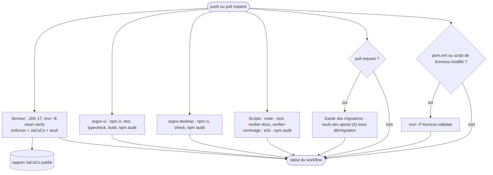

# Conception : mettre en place l'intégration continue

<!-- Statuts : [EXIGENCE] [EXISTANT] [DÉCISION] [PROPOSITION] [QUESTION] — légende : /docs/specifications/README.md#statuts-des-informations. -->

**Niveau de conception** : allégée — outillage de build sans comportement applicatif ; seules les sections utiles sont remplies.

## Contexte technique

- Serveur Quarkus 3.40 (`argos-server/pom.xml:21`), compilé en Java 17 (`:16`) ; tests d'intégration sur un PostgreSQL 18 jetable des Dev Services, donc Docker requis (`Dockerfile:17`, ADR-0032 « Contexte ») [EXISTANT].
- 654 tests serveur à `b142695`, environ 11 minutes (`/docs/audit/2026-11-21/sprints.md`, critère du sprint 1) [EXISTANT — mesure de l'audit].
- `argos-ui` expose `test`, `typecheck` (vue-tsc) et `build` ; `argos-desktop` expose `check` (= `check:syntax` + `test`) ; `e2e` n'expose aucun contrôle de types (`*/package.json`) [EXISTANT].
- Scripts Node : `verifier-docs.mjs`, `verifier-nommage.mjs` (+ tests), `verifier-licences-serveur.mjs` (sans test) ; campagne de performance testée par `e2e/performance/*.test.mjs` [EXISTANT — `scripts/`, `README.md` « Vérifications locales »].
- Profil Maven `licences` (`argos-server/pom.xml:221`) : génère la BOM CycloneDX (accès réseau requis) puis appelle le script de licences ; seul appel actuel : `Dockerfile:33-37` [EXISTANT].
- Aucun `.github/`, aucun robot de mises à jour [EXISTANT].

## Exigences couvertes

Non applicable — `skip_specs: true` ; les constats traités sont listés dans la matrice de `tasks.md` (AUD-TST-01, AUD-TST-19, AUD-TST-02, AUD-DEP-20, AUD-DEP-22, AUD-DEP-05).

## Objectifs et non-objectifs

**Objectifs :**
- Chaque push et chaque pull request exécutent, sans intervention, les contrôles aujourd'hui manuels du README.
- Le build échoue sur un JDK hors plage, sur une couverture sous le seuil, sur une migration fusionnée modifiée, sur une licence non admise.
- Les mises à jour de dépendances et d'images arrivent en pull request, vérifiées par le même workflow.

**Non-objectifs :**
- Campagne E2E Playwright et campagne de performance (pile complète) : hors workflow.
- Livraison continue (construction ou publication d'image, déploiement sur le NAS).

## Composants impactés, responsabilités et frontières

| Composant | Responsabilité dans ce changement | Ne doit pas | Statut |
|---|---|---|---|
| Quarkus Backend (build Maven) | enforcer, JaCoCo et seuil, profil `licences` lancé par le workflow | changer de comportement à l'exécution | modifié (outillage) |
| Vue.js 3 SPA (build npm) | `npm ci`, `test`, `typecheck`, `build`, `npm audit` | — | inchangé, exécuté |
| Client desktop Electron (build npm) | `npm ci`, `check`, `npm audit` | — | inchangé, exécuté |
| Workflow d'intégration continue | orchestrer les contrôles ; publier le rapport de couverture | détenir un secret applicatif ; écrire dans le dépôt | nouveau (outillage, hors arc42 §5) |
| Renovate | ouvrir les pull requests de dépendances et d'images | fusionner sans revue | nouveau (outillage) |

## Traitements et interactions

### DC-1 — Enchaînement des contrôles d'une pull request

Question : quels contrôles s'exécutent, dans quel ordre et à quelle condition ? Type : organigramme (flowchart). Vue cible (rien n'existe). Constats : AUD-TST-01, AUD-TST-19, AUD-TST-02, AUD-DEP-20, AUD-DEP-22.

Les tâches sont indépendantes et s'exécutent en parallèle ; le statut est en échec dès qu'une tâche échoue. La garde des migrations compare la branche à sa base (`git diff --name-status <base>...HEAD -- argos-server/src/main/resources/db/migration`) et échoue sur tout statut autre que `A` ; sur un push direct sur `main`, elle compare au commit précédent. Le changement `verifier-types-et-frontieres-modules` ajoutera deux étapes (types de `e2e/` et d'`argos-desktop`).

## Sécurité et isolation

- Jeton du workflow limité à `contents: read` ; aucune étape n'a besoin d'écrire dans le dépôt [PROPOSITION].
- Actions tierces épinglées par empreinte de commit et suivies par Renovate [PROPOSITION].
- Les pull requests venant d'un fork n'ont accès à aucun secret (comportement par défaut de GitHub Actions) ; le workflow n'en utilise aucun.

## Gestion des erreurs et reprise

- Un échec intermittent lié au temps réel (AUD-TST-06) peut apparaître sur un exécuteur partagé : il est traité par `injecter-horloge-et-executeurs` (sprint 4), pas par une relance automatique ici [PROPOSITION].
- `npm audit` : niveau bloquant à fixer (Q-7) pour éviter qu'une CVE sans correctif publié bloque toutes les pull requests.

## Performance et stratégie de mesure

Durée de référence du job serveur : environ 11 minutes (mesure de l'audit). Cache Maven et npm du workflow pour les dépendances ; aucune cible chiffrée de durée n'est fixée par les sources [QUESTION] Q-8 (non bloquante).

## Compatibilité, migration et retour arrière

Ajout de fichiers d'outillage et de plugins Maven ; retour arrière par suppression du workflow ou des plugins. Le seuil de couverture (85 % des lignes, 70 % des branches) ne baisse pas sans nouvelle décision du porteur.

## Décisions, alternatives et compromis

### D1 — Plateforme : GitHub Actions

- **Statut** : [DÉCISION] — décision du porteur, 2026-11-24
- **Choix** : GitHub Actions, exécuteur `ubuntu-latest` (Docker disponible pour les Dev Services), `actions/setup-java` en Temurin 17.
- **Justification** : dépôt hébergé sur GitHub ; protection de branche native par statut ; exécuteur gratuit pour un dépôt public ou dans le quota d'un dépôt privé.
- **Alternatives écartées** : GitLab CI (miroir à maintenir) ; Jenkins ou Woodpecker auto-hébergés sur le NAS (charge d'exploitation, Docker-in-Docker) ; hooks Git locaux seuls (contournables, non visibles en revue).
- **Compromis** : dépendance à un service externe pour la barrière ; les commandes restent celles du README, rejouables localement.
- **ADR** : candidat à un nouvel ADR, avec D5, si le porteur souhaite consigner ces décisions.

### D2 — JDK de test : setup-java 17 et maven-enforcer en profil d'intégration continue

- **Statut** : [PROPOSITION] (Q-6)
- **Choix** : le workflow installe Temurin 17 et lance toujours `clean verify` ; un profil Maven activé par une propriété du workflow porte `requireJavaVersion [17,18)` ; hors profil, l'enforcer exige seulement Java 17 ou plus.
- **Justification** : AUD-TST-19 demande des tests sur le JDK de l'image (JRE 17) sans imposer un JDK 17 au poste du mainteneur (JDK 24 aujourd'hui).
- **Alternatives écartées** : maven-toolchains (configuration locale par poste) ; plage stricte partout (casse le poste actuel).
- **Compromis** : un écart JDK local reste possible, mais la barrière s'exécute sur 17.
- **ADR** : non : décision locale.

### D3 — Couverture : jacoco-maven-plugin et quarkus-jacoco, seuil bloquant

- **Statut** : [DÉCISION] — décision du porteur, 2026-11-24 (seuil) ; outillage [PROPOSITION]
- **Choix** : `prepare-agent`, `report` et `check` en phase `verify` ; l'extension `quarkus-jacoco` (test) pour les classes chargées par `@QuarkusTest` ; règle `check` au niveau `BUNDLE` : `LINE` `COVEREDRATIO` minimum 0,85 et `BRANCH` `COVEREDRATIO` minimum 0,70, bloquante.
- **Justification** : action d'AUD-TST-02 ; un seuil non bloquant ne prévient aucun recul ; valeurs juste sous la mesure de référence (85,8 % des lignes, 72,0 % des branches).
- **Alternatives écartées** : seuils par paquet (api.security, mcp, workspace, alerting, cités par AUD-TST-02) — non retenus par le porteur ; rapport sans seuil ; service externe de couverture (compte et jeton).
- **Compromis** : quelques secondes de plus par build ; marge de 0,8 point (lignes) et 2 points (branches) sous la mesure : un module peu couvert (scm, 51,8 %) peut reculer sans faire échouer le seuil global.
- **ADR** : non : décision locale.

### D4 — Garde des migrations dans le workflow

- **Statut** : [PROPOSITION]
- **Choix** : étape shell du workflow sur `git diff --name-status` (récupération de l'historique de la base : `fetch-depth: 0`) ; échec sur `M`, `R`, `D`.
- **Justification** : applique ADR-0032 (Accepté) au moment de la revue, avant fusion.
- **Alternatives écartées** : test JUnit d'empreintes des fichiers (liste d'empreintes à mettre à jour à chaque ajout) ; hook local (contournable) ; `flyway validate` contre une base de `main` (plus lourd, à envisager plus tard, AUD-DEP-20 « Option »).
- **Compromis** : une correction légitime d'une migration non fusionnée reste possible (diff calculé contre la base de la branche).
- **ADR** : non : application d'ADR-0032.

### D5 — Robot de mises à jour

- **Statut** : [DÉCISION] — décision du porteur, 2026-11-24
- **Choix** : Renovate (application GitHub), `renovate.json` à la racine : gestionnaires `maven`, `npm` (`argos-ui`, `argos-desktop`, `e2e`), `dockerfile`, `docker-compose`, `github-actions`, et un gestionnaire `regex` pour les valeurs par défaut des variables d'image de `compose.yaml` (`${ARGOS_KEYCLOAK_VERSION:-26.7.4}`).
- **Justification** : AUD-DEP-05 ; le produit est lui-même un outil de veille de vulnérabilités ; Renovate suit les images de `compose.yaml`, variables comprises.
- **Alternatives écartées** : Dependabot (natif, mais ne lit pas les valeurs par défaut des variables d'image de `compose.yaml`) ; veille manuelle ; OWASP dependency-check en build (lent, base NVD locale).
- **Compromis** : application tierce à installer sur le dépôt par le porteur ; configuration plus riche à maintenir.
- **ADR** : candidat à un nouvel ADR, avec D1, si le porteur souhaite consigner ces décisions.

## Risques

- Durée du job serveur (environ 11 minutes) et quota d'exécution → cache des dépendances, déclenchement sur push de `main` et sur pull request seulement.
- Tests dépendants du temps réel instables sur un exécuteur partagé (AUD-TST-06) → suivis par `injecter-horloge-et-executeurs` ; tout échec intermittent est consigné, pas relancé en silence.
- `mvn -P licences validate` dépend du réseau (`makeBom` en ligne) → limité aux pull requests qui touchent `pom.xml` ou le script.

## Écarts code / tests / specs / documentation

Voir proposal.md, « Écarts constatés » (commentaire « ADR-0032, proposé » de `application.properties:22`).

## Stratégie de vérification

| Constat | Niveau de test | Moyen de preuve | État |
|---|---|---|---|
| AUD-TST-01 | exécution du workflow | pull request de test : workflow vert ; une pull request avec un test en échec rend le statut rouge | à exécuter |
| AUD-TST-19 | exécution du workflow | journal du job serveur : `java -version` 17, `clean verify` ; build avec JDK 21 et le profil : refus de l'enforcer | à exécuter |
| AUD-TST-02 | build Maven | rapport JaCoCo publié ; seuil 85 % / 70 % vert ; seuil relevé au-dessus de la mesure sur une branche de test : build en échec | à exécuter |
| AUD-DEP-20 | exécution du workflow | pull request de test modifiant `V1__socle.sql` : statut rouge ; ajout d'une migration : vert | à exécuter |
| AUD-DEP-22 | `node --test` | `scripts/verifier-licences-serveur.test.mjs` (quatre cas) ; job licences déclenché par une modification de `pom.xml` | à écrire |
| AUD-DEP-05 | observation | premières pull requests de Renovate (Electron, Playwright, image Keycloak de `compose.yaml`) | à observer |

## Documentation durable impactée

- `README.md` (« Vérifications locales » : renvoi au workflow) ; `argos-server/README.md` (licences : exécution en intégration continue).
- arc42 §8.11 (Tests : barrière d'intégration continue, couverture) et §8.7 (garde des migrations) ; §11.2 (dette).
- Inventaire `/docs/architecture/diagrams/README.md` si DC-1 est reporté dans arc42 §8.11.
- ADR (GitHub Actions et Renovate) et index arc42 §9, si le porteur souhaite consigner ces décisions.

## Questions ouvertes

- Q-7 : niveau de `npm audit` qui fait échouer le build (`high`, `critical`) — non bloquante, valeur à fixer à la tâche 2.3.
- Q-8 : durée maximale acceptable du workflow — non bloquante.
