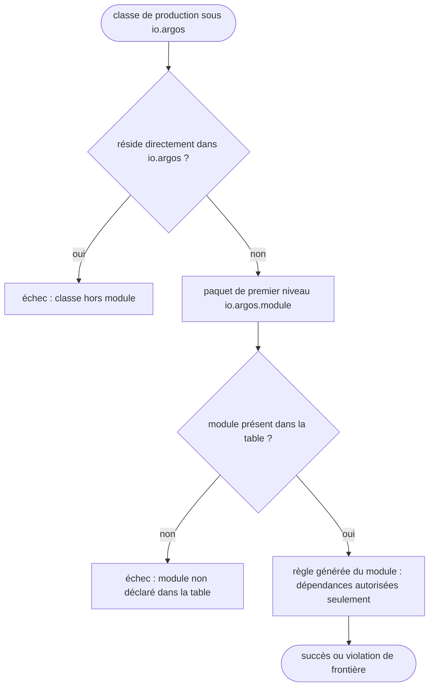

# Conception : vérifier les types et les frontières de modules

<!-- Statuts : [EXIGENCE] [EXISTANT] [DÉCISION] [PROPOSITION] [QUESTION] — légende : /docs/specifications/README.md#statuts-des-informations. -->

**Niveau de conception** : allégée — contrôles statiques et outillage de test, sans comportement applicatif ; seules les sections utiles sont remplies.

## Contexte technique

- `ModuleBoundariesTest` déclare `ALLOWED` (16 modules) et génère, pour chaque clé, une règle « aucune classe du module ne dépend d'un autre module de la table non autorisé » ; les modules interdits sont calculés à partir des seules clés et `allowEmptyShould(true)` accepte un module vide (`argos-server/src/test/java/io/argos/architecture/ModuleBoundariesTest.java:32-82`) [EXISTANT]. Un paquet `io.argos.nouveau` absent de la table n'est ni contraint ni protégé (AUD-ARC-07) ; à `b142695`, les 16 paquets de premier niveau figurent dans la table et aucune classe ne réside directement dans `io.argos` (audit).
- `e2e/` : modules ES, `@playwright/test` qui transpile sans vérifier les types ; aucun `tsconfig` ; `support/donnees.ts:9` importe `./docker.mjs` sans déclaration ; fonctions de rappel `webRequest` non typées (`support/electron.ts:299`, `:319`, `:326`) ; 16 conversions `as unknown as` dans `support/electron.ts` [EXISTANT].
- `argos-desktop/` : CommonJS (`"type": "commonjs"`), annotations JSDoc seules ; `check` = `check:syntax` (`scripts/verifier-syntaxe.mjs`) + `node --test` [EXISTANT].
- `e2e/performance/mesurer-p95.mjs:117-120` : `spawn(mvn, [...], { shell: platform() === 'win32' })` avec `mvn = 'mvn.cmd'` sous Windows ; `cheminGit()` (`:81-83`) montre le motif cible : variable `ARGOS_E2E_GIT` puis emplacements fixes [EXISTANT].

## Exigences couvertes

Non applicable — `skip_specs: true` ; constats traités : AUD-ARC-07, AUD-QUA-19, AUD-TST-26, AUD-SEC-24 (matrice de `tasks.md`).

## Objectifs et non-objectifs

**Objectifs :**
- Un module serveur ajouté sans entrée dans la table fait échouer le test d'architecture.
- La table n'autorise que les dépendances utilisées (ou motivées).
- Une erreur de type dans `e2e/` ou `argos-desktop` échoue avant l'exécution, localement et en intégration continue.
- La campagne de performance n'exécute aucun programme trouvé par le `PATH` et ne passe par aucun interpréteur de commandes.

**Non-objectifs :**
- Migration d'`argos-desktop` vers TypeScript (les sources restent en JavaScript annoté).
- Déplacement de classes de production entre modules.

## Composants impactés, responsabilités et frontières

| Composant | Responsabilité dans ce changement | Ne doit pas | Statut |
|---|---|---|---|
| Quarkus Backend (tests d'architecture) | table resserrée ; règle d'appartenance à un module déclaré | modifier une classe de production | modifié (test) |
| Client desktop Electron | annotations JSDoc corrigées ; `typecheck` dans `check` | changer de comportement (IPC, CSP, OIDC) | modifié (annotations) |
| Campagne E2E et de performance (`e2e/`) | `typecheck` ; Maven par chemin absolu, sans interpréteur | dépendre du `PATH` | modifié (outillage) |

## Traitements et interactions

### DC-1 — Règle d'appartenance à un module déclaré

Question : comment le test traite-t-il une classe de `io.argos` ? Type : organigramme (flowchart). Vue cible. Constat : AUD-ARC-07.

La nouvelle règle (`classes().should().resideInAnyPackage(<modules de la table>)`, sans `allowEmptyShould`) précède les règles générées existantes, inchangées. La classe `io.argos` éventuelle de démarrage, s'il en existe une un jour, serait ajoutée explicitement à la règle avec sa justification. Un test d'exemple (classe factice importée à part, comme `architecture/exemples/` pour `LectureGroupeeSignauxTest`) prouve que la règle détecte un module non déclaré.

## Sécurité et isolation

AUD-SEC-24 : Maven est résolu par `process.env.ARGOS_E2E_MVN` (nom à confirmer, Q-3) puis par des emplacements fixes ; sous Windows, `mvn.cmd` est un script batch qu'on ne peut lancer sans interpréteur : la campagne lance `cmd.exe` par son chemin absolu (`C:\Windows\System32\cmd.exe`) avec `/d /s /c` et des arguments échappés, ou démarre directement `java` sur le lanceur Quarkus construit (D3). Le serveur web de `playwright.config.ts:89` suit la même résolution (commande construite à partir du chemin résolu).

## Compatibilité, migration et retour arrière

Aucun effet en production. Le retrait d'une autorisation de la table se défait par une ligne ; une dépendance réellement nécessaire plus tard rouvre l'autorisation dans la pull request qui l'introduit (revue explicite).

## Décisions, alternatives et compromis

### D1 — Règle « module déclaré » plutôt que liste blanche implicite

- **Statut** : [PROPOSITION]
- **Choix** : règle ArchUnit dérivée de `ALLOWED.keySet()` ; retrait des 7 autorisations inutilisées (Q-1).
- **Justification** : action d'AUD-ARC-07 ; la table devient la liste fermée des modules.
- **Alternatives écartées** : modules Maven séparés (refonte du build, hors sprint 1) ; jMolecules ou Spring Modulith (dépendance nouvelle sans gain sur Quarkus).
- **Compromis** : ajouter un module demande de toucher la table, ce qui est l'effet recherché.
- **ADR** : non : application d'ADR-0001 (Proposé).

### D2 — Vérification de types par `tsc --noEmit`

- **Statut** : [PROPOSITION] ; strictness du desktop [QUESTION] Q-2
- **Choix** : `e2e/tsconfig.json` (`strict`, `noEmit`, `moduleResolution` adaptée à Playwright) et déclaration `support/docker.d.mts` ; `argos-desktop/tsconfig.json` (`allowJs`, `checkJs`, `noEmit`, `module nodenext`, types `node`), strict progressif ; `typescript` en dépendance de développement des deux projets (licence Apache-2.0).
- **Justification** : actions d'AUD-QUA-19 et d'AUD-TST-26 ; même compilateur que vue-tsc côté IHM.
- **Alternatives écartées** : ESLint avec règles typées seul (ne remplace pas le contrôle de types) ; réécriture du desktop en TypeScript (coût, chaîne de build Electron à revoir).
- **Compromis** : une dépendance de développement de plus par projet, suivie par le robot de mises à jour.
- **ADR** : non : décision locale.

### D3 — Lancement de Maven sans interpréteur trouvé par le PATH

- **Statut** : [PROPOSITION] ; nom de variable [QUESTION] Q-3
- **Choix** : `cheminMaven()` sur le modèle de `cheminGit()` ; sous Windows, `cmd.exe` par chemin absolu avec arguments échappés ; ailleurs, `spawn` direct sans `shell`.
- **Justification** : règle déjà écrite dans la campagne (`mesurer-p95.mjs:77-78`) ; AUD-SEC-24.
- **Alternatives écartées** : laisser `shell: true` en citant le chemin (échappement `cmd.exe` fragile) ; lancer `java -jar target/quarkus-app/quarkus-run.jar` (demande un build préalable, mais reste une option si l'échappement s'avère fragile).
- **Compromis** : liste d'emplacements fixes à maintenir.
- **ADR** : non : décision locale.

## Risques

- Les corrections d'annotations du desktop pourraient masquer un vrai défaut de type → chaque erreur est corrigée à la source (signature réelle) et vérifiée par `npm run check`, jamais par `// @ts-ignore` sans justification.
- Retrait d'une autorisation encore utilisée par un code non détecté par l'analyse de l'audit → le test d'architecture échoue immédiatement : l'autorisation est rétablie avec sa motivation.

## Écarts code / tests / specs / documentation

Voir proposal.md, « Écarts constatés ».

## Stratégie de vérification

| Constat | Niveau de test | Moyen de preuve | État |
|---|---|---|---|
| AUD-ARC-07 | architecture (ArchUnit) | `ModuleBoundariesTest` vert après retrait ; test d'exemple : module factice non déclaré détecté | à écrire |
| AUD-QUA-19 | vérification de types | `npm --prefix e2e run typecheck` : 0 erreur ; erreur introduite → échec | à écrire |
| AUD-TST-26 | vérification de types | `npm --prefix argos-desktop run check` inclut `typecheck` : 0 erreur | à écrire |
| AUD-SEC-24 | test Node + revue | `e2e/performance/*.test.mjs` : résolution de Maven sans `shell` ; `grep -n "shell:" e2e/performance/mesurer-p95.mjs` vide | à écrire |

## Documentation durable impactée

- arc42 §5 (paragraphe du socle `argos-server/` : table resserrée, règle du module déclaré), §8.11 (tests d'architecture et vérifications de types), §8.16 (JSDoc vérifiées, TypeScript strict dans `e2e/`).
- `e2e/README.md` (`typecheck`, variable d'emplacement de Maven), `argos-desktop/README.md` (`check`), `README.md` (« Vérifications locales »).
- Inventaire des diagrammes : non concerné (DC-1 reste dans ce changement).

## Questions ouvertes

Voir proposal.md (Q-1 à Q-3, non bloquantes).
