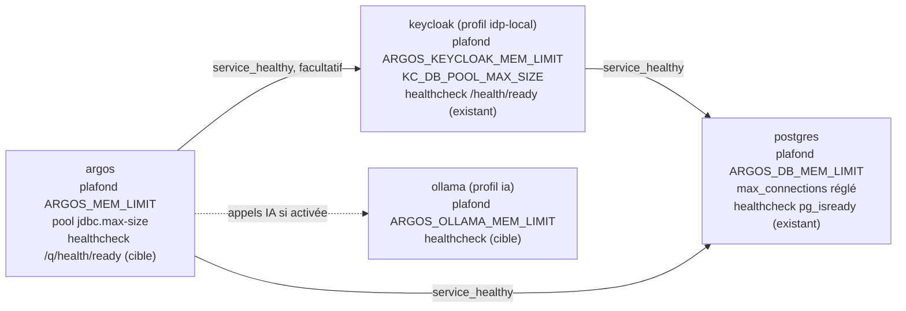

# Conception : compléter la configuration des conteneurs

<!-- Statuts : [EXIGENCE] [EXISTANT] [DÉCISION] [PROPOSITION] [QUESTION] (légende : /docs/specifications/README.md#statuts-des-informations). -->

**Niveau de conception** : allégée — configuration d'exploitation (Compose, image, propriétés Quarkus) sans modèle de données ni contrat d'API ; seules les sections utiles sont remplies.

## Contexte technique

- [EXISTANT] Service `argos` : 10 variables transmises (`compose.yaml:89-102`), pas de `healthcheck`, `mem_limit` 1g (`:107`) ; service `ollama` idem (`:113-124`) ; aucune clé `logging:`.
- [EXISTANT] Service `keycloak` (profil `idp-local`) : `KC_BOOTSTRAP_ADMIN_PASSWORD`, `ARGOS_ADMIN_EMAIL`, `ARGOS_ADMIN_MOT_DE_PASSE_INITIAL` à `:-` vide (`compose.yaml:58-60`), contrôle de santé présent (`:66-77`), `mem_limit` 1g (`:65`).
- [EXISTANT] Image : `eclipse-temurin:17-jre`, `COPY --from=server --chown=1001:0 … quarkus-app/`, `USER 1001`, `JAVA_OPTS="-XX:MaxRAMPercentage=75 …"` (`Dockerfile:45-54`) ; IHM servie par Quarkus depuis `META-INF/resources` (`Dockerfile:36`).
- [EXISTANT] `/q/health` et `/q/health/*` publics (`application.properties:294`) ; seule l'extension `quarkus-smallrye-health` est présente (`argos-server/pom.xml:61`).
- [EXISTANT] Les mots de passe de base deviennent obligatoires dans `fiabiliser-sauvegarde-et-roles-base` (EXP-06) : ce changement part de cet état.

## Exigences couvertes

| Exigence | Section(s) de conception | Diagramme(s) |
|---|---|---|
| EXP-07 | D1 | — |
| EXP-08 | D2 | — |
| EXP-09 | D3, DC-1 | DC-1 |
| EXP-10 | D4 | — |
| EXP-11 | D5, DC-1 | DC-1 |
| EXP-12 | D6 | — |

## Objectifs et non-objectifs

**Objectifs :** un `compose.yaml` qui transmet ce que le serveur lit, refuse une configuration `idp-local` incomplète, expose la santé de chaque service, tient dans la mémoire du NAS et durcit le conteneur applicatif.

**Non-objectifs :** contrôles de santé métier et métriques (`instrumenter-observabilite`) ; rebinding DNS (`epingler-adresse-veille-web`) ; comptes de base (`fiabiliser-sauvegarde-et-roles-base`).

## Composants impactés, responsabilités et frontières

| Composant | Responsabilité dans ce changement | Ne doit pas | Statut |
|---|---|---|---|
| Quarkus Backend | lit sa configuration de l'environnement ; s'arrête sur `OutOfMemoryError` ; compresse ; pool borné | écrire hors de `/tmp` | modifié (configuration, image) |
| PostgreSQL | `max_connections`, `shared_buffers`, `work_mem` réglés pour sa limite | dépasser son plafond mémoire | modifié (commande) |
| Keycloak auto-hébergé | exige ses variables ; pool borné | importer un royaume sans administrateur | modifié (configuration) |
| Ollama | contrôle de santé, journaux bornés | — | modifié (configuration) |

### DC-1 — Services, plafonds et dépendances de santé

Question : quels services démarrent selon les profils, avec quels plafonds et quelles dépendances de santé ? Type : organigramme (vue de déploiement simplifiée). État : cible ([PROPOSITION]) ; valeurs des plafonds à fixer (Q-1, Q-2). Exigences : EXP-09, EXP-11.

Contrainte EXP-11 : somme des plafonds ≤ 8 Go − 3 Go avec les deux profils ; `jdbc.max-size` + `KC_DB_POOL_MAX_SIZE` < `max_connections` (en gardant les connexions d'administration et de sauvegarde).

## Modèle de domaine et invariants

Non applicable — aucun modèle métier. Invariant testable : INV-1, l'ensemble des `${ARGOS_*}` lus en production est inclus dans le bloc `environment` du service `argos` et dans `.env.example` (EXP-07).

## Traitements et interactions

Non applicable — aucune interaction nouvelle entre composants ; les contrôles de santé sont exécutés par le moteur de conteneurs (DC-1).

## États et transitions

Non applicable — les états `starting` / `healthy` / `unhealthy` sont ceux du moteur de conteneurs.

## Contrats d'interface

- Compression : `Content-Encoding: gzip` si `Accept-Encoding` le permet (EXP-10-S2) ; contenu inchangé.
- Contrat d'exploitation : variables ajoutées à `.env.example` (liste produite par le test de parité) ; variables `idp-local` obligatoires (EXP-08).

## Persistance et intégrité

Non applicable — aucune donnée.

## Transactions, concurrence et idempotence

Non applicable.

## Sécurité et isolation

- EXP-12 : `quarkus-app` copié sans `--chown` (root, lecture seule pour 1001), comme `/opt/argos/licenses` (`Dockerfile:43-50`) ; service `argos` en `read_only: true`, `tmpfs: /tmp`, `cap_drop: [ALL]`, `security_opt: [no-new-privileges:true]`. À vérifier : besoins d'écriture de Quarkus et de la JVM (fichiers temporaires, vidage du tas éventuel) — tous dirigés vers `/tmp`.
- Les jetons de forge et le mot de passe SMTP sont transmis par `.env` ; `.env.example` ne contient que des valeurs vides ou d'exemple.

## Gestion des erreurs et reprise

`-XX:+ExitOnOutOfMemoryError` et `restart: unless-stopped` (existant) : la saturation mémoire devient un redémarrage visible au lieu d'un processus dégradé ou d'un arrêt sans message (EXP-10-S1).

## Observabilité

Contrôles de santé et rotation des journaux (EXP-09) ; aucun journal ni métrique nouveau (changement `instrumenter-observabilite`).

## Performance et stratégie de mesure

- Cible issue des sources : au moins 3 Go laissés au DSM avec `ia` et `idp-local` (critère de sortie du sprint 3) ; 8 Go livrés (ADR-0026).
- Valeurs de réglage (tas, pools, `shared_buffers`, `work_mem`) : [QUESTION] Q-2 ; l'audit suggère `MaxRAMPercentage` 60 à 65, pools à 10, `shared_buffers` ~128 Mo. Mesure : `docker stats` sur le NAS après démarrage des deux profils ; `SELECT count(*) FROM pg_stat_activity` sous charge OIDC.
- Compression : taille transférée du bundle principal (l'audit mesure 201,74 kB brut contre 68,43 kB gzippé, AUD-PER-17).

## Compatibilité, migration et retour arrière

- **BREAKING** : profil `idp-local` sans ses variables → refus de démarrer (annoncé dans le guide).
- Un `.env` existant reste valable pour les variables déjà transmises ; les nouvelles variables ont les mêmes défauts que `application.properties`.
- Retour arrière : revenir à la version précédente de `compose.yaml` et de l'image.

## Décisions, alternatives et compromis

### D1 — Transmission explicite des variables, contrôlée par un test de parité

- **Statut** : [PROPOSITION]
- **Choix** : lister chaque variable dans le bloc `environment` du service `argos` et dans `.env.example` ; test (script Node ou test Java) qui extrait les `${ARGOS_*}` de `application.properties` (hors `%dev`/`%test`) et de `compose.yaml` et les compare.
- **Justification** : action d'AUD-DEP-01 et AUD-DEP-27 ; la liste reste lisible et revue.
- **Alternatives écartées** : `env_file: .env` — transmet tout `.env` au conteneur (y compris des variables destinées à d'autres services) et masque les oublis du modèle.
- **Compromis** : bloc `environment` long.
- **ADR** : non : décision locale.

### D2 — Garde dans la commande d'entrée du service `keycloak`

- **Statut** : [DÉCISION — 2026-11-24, implémentation de la tâche 1.3]
- **Choix** : la commande d'entrée du service `keycloak` (`entrypoint` bash dans `compose.yaml`) vérifie les trois variables, nomme chacune de celles qui manquent et s'arrête avant `kc.sh start --import-realm`.
- **Justification** : action d'AUD-DEP-27 ; Docker Compose 5.7.0 interpole aussi les services des profils inactifs (essai du 2026-11-24 : `${VAR:?message}` dans un service de profil fait échouer `docker compose config` sans ce profil), ce qui contredirait EXP-08-S2.
- **Alternatives écartées** : `${VAR:?message}` dans le service — refuse aussi le démarrage sans le profil ; contrôle dans un conteneur d'initialisation — plus lourd.
- **Compromis** : l'erreur apparaît au démarrage du conteneur (journal de `keycloak`, redémarrages en boucle), pas à la validation de `compose.yaml`.
- **ADR** : non.

### D3 — Contrôle de santé sans outil ajouté à l'image

- **Statut** : [PROPOSITION]
- **Choix** : contrôle sur `/q/health/ready`, par la même technique que Keycloak (`/dev/tcp` sous bash) si l'image `eclipse-temurin` la permet, sinon `HEALTHCHECK` du `Dockerfile` ; rotation `json-file` `max-size: 10m`, `max-file: 3` (action d'AUD-DEP-08) sur chaque service ; contrôle d'Ollama par sa commande ou son API locale.
- **Alternatives écartées** : ajouter `curl` à l'image — surface et taille accrues.
- **ADR** : non.

### D4 — JVM arrêtée sur saturation, compression activée

- **Statut** : [PROPOSITION]
- **Choix** : `-XX:+ExitOnOutOfMemoryError`, fraction de tas réduite (Q-2) ; `quarkus.http.enable-compression=true`.
- **Alternatives écartées** : laisser la compression au reverse proxy de DSM — absent sur le PC et en accès direct.
- **ADR** : non.

### D5 — Dimensionnement NAS documenté et pools explicites

- **Statut** : [PROPOSITION]
- **Choix** : `quarkus.datasource.jdbc.max-size` et `acquisition-timeout` explicites ; `KC_DB_POOL_MAX_SIZE` ; `command:` de `postgres` avec `max_connections`, `shared_buffers`, `work_mem` ; tableau de dimensionnement dans le guide ; défaut d'Ollama selon Q-1.
- **Alternatives écartées** : instance PostgreSQL par application — dépend de Q-1 de `fiabiliser-sauvegarde-et-roles-base`.
- **ADR** : non, sauf si le porteur fait du profil NAS par défaut une décision structurante (Q-1).

### D6 — Durcissement du seul conteneur applicatif

- **Statut** : [PROPOSITION]
- **Choix** : voir « Sécurité et isolation » ; extension aux autres services selon Q-3.
- **Alternatives écartées** : image distroless — changement d'image de base plus large que le constat.
- **ADR** : non.

## Risques

- `read_only` révèle une écriture oubliée hors de `/tmp` → démarrage en échec ; atténuation : démarrage vérifié dans la tâche 4.1, `tmpfs` supplémentaire si nécessaire.
- Pools trop petits → attente de connexion sous charge ; atténuation : `acquisition-timeout` explicite, mesure (Q-2).

## Écarts code / tests / specs / documentation

Repris de proposal.md : guide en retard sur `compose.yaml` (AUD-DOC-03, hors périmètre) ; quotas IA documentés non transmis (traités par EXP-07).

## Stratégie de vérification

| Exigence / scénario | Niveau de test | Moyen de preuve | État |
|---|---|---|---|
| EXP-07-S2, -S3 | test automatisé (parité) | test de parité exécuté par la construction | à écrire |
| EXP-07-S1 | intégration | pile locale avec serveur SMTP de test, lien de l'e-mail reçu | à exécuter |
| EXP-08-S1, -S2 | commande | `docker compose --profile idp-local config` sans les variables, puis sans profil | à exécuter |
| EXP-09-S1 à -S3 | commande | `docker inspect --format '{{.State.Health.Status}}'`, base arrêtée ; `docker inspect` de la configuration de journalisation | à exécuter |
| EXP-10-S1 | intégration | conteneur avec plafond réduit et charge provoquant l'épuisement, ou revue de `JAVA_OPTS` | à exécuter |
| EXP-10-S2, -S3 | intégration | requête avec et sans `Accept-Encoding: gzip` | à écrire |
| EXP-11-S1, -S2 | revue chiffrée | tableau du guide ; `SHOW max_connections` ; `docker stats` sur le NAS | à exécuter |
| EXP-12-S1 à -S3 | commande | `docker compose exec argos` : écriture dans `/opt/argos`, dans `/tmp`, ailleurs ; `docker inspect` (`CapDrop`, `SecurityOpt`, `ReadonlyRootfs`) | à exécuter |

## Documentation durable impactée

- `/docs/specifications/exploitation-plateforme.md` (EXP-07 à EXP-12, questions).
- `/docs/deploiement/synology-et-pc.md` (variables, profil `idp-local`, dimensionnement NAS, contrôles de santé).
- arc42 §7.3 et §8.12 ; D-11 ; inventaire `/docs/architecture/diagrams/README.md`.

## Questions ouvertes

Q-1 à Q-4 de la proposition : aucune ne change les specs ni le découpage en tâches.
