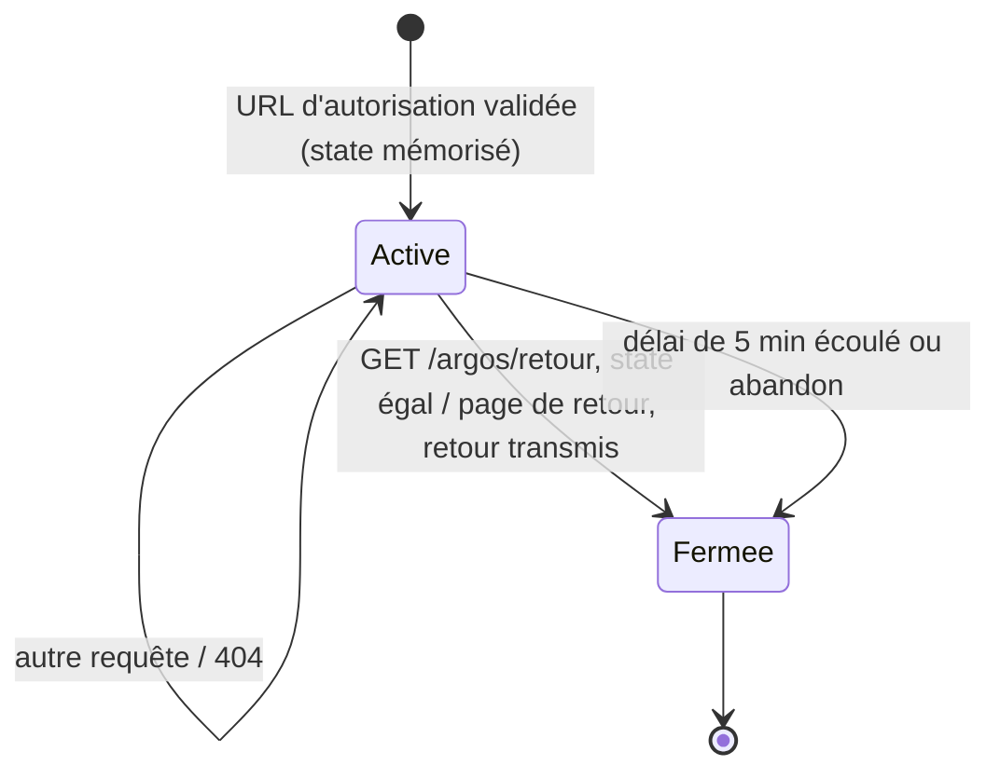

# Conception : durcir les autorisations et limiter les débits

<!-- Statuts : [EXIGENCE] [EXISTANT] [DÉCISION] [PROPOSITION] [QUESTION] (légende : /docs/specifications/README.md#statuts-des-informations). -->

**Niveau de conception** : complète — sécurité transverse (`API & Security`, `reg-intel`, `workspace`, `alerting`, client desktop), migration de données (effacement des adresses enregistrées) et test d'architecture nouveau (matrice des rôles).

## Contexte technique

- **Demande d'évolution** [EXISTANT] : `ReglementaireResource.java:315-320` (authentification, limite de 10/min, puis service) ; `ExpertiseFiches.java:178` contrôle préalable qui ne lève rien pour une fiche invisible, inexistante ou un non-expert ; `:181-182` appel à la forge (`DemandesEvolution.etat`) puis `DEMANDE_INTROUVABLE` sur un 404 ; `:188` puis `:218-223` (`travailler`) contrôle de visibilité (`NON_MEMBRE`) et d'expertise (`ROLE_INSUFFISANT`) dans la transaction ; `DemandesEvolution.java:122` envoie le jeton du serveur.
- **Adresse du compte** [EXISTANT] : `ComptesService.java:54` calcule l'adresse vérifiée normalisée, `:74` enregistre pourtant l'adresse brute ; un compte existant est renvoyé sans mise à jour (`:56-58`). `Destinataires.java:39`, `:51` lisent `compte.email` ; `RappelsReglementaires.java:131-132` bascule sur le canal poste sans adresse.
- **Limiteur** [EXISTANT] : `LimiteurDebit` (fenêtre glissante d'une minute, par compte, horloge injectable), réponse 429 avec `Retry-After` et refus journalisé `LIMITE_DEBIT` (`GestionErreurs.java:27`, `:78`) ; utilisé par cinq ressources et le MCP, valeurs configurables (`argos.<domaine>.debit.requetes-par-minute`).
- **Écoute de bouclage** [EXISTANT] : `connexion.js:101-104` (`retourAttendu` : méthode, chemin, écoute active), `:119-130` (page de retour puis `fermer(url.search…)`) ; le state est connu du processus principal lors de la validation de l'URL d'autorisation (`urlAutorisationSure`, `:67-76`).
- **Autorisations** [EXISTANT] : contrôle impératif par `access.*()` dans chaque ressource ; 401 global par `quarkus.http.auth.permission` (`application.properties:294-297`) ; aucun test ne couvre `POST /api/v1/ops/sources/{id}/synchronizations` (AUD-TST-05).

## Exigences couvertes

| Exigence | Section(s) de conception | Diagramme(s) |
|---|---|---|
| REG-09 | D1, « Traitements et interactions » | DC-1 |
| ALR-08 | D2, « Persistance et intégrité » | — |
| RCH-06 | D3 | — |
| PRF-08 | D3 | — |
| ACC-14 | D4 | DC-2 |
| (AUD-TST-05, sans exigence) | D5 | — |

## Objectifs et non-objectifs

**Objectifs :** supprimer l'oracle sur les forges ; aucun e-mail vers une adresse non vérifiée ; borner le coût des lectures les plus chères par compte ; connexion desktop non interruptible ; détecter automatiquement tout oubli de contrôle de rôle.

**Non-objectifs :** contrôles déclaratifs par annotations ; limite globale au reverse proxy ; limites des autres opérations ; MCP.

## Composants impactés, responsabilités et frontières

| Composant | Responsabilité dans ce changement | Ne doit pas | Statut |
|---|---|---|---|
| API & Security | limiteurs de la recherche et de « Ma veille » ; codes 429 documentés | contenir la règle d'expertise | modifié |
| reg-intel | contrôle de visibilité, d'expertise et d'état avant tout appel à `scm-connector` | appeler la forge pour un appelant non autorisé | modifié |
| scm-connector | lecture de l'état d'une demande (inchangée) | décider des droits | existant |
| workspace | enregistrer et tenir à jour la seule adresse vérifiée du compte | enregistrer l'adresse brute du jeton | modifié |
| alerting | ignorer le canal e-mail sans adresse vérifiée | envoyer à une autre adresse | modifié (comportement induit par `workspace`) |
| Client desktop Electron | comparer le state du retour avant de fermer l'écoute | transmettre un retour étranger à l'IHM | modifié |

## Modèle de domaine et invariants

Non applicable — aucun modèle de domaine modifié. Invariants testables :

- **I-1** : pour un appelant non membre ou non expert, `PUT …/demande-evolution` n'émet aucune requête vers une forge (compteur du serveur de forge simulé à zéro).
- **I-2** : `compte.email` est nul ou égal à l'adresse vérifiée normalisée du dernier jeton reçu pour ce compte.
- **I-3** : toute opération du document OpenAPI figure dans la matrice des rôles.

## Traitements et interactions

### DC-1 — Association d'une demande d'évolution (cible)

Question : dans quel ordre les contrôles et l'appel à la forge s'enchaînent-ils ? Type : diagramme de séquence UML, cible. Exigence : REG-09.

```mermaid
sequenceDiagram
    autonumber
    participant Client
    participant Api as API & Security (ReglementaireResource)
    participant Reg as reg-intel (ExpertiseFiches)
    participant Db as PostgreSQL (RLS)
    participant Forge as scm-connector → forge
    Client->>Api: PUT /api/v1/reglementaire/fiches/{id}/demande-evolution
    Api->>Api: authentifié ; limite de débit (10/min, existant)
    Api->>Reg: associerDemande(compte, id, adresse)
    Reg->>Reg: adresse reconnue ? sinon 400 DEMANDE_INVALIDE
    Reg->>Db: lecture de la fiche sous le contexte de l'appelant
    alt fiche inexistante ou invisible
        Reg-->>Client: 404 (refus journalisé)
    else appelant non expert
        Reg-->>Client: 403 (refus journalisé)
    else état différent de « impact produit »
        Reg-->>Client: 409 IMPACT_PRODUIT_REQUIS
    else autorisé
        Reg->>Forge: état de la demande (jeton du serveur)
        alt 404 forge
            Reg-->>Client: 400 DEMANDE_INTROUVABLE
        else lu ou forge injoignable
            Reg->>Db: transaction : nouveau contrôle, mise à jour, historique
            Reg-->>Client: 200 fiche
        end
    end
```

Le contrôle se fait avant l'appel à la forge et hors de toute transaction ouverte pendant l'appel HTTP ; la transaction finale refait le contrôle (concurrence : l'expertise ou l'état peuvent changer entre-temps). Les codes reprennent la convention existante (`GestionErreurs.java:25-26`).

### DC-2 — Écoute de bouclage du desktop (cible)

Question : quand l'écoute se ferme-t-elle ? Type : diagramme d'états UML (stateDiagram-v2), cible. Exigence : ACC-14.



## États et transitions

Voir DC-2 ; aucun autre cycle de vie.

## Contrats d'interface

| Opération | Changement |
|---|---|
| `GET /api/v1/recherche`, `GET /api/v1/vues/{id}/resultats`, `GET /api/v1/me/veille` | réponse 429 (`LIMITE_DEBIT`, en-tête `Retry-After`) documentée par `@APIResponse`, comme les ressources déjà limitées |
| `PUT /api/v1/reglementaire/fiches/{id}/demande-evolution` | 404 (non-membre, fiche inexistante) et 403 (non-expert) avant tout appel à la forge ; 409 avant tout appel ; 400 `DEMANDE_INTROUVABLE` pour l'expert autorisé seulement |

Contrat exécutable : `/q/openapi`.

## Persistance et intégrité

- `compte.email` reçoit l'adresse vérifiée normalisée (ou nul) à la création et à chaque connexion (I-2).
- Comptes existants [DÉCISION — décision du porteur, 2026-11-24] : migration Flyway qui met `compte.email` à nul pour tous les comptes ; l'adresse est réécrite à la connexion suivante si le jeton la dit vérifiée. Aucun e-mail n'est envoyé à un compte entre la migration et sa reconnexion (canal poste et IHM inchangés). Migration non réversible automatiquement (ADR-0032, Accepté).

## Transactions, concurrence et idempotence

- REG-09 : contrôle préalable (lecture sous RLS) puis contrôle répété dans la transaction d'écriture (existant). L'association reste idempotente pour une même adresse.
- Mise à jour de l'adresse à la connexion : écriture conditionnelle (seulement si différente) pour éviter une écriture par requête.
- Limiteurs : structures concurrentes existantes ; un limiteur par instance, cohérent avec un déploiement à une instance (ADR-0026).

## Sécurité et isolation

- REG-09 supprime l'oracle et la consommation du quota du jeton partagé par des appelants non autorisés ; la limite de 10/min reste.
- ALR-08 : aucune donnée d'espace (titres, projets) vers une adresse non vérifiée.
- ACC-14 : comparaison du state en temps constant (longueurs différentes rejetées d'abord) ; aucune donnée reçue reprise dans la page d'erreur.
- Refus journalisés selon ACC-06 (motifs existants `NON_MEMBRE`, `ROLE_INSUFFISANT`, `LIMITE_DEBIT`).

## Gestion des erreurs et reprise

Forge injoignable pour l'expert autorisé : comportement actuel conservé (lien enregistré, état non vérifié, Q-5). Limite atteinte : 429 avec délai ; le client réessaie après la fenêtre.

## Observabilité

Les refus sont déjà journalisés par la couche d'exposition ; aucun journal ni métrique nouveau.

## Performance et stratégie de mesure

Les limites protègent le processeur du NAS : 60 requêtes/min/compte pour la recherche et 60 pour « Ma veille » [DÉCISION — décision du porteur, 2026-11-24]. La campagne de performance (PRF-07-S1, 200 appels de `GET /api/v1/me/veille` par 4 clients avec un seul compte) relève la limite par configuration, sans quoi elle échouerait en 429 ; la campagne est relancée pour le vérifier.

## Compatibilité, migration et retour arrière

**BREAKING** limité : 429 au-delà de la limite ; plus d'e-mail sans adresse vérifiée. Retour arrière : relever les limites par configuration ; la migration d'effacement n'est pas réversible, les adresses se reconstituent à la connexion.

## Décisions, alternatives et compromis

### D1 — Contrôle de la demande d'évolution avant la forge

- **Statut** : [PROPOSITION] (action d'AUD-SEC-22).
- **Choix** : lire la fiche sous le contexte de l'appelant et lever les refus (404, 403, 409) avant tout appel à la forge ; appel HTTP hors transaction ; nouveau contrôle dans la transaction d'écriture.
- **Alternatives écartées** : appel à la forge dans la transaction (connexion tenue pendant un appel réseau) ; réponse unique 400 pour tous les cas (masquerait aussi les erreurs utiles à l'expert).
- **ADR** : non : décision locale.

### D2 — Seule l'adresse vérifiée est enregistrée

- **Statut** : [PROPOSITION] (action d'AUD-SEC-04) ; effacement des adresses existantes [DÉCISION — décision du porteur, 2026-11-24].
- **Choix** : enregistrer l'adresse vérifiée normalisée et la mettre à jour à chaque connexion ; effacer par migration les adresses déjà enregistrées ; le canal e-mail est ignoré sans adresse (comportement existant des rappels généralisé).
- **Alternatives écartées** : vérifier l'adresse au moment de l'envoi (le jeton n'est pas disponible dans les tâches planifiées) ; restreindre la modification d'adresse dans Keycloak seulement (n'empêche pas un fournisseur mal configuré).
- **ADR** : non.

### D3 — Limiteurs de la recherche et de « Ma veille »

- **Statut** : [PROPOSITION] pour la mise en œuvre ; valeurs et compteurs [DÉCISION — décision du porteur, 2026-11-24].
- **Choix** : réutiliser `LimiteurDebit` ; réglages `argos.recherche.debit.requetes-par-minute` (défaut 60) et `argos.veille.debit.requetes-par-minute` (défaut 60), noms proposés suivant la convention existante ; un compteur commun à `GET /api/v1/recherche` et `GET /api/v1/vues/{id}/resultats`, un compteur distinct pour `GET /api/v1/me/veille` ; valeurs relevées dans la configuration de la campagne de performance.
- **Alternatives écartées** : limite globale au reverse proxy (hors du code, non testable ici) ; limite par adresse IP (les comptes partagent l'adresse du proxy DSM).
- **ADR** : non.

### D4 — State mémorisé par l'écoute

- **Statut** : [PROPOSITION] (action d'AUD-SEC-23).
- **Choix** : mémoriser le state de l'URL validée par `urlAutorisationSure` dans l'écoute courante ; `retourAttendu` exige un state égal (comparaison en temps constant) ; sinon 400 sans fermer ; cas ajoutés à `argos-desktop/test/connexion.test.js`.
- **ADR** : non ; précise ADR-0033 point 4 sans le changer.

### D5 — Test matriciel point d'entrée × rôle

- **Statut** : [PROPOSITION] (action d'AUD-TST-05) ; rôles [QUESTION] Q-4.
- **Choix** : test paramétré qui lit `/q/openapi`, énumère chaque opération et, pour chaque rôle (anonyme, membre lecteur, administrateur d'espace, exploitant, membre d'un autre espace ; administrateur plateforme et expert réglementaire proposés en plus, Q-4), compare le code reçu au code déclaré dans une matrice versionnée (fichier de test) ; échec si une opération n'y figure pas (I-3). Les opérations à effet sont appelées sur des ressources de test ; `PUT …/demande-evolution` est vérifié avec un serveur de forge simulé qui compte les requêtes (I-1).
- **Alternatives écartées** : liste manuelle de tests de refus (c'est la situation actuelle, incomplète) ; règle ArchUnit « chaque méthode appelle `access.*()` » (vérifie la présence d'un appel, pas le bon rôle).
- **Compromis** : maintenance de la matrice à chaque nouvelle opération, voulue (I-3).
- **ADR** : non.

## Risques

- Limites trop basses gênant un usage normal de l'IHM (recherche à la frappe) → valeur configurable, test E2E de la recherche.
- Campagne de performance cassée par PRF-08 → limite relevée par configuration, tâche 3.4.
- Comptes inactifs sans e-mail après la migration jusqu'à leur reconnexion → effet consigné dans la fiche `alertes-digests`.

## Écarts code / tests / specs / documentation

Voir proposal.md, « Écarts constatés » (lignes déplacées, campagne de performance, comptes existants).

## Stratégie de vérification

| Exigence / scénario | Niveau de test | Moyen de preuve | État |
|---|---|---|---|
| REG-09-S1 à S4 | intégration | test de la demande d'évolution avec serveur de forge simulé (compteur de requêtes) ; matrice D5 | à écrire |
| ALR-08-S1 à S4 | intégration | création et reconnexion d'un compte avec jetons à adresse vérifiée ou non ; migration d'effacement ; destinataires e-mail | à écrire |
| RCH-06-S1 à S3 | unitaire et intégration | horloge injectée du limiteur ; 429 et journal sur `/api/v1/recherche` et `/api/v1/vues/{id}/resultats` | à écrire |
| PRF-08-S1 à S3 | intégration | 429 et journal sur `/api/v1/me/veille` ; compteurs indépendants | à écrire |
| ACC-14-S1, S2 | unitaire | `argos-desktop/test/connexion.test.js` | à écrire |
| AUD-TST-05 | architecture / intégration | test matriciel D5 | à écrire |

## Documentation durable impactée

- Fiches `/docs/specifications/veille-reglementaire.md`, `alertes-digests.md`, `recherche-veille.md`, `profils-veille.md`, `comptes-acces.md` (DF-ACC-2 si l'écoute y figure) ; registre `/docs/specifications/README.md`.
- arc42 §8.1 (contrôle d'une requête authentifiée, D-14), §8.3 (débits), §8.11 (test matriciel), §8.7 si migration ; inventaire `/docs/architecture/diagrams/README.md` si DC-1 ou DC-2 est reporté.

## Questions ouvertes

Aucune question ouverte ne change ce qui sera construit ; Q-4 et Q-5 (proposal.md) ont une proposition par défaut.
