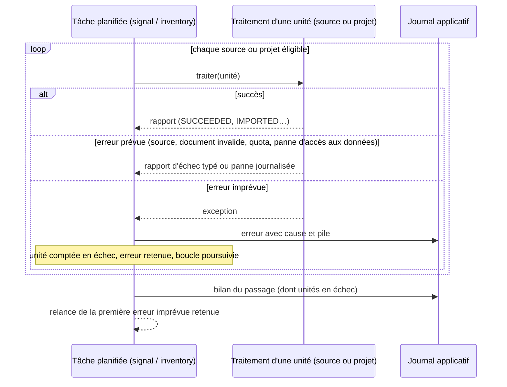
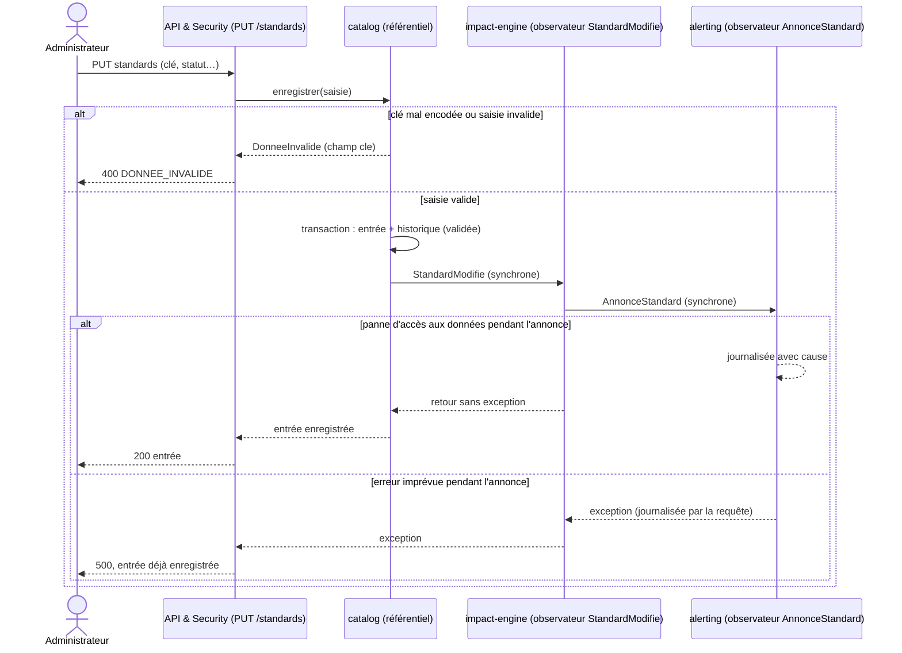
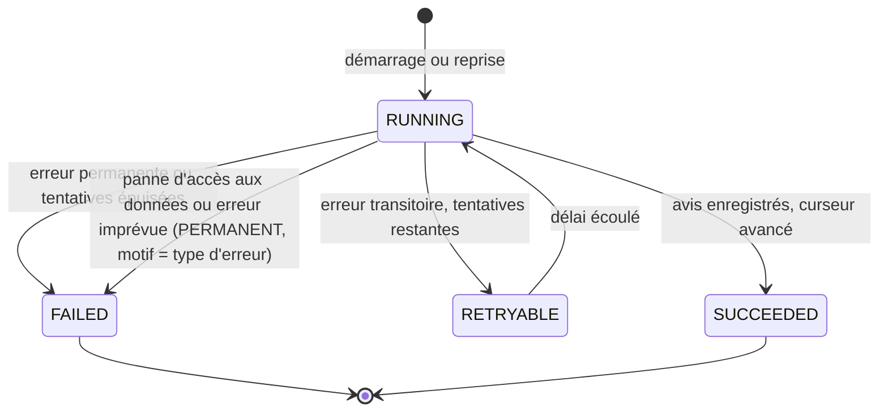

# Conception : isoler les erreurs imprévues aux frontières de traitement

**Niveau de conception** : complète — règle transverse à onze composants, qui modifie l'état visible des traitements planifiés et une réponse d'API ; elle doit être écrite une fois (arc42 §8) et vérifiée par frontière.

## Contexte technique

[EXISTANT, révision `b142695`] Une **frontière d'erreur** est ici le point où un traitement itère sur des unités indépendantes (source, projet, espace, produit, message) ou reçoit un événement d'un autre composant (observateur synchrone), ou bien rend une réponse à un client externe (garde MCP). Le lot 23 n'y capture plus que `IllegalStateException`, convention implicite « panne d'accès aux données » :

| Frontière | Composant (arc42 §5) | Preuve | Effet d'une autre erreur d'exécution |
|---|---|---|---|
| synchronisation d'une source (`synchronize`) | source-ingestion | `ingestion/SourceSynchronizer.java:95`, `:132` | sort de `synchronize`, traitement laissé `RUNNING`, aucun `FAILED` |
| passage planifié des sources | signal | `signal/SynchronisationPlanifiee.java:67` | interrompt le passage, sources suivantes non synchronisées |
| import planifié par projet, relance de recorrélation | inventory | `inventory/ImportPlanifie.java:66`, `:89` | interrompt le passage, projets suivants non importés |
| observateur `StandardModifie` | impact-engine | `impact/RadarProjets.java:198` (et `:110-134`) | remonte à `PUT /standards` après l'enregistrement (`catalog/standard/ReferentielEspace.java:101-104`, `:219`) |
| observateur `AnnonceStandard`, boucles par espace | alerting | `alerting/RappelsRadar.java:114-158` | idem ; boucle par espace interrompue |
| observateur `ImpactsRecorded`, envoi | alerting | `alerting/MoteurAlertes.java:141`, `alerting/EnvoiAlertes.java:121` | remonte à la corrélation (`CorrelationEngine.publish`) |
| cycles de vie, fiches réglementaires, activité | release-radar, reg-intel, project-intel | `releaseradar/CyclesDeVie.java:56`, `regintel/PreparationFiches.java:108`, `projectintel/CollecteActivite.java:110` | boucle interrompue |
| appel du fournisseur de modèle | ai-gateway | `aigateway/PasserelleIa.java:169-182` (seules `IOException`, `InterruptedException`) | sort de la passerelle au lieu d'un « modèle indisponible » |
| garde des outils | mcp-server | `mcp/GardeAppels.java:117-121` | erreur de protocole JSON-RPC (documentation quarkus-mcp-server, citée par le constat) ; aucun `Issue.ERREUR` |

Cause de données démontrée : `catalog/PackageKey.java:125-126` (`URLDecoder.decode`) lève `IllegalArgumentException` sur un `%` mal formé ; `parse` est appelé par `signal/SignalRecorder.java:307`, `inventory/CycloneDxParser.java:125`, `catalog/standard/SaisieStandard.java:40`, `mcp/Parametres.java:22`, `mcp/OutilsSecurite.java:291`, `signal/SignalQueries.java:244`.

Motivation : proposal.md.

## Exigences couvertes

| Exigence | Section(s) de conception | Diagramme(s) |
|---|---|---|
| COL-11 | D1, D2, D3 ; « Traitements et interactions » ; « États et transitions » | DC-1, DC-2 |
| INV-11 | D1, D2 ; « Traitements et interactions » | DC-1 |
| RAD-07 | D2, D4 ; « Contrats d'interface » | DC-3 |
| MCP-08 | D5 ; « Contrats d'interface » | — |
| (AUD-QUA-23, sans exigence) | D6 ; « Observabilité » | — |

## Objectifs et non-objectifs

**Objectifs :**
- À chaque frontière, isoler l'unité fautive (journalisée avec sa cause, comptée en échec), traiter les unités suivantes, puis relancer la première erreur imprévue : aucune erreur imprévue n'est absorbée ([DÉCISION] du porteur du projet, 2026-11-24, « isoler puis relancer »).
- Captures précises conservées à l'intérieur des unités.
- Le PURL mal encodé devient une donnée illisible, traitée selon la règle déjà en place à chaque entrée.
- Un test par frontière, avec une erreur imprévue simulée et, pour les entrées externes, le PURL `%zz`.
- La règle écrite dans arc42 §8.5.

**Non-objectifs :**
- Rendre asynchrones les observateurs (AUD-PER-02, sprint 8).
- Métriques et journaux structurés (`instrumenter-observabilite`).
- Requalifier les 147 `new IllegalStateException(` (Q-1 de la proposition : pas de type dédié dans ce changement).

## Composants impactés, responsabilités et frontières

| Composant | Responsabilité dans ce changement | Ne doit pas | Statut |
|---|---|---|---|
| catalog | décoder une clé de paquet sans lever d'erreur d'exécution sur un encodage invalide | décider du sort de la donnée (appartient à l'appelant) | modifié |
| source-ingestion | terminer une synchronisation en `FAILED`/`PERMANENT` sur toute erreur imprévue, puis la relancer | laisser un traitement `RUNNING` | modifié |
| signal | isoler chaque source dans le passage planifié, sources en erreur au bilan, relancer à l'échéance | interrompre le passage | modifié |
| inventory | isoler chaque projet dans le passage, compter `enEchec`, relancer à l'échéance | interrompre le passage | modifié |
| impact-engine, alerting | isoler espaces, produits et messages dans les boucles du radar et de la diffusion ; observateurs synchrones : panne d'accès aux données journalisée, erreur imprévue propagée | absorber une erreur imprévue | modifié |
| release-radar, reg-intel, project-intel | isoler produits, textes et projets ; relancer à la fin de la boucle | interrompre la boucle | modifié |
| ai-gateway | pannes prévues du fournisseur (injoignable, délai, réponse en erreur) = « modèle indisponible » ; erreur imprévue propagée | traduire une erreur imprévue en indisponibilité | inchangé (vérifié par test) |
| mcp-server | panne d'accès aux données → `INDISPONIBLE` ; erreur imprévue journalisée, appel inscrit en erreur, puis relancée | traduire une erreur imprévue en `INDISPONIBLE` ; renvoyer un détail interne | modifié |
| observabilite (module technique) | `ErreursImprevues` : retenir puis relancer la première erreur d'un passage | dépendre d'un module métier | modifié |

## Modèle de domaine et invariants

Pas de modèle métier nouveau. Invariants testables :

- I-1 : à la fin d'un passage (sources d'avis, imports, radar, cycles de vie, fiches, activité, diffusion), chaque unité éligible a été tentée, quelle que soit l'erreur d'une autre unité.
- I-2 : aucune synchronisation de source ne reste `RUNNING` après le retour ou la sortie en erreur de `synchronize`, sauf attente de nouvelle tentative interrompue (comportement existant).
- I-3 : une erreur imprévue n'est jamais absorbée : elle est relancée par le passage, par la garde MCP ou par l'observateur synchrone, après traitement des autres unités.
- I-4 : toute erreur capturée à une frontière est journalisée au niveau erreur avec l'exception en premier argument (pile et causes comprises).
- I-5 : le décodage d'une clé de paquet ne lève aucune erreur d'exécution pour une chaîne quelconque.

## Traitements et interactions

**DC-1** — Question : que devient un passage planifié quand une unité échoue sur une erreur imprévue ? Type : UML sequenceDiagram. Statut : cible ([PROPOSITION]). Exigences : COL-11, INV-11.

Explication : le filet est posé dans la boucle de la tâche planifiée ; pour une source d'avis, la synchronisation termine d'abord le traitement en `FAILED` (DC-2) puis relance l'erreur, que la boucle retient. La méthode testable du passage (`synchroniserToutes`, `importer`, `executer`, `collecter`) rend un bilan portant les erreurs retenues ; le point d'entrée `@Scheduled` les relance (`Bilan.relancerErreurImprevue()`), si bien que l'exécution planifiée se termine en échec visible (journal de l'intercepteur, métrique `resultat=echec`, contrôle de santé `en-echec`, `instrumenter-observabilite`). Les boucles internes sans bilan (`CyclesDeVie.synchroniser`, `RadarProjets.enregistrerDettes`, `PreparationFiches.preparer`, `EnvoiAlertes.envoyer`) relancent elles-mêmes à leur fin ; leur appelant qui est une frontière les traite comme une unité.

**DC-3** — Question : quand l'administrateur reçoit-il une erreur lors de l'enregistrement d'un standard ? Type : UML sequenceDiagram. Statut : cible ([PROPOSITION]). Exigences : RAD-07, RAD-01-S2, RAD-06.

Explication : la validation précède la transaction (RAD-07-S1, RAD-01-S2) ; l'annonce suit la validation de la transaction. Une panne d'accès aux données y est absorbée et journalisée (RAD-07-S2) ; une erreur imprévue est propagée (RAD-07-S3) : l'enregistrement reste acquis, l'erreur est visible.

## États et transitions

**DC-2** — Question : quel état prend une synchronisation de source sur une erreur imprévue ? Type : UML stateDiagram-v2. Statut : cible ([PROPOSITION]) ; transitions existantes conservées. Exigences : COL-11, COL-06, COL-07.

Explication : la transition « erreur imprévue » termine le traitement en `FAILED`/`PERMANENT` avec le type d'erreur pour motif, puis l'erreur est relancée. L'échec compte pour le seuil de `DEGRADED` (COL-07, COL-11-S3).

## Contrats d'interface

| Élément | Valeur |
|---|---|
| Opération et chemin | `PUT /api/v1/radar/espaces/{espaceId}/standards` (`api/RadarResource.java`) |
| Authentification / autorisations | inchangées (administrateur de l'espace, RAD-02) |
| Erreur de saisie | 400 `DONNEE_INVALIDE`, attribut `cle`, pour une clé mal encodée ; message de `SaisieStandard` existant (« La clé doit être un PURL sans version… ») ; réponse 400 déjà déclarée par l'OpenAPI de l'opération |
| Réponse après enregistrement | 200 avec l'entrée si l'annonce réussit ou échoue sur une panne d'accès aux données ; 500 si l'annonce échoue sur une erreur imprévue, l'entrée restant enregistrée |
| Compatibilité | aucune rupture |

Outils MCP : panne d'accès aux données → résultat d'erreur d'outil (`isError`) dont le texte commence par `INDISPONIBLE` ; erreur imprévue → erreur de protocole JSON-RPC émise par l'extension, sans message interne. Aucun nouveau code.

## Persistance et intégrité

Non applicable — aucune migration. Les états `FAILED`/`PERMANENT` d'une synchronisation existent déjà.

## Transactions, concurrence et idempotence

- L'enregistrement d'un avis reste dans la transaction de la synchronisation (`SignalRecorder.record`, `MANDATORY`) : une erreur imprévue annule le lot en cours ; le curseur n'avance pas (COL-05).
- La corrélation d'un avis est un observateur transactionnel `AFTER_SUCCESS` (`CorrelationEngine.onSignalChanged`) : une erreur imprévue qui en sort (évaluation des alertes comprise) est journalisée par le conteneur CDI au niveau erreur, avec sa pile ; elle ne peut plus annuler l'avis déjà validé.
- L'annonce d'un standard reste synchrone et postérieure à la validation de la transaction ; le filet n'introduit aucune transaction.
- Les verrous existants (synchronisation par source, imports sérialisés par projet, INV-08) sont inchangés ; les blocs `finally` existants libèrent les ressources.

## Sécurité et isolation

- Les réponses (API, MCP) ne contiennent ni trace ni message d'exception interne ; le détail va au journal applicatif.
- Une donnée externe malveillante (PURL forgé) ne peut plus bloquer la collecte des autres sources ou projets : résistance au déni de service par donnée empoisonnée.
- Droits et RLS inchangés.

## Gestion des erreurs et reprise

Règle écrite dans arc42 §8.5 (tâche 6.1) :

1. À l'intérieur d'une unité de traitement, capturer précisément les erreurs prévues et les traduire en résultats typés (rejet, refus, source indisponible, panne d'accès aux données journalisée).
2. À chaque frontière (boucle sur des unités indépendantes), capturer toute erreur d'exécution d'une unité, la journaliser au niveau erreur avec l'exception en premier argument, compter l'unité en échec, poursuivre, puis relancer la première erreur imprévue une fois les unités traitées (`observabilite.ErreursImprevues`).
3. Observateurs synchrones et garde MCP : la panne d'accès aux données est traitée (journalisée ; `INDISPONIBLE` pour le MCP) ; une erreur imprévue est journalisée puis propagée.
4. Une erreur d'une donnée externe ne doit jamais sortir d'un analyseur sous forme d'erreur d'exécution non typée.
5. `InterruptedException` rétablit l'indicateur d'interruption (existant) ; `Error` n'est pas capturée.
6. Un test par frontière simule une erreur imprévue autre que la panne d'accès aux données.

## Observabilité

- Journal : niveau erreur, exception en premier argument (I-4) ; message nommant l'unité (source, projet, espace, produit, texte, message) sans donnée personnelle.
- Bilans de passage : sources en erreur (`SynchronisationPlanifiee.Bilan.enErreur`), `projetsEnEchec` (`ImportPlanifie.Bilan`), `echecs` (`CollecteActivite.Bilan`), erreurs imprévues retenues (`erreursImprevues`).
- Exécution planifiée relancée en échec : métrique `argos_taches_executions_seconds_count{resultat="echec"}` et état `en-echec` du contrôle de santé (`instrumenter-observabilite`).
- MCP : `Issue.ERREUR` au journal des appels (MCP-06), pour les deux cas.

## Performance et stratégie de mesure

Non applicable — aucun coût mesurable ajouté (une capture par unité).

## Compatibilité, migration et retour arrière

Aucune migration. Retour arrière par commit ; aucun état persistant nouveau. Les traitements restés `RUNNING` avant le déploiement expirent selon la règle existante (30 minutes).

## Décisions, alternatives et compromis

### D1 — Isoler puis relancer aux frontières, captures précises à l'intérieur

- **Statut** : [DÉCISION — porteur du projet, 2026-11-24]
- **Choix** : à chaque boucle du tableau « Contexte technique », capturer `RuntimeException` par unité après les captures précises, journaliser avec la cause, compter l'unité en échec, poursuivre, puis relancer la première erreur imprévue (les suivantes en erreurs supprimées) ; ne pas toucher aux captures précises internes.
- **Justification** : isole les pannes sans en absorber aucune, conformément à la consigne du porteur (« une erreur imprévue n'est plus absorbée, même aux points d'isolation ») ; l'exécution planifiée se termine en échec visible et mesuré.
- **Alternatives écartées** : filet journalisé sans relance (absorbe l'erreur, contraire à la consigne) ; aucun filet (une donnée empoisonnée arrête toute la collecte) ; capturer `Exception`/`Throwable` (capture `Error`, contraire à la règle 5).
- **Compromis** : une méthode de passage relancée ne rend plus son bilan à l'appelant planifié ; le bilan est journalisé avant la relance et rendu par la méthode testable.
- **ADR** : non : convention transverse écrite en arc42 §8.5 ; pas de type de panne dédié (Q-1).

### D2 — PURL mal encodé = PURL illisible

- **Statut** : [DÉCISION — porteur du projet, 2026-11-24 (Q-2) : composant écarté]
- **Choix** : le décodage d'une clé de paquet renvoie « illisible » (vide) sur un encodage invalide (capture précise de l'`IllegalArgumentException` de `URLDecoder`) ; chaque appelant applique sa règle existante : avis indexé par écosystème et nom (`SignalRecorder.toAffected`), composant écarté et signalé (`CycloneDxParser`, INV-01), `DonneeInvalide` 400 (`SaisieStandard`), `ParametreInvalide` (`Parametres` MCP), recherche par la valeur brute (`OutilsSecurite`, `SignalQueries`).
- **Justification** : corrige la cause à la source, une seule fois ; aucun appelant nouveau à protéger ; aligne sur des règles déjà spécifiées.
- **Alternatives écartées** : refuser l'import du projet entier (texte du constat, Q-2) — plus sévère que la règle d'un PURL illisible et contraire à la décision D6 du 2026-11-18 ; correspondance `IllegalArgumentException` → 400 dans `GestionErreurs` — masquerait des défauts de programmation en erreurs de saisie.
- **Compromis** : un composant au PURL mal encodé n'apparaît pas dans l'inventaire (signalé comme écarté).
- **ADR** : non : décision locale.

### D3 — Erreur imprévue d'une synchronisation : `FAILED` / `PERMANENT`, puis relance

- **Statut** : [PROPOSITION]
- **Choix** : dans `synchronize`, toute erreur d'exécution autre que les erreurs typées termine le traitement comme la panne d'accès aux données (`SourceException` `PERMANENT`, motif = type d'erreur, tentative enregistrée, source en échec), puis est relancée.
- **Justification** : visible, compté pour `DEGRADED`, pas de rejeu automatique d'une donnée qui échouera de même ; l'erreur atteint la frontière du passage.
- **Alternatives écartées** : `RETRYABLE` — retenterait cinq fois une erreur déterministe ; mettre l'avis fautif à l'écart (COL-08) dans tous les cas — l'erreur imprévue peut ne pas être attribuable à un avis ; laissé à la frontière par avis existante (`AdvisoryRejectedException`).
- **Compromis** : une erreur imprévue sur un seul avis bloque la source jusqu'à correction, mais n'arrête plus les autres sources. Une synchronisation lancée par l'exploitant (API) répond en erreur serveur.
- **ADR** : non : décision locale.

### D4 — Annonce d'un standard : panne d'accès aux données absorbée, erreur imprévue propagée

- **Statut** : [DÉCISION — porteur du projet, 2026-11-24]
- **Choix** : les observateurs synchrones `StandardModifie` et `AnnonceStandard` gardent la capture de la panne d'accès aux données (journalisée) ; une erreur imprévue remonte à la requête.
- **Justification** : l'enregistrement est validé avant l'annonce ; une panne de données ne doit pas faire croire à un échec d'enregistrement (RAD-07-S2) ; une erreur imprévue n'est pas absorbée (RAD-07-S3).
- **Alternatives écartées** : absorber toute erreur (contraire à la consigne) ; observateur `AFTER_SUCCESS` ou asynchrone — change l'ordre et la sémantique des annonces, relève d'AUD-PER-02.
- **Compromis** : sur une erreur imprévue, l'administrateur reçoit 500 alors que l'entrée est enregistrée ; il la retrouve en relisant le référentiel.
- **ADR** : non : décision locale.

### D5 — Garde MCP : `INDISPONIBLE` pour la panne d'accès aux données, erreur imprévue relancée

- **Statut** : [DÉCISION — porteur du projet, 2026-11-24]
- **Choix** : la garde traduit la panne d'accès aux données en `INDISPONIBLE` (existant) ; toute autre erreur d'exécution est journalisée avec sa cause, l'appel inscrit `Issue.ERREUR`, puis l'erreur est relancée à l'extension, qui répond par une erreur de protocole sans message interne ; la Javadoc décrit les deux cas.
- **Justification** : un seul point de passage pour tous les outils ; aucune erreur imprévue déguisée en indisponibilité.
- **Alternatives écartées** : `INDISPONIBLE` pour toute erreur (masque les défauts) ; annotation d'enveloppement des erreurs métier de l'extension sur chaque outil — dispersée, et ne journalise pas `Issue.ERREUR`.
- **Compromis** : le client reçoit une erreur de protocole pour un défaut interne ; le détail reste au journal.
- **ADR** : non : décision locale (ADR-0014, Proposé, inchangé).

### D6 — Journaliser la cause avec sa pile (AUD-QUA-23)

- **Statut** : [PROPOSITION]
- **Choix** : passer la cause en premier argument du journal dans `MoteurAlertes` (résumé IA indisponible) et dans tous les appels qui formataient l'exception en argument (relevés par `instrumenter-observabilite`, tâche 1.3) ; règle I-4 écrite en arc42 §8.5.
- **Justification** : diagnostic d'une panne du fournisseur IA avec pile et causes imbriquées.
- **Alternatives écartées** : aucune sérieuse.
- **Compromis** : journaux plus longs au niveau information.
- **ADR** : non.

### D7 — Pas de test d'architecture du filet (tâche 6.2)

- **Statut** : [PROPOSITION]
- **Choix** : la règle des frontières n'est pas vérifiée par ArchUnit ; elle l'est par l'inventaire des frontières d'arc42 §8.5 et par un test par frontière.
- **Justification** : ArchUnit ne voit pas les blocs `catch` d'une méthode, et une méthode `@Scheduled` ou un observateur n'est pas toujours la frontière (la boucle peut être dans une méthode appelée) : une règle structurelle donnerait de faux positifs et de faux négatifs. L'observation des tâches (`TachesObserveesTest`) garantit déjà qu'une exécution relancée en échec se voit.
- **Alternatives écartées** : règle « toute méthode `@Scheduled` capture `RuntimeException` » — contredirait la relance et ne couvre pas les boucles internes.
- **ADR** : non.

## Risques

- [Frontière oubliée] → inventaire d'arc42 §8.5 ; test par frontière ; une boucle planifiée hors de l'inventaire interrompt son passage sur une erreur imprévue, ce qui se voit (exécution en échec) sans être absorbé.
- [Erreur relancée qui masque un bilan] → bilan journalisé avant la relance ; erreurs suivantes attachées en erreurs supprimées.
- [Conflits avec `injecter-horloge-et-executeurs`] → intégration séquentielle dans le sprint 4.

## Écarts code / tests / specs / documentation

- Fiche `radar-standards` : promet l'isolation par produit ou espace, que le code assure (boucles isolées puis relancées).
- Texte du constat (« projet refusé ») contre la règle d'un PURL illisible (D2, Q-2 tranchée : composant écarté).
- Boucles planifiées hors du périmètre du constat (`RappelsReglementaires`, `RappelsOpportunites`, `ResumesPeriodiques`, `CollecteOpportunites`, `CollecteWeb`, `CollecteReglementaire`) : elles gardent leur seule capture de la panne d'accès aux données ; une erreur imprévue y interrompt le passage, visible en échec. Consigné dans l'inventaire d'arc42 §8.5 comme frontières à aligner.

## Stratégie de vérification

| Exigence / scénario | Niveau de test | Moyen de preuve | État |
|---|---|---|---|
| COL-11-S1 | intégration (base jetable, sources simulées) | `chain/FrontieresCollecteTest.col11S1AvisAuPurlMalEncode` | vert |
| COL-11-S2 | intégration | `FrontieresCollecteTest.col11S2…` ; `chain/ResilienceTest.erreurImprevueTermineLeTraitementEnEchecPuisEstRelancee` | vert |
| COL-11-S3 | intégration | `FrontieresCollecteTest.col11S3SeuilAtteintParDesErreursImprevues` | vert |
| INV-11-S1 | intégration (forges simulées) | `chain/ImportPlanifieTest.inv11S1SbomPortantUnPurlMalEncode` | vert |
| INV-11-S2 | intégration | `ImportPlanifieTest.inv11S2ErreurImprevuePendantLImportDUnProjet` | vert |
| RAD-07-S1 | API (REST) | `chain/RadarStandardsTest.rad07S1CleMalEncodee` | vert |
| RAD-07-S2, RAD-07-S3 | intégration | `RadarStandardsTest.rad07S2…`, `annonceEnErreurImprevueRemonteApresLEnregistrement` | vert |
| MCP-08-S1, MCP-08-S2 | intégration MCP | `mcp/ErreursOutilsMcpTest` | vert |
| I-5 | unitaire | `catalog/PackageKeyDecodageTest` (`%zz`, `%`, `%e9%`, version mal encodée) | vert |
| I-1, I-3 (autres frontières) | intégration | `RadarStandardsTest.espaceEnErreurImprevueDansLaTacheQuotidienne`, `produitEnErreurImprevueDansLaSynchronisationDesCycles` ; `chain/VeilleReglementaireTest.texteEnErreurImprevueNEmpechePasLesAutresFiches` ; `projectintel/ActiviteProjetsTest.projetEnErreurImprevueNInterromptPasLePassage` ; `alerting/AlertesTest` (évaluation en panne, erreur imprévue de l'évaluation, message de diffusion en erreur) ; `aigateway/PasserelleIaTest.erreurImprevueDuFournisseurRemonteALAppelant` | vert |

## Documentation durable impactée

- Fiches `/docs/specifications/collecte-avis-securite.md`, `/docs/specifications/inventaire-sbom.md`, `/docs/specifications/radar-standards.md`, `/docs/specifications/serveur-mcp.md` et registre `/docs/specifications/README.md`.
- arc42 §8.5 (`/docs/architecture/arc42/08-concepts-transverses.md`) : règle des frontières d'erreur et de journalisation de la cause, inventaire des frontières.
- Diagrammes D-08 (erreur API/retry) et D-09 (redémarrage/reprise) d'arc42 §6 : ne décrivent pas la reprise d'une synchronisation sur erreur imprévue ; inchangés.

## Questions ouvertes

Tranchées par le porteur du projet le 2026-11-24 : Q-1 (pas de type de panne dédié dans ce changement ; piste pour `extraire-noyau-commun`), Q-2 (composant au PURL mal encodé écarté et signalé). Décision supplémentaire du même jour : « isoler puis relancer » aux frontières (D1, D4, D5).
