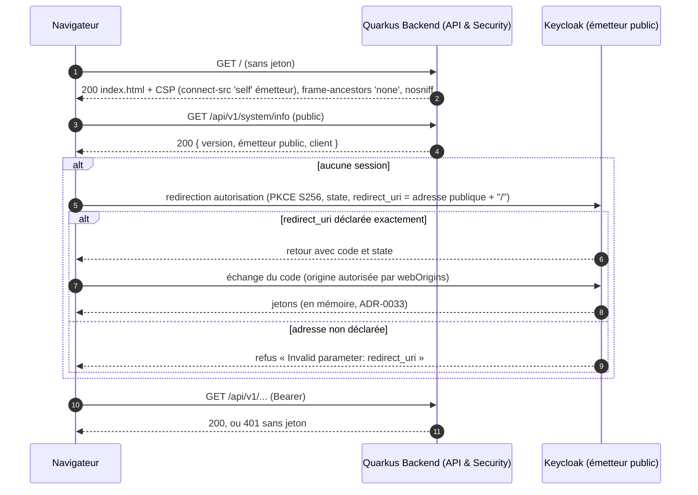
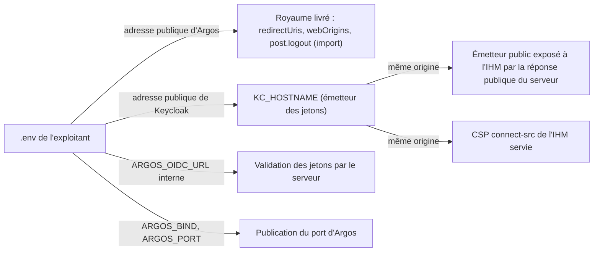

# Conception : rendre le portail web déployable hors du poste hôte

<!-- Statuts : [EXIGENCE] [EXISTANT] [DÉCISION] [PROPOSITION] [QUESTION] (légende : /docs/specifications/README.md#statuts-des-informations). -->

**Niveau de conception** : complète — changement transverse (image, Vue.js 3 SPA, Quarkus Backend, royaume Keycloak, `compose.yaml`) touchant la sécurité et un contrat entre l'image et l'IHM (D1).

## Contexte technique

- **Émetteur figé au build** [EXISTANT] : `argos-ui/src/session/session.ts:12` (`EMETTEUR_PAR_DEFAUT = 'http://localhost:8180/realms/argos'`) et `:114-115` (`import.meta.env.VITE_ARGOS_OIDC_ISSUER || …`, résolu par Vite à la compilation) ; `Dockerfile:13` ne fixe que `VITE_ARGOS_API_URL` ; `compose.yaml:80` construit sans argument. L'audit a rejoué le build : le bundle contient `localhost:8180/realms/argos` (AUD-DEP-21).
- **Deux adresses pour un même royaume** [EXISTANT] : en `idp-local`, le serveur joint Keycloak par `http://keycloak:8080/realms/argos` (`.env.example:23`) ; le navigateur et l'émetteur des jetons utilisent `KC_HOSTNAME` (`compose.yaml:54`), avec `KC_HOSTNAME_BACKCHANNEL_DYNAMIC: "true"` (`:55`) pour que la découverte vue du serveur reste joignable. Keycloak est publié sur `127.0.0.1` seulement (`:64`).
- **Royaume livré** [EXISTANT] : `deploiement/keycloak/argos-realm.json:7` (`sslRequired: none`), `:39-49` (redirections, origines et fin de session en `http://localhost:8088`, joker `/*`) ; import au premier démarrage seulement (`compose.yaml:43`, `start --import-realm`) ; substitution `${VAR}` déjà utilisée pour l'administrateur (`:95-104`).
- **Adresse de retour du portail** [EXISTANT] : origine + chemin de la page (`session.ts:40-48`) ; routage par fragment (`argos-ui/src/router.ts:52`), donc le chemin vaut `/` quand la page est ouverte à la racine.
- **Politique d'accès HTTP** [EXISTANT] : `application.properties:294-297` ; aucune ressource statique dans `src/main/resources/META-INF/resources` (l'IHM n'est copiée que dans l'étage Docker, `Dockerfile:36`) ; `AuthentificationTest.java:21-27` ne teste que des 401.
- **En-têtes** [EXISTANT] : aucun côté serveur ; la CSP de référence est celle du desktop (`argos-desktop/src/ui-protocol.js:16-33` : `default-src 'self'`, `script-src 'self'`, `style-src 'self' 'unsafe-inline'`, `img-src 'self' data:`, `font-src 'self'`, `connect-src 'self' <serveur> <émetteur>`, `object-src 'none'`, `base-uri 'none'`, `frame-ancestors 'none'`).
- **Desktop** [EXISTANT] : `argos-desktop/src/main.js:25-34`, priorité variable d'environnement > champ `argos` du `package.json` emballé > valeur par défaut ; aucun test (`grep -rln 'REGLAGES_EMBALLES|extraMetadata|oidcUrl' argos-desktop/test` : rien, AUD-DEP-21).

## Exigences couvertes

| Exigence | Section(s) de conception | Diagramme(s) |
|---|---|---|
| ACC-11 | D1, D2, « Traitements et interactions », « Compatibilité » | DC-1, DC-2 |
| ACC-12 | D3, D4, « Sécurité et isolation » | DC-1 |
| ACC-13 | D2, D5, « Sécurité et isolation » | — |

## Objectifs et non-objectifs

**Objectifs :**
- une image unique utilisable sur le PC et sur le NAS, l'émetteur étant une donnée de l'instance ;
- un royaume livré aligné sur le port publié par défaut et sûr avant toute exposition hors 127.0.0.1 ;
- une défense en profondeur de l'IHM qui tient des jetons en mémoire (ADR-0033).

**Non-objectifs :**
- TLS, HSTS et reverse proxy (DSM) ; MFA ; migration d'un royaume déjà importé (procédure manuelle documentée) ; CSP du desktop.

## Composants impactés, responsabilités et frontières

| Composant | Responsabilité dans ce changement | Ne doit pas | Statut |
|---|---|---|---|
| Vue.js 3 SPA (`argos-ui/src/session/`) | obtenir l'émetteur et le client de l'instance (D1) avant d'ouvrir la session | conserver un émetteur par défaut dans le bundle de production | modifié |
| API & Security (Quarkus Backend) | poser les en-têtes de sécurité (D3) ; selon D1, exposer l'émetteur public dans la réponse publique d'identité du serveur | exposer une donnée d'utilisateur ou un secret ; élargir les chemins publics au-delà des ressources statiques | modifié |
| Keycloak (royaume `argos`, profil `idp-local`) | adresses exactes paramétrées, force brute, politique de mot de passe, TLS (D2, D5) | porter des rôles d'espace (ADR-0027) | modifié |
| Client desktop Electron | inchangé ; tests et documentation des réglages emballés | — | existant |

## Modèle de domaine et invariants

Non applicable — aucun modèle de domaine modifié. Invariants testables :

- **I-1** : le bundle de production de l'IHM ne contient aucune adresse d'émetteur figée (`localhost:8180` notamment).
- **I-2** : `quarkus.http.auth.permission.public.paths` ne contient aucune route `/api/` autre que `/api/v1/system/info` ni aucune route `/q/` autre que la santé.
- **I-3** : aucune adresse du client `argos-ui` du royaume livré ne contient `*`.

## Traitements et interactions

### DC-1 — Démarrage du portail et connexion (cible)

Question : dans quel ordre le portail obtient-il sa configuration, puis sa session, et quels contrôles s'appliquent ? Type : diagramme de séquence UML, cible. Exigences : ACC-11, ACC-12.

Le portail ne connaît plus l'émetteur avant d'avoir lu la réponse publique du serveur ; la CSP posée par le serveur nomme la même origine, puisque les deux viennent de la même configuration de l'instance.

### DC-2 — Adresses de l'instance (cible)

Question : quelles adresses l'exploitant règle-t-il, et qui les consomme ? Type : organigramme (flowchart), cible. Exigences : ACC-11, ACC-13.

Trois adresses distinctes coexistent : l'adresse publique d'Argos (retours du royaume), l'émetteur public (navigateur, jetons, CSP) et l'URL interne du royaume (serveur). Le guide les présente ensemble, avec la valeur par défaut de chacune pour l'installation locale.

## États et transitions

Non applicable — aucun cycle de vie introduit.

## Contrats d'interface

Réponse publique d'identité du serveur [DÉCISION — décision du porteur, 2026-11-24] :

| Élément | Valeur |
|---|---|
| Opération et chemin | `GET /api/v1/system/info` (existant, public, ACC-01-S2) |
| Authentification / autorisations | aucune (chemin public existant) |
| Champs ajoutés | `oidcIssuer` (chaîne, URL absolue de l'émetteur public), `oidcClientId` (chaîne) — noms [PROPOSITION] |
| Exemple de réponse | `{"application":"argos-server","version":"…","apiVersion":"v1","oidcIssuer":"https://auth.exemple.fr/realms/argos","oidcClientId":"argos-ui"}` |
| Erreurs | aucune nouvelle ; si l'émetteur public n'est pas configuré, le serveur refuse de démarrer en production, comme pour `ARGOS_OIDC_URL` aujourd'hui |
| Compatibilité | ajout de champs, compatible avec les clients existants ; le desktop garde ses réglages emballés (ACC-10) |

Le contrat exécutable reste `/q/openapi` ; la description y est générée par l'annotation existante.

## Persistance et intégrité

Non applicable — aucune donnée d'Argos ; le royaume Keycloak est persistant après import (voir « Compatibilité »).

## Transactions, concurrence et idempotence

Non applicable — lecture de configuration et en-têtes statiques par instance.

## Sécurité et isolation

- **Réponse publique** : l'émetteur et l'identifiant du client public sont déjà visibles par quiconque lance une connexion ; les exposer n'ajoute aucune information sensible. Aucun secret (le client `argos-ui` est public, ADR-0027).
- **CSP** : alignée sur celle du desktop (ADR-0033 point 4), `connect-src 'self' <origine de l'émetteur>` ; `style-src 'unsafe-inline'` est repris tel quel du desktop [EXISTANT] et reste une faiblesse connue, non traitée ici.
- **Force brute et mot de passe** : réglages du royaume (D5) : 5 échecs, attente incrémentale de 60 s, attente maximale de 15 min ; `length(12) and notUsername and notEmail and passwordHistory(3)` [DÉCISION — décision du porteur, 2026-11-24].
- **TLS** : `sslRequired` `external` dans le fichier (refus du clair depuis une adresse publique, installation locale en http sur 127.0.0.1 préservée), `all` documenté derrière le reverse proxy [DÉCISION — décision du porteur, 2026-11-24].
- **Ordre de mise en service** : ACC-13 doit être appliquée avant d'exposer Keycloak hors 127.0.0.1 (ACC-11-S2) ; le guide le dit explicitement.

## Gestion des erreurs et reprise

- Si la lecture de la réponse publique échoue, le portail affiche l'état du serveur injoignable (vue publique existante) et ne tente aucune connexion ; aucune valeur de repli vers localhost.
- Royaume déjà importé : la correction des adresses et des politiques se fait dans la console ou par réimport documenté ; le guide donne la procédure.

## Observabilité

Non applicable — aucun journal ni métrique ajouté ; les refus du fournisseur restent visibles dans les journaux de Keycloak.

## Performance et stratégie de mesure

Une requête supplémentaire au chargement de la page (réponse statique, sans base) ; aucune cible chiffrée n'est fixée par les sources [QUESTION non bloquante].

## Compatibilité, migration et retour arrière

- **BREAKING** pour une installation existante publiée sur 8088 : régler l'adresse publique ; un royaume déjà importé conserve ses anciens réglages (import unique), à corriger dans la console.
- Retour arrière : revenir à l'image précédente rétablit l'émetteur figé ; le royaume durci reste compatible avec l'ancienne IHM si l'adresse publique est inchangée.

## Décisions, alternatives et compromis

### D1 — Origine de l'émetteur et du client de l'IHM servie

- **Statut** : [DÉCISION] — décision du porteur, 2026-11-24.
- **Choix — lecture au démarrage depuis le serveur** : la page lit l'émetteur public et le client dans la réponse publique d'identité du serveur, alimentée par une variable d'environnement de l'instance (même source que la CSP et `KC_HOSTNAME`). Avantages : une image unique pour le PC et le NAS, changement d'émetteur sans reconstruction (ACC-11-S3), une seule source pour l'émetteur et la CSP, valeur par défaut supprimée du bundle (I-1, critère du sprint 6). Inconvénients : une requête de plus au démarrage ; le développement Vite garde un repli explicite (`.env` local).
- **Alternative écartée — argument de build** : `ARG VITE_ARGOS_OIDC_ISSUER` et `VITE_ARGOS_OIDC_CLIENT_ID` dans le `Dockerfile`, passés par `build.args` de `compose.yaml`. Avantages : aucun changement de l'IHM ni de l'API. Inconvénients : reconstruction à chaque changement d'émetteur ; image liée à une instance ; la CSP du serveur doit recevoir une seconde copie de la même valeur ; le contrôle « refuser le build si localhost » proposé par l'audit casserait l'installation locale par défaut (proposal.md, « Écarts constatés »).
- **Justification** : seule la lecture au démarrage satisfait ACC-11-S3 et garde une source unique pour l'émetteur et la CSP.
- **Écart avec l'action d'AUD-DEP-21** : exposer `quarkus.oidc.auth-server-url` ne convient pas en `idp-local` (adresse interne) ; il faut exposer l'émetteur public, par une variable dédiée ou l'`issuer` du document de découverte.
- **ADR** : candidate à un ADR, maintenu au statut Proposé — configuration de l'IHM à l'exécution, contrat entre image et IHM.

### D2 — Adresses de l'instance et royaume paramétré

- **Statut** : [PROPOSITION].
- **Choix** : une adresse publique d'Argos (`ARGOS_PUBLIC_URL`, nom cité par `/docs/audit/2026-11-21/sprints.md`, défaut `http://localhost:${ARGOS_PORT:-8080}`) transmise au conteneur Keycloak et substituée à l'import dans `redirectUris` (`${ARGOS_PUBLIC_URL}/`), `webOrigins` et `post.logout.redirect.uris` ; une adresse publique de Keycloak (nom à fixer, Q-7) qui alimente `KC_HOSTNAME` et l'émetteur public de l'IHM ; publication du port de Keycloak réglable comme celle d'Argos.
- **Justification** : la substitution `${VAR}` est déjà employée par le royaume [EXISTANT] ; le routage par fragment rend une adresse de retour exacte suffisante [EXISTANT].
- **Alternatives écartées** : aligner le royaume sur 8080 en dur (corrige le défaut, pas un autre port ni le NAS) ; garder le joker (contraire à ACC-13).
- **Compromis** : une page ouverte par `/index.html` produirait une adresse de retour non déclarée ; le portail redirige vers `/` ou l'adresse `/index.html` est déclarée en plus [QUESTION non bloquante, tranchée à l'implémentation par test].
- **ADR** : non : décision locale de déploiement.

### D3 — En-têtes de sécurité posés par le serveur

- **Statut** : [PROPOSITION].
- **Choix** : en-têtes configurés (`quarkus.http.header.*`, valeur de la CSP construite à partir de l'origine de l'émetteur public) sur toutes les réponses : CSP alignée sur le desktop avec `connect-src 'self' <émetteur>`, `X-Content-Type-Options: nosniff`, `Referrer-Policy: no-referrer` (proposition de l'auditeur), `frame-ancestors 'none'`.
- **Alternatives écartées** : filtre JAX-RS (ne couvre pas les ressources statiques servies hors JAX-RS) ; CSP par balise `<meta>` dans `index.html` (n'accepte pas `frame-ancestors`, et l'émetteur n'est connu qu'à l'exécution).
- **Compromis** : la CSP s'applique aussi aux réponses JSON, sans effet pour elles.
- **ADR** : non : décision locale, conforme à ADR-0033.

### D4 — Tests de la politique d'accès HTTP

- **Statut** : [PROPOSITION] (action d'AUD-TST-25).
- **Choix** : ressource statique de test sous `src/test/resources/META-INF/resources` ; test paramétré des chemins publics (réponse différente de 401 sans session, ACC-12-S1) et des routes protégées (401, ACC-12-S2) ; test qui lit `quarkus.http.auth.permission.public.paths` et échoue sur I-2 ; test des en-têtes (ACC-12-S3) ; Javadoc d'`AuthentificationTest` mise à jour.
- **ADR** : non.

### D5 — Royaume livré et son contrôle

- **Statut** : [PROPOSITION] pour le contrôle ; valeurs [DÉCISION] — décision du porteur, 2026-11-24.
- **Choix** : `bruteForceProtected: true` avec `failureFactor` 5, `waitIncrementSeconds` 60 et `maxFailureWaitSeconds` 900 ; `passwordPolicy` `length(12) and notUsername and notEmail and passwordHistory(3)` ; `sslRequired: external` dans le fichier, `all` documenté derrière le reverse proxy ; adresses exactes (D2) ; contrôle automatique qui lit le fichier et vérifie ces clés et I-3 (ACC-13-S4), en test JUnit du serveur ou script `node` appelé par `verifier-docs` ou la CI [QUESTION non bloquante sur l'emplacement].
- **Alternatives écartées** : réglages par la console après import (non reproductibles, non testables).
- **ADR** : non ; ADR-0027 prévoit déjà cette revue.

### D6 — Contrôle du bundle et du desktop

- **Statut** : [PROPOSITION].
- **Choix** : test qui construit l'IHM comme l'étage Docker (`VITE_ARGOS_API_URL=` vide) et échoue si le bundle contient `localhost:8180` (I-1) ; tests `node:test` de la priorité des réglages du desktop (variable > `package.json` emballé > défaut).
- **ADR** : non.

## Risques

- Exposer Keycloak avant d'appliquer ACC-13 → ordre imposé par le guide et les tâches (groupe 3 avant la documentation d'exposition).
- Royaume déjà importé non mis à jour → procédure documentée ; R-18 (disponibilité liée à Keycloak, `/docs/architecture/risks/register.md`) inchangé.
- CSP trop stricte bloquant une ressource de l'IHM → test E2E du portail servi (ACC-11-S1) et console du navigateur sans violation.

## Écarts code / tests / specs / documentation

Voir proposal.md, « Écarts constatés » : émetteur public et URL interne, refus du build sur localhost, Keycloak injoignable depuis un autre poste, ACC-01 et ressources publiques, lignes du guide déplacées.

## Stratégie de vérification

| Exigence / scénario | Niveau de test | Moyen de preuve | État |
|---|---|---|---|
| ACC-11-S1 | E2E / recette | parcours sur l'image avec `idp-local` et `.env.example` (recette consignée, `docs/deploiement/recette-poste.md`) | à écrire |
| ACC-11-S2 | recette | connexion depuis un second poste, réglages du guide | à écrire |
| ACC-11-S3 | intégration | changement d'émetteur et redémarrage sans build ; contrôle du bundle (I-1) | à écrire |
| ACC-11-S4 | intégration | Keycloak de test avec le royaume livré : demande à `redirect_uri` étrangère refusée | à écrire |
| ACC-12-S1, S2 | intégration | `AuthentificationTest` paramétré, ressource statique de test, contrôle I-2 | à écrire |
| ACC-12-S3, S4 | intégration | test des en-têtes de la réponse de `/` | à écrire |
| ACC-13-S1 à S3 | intégration / recette | Keycloak de test important le royaume livré | à écrire |
| ACC-13-S4 | unitaire | contrôle automatique du fichier du royaume | à écrire |

## Documentation durable impactée

- `/docs/specifications/comptes-acces.md` (ACC-11 à ACC-13, DF-ACC-2 complété par la lecture de la configuration, écarts, questions) ; `/docs/specifications/README.md` (ligne `comptes-acces`, couverture).
- arc42 §7 (déploiement : adresses de l'instance, Keycloak joignable), §8.1 (identité), §8.3 (sécurité : en-têtes, royaume), §8.12 (déploiement) ; `/docs/architecture/diagrams/README.md` si DC-2 est reporté dans arc42.
- `/docs/deploiement/synology-et-pc.md`, `.env.example`, `argos-ui/.env.example`.
- ADR candidat (D1, statut Proposé) et index arc42 §9.

## Questions ouvertes

Aucune question ouverte ne change ce qui sera construit ; Q-5 à Q-7 (proposal.md) et les points d'implémentation (emplacement du contrôle du royaume, `/index.html`, coût de la requête de configuration) peuvent attendre l'implémentation.
