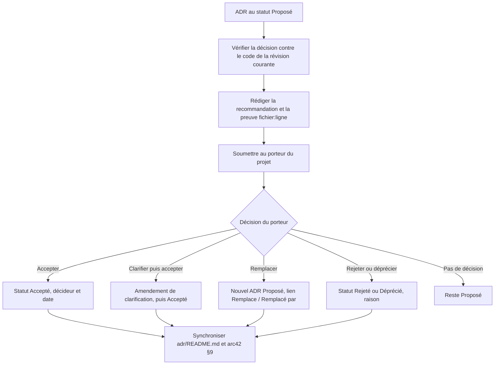

# Conception : écrire les décisions d'architecture du socle

<!-- Statuts : [EXIGENCE] [EXISTANT] [DÉCISION] [PROPOSITION] [QUESTION] — légende : /docs/specifications/README.md#statuts-des-informations. -->

**Niveau de conception** : allégée — changement documentaire ; aucune section technique (contrats, persistance, transactions) n'est concernée.

## Contexte technique

Les ADR sont dans `docs/architecture/adr/` au format du modèle `template.md` (ligne `- **Statut** :`, champs « Remplace » / « Remplacé par ») ; l'index lisible est `docs/architecture/adr/README.md`, l'index arc42 est `docs/architecture/arc42/09-decisions.md` (tableau ID, titre, statut, date, remplace) [EXISTANT]. Motivation : proposal.md.

## Exigences couvertes

Non applicable — `skip_specs: true` ; le changement traite le constat AUD-ARC-14 (et AUD-DOC-09, fusionné), sans exigence de capacité.

## Objectifs et non-objectifs

**Objectifs :**
- Une preuve du code par ADR « Proposé » et un statut écrit conforme à la décision du porteur du 2026-11-24 (D1).
- Les statuts écrits reflètent la réponse du porteur, et seulement elle.
- Un ADR du noyau commun au statut Proposé, assez précis pour que `extraire-noyau-commun` puisse s'y référer.

**Non-objectifs :**
- Réécrire le fond des ADR anciens (AUD-DOC-01, AUD-DOC-08).
- Trancher à la place du porteur.

## Composants impactés, responsabilités et frontières

Non applicable — aucun composant modifié ; le composant transverse « commun » est seulement proposé par l'ADR (D2).

## Modèle de domaine et invariants

Non applicable — aucun modèle. Invariants documentaires vérifiables :
- RD-1 : un ADR ne passe en « Accepté » qu'avec la date et la référence de la décision du porteur dans le champ « Décideurs » ou une note datée.
- RD-2 : le statut d'un ADR est identique dans le fichier de l'ADR, dans `adr/README.md` et dans `arc42/09-decisions.md`.
- RD-3 : un ADR remplacé pointe vers son successeur, et le successeur vers lui (règle 2 du README des ADR).

## Traitements et interactions

### DC-1 — Circuit de décision d'un statut d'ADR

Question : qui fait passer un ADR de « Proposé » à un autre statut ? Type : organigramme (flowchart). Vue cible. Concerne AUD-ARC-14.

Explication : la vérification et la recommandation sont du travail de développement ; la transition de statut appartient au porteur. Sans réponse, l'ADR reste « Proposé » et l'écart est consigné.

## États et transitions

Non applicable — les statuts d'ADR sont définis par `/docs/architecture/adr/README.md` (« Statuts ») ; ce changement n'en ajoute aucun.

## Contrats d'interface

Non applicable — aucun contrat.

## Persistance et intégrité

Non applicable.

## Transactions, concurrence et idempotence

Non applicable.

## Sécurité et isolation

Non applicable — aucun changement ; ADR-0016 et ADR-0014 sont seulement soumis à acceptation.

## Gestion des erreurs et reprise

Non applicable.

## Observabilité

Non applicable.

## Performance et stratégie de mesure

Non applicable.

## Compatibilité, migration et retour arrière

Retour arrière : un statut appliqué par erreur se corrige par un nouveau commit (les ADR ne sont jamais supprimés ni renumérotés, règle 1 du README des ADR).

## Décisions, alternatives et compromis

### D1 — Statut de chaque ADR « Proposé »

- **Statut** : [DÉCISION] — décision du porteur, 2026-11-24.
- **Choix** : le statut cible du tableau ci-dessous ; preuves vérifiées le 2026-11-24 sur la révision `b142695`.

| ADR | Statut cible | Preuve dans le dépôt |
|---|---|---|
| 0001 Monolithe modulaire | Accepté | un seul serveur déployable `argos-server` ; table `ALLOWED` des frontières, `argos-server/src/test/java/io/argos/architecture/ModuleBoundariesTest.java:21` (cite ADR-0001) et `:32` |
| 0003 Modèle canonique d'événements | Accepté après amendement de clarification : les noms `IntelligenceItem` / `ProjectActivity` sont remplacés par les modèles normalisés réels | `argos-server/src/main/java/io/argos/ingestion/NormalizedAdvisory.java`, adaptateur `ingestion/osv/OsvNormalizer.java` ; noms de l'ADR absents du code |
| 0007 n8n périphérique | Proposé (maintenu) : aucune dépendance à n8n, n8n non déployé | aucune occurrence de `n8n` dans `argos-server/src`, `compose.yaml`, `deploiement/` ; ADR-0021 point 5 (licence de n8n incompatible avec une offre payante) |
| 0008 IAM OIDC | Accepté pour le principe (OIDC, autorisation fine dans ARGOS), avec renvoi à ADR-0027 pour le choix de l'IdP | `argos-server/src/main/resources/application.properties:274-277` (`quarkus.oidc.*`) ; ADR-0025 et ADR-0027 (Acceptés) contredisent « IdP d'entreprise » |
| 0010 OSV et enrichissements | Accepter | `argos-server/src/main/java/io/argos/ingestion/osv/OsvAdvisoryFeed.java` ; `vulnintel/NvdSource.java`, `KevSource.java`, `EpssSource.java`, `CertFrSource.java` |
| 0011 SBOM CycloneDX | Accepter | `argos-server/src/main/java/io/argos/inventory/CycloneDxParser.java` ; INV-01 et INV-04 (`/openspec/specs/inventaire-sbom/spec.md`) |
| 0012 Dependency-Track optionnel | Proposé (maintenu) : comparaison du POC jamais faite, outil absent | aucune occurrence hors de la documentation (`docs/architecture/adr/`, `arc42/09-decisions.md`) |
| 0013 Corrélation déterministe | Accepter | `argos-server/src/main/java/io/argos/impact/MatchRules.java:27` (niveaux `EXACT`, `PROBABLE`, `A_VERIFIER`) ; `impact/CorrelationEngine.java:155` (suggestions IA sans impact) ; COR-02, COR-04, COR-05 (`/openspec/specs/correlation-impact/spec.md`) |
| 0014 MCP lecture seule, Streamable HTTP | Accepter | `argos-server/pom.xml:104-109` (`quarkus-mcp-server-http`) ; `application.properties:311-323` ; `io/argos/mcp/package-info.java:4` |
| 0015 PostgreSQL FTS, pgvector différé | Accepter | `argos-server/src/main/resources/db/migration/V11__recherche_veille.sql:12` (`tsvector`) ; aucune extension `vector` dans les migrations |
| 0016 Workspaces RBAC + RLS | Accepter | `V2__comptes_et_acces.sql` (rôle `argos_app`, politiques RLS) ; `io/argos/workspace/ContexteBase.java:76-91` ; `workspace/Role.java` ; ACC-03, ACC-04 (`/openspec/specs/comptes-acces/spec.md`) |
| 0020 OpenSpec `detailed-uml` | Accepter | `openspec/config.yaml` (`schema: detailed-uml`) ; `openspec/schemas/detailed-uml/schema.yaml` ; 18 specs principales sous `openspec/specs/` |
| 0021 Double licence | Accepté après correction du contexte, ligne 16 (AUD-DOC-09) | `argos-server/pom.xml:221` (profil `licences`) ; `Dockerfile:24` ; `argos-server/README.md:19`, `:32` |
| 0022 Client desktop Electron | Accepter | `argos-desktop/src/main.js:104-106` (`contextIsolation`, `sandbox`) ; ADR-0033 (Accepté) précise son point 6 |

ADR cités par l'action du constat et déjà dans l'état visé (aucune action) : ADR-0004 et ADR-0006 « Remplacé » ; ADR-0027, 0028, 0029 « Accepté ».

- **Justification** : un ADR appliqué par le code et vérifié par une preuve versionnée remplit le critère « décision validée » ; ADR-0007 et ADR-0012 ne sont pas appliqués et restent des propositions.
- **Alternatives écartées** : remplacer ADR-0008 par un nouvel ADR — le principe (OIDC, autorisation dans ARGOS) reste valable, seul le choix de l'IdP a changé et ADR-0027 le porte ; marquer ADR-0007 et ADR-0012 « Rejeté » ou « Déprécié » — non retenu ; laisser tous les statuts en l'état — maintient l'écart AUD-ARC-14.
- **Compromis** : ADR-0007 et ADR-0012 restent « Proposé » ; l'écart AUD-ARC-14 ne porte plus que sur des ADR non appliqués.
- **ADR** : sans objet (décision sur les statuts).

### D2 — ADR du noyau commun

- **Statut** : [PROPOSITION] — ADR rédigé au statut Proposé (tâche 3.1).
- **Choix** : un paquet transverse (nom proposé par le constat : `io.argos.commun`, avec `io.argos.commun.securite`) porte les mécanismes techniques partagés — contexte RLS, transaction, accès JDBC, erreurs du domaine, appelant et limiteur de débit ; il est autorisé à tous les modules et ne dépend d'aucun module métier ; les règles d'exception du test des frontières disparaissent.
- **Justification** : AUD-ARC-05 (cinq règles d'exception, classes de `workspace` importées par 16 fichiers hors de ce module) et AUD-ARC-04 (protocole RLS écrit quatre fois parce qu'`impact` ne peut pas dépendre de `workspace`).
- **Alternatives à présenter dans l'ADR** : (A) paquet transverse dans `argos-server` — recommandée ; (B) statu quo, noyau dans `workspace` et `api.security` avec exceptions — écartée par le constat ; (C) module Maven séparé — isolement plus fort, coût de build et de version sans besoin démontré.
- **Compromis** : le paquet commun doit rester petit ; l'ADR fixe ce qui n'y entre pas (règle métier, accès à une table d'un module).
- **ADR** : nouvel ADR, Proposé ; les choix du modèle transactionnel et de l'outil JDBC sont tranchés dans `extraire-noyau-commun` (design.md, D2 et D3) et consignés dans cet ADR s'il est encore Proposé.

## Risques

- Les preuves citées bougent avant l'application des statuts → la tâche 1.1 relit les preuves au moment de l'application et signale au porteur toute preuve disparue.
- L'ADR du noyau commun n'est pas accepté → `extraire-noyau-commun` reste bloqué (proposal.md, Q-5).

## Écarts code / tests / specs / documentation

Voir proposal.md, « Écarts constatés » (ADR-0004 et 0006 déjà remplacés, index incomplet, mentions obsolètes d'ADR-0008, 0028, 0030, noms d'ADR-0003, Archgate sans règles). Traitement : tâches 2.2 à 2.5.

## Stratégie de vérification

| Exigence / scénario | Niveau de test | Moyen de preuve | État |
|---|---|---|---|
| AUD-ARC-14 (statuts) | revue | relevé `grep -m1 Statut docs/architecture/adr/0*.md` comparé au statut cible de D1 ; RD-2 | à faire |
| AUD-DOC-09 (ADR-0021) | revue | ligne 16 d'ADR-0021 corrigée | à faire |
| Documentation | contrôle documentaire | `node scripts/verifier-docs.mjs` | à exécuter |

## Documentation durable impactée

- ADR 0001, 0003, 0007, 0008, 0010 à 0016, 0020 à 0022, 0028, 0030 (statuts cibles de D1) ; nouvel ADR du noyau commun.
- `/docs/architecture/adr/README.md`, `/docs/architecture/arc42/09-decisions.md`.

## Questions ouvertes

Voir proposal.md, Q-4 (hors périmètre) et Q-5 (acceptation de l'ADR du noyau commun).
