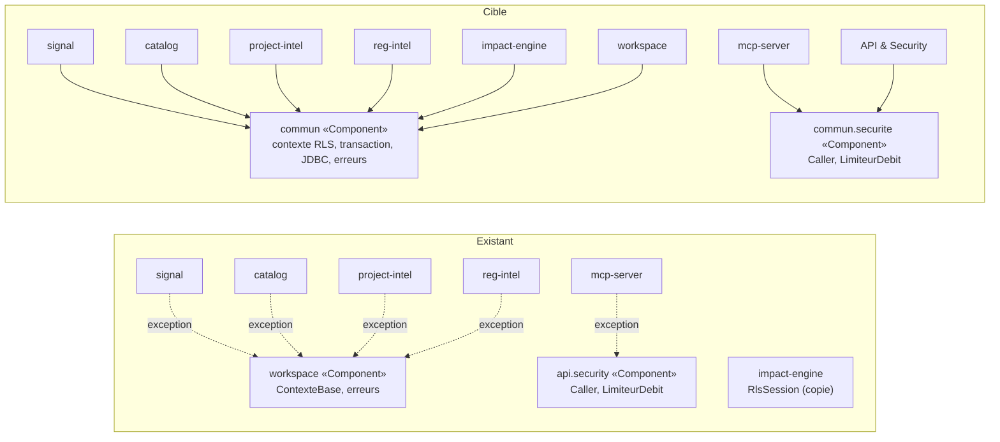
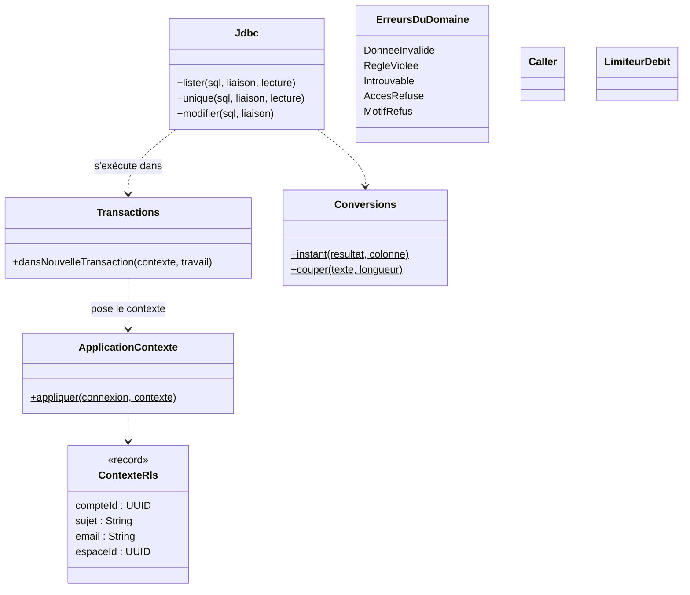

# Conception : extraire le noyau commun du serveur

<!-- Statuts : [EXIGENCE] [EXISTANT] [DÉCISION] [PROPOSITION] [QUESTION] — légende : /docs/specifications/README.md#statuts-des-informations. -->

**Niveau de conception** : complète — refactoring transverse de plusieurs modules, deux décisions structurantes à alternatives sérieuses (D2, D3, tranchées par le porteur le 2026-11-24), règle de propriété des données (D4).

## Contexte technique

État à la révision `b142695`, relu le 2026-11-24 (motivation et comptages : proposal.md) :

- **Contexte RLS** [EXISTANT] : `workspace/ContexteBase` offre `executer(contexte, travail)` (transaction manuelle) et `appliquer(connexion, contexte)` (quatre paramètres, utilisable dans une transaction JTA) ; `impact/RlsSession.account` en est une copie (compte seul, autres paramètres vidés) ; `SubscriptionService` et `PreferencesRepository` en ont chacun une variante qui ne pose que le compte et l'espace.
- **Transactions** [EXISTANT] : 90 `@Transactional` et 23 `QuarkusTransaction.` ; six blocs manuels `setAutoCommit(false) … commit/rollback` (proposal.md, « Sources et preuves »). Les lectures d'`impact` posent déjà le contexte RLS dans une transaction JTA (`impact/ImpactQueries.java:111-117`).
- **JDBC** [EXISTANT] : SQL explicite en blocs de texte, paramètres positionnels, lecture par index de colonne, `catch (SQLException …) { throw new IllegalStateException(…) }` répété ; convertisseurs `instant(ResultSet, int)`, `couper`/`cut`/`borner`, `utc` recopiés (AUD-QUA-06).
- **Frontières** [EXISTANT] : table `ALLOWED` de `ModuleBoundariesTest` et cinq règles d'exception (`mcpNeLitQueLaSecuriteDeLApi`, `signalNEmprunteQueRlsEtErreurs`, `projectintelNEmprunteQueRlsEtErreurs`, `catalogNEmprunteQueRlsEtErreurs`, `regintelNEmprunteQueRlsEtErreurs`) ; les tests ArchUnit ne voient pas le SQL.
- **Données** [EXISTANT] : aucune documentation du propriétaire des tables ; 13 tables lues par plusieurs modules (AUD-ARC-06).

## Exigences couvertes

Non applicable — `skip_specs: true`. Constats traités : AUD-ARC-05, AUD-ARC-04, AUD-QUA-06, AUD-ARC-06, AUD-QUA-04. Exigences existantes à ne pas régresser : ACC-04 (cloisonnement par espace), COR-08 (visibilité des impacts) — preuves par leurs tests actuels.

## Objectifs et non-objectifs

**Objectifs :**
- Un seul endroit pour le contexte RLS, la frontière transactionnelle et le squelette JDBC.
- Aucune règle d'exception au cas par cas dans le test des frontières.
- Propriété des tables écrite et vérifiée.

**Non-objectifs :**
- Changer une politique RLS, une requête SQL dans sa sémantique, une réponse d'API.
- Introduire un ORM : le SQL reste explicite (choix actuel, AUD-QUA-06 « Garder le SQL explicite »).
- Migrer tous les modules vers l'utilitaire JDBC dans ce changement.

## Composants impactés, responsabilités et frontières

| Composant | Responsabilité dans ce changement | Ne doit pas | Statut |
|---|---|---|---|
| commun (noyau commun) | contexte RLS, frontière transactionnelle, utilitaire JDBC et convertisseurs, erreurs du domaine partagées ; sous-paquet sécurité : appelant (`Caller`) et limiteur de débit | dépendre d'un module métier ; contenir une règle métier ; citer une table | nouveau |
| workspace | espaces, rôles, abonnements, préférences ; propriétaire de ses tables | servir de socle technique aux autres modules | modifié |
| API & Security | résolution OIDC de l'appelant (`CallerResolver`, `OidcCallerResolver`), ressources REST | porter l'appelant et le limiteur partagés avec `mcp-server` | modifié |
| impact-engine, signal, alerting | consommateurs migrés en premier vers l'utilitaire JDBC | poser `SET LOCAL ROLE` ou gérer l'autocommit | modifié |
| catalog, project-intel, reg-intel, inventory, ai-gateway, release-radar, mcp-server | consommateurs du contexte RLS, des erreurs et de la transaction communs | idem | modifié |

### DC-1 — Frontières de modules avant et après

Question : quelles dépendances disparaissent quand le noyau devient un composant ? Type : C4 Component (flowchart à stéréotypes). Existant (gauche) et cible (droite). Concerne AUD-ARC-05, AUD-ARC-04.



Explication : à gauche, chaque flèche pointillée est une règle d'exception ou une copie ; à droite, tous les modules dépendent du noyau, qui ne dépend d'aucun d'eux. Les dépendances métier de la table `ALLOWED` (par exemple `alerting → workspace` pour les destinataires) restent inchangées et ne sont pas dessinées.

## Modèle de domaine et invariants

### DC-2 — Contenu du noyau commun

Question : quelles classes forment le noyau et qu'exposent-elles ? Type : UML, diagramme de classes. Cible. Concerne AUD-ARC-05, AUD-ARC-04, AUD-QUA-06, AUD-QUA-04.



Explication : noms indicatifs (le nom final suit la convention de nommage d'arc42 §8.16). `Transactions` ouvre une transaction JTA et pose le contexte (D2) ; `Jdbc` est l'utilitaire interne (D3). `Caller` et `LimiteurDebit` sont déplacés sans changement de comportement.

Invariants testables :
- NC-1 : aucune classe hors du noyau commun ne contient `SET LOCAL ROLE` ni `set_config('argos.` (test de source).
- NC-2 : aucune classe du serveur, noyau compris, n'appelle `Connection.setAutoCommit`, `Connection.commit` ni `Connection.rollback` (ArchUnit).
- NC-3 : le noyau commun ne dépend d'aucun paquet de module métier (ArchUnit).
- NC-4 : tout contexte appliqué pose les quatre paramètres ; un paramètre absent vaut la chaîne vide, jamais une exception (test unitaire de l'application du contexte).
- NC-5 : chaque module ne cite dans son SQL que ses tables ou des vues publiées par leur propriétaire (test de source, D4).

## Traitements et interactions

### DC-3 — Lecture sous RLS dans le modèle transactionnel unique (D2)

Question : comment une lecture sous RLS s'exécute-t-elle avec une frontière JTA unique ? Type : UML, diagramme de séquence. Cible. Concerne AUD-QUA-04, AUD-ARC-04.

```mermaid
sequenceDiagram
    participant Service as Service d'un module
    participant Tx as Transactions (noyau)
    participant Ctx as ApplicationContexte (noyau)
    participant Base as PostgreSQL
    Service->>Tx: dansNouvelleTransaction(contexte, travail)
    Tx->>Base: début de transaction JTA (QuarkusTransaction)
    Tx->>Ctx: appliquer(connexion, contexte)
    Ctx->>Base: SET LOCAL ROLE argos_app ; set_config × 4 (locaux à la transaction)
    Tx->>Base: requêtes du travail (utilitaire JDBC)
    alt succès
        Tx->>Base: validation
    else exception
        Tx->>Base: annulation
        Tx-->>Service: exception relancée (traduction aux frontières inchangée)
    end
```

Explication : les paramètres `SET LOCAL` disparaissent à la fin de la transaction ; aucun appel `commit()` direct sur la connexion, donc aucun conflit avec une transaction JTA ouverte par un appelant.

## États et transitions

Non applicable — aucun cycle de vie introduit.

## Contrats d'interface

Non applicable — aucune opération REST, aucun outil MCP ni événement ne change. Vérification : comparaison du document `/q/openapi` avant et après (tâche 7.2).

## Persistance et intégrité

Aucune table ni politique modifiée. Si D4 retient une vue SQL nommée pour une lecture étrangère, elle est ajoutée par une nouvelle migration Flyway (ADR-0032), au numéro libre à la date de l'implémentation, avec ses droits pour `argos_app` et sa politique de sécurité (`security_invoker` ou équivalent) vérifiés par un test sous RLS ; sa ligne s'ajoute à l'inventaire d'arc42 §8.7.

## Transactions, concurrence et idempotence

Voir D2. Règle cible, à écrire dans arc42 §8.7 : une seule manière d'ouvrir une transaction de base ; le contexte RLS est posé au début de chaque transaction qui lit ou écrit des données cloisonnées ; aucune gestion manuelle de l'autocommit. Les six sites manuels sont migrés ; `PreparationFiches` cesse de laisser l'autocommit désactivé.

## Sécurité et isolation

- Le contexte RLS unique pose les quatre paramètres partout : les variantes de `SubscriptionService` et `PreferencesRepository` ne laissent plus hériter sujet et courriel (AUD-ARC-04).
- Les politiques RLS (ADR-0016, Proposé ; V2 et suivantes) sont inchangées ; tests de non-régression : tests de cloisonnement existants (`SubscriptionIsolationTest`, `SuiviIsolationTest`, tests ACC-04 et COR-08), plus le test de l'invariant NC-4.
- `Caller` et `LimiteurDebit` sont déplacés sans changer leur logique ; la résolution OIDC reste dans `api.security`.

## Gestion des erreurs et reprise

L'utilitaire JDBC traduit `SQLException` en une seule exception technique, au lieu des 111 `throw new IllegalStateException` recopiés ; la traduction aux frontières REST, MCP et planifiées suit le changement `isoler-erreurs-aux-frontieres` (sprint 4), dont l'état intégré sert de base. Aucune reprise nouvelle.

## Observabilité

Non applicable — aucune instrumentation ajoutée ; l'instrumentation du sprint 4 (`instrumenter-observabilite`) n'est pas modifiée.

## Performance et stratégie de mesure

Aucune cible nouvelle. La campagne `npm --prefix e2e run test:performance` (cible p95 < 500 ms des consultations, arc42 §10.2 Q-05) est relancée après la migration des modules cœur pour vérifier l'absence de régression (tâche 7.3).

## Compatibilité, migration et retour arrière

Migration par étapes, dans l'ordre interne du sprint 5 (AUD-ARC-05 → AUD-ARC-04 → AUD-QUA-06 → AUD-ARC-06 → AUD-QUA-04) : chaque groupe de tâches laisse `mvn -B -f argos-server/pom.xml verify` vert. Retour arrière : revert des commits du groupe ; aucune donnée migrée, sauf une vue éventuelle (D4), retirée par `DROP VIEW` sans perte.

## Décisions, alternatives et compromis

### D1 — Emplacement et périmètre du noyau commun

- **Statut** : [PROPOSITION] — dépend de l'acceptation de l'ADR du noyau commun, encore à rédiger (`ecrire-decisions-architecture-socle`, tâche 3.1 ; Q-1).
- **Choix** : paquet `io.argos.commun` (contexte RLS, transaction, JDBC, conversions, erreurs du domaine) et `io.argos.commun.securite` (`Caller`, `LimiteurDebit`), dans `argos-server` ; entrée `commun` autorisée pour tous les modules dans `ALLOWED`, `commun` ne dépendant de rien.
- **Justification** : action d'AUD-ARC-05 ; supprime les cinq exceptions et la copie d'`impact`.
- **Alternatives écartées** : laisser le noyau dans `workspace` — maintient les exceptions et les copies ; module Maven séparé — coût de build sans besoin démontré.
- **Compromis** : risque de « fourre-tout » ; l'ADR et NC-3 limitent le contenu à des mécanismes techniques.
- **ADR** : ADR du noyau commun (Proposé).

### D2 — Modèle transactionnel unique

- **Statut** : [DÉCISION] — décision du porteur, 2026-11-24.
- **Choix** : tout en JTA. `QuarkusTransaction.requiringNew()` ou `@Transactional` partout ; le noyau expose une frontière qui ouvre la transaction et applique le contexte RLS (DC-3) ; les six sites manuels sont réécrits et plus aucune classe du serveur ne gère l'autocommit ni n'appelle `commit()` ou `rollback()` sur une connexion.
- **Justification** : modèle déjà majoritaire (90 + 23 sites contre 6) ; plus de `commit()` sur une connexion enrôlée, donc plus de panne quand un appelant ajoute `@Transactional` (impact décrit par AUD-QUA-04) ; motif déjà prouvé par `ImpactQueries` (`@Transactional` + contexte RLS).
- **Alternatives écartées** : utilitaire manuel unique (`ContexteBase.executer` généralisé, avec une garde qui refuse l'appel dans une transaction JTA active) — deux modèles subsisteraient (JTA pour 113 sites, manuel pour les autres) et la garde ne ferait que transformer une panne à l'exécution en erreur plus claire.
- **Compromis** : les sites manuels qui enchaînent plusieurs transactions courtes (par exemple `RadarProjets`, `RapprochementActualites`) sont reproduits par des `requiringNew()` successifs ; leurs tests existants vérifient que les frontières de validation sont conservées.
- **ADR** : consigné dans l'ADR du noyau commun s'il est encore Proposé, sinon dans un ADR distinct (structurant, coûteux à inverser).

### D3 — Accès JDBC

- **Statut** : [DÉCISION] — décision du porteur, 2026-11-24.
- **Choix** : utilitaire interne au noyau commun, sans dépendance nouvelle : quelques méthodes (`lister`, `unique`, `modifier`) prenant le SQL, une liaison de paramètres et une lecture de ligne ; convertisseurs communs (dates, troncature) ; une seule traduction de `SQLException`.
- **Justification** : aucune dépendance livrée en plus (pas de revue de licence au titre d'ADR-0021) ; SQL explicite conservé ; migration progressive fichier par fichier.
- **Alternatives écartées** : Jdbi (client léger au-dessus de JDBC, extension Quarkiverse) — liaison par nom et lecture vers des records, mais nouvelle dépendance livrée (licence à vérifier et enregistrer, ADR-0021 points 4 et 6, contrôle `-P licences`), deuxième style d'accès tant que la migration n'est pas finie, intégration du contexte RLS et de JTA à valider.
- **Compromis** : code à maintenir et à tester ; la lecture par nom de colonne est offerte par `ResultSet`, la liaison par nom n'est pas fournie.
- **Exemple indicatif** :

```java
List<SignalResume> signaux = jdbc.lister(
        "SELECT id, title, published_at FROM signal WHERE id = ANY (?)",
        requete -> requete.setArray(1, identifiants),
        resultat -> new SignalResume(
                resultat.getObject("id", UUID.class),
                resultat.getString("title"),
                Conversions.instant(resultat, "published_at")));
```

- **ADR** : décision locale ; mentionnée dans l'ADR du noyau commun comme composant de son périmètre.

### D4 — Propriété des tables et lectures étrangères

- **Statut** : [PROPOSITION] — choix par cas révisable par le porteur (Q-4).
- **Choix** : arc42 §5.3 reçoit un tableau « module propriétaire → tables » ; le test de propriété (NC-5) contient la même table, sur le modèle de `ALLOWED` (« ajouter d'abord au test, puis à arc42 ») ; une lecture étrangère passe par le service de lecture du propriétaire quand la dépendance Java est déjà autorisée, sinon par une vue SQL nommée publiée par le propriétaire. Cas proposés pour les trois lectures non couvertes :
  - `impact → compte` (nom de l'acteur d'une transition, `ImpactQueries.java:322`) : vue nommée publiée par `workspace`, `impact` n'ayant pas le droit de dépendre de `workspace` ;
  - `catalog → appartenance` (`DictionnaireMetier.java:191`) : service de lecture de `workspace` (dépendance déjà autorisée) ;
  - `alerting → workspace_preference_utilisateur` (`Destinataires.java:52`) : service de lecture des préférences de `workspace`, et correction d'arc42 §5.4.1 et de `PreferencesIsolationTest` pour autoriser explicitement `alerting`.
- **Justification** : action d'AUD-ARC-06 ; le test rend visible tout nouveau couplage par le schéma.
- **Alternatives écartées** : documenter sans test — la dérive constatée depuis le 17/11 reprendrait ; vues pour toutes les lectures — multiplie les migrations sans gain quand la dépendance Java existe.
- **Compromis** : le test de source repère les tables par motif (`FROM`, `JOIN`, `INTO`, `UPDATE` suivis d'un nom) ; un SQL construit dynamiquement lui échappe (risque consigné).
- **ADR** : non : règle locale documentée en arc42 §5.3 et §8.7.

### D5 — Règles d'architecture

- **Statut** : [PROPOSITION].
- **Choix** : retirer les cinq règles d'exception et les entrées `workspace` / `api` de `ALLOWED` qui n'existaient que pour le noyau (à vérifier module par module : `catalog`, `signal`, `regintel`, `projectintel` vers `workspace`, `mcp` vers `api`) ; ArchUnit pour NC-2 et NC-3 ; test de source pour NC-1 et NC-5 (ArchUnit ne lit pas les chaînes SQL).
- **Justification** : critère de sortie du sprint 5 (« aucune autre classe ne pose SET LOCAL ROLE ni setAutoCommit »).
- **Alternatives écartées** : revue manuelle — c'est elle qui a laissé passer les copies.
- **Compromis** : un test de source dépend de la forme du code ; il s'appuie sur les mêmes motifs que l'audit.
- **ADR** : non : outillage de l'ADR du noyau commun et d'ADR-0001.

## Risques

- Changement de comportement transactionnel d'un site manuel (validation intermédiaire perdue ou ajoutée) → migrer un site par commit, avec ses tests existants ; relire la frontière de chaque validation.
- Fusion difficile avec les changes des sprints 1 à 4 qui touchent les mêmes fichiers → partir de leur état intégré (proposal.md, Impact).
- Noyau « fourre-tout » → périmètre fixé par l'ADR, NC-3.
- Test de propriété contourné par du SQL dynamique → consigné ; revue.

## Écarts code / tests / specs / documentation

- arc42 §5.4.1 (ligne 162) affirme que les préférences ne sont lues que par `api` et `mcp` ; `alerting/Destinataires.java:52` les lit ; `PreferencesIsolationTest` ne contrôle que les dépendances Java. Traitement : D4, tâche 5.3.
- `regintel/PreparationFiches.java:154` ne restaure pas l'autocommit. Traitement : tâche 6.1.
- `PreferencesRepository.java:120` peut lever une exception sur un compte nul. Traitement : tâche 3.1.

## Stratégie de vérification

| Constat / invariant | Niveau de test | Moyen de preuve | État |
|---|---|---|---|
| AUD-ARC-05, NC-3 | architecture | `ModuleBoundariesTest` sans règle d'exception ; règle « commun ne dépend d'aucun module » | à écrire |
| AUD-ARC-04, NC-1, NC-4 | architecture, unitaire, intégration | test de source ; test de l'application du contexte (quatre paramètres, valeurs nulles) ; tests de cloisonnement existants | à écrire |
| AUD-QUA-04, NC-2 | architecture, intégration | règle ArchUnit sur `Connection.setAutoCommit/commit/rollback` ; tests des six sites migrés | à écrire |
| AUD-QUA-06 | unitaire, intégration | tests de l'utilitaire JDBC et des conversions ; tests existants de `signal`, `impact`, `alerting` | à écrire |
| AUD-ARC-06, NC-5 | architecture | test de propriété des tables | à écrire |
| Non-régression de contrat | contrat | diff du document `/q/openapi` avant / après | à exécuter |
| Non-régression de performance | mesure | `npm --prefix e2e run test:performance` | à exécuter |

## Documentation durable impactée

- arc42 §5.2 (diagramme de composants du serveur : composant « commun »), §5.3 (composant « commun », tableau de propriété des tables), §5.4.1 (lecteurs des préférences), §5.5 (règle de dépendance vers le noyau), §8.7 (accès aux données et modèle transactionnel), inventaire `/docs/architecture/diagrams/README.md` si un diagramme est ajouté ou modifié.
- ADR du noyau commun (D2, D3 consignés s'il est encore Proposé) et index arc42 §9.

## Questions ouvertes

Q-1 de proposal.md (acceptation de l'ADR du noyau commun, encore à rédiger) bloque le groupe 2 des tâches. Q-4 et Q-5 peuvent attendre.
