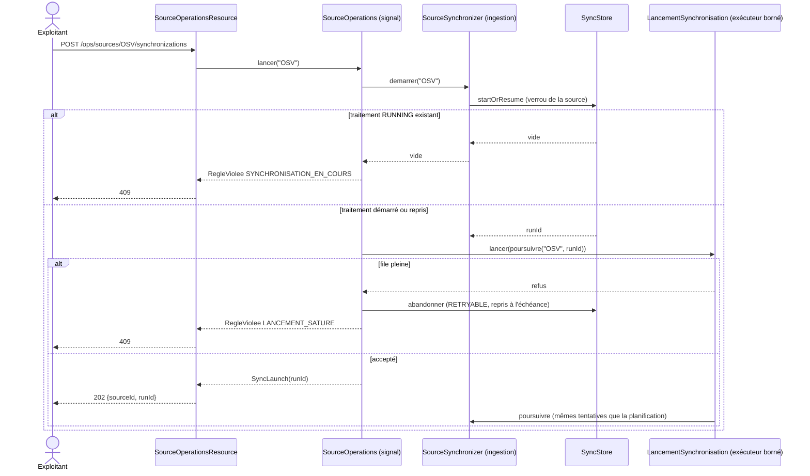
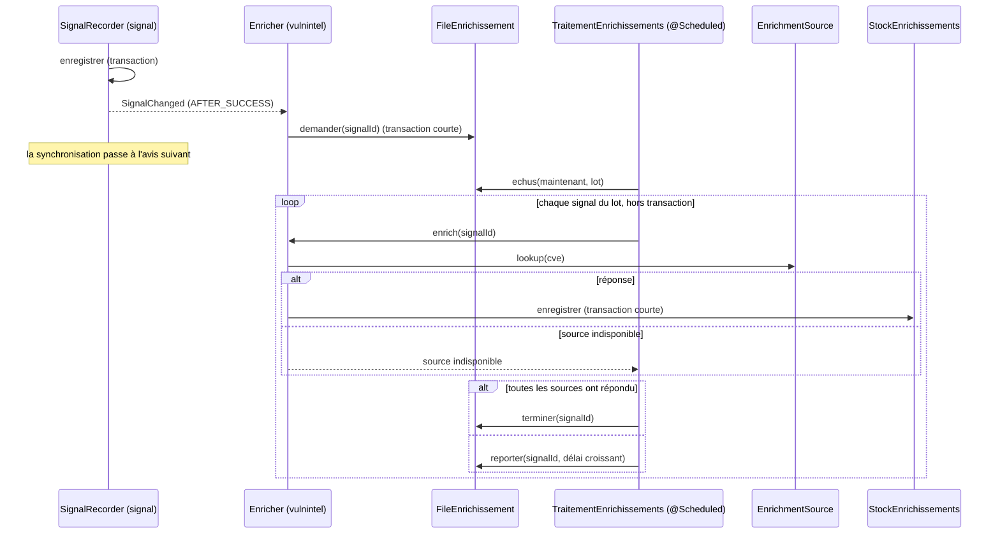
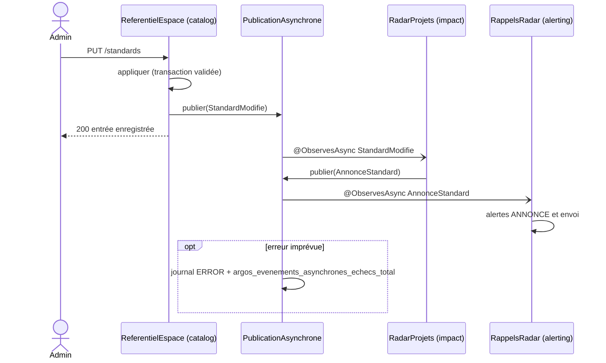
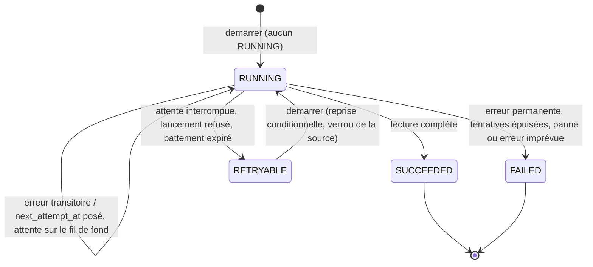
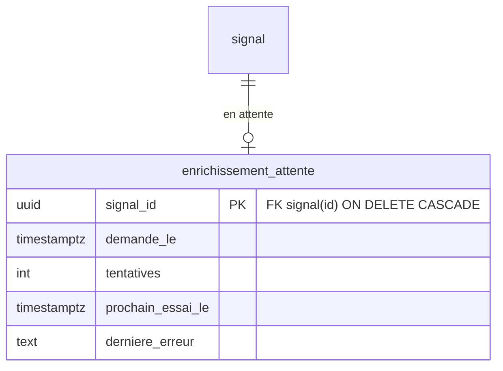

# Conception : rendre l'ingestion asynchrone

**Niveau de conception** : complète — un contrat d'API, une migration, des règles d'architecture transverses (événements, transactions, clients HTTP) et cinq composants changent ensemble.

## Contexte technique

Voir `proposal.md` pour la motivation et les preuves. État à `dab09c6` :

- `SourceSynchronizer.synchronize` enchaîne lecture de l'index, lecture de chaque avis, normalisation et enregistrement ; les attentes de reprise dorment sur le fil appelant (`Sleeper`) après `SyncStore.markRetryable` (état `RETRYABLE`) [EXISTANT].
- `SignalRecorder` publie `SignalChanged` dans la transaction d'enregistrement ; `Enricher` et `CorrelationEngine` l'observent `AFTER_SUCCESS`, sur le même fil ; `Enricher` ouvre une transaction autour des appels réseau [EXISTANT].
- `CorrelationEngine.publish` publie `ImpactsRecorded` hors transaction ; `MoteurAlertes` l'observe de façon synchrone (résumé IA borné, envoi) [EXISTANT].
- `ReferentielEspace` publie `StandardModifie` après `ContexteBase.executer`, hors transaction : un observateur transactionnel y serait appelé immédiatement, dans la requête [EXISTANT].
- `io.argos.execution.ExecuteurBorne` offre « soumettre, attendre avec délai, annuler » ; `ExecuteurResumeIa` et `ExecuteurSyntheseIa` l'étendent [EXISTANT].

## Exigences couvertes

| Exigence | Section(s) de conception | Diagramme(s) |
|---|---|---|
| COL-04 (S1 à S4) | D3, Traitements, Persistance | DC-2, DC-4 |
| COL-12-S1, COL-12-S2 | D1, Contrats d'interface | DC-1 |
| COL-12-S3 | D2, États | DC-3 |
| RAD-07 (S2 à S4) | D5 | DC-5 |
| COL-09-S2 (non-régression) | D2 | DC-3 |

AUD-ARC-10, AUD-PER-11, AUD-PER-13 et AUD-ARC-19 ne changent aucun comportement spécifié : D6 à D9.

## Objectifs et non-objectifs

**Objectifs :**
- aucune requête HTTP n'attend une synchronisation, un enrichissement, une annonce ou une évaluation d'alertes ;
- aucun appel réseau dans une transaction ouverte, vérifié par ArchUnit ;
- un enrichissement refusé est toujours repris ;
- un seul traitement en cours par source, attente de reprise comprise ;
- une seule construction de client `java.net.http`, une lecture bornée partout.

**Non-objectifs :**
- broker ou file externe (arc42 §8.9 : pas de broker sans besoin mesuré) ;
- limiteur de débit par jeton pour NVD (Q-1) ;
- modification du transport épinglé de la veille web.

## Composants impactés, responsabilités et frontières

| Composant | Responsabilité dans ce changement | Ne doit pas | Statut |
|---|---|---|---|
| source-ingestion | démarrer un traitement puis le poursuivre en tâche de fond (`LancementSynchronisation`, exécuteur borné) ; attente de reprise exclusive ; lecture d'OSV par archive au-delà du seuil | attendre une source secondaire | modifié |
| signal | façade d'exploitation : lancement 202 / 409 | appeler un connecteur | modifié |
| vulnerability-intelligence | file d'enrichissement persistante, traitement planifié par lots, rattrapage planifié | appeler une source en transaction | modifié |
| impact-engine | publier `ImpactsRecorded` et `AnnonceStandard` de façon asynchrone ; observer `StandardModifie` de façon asynchrone | attendre l'évaluation des alertes | modifié |
| alerting | observer `ImpactsRecorded` et `AnnonceStandard` de façon asynchrone ; `AlerteEmise` supprimé | — | modifié |
| catalog | publier `StandardModifie` de façon asynchrone après validation | attendre l'annonce | modifié |
| project-intel | lire les échéances en une requête ; une tâche par forge sur un exécuteur borné | appeler une forge en parallèle d'elle-même | modifié |
| commun | `commun.http` : fabrique de clients et lecture bornée | contenir une règle métier ou une URL de source | modifié |
| execution | lancement sans attente (`lancer`), lot de tâches avec délai global (`executerTous`), état d'inactivité | — | modifié |
| observabilite | publication asynchrone comptée (`PublicationAsynchrone`), compteur des échecs de traitement de fond | — | modifié |

## Modèle de domaine et invariants

Le modèle métier ne change pas. Invariants testables :

- INV-1 : au plus un traitement `RUNNING` par source, y compris pendant l'attente d'une nouvelle tentative (index `sync_run_one_running`, COL-12-S3).
- INV-2 : un traitement ne reprend après son attente que s'il est toujours `RUNNING` et à lui (mise à jour conditionnelle, nombre de lignes contrôlé).
- INV-3 : tout signal créé ou modifié est dans la file d'enrichissement jusqu'à ce que toutes les sources secondaires aient répondu, ou jusqu'à l'épuisement de ses tentatives ; le rattrapage replace en file un signal à CVE sans aucun enrichissement.
- INV-4 : aucune méthode qui appelle `EnrichmentSource.lookup` ou lit un avis (`AdvisoryFeed.fetch`, `AdvisoryFeed.Lecture.avis`), ni aucune méthode qui l'appelle transitivement, n'est transactionnelle ni n'ouvre de transaction par `QuarkusTransaction`.
- INV-5 : un observateur synchrone (`@Observes` sans phase) d'un événement d'un autre module figure dans la liste fermée du test des observateurs.

## Traitements et interactions

### DC-1 — Lancement d'une synchronisation par l'exploitant (UML séquence, cible ; COL-12-S1, S2)

La synchronisation planifiée appelle `synchronize`, qui est `demarrer` suivi de `poursuivre` sur le fil du planificateur : les deux déclencheurs exécutent le même traitement.

### DC-2 — Enrichissement différé (UML séquence, cible ; COL-04-S3, S4)

### DC-5 — Annonce d'un changement de standard (UML séquence, cible ; RAD-07-S2 à S4)

## États et transitions

### DC-3 — Traitement de synchronisation (UML états, cible ; COL-12-S3, INV-1, INV-2)

Existant : l'attente faisait passer le traitement `RETRYABLE`, hors de l'index unique. Cible : il reste `RUNNING` ; un second lancement reçoit « déjà en cours ».

## Contrats d'interface

| Élément | Valeur |
|---|---|
| Opération et chemin | `POST /api/v1/ops/sources/{id}/synchronizations` (contrat exécutable : `/q/openapi`) |
| Authentification / autorisations | jeton OIDC, rôle d'exploitation (`Access.operator()`), inchangé ; matrice `securite/matrice-roles.tsv` inchangée |
| Champs | aucun corps de requête ; réponse `SyncLaunch` : `sourceId` (texte), `runId` (UUID) |
| Exemple | `202 {"sourceId":"OSV","runId":"4f0c…"}` |
| Erreurs et codes | 404 source inconnue ; 409 `SYNCHRONISATION_EN_COURS` ; 409 `LANCEMENT_SATURE` (file de l'exécuteur pleine, traitement laissé `RETRYABLE`) ; 401/403 inchangés |
| Compatibilité et idempotence | **BREAKING** : 202 au lieu de 200 et corps réduit ; seul consommateur connu : `e2e/performance/mesure.mjs` (opération exclue de la mesure), mis à jour ; un second appel pendant le traitement est refusé (409), sans effet |

Événements CDI : `StandardModifie`, `AnnonceStandard`, `ImpactsRecorded` publiés par `fireAsync` ; `AlerteEmise` retiré.

## Persistance et intégrité

DC-4 (entité-association, cible). Migration `V25__file_enrichissement.sql` : table, index sur `prochain_essai_le`, droits identiques aux tables de `vulnintel` (`enrichment`). Propriété : `vulnintel` (arc42 §5.3.1, `ProprieteTablesTest`). La suppression en cascade suit `signal` ; le nettoyage des tests (`TRUNCATE signal … CASCADE`) la vide sans modification.

`sync_run` : pas de changement de schéma ; `next_attempt_at` est renseigné sur un traitement `RUNNING` en attente.

## Transactions, concurrence et idempotence

- `SyncStore.attendreReprise` laisse `RUNNING`, pose `next_attempt_at` et le battement ; `SyncStore.reprendre` : `UPDATE … WHERE id = ? AND state = 'RUNNING'` ; zéro ligne → le traitement s'arrête sans écrire (INV-2). `startOrResume` reprend un `RETRYABLE` par `UPDATE … WHERE state = 'RETRYABLE'` sous le verrou de la source.
- Attente (≤ `backoff-max`, PT5M) très inférieure à `running-expiry` (PT30M) : un traitement en attente n'expire pas.
- File d'enrichissement : `INSERT … ON CONFLICT (signal_id) DO UPDATE SET prochain_essai_le = least(...)` (idempotent) ; la tâche planifiée est `SKIP` : un seul passage à la fois. L'enregistrement d'un enrichissement reste `ON CONFLICT DO UPDATE`.
- Collecte d'activité : une tâche par forge ; les projets d'une forge restent séquentiels, le report sur quota reste local à la forge.

## Sécurité et isolation

- Aucun droit nouveau. La file d'enrichissement est une table technique sans donnée personnelle ; RLS non requise (même régime que `enrichment`).
- `commun.http` : redirections refusées, `User-Agent` fixe, lecture bornée (R-12) ; les archives OSV vont dans un fichier temporaire du répertoire temporaire de la JVM, supprimé à la fermeture de la lecture, taille bornée.
- Les noms d'entrée de l'archive OSV ne sont jamais utilisés comme chemin : lecture par `ZipFile.getEntry("<id>.json")` en mémoire bornée.

## Gestion des erreurs et reprise

- Tâche de fond (`ExecuteurBorne.lancer`) : `SourceSynchronizer.poursuivre` traite ses erreurs comme aujourd'hui (FAILED, relance de l'imprévue) ; l'erreur relancée est journalisée avec sa cause par l'exécuteur et comptée (`argos_traitements_fond_echecs_total{traitement}`).
- Observateur asynchrone : la panne d'accès aux données reste capturée et journalisée par l'observateur ; une erreur imprévue sort de l'observateur, est journalisée au niveau erreur avec sa pile et comptée (`argos_evenements_asynchrones_echecs_total{evenement}`). Elle n'est plus propagée à la requête (RAD-07-S3) : la règle 3 des frontières d'erreur (arc42 §8.5) est réécrite pour les trois styles.
- File d'enrichissement : panne d'accès aux données sur un signal → journalisée, signal reporté ; erreur imprévue → retenue, passage terminé en échec visible (`ErreursImprevues`).
- Archive OSV indisponible ou trop volumineuse : journalisée, lecture avis par avis pour cet écosystème.
- Arrêt du serveur : `shutdownNow` interrompt la synchronisation de fond ; le traitement reste `RUNNING` puis est reclassé à l'expiration (arc42 §6.4, inchangé).

## Observabilité

- Tâches planifiées `vulnintel-enrichissement` et `vulnintel-rattrapage`, avec `@TacheObservee` (contrôle `tache-<identité>`).
- Compteurs Micrometer : `argos_traitements_fond_echecs_total`, `argos_evenements_asynchrones_echecs_total`.
- La corrélation des journaux est propagée aux tâches de fond et aux observateurs asynchrones par l'exécuteur des événements (`Correlation.propager`).

## Performance et stratégie de mesure

Aucune cible chiffrée dans les sources ([QUESTION] héritée de `mesure-performance-api-mcp.md`, opérations d'ingestion exclues). Mesures de non-régression : le `POST` de lancement répond sans dépendre du nombre d'avis (test : réponse 202 pendant qu'une réponse OSV est retenue par le serveur simulé).

## Compatibilité, migration et retour arrière

- Migration additive (V25). Retour arrière : redéployer la version précédente ; la table orpheline est sans effet.
- API d'exploitation : 202 au lieu de 200 ; l'IHM n'appelle pas cette opération (`argos-ui` : aucune occurrence).
- Collision de numéro de migration possible avec le sprint 7 mené en parallèle : renuméroter au rebase si `origin/main` porte déjà un V25.

## Décisions, alternatives et compromis

### D1 — Lancement manuel en tâche de fond sur un exécuteur borné

- **Statut** : [PROPOSITION]
- **Choix** : `LancementSynchronisation extends ExecuteurBorne` (`argos.ingestion.lancement.fils` 1, `fils-max` 2, `file` 8) ; `ExecuteurBorne.lancer(nom, tâche)` soumet sans attendre ; le traitement est démarré dans la requête pour rendre son identifiant.
- **Justification** : réutilise le motif d'exécuteur possédé par un bean (arrêt propre, corrélation) ; le même `poursuivre` sert la planification.
- **Alternatives écartées** : déclencher la tâche `@Scheduled` (pas d'identifiant de traitement, couplage au planificateur) ; `ManagedExecutor` (extension supplémentaire, pool partagé).
- **Compromis** : les attentes de reprise dorment toujours, mais sur un fil de fond dédié.
- **ADR** : ADR-0039 (Proposé).

### D2 — Attente de reprise sous l'exclusion

- **Statut** : [PROPOSITION]
- **Choix** : rester `RUNNING` avec `next_attempt_at` ; reprise conditionnelle (AUD-PER-27, première option de l'audit).
- **Alternatives écartées** : reprise conditionnelle seule en `RETRYABLE` (un second fil démarrerait quand même pendant l'attente) ; re-planification sans fil endormi (refonte du curseur, hors sprint).
- **ADR** : non : décision locale.

### D3 — File d'enrichissement persistante traitée par une tâche planifiée

- **Statut** : [PROPOSITION]
- **Choix** : table `enrichissement_attente`, tâche `@Scheduled` (`argos.enrichissement.cadence` PT30S, `lot` 5, `tentatives-max` 8, délai PT5M doublé jusqu'à PT6H) ; rattrapage `retryMissing` planifié (`argos.enrichissement.rattrapage.cadence` PT6H, `rattrapage.lot` 500) qui replace en file.
- **Justification** : aucun enrichissement perdu au redémarrage ; débit vers NVD borné (5 signaux / 30 s) sans clé ; aucune transaction pendant les appels.
- **Alternatives écartées** : observateur `@ObservesAsync` (perdu au redémarrage, débit non borné) ; seul `retryMissing` planifié (ne reprend pas un enrichissement partiel).
- **Compromis** : l'enrichissement d'un nouveau signal arrive jusqu'à une cadence plus tard.
- **ADR** : ADR-0039 (Proposé), volet « appels réseau hors transaction ».

### D4 — Règle ArchUnit « aucun appel réseau en transaction »

- **Statut** : [PROPOSITION]
- **Choix** : condition qui remonte les appelants transitifs des méthodes `lookup` et de lecture d'avis et refuse `@Transactional` (méthode ou classe) et tout appel à `QuarkusTransaction` ; classe d'exemple qui viole la règle.
- **ADR** : ADR-0039 (Proposé).

### D5 — Trois styles d'observateurs et publication asynchrone comptée

- **Statut** : [PROPOSITION] — périmètre décidé par le porteur du projet le 2026-11-26 (alertes comprises).
- **Choix** : (1) `@Observes` synchrone : seulement pour un travail court, local, qui doit réussir ou échouer avec la transaction de l'émetteur, ou une invalidation en mémoire ; (2) `@Observes(during = AFTER_SUCCESS)` : travail court en base après validation ; (3) `@ObservesAsync` publié par `PublicationAsynchrone` : tout travail long, réseau, IA ou envoi, et tout travail déclenché par une requête qui ne doit pas l'attendre. Exécuteur dédié `ExecuteurEvenements` (`argos.evenements.fils` 2, `fils-max` 4, `file` 256) ; file pleine → exécution sur le fil émetteur (rien n'est perdu).
- **Alternatives écartées** : pool par défaut de `fireAsync` (corrélation non propagée, taille non configurée) ; `AFTER_SUCCESS` pour la chaîne radar (exécuté immédiatement hors transaction JTA, donc dans la requête).
- **ADR** : ADR-0039 (Proposé).

### D6 — Suppression d'`AlerteEmise`

- **Statut** : [DÉCISION] du porteur du projet, 2026-11-26.
- **ADR** : non.

### D7 — Fabrique HTTP commune

- **Statut** : [PROPOSITION]
- **Choix** : `io.argos.commun.http.ClientsHttp` (`client(délai)`, `clientSansProxy(délai)`, `requete(uri, délai)` avec `User-Agent: argos-server`) et `LectureBornee` (`lire(flux, max)`, `lignes(flux, max, consommateur)`, `copier(flux, fichier, max)`) ; `ReponseTropVolumineuse extends IOException`. Plafond par défaut `argos.http.taille-max-octets` (16 Mio), surchargé par client. Test ArchUnit : `HttpClient.newBuilder` n'est appelé que dans `commun.http`.
- **Alternatives écartées** : client REST MicroProfile (dépendance et modèle de programmation nouveaux) ; un seul client partagé (délais de connexion différents selon la source, proxy refusé pour Ollama).
- **ADR** : ADR-0039 (Proposé) précise ADR-0037.

### D8 — Lecture OSV par archive au-delà d'un seuil

- **Statut** : [PROPOSITION] — seuil : Q-2.
- **Choix** : `AdvisoryFeed.lire(position)` rend une `Lecture` fermable ; OSV lit l'index en flux et, au-delà de `argos.sources.osv.seuil-archive` (1 000) avis pour un écosystème, télécharge `<export>/<écosystème>/all.zip` (plafond `argos.sources.osv.archive-taille-max-octets`, 1 Gio) ; chaque avis est lu dans l'archive, l'API servant de repli.
- **Alternatives écartées** : archive seulement sans curseur (ne couvre pas une longue interruption) ; extraction complète en mémoire.
- **Compromis** : une archive par écosystème reste sur disque jusqu'à la fin de la synchronisation ; le battement du traitement n'est pas rafraîchi pendant un téléchargement, qui doit durer moins que `argos.ingestion.running-expiry` (PT30M).
- **ADR** : non : décision locale à l'adaptateur.

### D9 — Collecte d'activité par forge

- **Statut** : [PROPOSITION]
- **Choix** : `ActiviteStore.prochainesCollectes()` (une requête) ; `ExecuteurCollecteActivite` (`argos.activite.forges.fils` 2, `fils-max` 2, `file` 8) ; `ExecuteurBorne.executerTous(tâches, délai)` ; délai global `argos.activite.duree-max-passage` (PT50M).
- **Alternatives écartées** : jointure SQL avec `project` (lecture croisée interdite par la propriété des tables) ; parallélisme par projet (quotas d'une forge consommés en concurrence).
- **ADR** : non : décision locale.

## Risques

- Tests d'alertes devenus asynchrones → attente bornée par Awaitility sur l'inactivité de `ExecuteurEvenements` (arc42 §8.11 : aucun sommeil).
- Archive npm volumineuse → plafond et repli avis par avis.
- Collision de migration avec le sprint 7 → renumérotation au rebase.

## Écarts code / tests / specs / documentation

- `RadarStandardsTest#annonceEnErreurImprevueRemonteApresLEnregistrement` exige 500 : contredit RAD-07-S3 modifié ; le test est réécrit (200, erreur comptée).
- Javadoc d'`Enricher` (rattrapage annoncé, inexistant) : réécrit.
- arc42 §8.5 règle 3 des frontières d'erreur (observateur synchrone propage l'imprévue) : réécrite pour les trois styles.

## Stratégie de vérification

| Exigence / scénario | Niveau de test | Moyen de preuve | État |
|---|---|---|---|
| COL-12-S1 | intégration | `LancementSynchronisationTest` : 202 et `runId` pendant qu'une réponse OSV est retenue, puis traitement `SUCCEEDED` | écrit |
| COL-12-S2 | intégration | même classe : second POST → 409 `SYNCHRONISATION_EN_COURS` | écrit |
| COL-12-S3 | intégration (concurrence) | attente simulée qui lance une seconde synchronisation (manuelle et planifiée) pendant l'attente : « déjà en cours », un seul `RUNNING` | écrit |
| COL-04-S1 à S3 | intégration | `EnrichmentTest` : passage de la file après synchronisation ; EPSS rattrapé au passage suivant | écrit |
| COL-04-S4 | intégration | réponse NVD retenue : la synchronisation se termine sans attendre | écrit |
| INV-4 | architecture | `AppelsReseauHorsTransactionTest` + classe d'exemple | écrit |
| INV-5 | architecture | `ObservateursEvenementsTest` + classe d'exemple | écrit |
| RAD-07-S2 à S4 | intégration | `RadarStandardsTest` (attente bornée), annonce retenue, compteur d'échecs | écrit |
| D7 | architecture + unitaire | `ClientsHttpCommunsTest` ; `LectureBorneeTest` | écrit |
| D8 | intégration | `OsvArchiveTest` (archive servie par le serveur simulé, seuil 1) | écrit |
| D9 | intégration | `ActiviteDepotCaracterisationTest` / test de collecte : une requête d'échéances, deux forges | écrit |

## Documentation durable impactée

- `/docs/specifications/collecte-avis-securite.md` (COL-04, COL-12, DF-COL-1) ; `/docs/specifications/radar-standards.md` (RAD-07) ; `/docs/specifications/README.md` (couverture).
- arc42 §5.3 (commun, source-ingestion, vulnerability-intelligence), §5.3.1 (propriété de `enrichissement_attente`), §6.1 et §6.3 (séquences), §8.5 (tâches planifiées, exécuteurs, frontières d'erreur), §8.6 (compteurs), nouvelle sous-section « Événements entre modules » en §8.
- ADR-0039 (Proposé) et index des ADR.

## Questions ouvertes

Q-1 et Q-2 de la proposition : valeurs par défaut retenues, modifiables par configuration.
