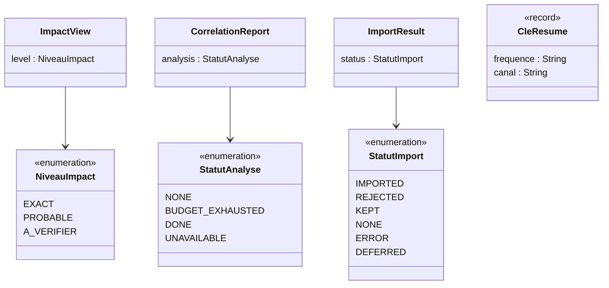

# Conception : typer les échanges entre modules

<!-- Statuts : [EXIGENCE] [EXISTANT] [DÉCISION] [PROPOSITION] [QUESTION] — légende : /docs/specifications/README.md#statuts-des-informations. -->

**Niveau de conception** : allégée — refactoring local (`impact-engine`, `alerting`, `inventory`, vues de `API & Security` et `mcp-server`), sans nouveau composant ni contrat.

## Contexte technique

Voir proposal.md, « Sources et preuves » (lignes relues le 2026-11-24). Points utiles :

- Le niveau est écrit en base par `Level.name()` (`impact/CorrelationEngine.java:333`) et relu en chaîne dans `ImpactView` (`impact/ImpactQueries.java:46`) [EXISTANT].
- Le serveur sérialise les records par Jackson (`quarkus-rest-jackson`, `argos-server/pom.xml:53`) ; une énumération est écrite par défaut sous son nom [EXISTANT — comportement par défaut de Jackson ; à vérifier par test, tâche 1.3].
- Java 17 (ADR-0019, Accepté) : une expression `switch` sur une énumération sans `default` doit couvrir toutes les constantes, sinon la compilation échoue [DÉCISION — ADR-0019 ; règle du langage].

## Exigences couvertes

Non applicable — `skip_specs: true`. Constat traité : AUD-QUA-08. Non-régression : COR-02, ALR-02, ALR-04, INV-07.

## Objectifs et non-objectifs

**Objectifs :**
- Toute valeur fermée échangée entre modules dans le périmètre est typée ; un renommage casse la compilation.
- Aucune branche `default` sur ces énumérations.

**Non-objectifs :**
- Changer une valeur JSON, une colonne ou une contrainte.
- Typer les champs hors constat (proposal.md, « Exclu »).

## Composants impactés, responsabilités et frontières

| Composant | Responsabilité dans ce changement | Ne doit pas | Statut |
|---|---|---|---|
| impact-engine | publier le type du niveau ; typer le statut d'analyse de la corrélation | exposer la règle de rapprochement à travers le type | modifié |
| alerting | consommer le niveau typé ; clé de résumé en record | réinterpréter le niveau par des littéraux | modifié |
| inventory | typer le statut d'import ; bilan exhaustif | compter une valeur inconnue sans le dire | modifié |
| API & Security, mcp-server | reprendre le niveau typé dans leurs vues | modifier le JSON exposé | modifié |

Les dépendances `alerting → impact`, `api → impact` et `mcp → impact` sont déjà autorisées (`ModuleBoundariesTest`, table `ALLOWED`) : aucune nouvelle arête.

## Modèle de domaine et invariants

### DC-1 — Types introduits ou exposés

Question : quels types remplacent les chaînes, et qui les possède ? Type : UML, diagramme de classes. Cible. Concerne AUD-QUA-08.

Explication : `NiveauImpact` désigne l'énumération existante `MatchRules.Level`, conservée telle quelle ou sortie de `MatchRules` en type de premier niveau du paquet `impact` (D1). Les noms des autres types sont indicatifs et suivent arc42 §8.16. `CleResume` est privé au moteur d'alertes. Le contenu d'alerte (`ContenuAlerte.Projet.niveau`) prend aussi `NiveauImpact`.

Invariants testables :
- TE-1 : la valeur JSON de `level` dans les réponses REST et MCP est exactement `EXACT`, `PROBABLE` ou `A_VERIFIER` (test de sérialisation).
- TE-2 : un contenu d'alerte écrit avant le changement se relit sans erreur (test de relecture d'un JSON existant).
- TE-3 : aucune expression `switch` sur ces énumérations ne porte de branche `default` (relecture ; le compilateur garantit l'exhaustivité des expressions `switch`).
- TE-4 : une valeur de niveau inconnue lue en base lève une erreur explicite au lieu d'un rang par défaut (test unitaire de la conversion).

## Traitements et interactions

Non applicable — les traitements sont inchangés ; seuls les types des valeurs changent.

## États et transitions

Non applicable — aucun cycle de vie.

## Contrats d'interface

| Élément | Valeur |
|---|---|
| Opérations concernées | réponses qui contiennent un impact ou un projet touché : `GET /api/v1/projects/{projectId}/impacts`, consultations d'impacts, « Ma veille » (`GET /api/v1/me/veille`), suivi (`WatchResource`), outils MCP de sécurité, alertes consultées |
| Champ | `level` (et `niveau` du contenu d'alerte) : chaîne parmi `EXACT`, `PROBABLE`, `A_VERIFIER` |
| Compatibilité | valeurs identiques ; le schéma OpenAPI passe de `string` à `string` avec `enum` ; aucun champ ajouté ni retiré |
| Vérification | comparaison du document `/q/openapi` avant et après : seule différence admise, l'ajout de `enum` sur ces champs (tâche 4.2) ; tests TE-1 et TE-2 |

Statuts d'import et d'analyse : non exposés en REST ni en MCP (`ImportResult` et `CorrelationReport` ne sortent pas de leur module, proposal.md) ; aucune incidence de contrat.

## Persistance et intégrité

Aucune migration. La conversion de la colonne `project_impact.level` vers l'énumération se fait à la lecture ; la contrainte `CHECK` de `V5__impacts_projet.sql:12` garantit les trois valeurs.

## Transactions, concurrence et idempotence

Non applicable — inchangé.

## Sécurité et isolation

Non applicable — inchangé.

## Gestion des erreurs et reprise

Une valeur inconnue (niveau en base, statut) lève une erreur explicite au lieu d'être rangée ou comptée silencieusement (TE-4). Le bilan de l'import planifié garde ses compteurs ; la répartition de `KEPT` et `NONE` reste celle d'aujourd'hui (Q-1).

## Observabilité

Message du bilan de l'import planifié inchangé.

## Performance et stratégie de mesure

Non applicable — aucun effet mesurable attendu.

## Compatibilité, migration et retour arrière

Un seul déploiement, sans migration ; retour arrière par revert. Les contenus d'alerte stockés restent lisibles dans les deux sens (mêmes valeurs).

## Décisions, alternatives et compromis

### D1 — Type du niveau d'impact

- **Statut** : [PROPOSITION].
- **Choix** : utiliser l'énumération du paquet `impact` (aujourd'hui `MatchRules.Level`), éventuellement sortie de `MatchRules` en type de premier niveau pour ne pas exposer la classe des règles ; les consommateurs (`alerting`, `api`, `mcp`) dépendent déjà d'`impact`.
- **Justification** : action d'AUD-QUA-08 (« Exposer MatchRules.Level (ou un type partagé) ») ; aucune nouvelle dépendance de module.
- **Alternatives écartées** : type dans le noyau commun (`extraire-noyau-commun`) — le niveau est un concept métier d'`impact-engine`, pas un mécanisme technique ; garder la chaîne et centraliser des constantes — ne rend pas les `switch` exhaustifs.
- **Compromis** : sortir l'énumération de `MatchRules` touche tous les imports de `MatchRules.Level`.
- **ADR** : non : décision locale.

### D2 — Rang des niveaux dans les alertes

- **Statut** : [PROPOSITION].
- **Choix** : expression `switch` exhaustive sur l'énumération (ou ordre de déclaration documenté), sans `default`.
- **Justification** : supprime le rang 2 attribué à toute valeur inconnue.
- **Alternatives écartées** : `ordinal()` seul — dépend silencieusement de l'ordre de déclaration.
- **ADR** : non.

### D3 — Statuts d'import et d'analyse

- **Statut** : [PROPOSITION].
- **Choix** : énumérations dans `inventory` et `impact`, mêmes noms que les chaînes actuelles ; `switch` exhaustif dans l'import planifié (`KEPT` et `NONE` vers « conservés », comme aujourd'hui).
- **Justification** : critère de sortie du sprint 5.
- **Alternatives écartées** : garder `default` en le journalisant — reste silencieux à la compilation.
- **ADR** : non.

### D4 — Clé de résumé

- **Statut** : [PROPOSITION].
- **Choix** : record privé (fréquence, canal) dans l'ensemble des résumés du plan ; égalité par valeur conservée.
- **Justification** : supprime `split(":")`, qui casserait sur un canal contenant `:`.
- **ADR** : non.

## Risques

- Un client qui validerait strictement le schéma OpenAPI verrait apparaître `enum` → valeurs identiques ; aucun client connu ne valide le schéma (l'IHM type `level` en `string`).
- Conflits de fusion avec `extraire-noyau-commun` sur `ImpactQueries` et `MoteurAlertes` → appliquer ce changement après lui (proposal.md, Impact).

## Écarts code / tests / specs / documentation

Voir proposal.md, « Écarts constatés » (record `ResumeObtenu` déjà livré, lignes déplacées, cumul `KEPT` / `NONE`).

## Stratégie de vérification

| Constat / invariant | Niveau de test | Moyen de preuve | État |
|---|---|---|---|
| AUD-QUA-08 niveau, TE-1, TE-4 | unitaire, intégration | test de sérialisation des vues ; test de conversion d'une valeur inconnue ; tests COR-02, ALR-02 existants | à écrire |
| AUD-QUA-08 contenu d'alerte, TE-2 | intégration | relecture d'un contenu JSON existant | à écrire |
| AUD-QUA-08 clé de résumé | unitaire, intégration | tests ALR-04 existants (résumés) verts | à exécuter |
| AUD-QUA-08 statuts, TE-3 | unitaire | bilan de l'import planifié par statut ; tests INV-07 existants ; compilation sans `default` | à écrire |
| Contrat | contrat | diff `/q/openapi` (ajout de `enum` seulement) | à exécuter |

## Documentation durable impactée

- arc42 §8.16 « Conventions de code » : valeur fermée échangée entre modules typée par énumération, `switch` sans `default`.

## Questions ouvertes

Q-1 de proposal.md (compteur de `NONE`) : peut attendre ; le comportement actuel est conservé.
