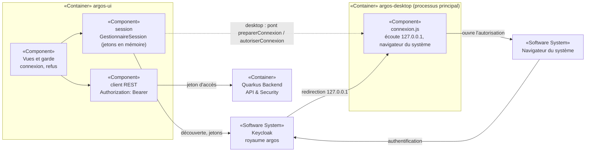
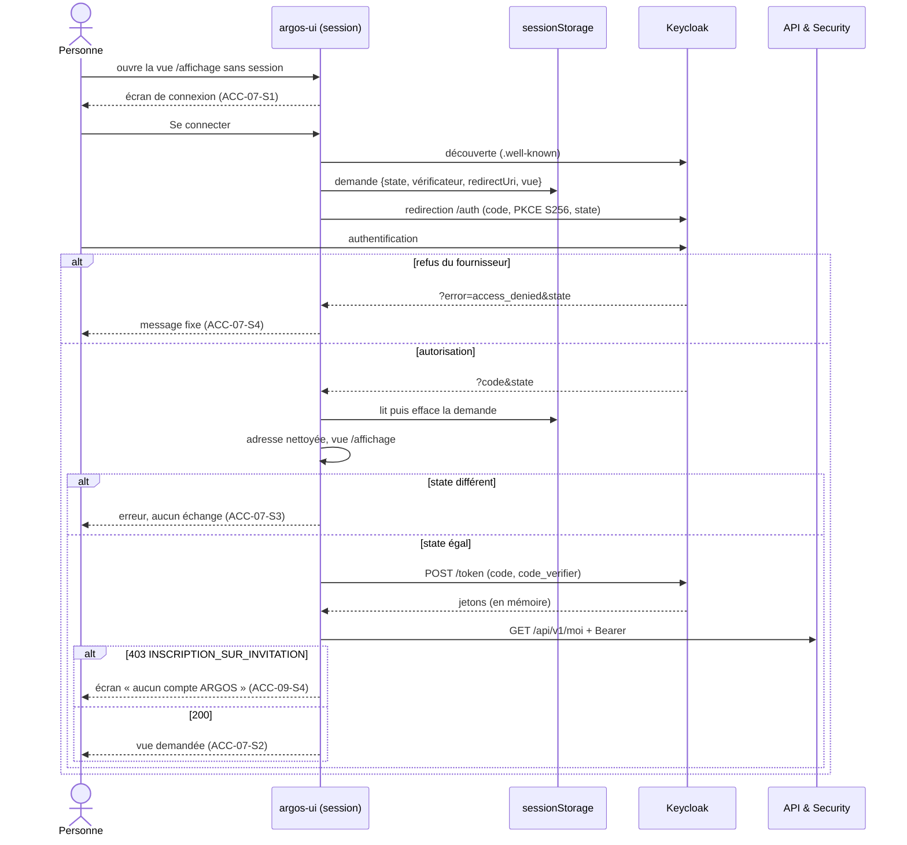
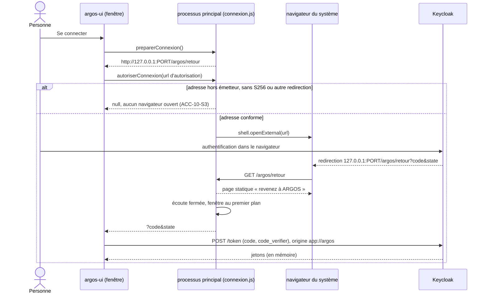
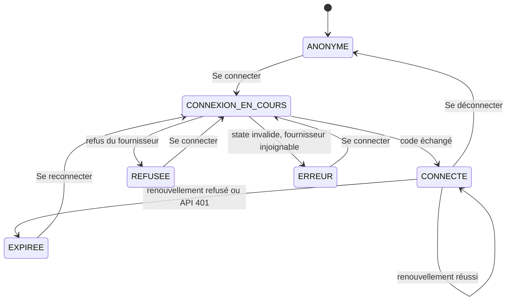

# Conception : connecter l'IHM et le client desktop au fournisseur d'identité OIDC

<!-- Statuts : [EXIGENCE] [EXISTANT] [DÉCISION] [PROPOSITION] [QUESTION] — légende : /docs/specifications/README.md#statuts-des-informations. -->

**Niveau de conception** : complète — sécurité de l'authentification côté clients, deux modules (`argos-ui`, `argos-desktop`) et le royaume de test, alternatives à trancher.

## Contexte technique

- L'API valide les jetons porteurs (`quarkus-oidc`, `application-type=service`, audience `argos-server`) ; seules `/api/v1/system/info` et `/q/health` sont publiques [EXISTANT — `argos-server/src/main/resources/application.properties`, `AuthentificationTest`].
- `/api/v1/moi` crée le compte à la première connexion et répond 403 `INSCRIPTION_SUR_INVITATION` sans invitation [EXISTANT — `CompteResource`, `PremiereConnexionTest`].
- L'IHM (Vue 3, `vue-router` en historique par « hash ») est servie par Vite (`http://localhost:5173`) ou par le protocole interne `app://argos` du desktop [EXISTANT — `argos-ui/src/router.ts`, `argos-desktop/src/ui-protocol.js`].
- Le desktop applique `contextIsolation`, `sandbox`, une CSP limitée au serveur Argos et ouvre tout lien externe dans le navigateur du système (`setWindowOpenHandler`) [EXISTANT — `argos-desktop/src/main.js`].
- Le serveur accepte l'origine CORS `app://argos` (et `http://localhost:5173` en développement) [EXISTANT — `application.properties`].

## Exigences couvertes

| Exigence | Section(s) de conception | Diagramme(s) |
|---|---|---|
| ACC-07 | Traitements ; D1, D2, D4 ; Sécurité | DC-1, DC-2, DC-4 |
| ACC-08 | Traitements ; États ; D3 | DC-4 |
| ACC-09 | Contrats d'interface ; D5 | DC-1, DC-2 |
| ACC-10 | Traitements ; D2 ; Sécurité | DC-1, DC-3 |

## Objectifs et non-objectifs

**Objectifs :**
- un seul code de session pour le portail web et le desktop, seul le transport du retour diffère ;
- logique de session testable sans navigateur ni fournisseur réel ;
- aucune dépendance nouvelle.

**Non-objectifs :**
- persistance de la session entre deux chargements de page ou lancements du desktop (ADR-0033) ;
- royaume de production, MFA, politique de mots de passe (ADR-0027) ;
- tests de bout en bout (étape ultérieure du lot 7).

## Composants impactés, responsabilités et frontières

| Composant | Responsabilité dans ce changement | Ne doit pas | Statut |
|---|---|---|---|
| `Vue.js 3 SPA` — couche contenu, session (`argos-ui/src/session/`) | flux OIDC, jetons en mémoire, renouvellement, garde des vues | décider d'un droit ; écrire un jeton dans un stockage, une adresse ou un journal | nouveau |
| `Vue.js 3 SPA` — client REST (`argos-ui/src/api/`) | joindre le jeton, classer 401 et 403 | interpréter un refus au-delà du statut et du code renvoyés | modifié |
| `Client desktop Electron` — processus principal (`argos-desktop/src/connexion.js`) | écoute de bouclage, ouverture du navigateur du système, CSP | voir, échanger ou stocker un jeton | nouveau |
| `Client desktop Electron` — pont (`argos-desktop/src/preload.js`, `canaux.js`) | deux appels : préparer, autoriser | exposer une autre capacité native | modifié |
| Fournisseur d'identité Keycloak (royaume de test) | redirections, origines web, PKCE S256 obligatoire | — | modifié |
| `API & Security` | inchangé ; port fixe du Keycloak de développement | — | existant |

### DC-1 — Frontières de la session OIDC

- **Question** : quels composants portent la connexion, et qui voit les jetons ?
- **Type** : flowchart à stéréotypes C4 (Component)
- **Portée** : cible proposée
- **Exigences** : ACC-07, ACC-09, ACC-10

Seule la session de l'IHM détient les jetons ; le processus principal du desktop ne reçoit que l'adresse d'autorisation et rend la chaîne de requête du retour (code et state), qu'il ne peut pas échanger sans le vérificateur PKCE resté dans l'IHM.

## Modèle de domaine et invariants

Non applicable — aucun objet métier ; invariants de sécurité :

- INV-1 : un code n'est échangé que si le state du retour est égal à celui de la demande en cours (ACC-07-S3), et, quand le retour porte le paramètre `iss` (RFC 9207), que s'il désigne l'émetteur configuré.
- INV-5 : au démarrage de l'IHM, le client REST et la garde des vues sont branchés sur la session avant la reprise d'un retour du fournisseur ; la lecture du compte qui suit la connexion porte donc le jeton (ACC-09-S1) et un compte non créé est détecté avant l'ouverture d'une vue protégée (ACC-09-S4).
- INV-2 : aucun jeton n'est écrit dans `localStorage`, `sessionStorage`, un cookie, une adresse ou un journal (ACC-08-S1).
- INV-3 : la seule écriture de stockage de la session est la demande transitoire du portail web (`argos.oidc.demande` : state, vérificateur, adresse de retour, vue), effacée au retour avant vérification.
- INV-4 : le processus principal n'ouvre que des adresses d'autorisation de l'émetteur configuré, avec PKCE S256 et la redirection qu'il a préparée (ACC-10-S3).

## Traitements et interactions

### DC-2 — Connexion depuis le portail web

- **Question** : comment une vue protégée obtient-elle une session dans le navigateur ?
- **Type** : UML séquence
- **Portée** : cible proposée
- **Exigences** : ACC-07-S1 à S4, ACC-09-S1, ACC-09-S4

Le retour est traité avant la première navigation du routeur : l'adresse est remplacée (`history.replaceState`) par l'adresse sans paramètres de retour, positionnée sur la vue demandée.

### DC-3 — Connexion depuis le client desktop

- **Question** : comment le desktop se connecte-t-il sans afficher la page du fournisseur dans l'application ?
- **Type** : UML séquence
- **Portée** : cible proposée
- **Exigences** : ACC-10-S1 à S3, ACC-07-S2

L'écoute est unique et bornée à cinq minutes ; une nouvelle préparation abandonne la précédente. La déconnexion ouvre la fin de session dans le navigateur du système (`window.open`, intercepté par `setWindowOpenHandler`), où vit la session du fournisseur.

## États et transitions

### DC-4 — États de la session de l'IHM

- **Question** : quels états la session traverse-t-elle, et qu'est-ce qui les déclenche ?
- **Type** : UML états
- **Portée** : cible proposée
- **Exigences** : ACC-07, ACC-08

Seul `CONNECTE` détient des jetons. « Compte non créé » n'est pas un état de session : c'est une session `CONNECTE` dont `/api/v1/moi` a répondu 403 `INSCRIPTION_SUR_INVITATION` ; la garde redirige alors toute vue protégée vers l'écran de refus.

## Contrats d'interface

| Élément | Valeur |
|---|---|
| Découverte | `GET {émetteur}/.well-known/openid-configuration` ; `issuer` égal à l'émetteur configuré |
| Autorisation | `response_type=code`, `client_id=argos-ui`, `redirect_uri`, `scope=openid`, `state` (32 octets aléatoires), `code_challenge` (S256), `response_mode=query` |
| Jetons | `POST token_endpoint`, `application/x-www-form-urlencoded`, `credentials: omit` ; `authorization_code` + `code_verifier`, puis `refresh_token` |
| Fin de session | `end_session_endpoint` avec `client_id`, `id_token_hint`, `post_logout_redirect_uri` (portail web seulement) |
| API | `Authorization: Bearer <jeton d'accès>` sur `/api/v1/**` sauf `/api/v1/system/info` ; contrat OpenAPI inchangé (`/q/openapi`) |
| Refus | 401 → session expirée et écran de connexion ; 403 `INSCRIPTION_SUR_INVITATION` → écran « aucun compte ARGOS » ; autre 403 → message de refus |
| Pont desktop | `preparerConnexion(): Promise<string \| null>` ; `autoriserConnexion(url: string): Promise<string \| null>` (canaux `argos:login-prepare`, `argos:login-authorize`, fenêtre principale seulement) |
| Configuration | `VITE_ARGOS_OIDC_ISSUER` (défaut `http://localhost:8180/realms/argos`), `VITE_ARGOS_OIDC_CLIENT_ID` (défaut `argos-ui`) ; desktop : `ARGOS_OIDC_URL` (même défaut) |
| Royaume de test | `argos-ui` : redirections `http://localhost:5173/*`, `http://127.0.0.1/argos/retour` (port libre, RFC 8252 §7.3) ; origines web `http://localhost:5173`, `app://argos` ; `post.logout.redirect.uris` `http://localhost:5173/*` ; PKCE S256 obligatoire |

## Persistance et intégrité

Non applicable — aucune donnée serveur ; aucune migration (dernière : V16).

## Transactions, concurrence et idempotence

- Une seule demande d'autorisation en cours : une nouvelle connexion remplace la demande (portail) ou abandonne l'écoute précédente (desktop).
- Le code est à usage unique chez le fournisseur ; un rejeu du retour est refusé (demande déjà effacée, ou code déjà consommé).
- Un seul minuteur de renouvellement à la fois ; il est annulé à l'expiration et à la déconnexion.

## Sécurité et isolation

- PKCE S256 et state vérifié en temps constant ; le fournisseur refuse une demande sans défi (`pkceObligatoire`).
- Paramètre `iss` du retour comparé à l'émetteur (RFC 9207) quand le fournisseur l'envoie. Aucun `nonce` n'est envoyé et l'`id_token` n'est pas validé : il ne sert que d'`id_token_hint` à la déconnexion (ADR-0033) ; PKCE S256 et un fournisseur unique couvrent l'injection de code.
- Jetons dans un champ privé (`#jetons`) de `GestionnaireSession`, jamais dans l'état réactif de Vue ni dans un stockage ; la session n'écrit aucun journal (`tests/securite-session.test.mjs`).
- Adresse nettoyée avant toute vérification ; vue de retour limitée à un chemin interne (`cheminInterne`) : aucune redirection ouverte.
- Message d'un refus du fournisseur choisi dans une liste fixe : `error_description` n'est jamais affichée.
- Aucun `v-html` dans l'IHM.
- Desktop : aucune page du fournisseur dans l'application (RFC 8252 §8.12) ; écoute sur `127.0.0.1` seulement, chemin unique, page de retour statique (`Content-Security-Policy: default-src 'none'`, `no-store`, `no-referrer`) ; CSP de l'IHM : `connect-src 'self'` + origine du serveur + origine du fournisseur ; canaux limités à la fenêtre principale.

## Gestion des erreurs et reprise

| Situation | Comportement |
|---|---|
| Fournisseur injoignable (découverte) | état `ERREUR`, message ; aucune redirection lancée |
| State invalide, émetteur `iss` différent, retour sans demande | état `ERREUR` ; aucun échange |
| Échange refusé | état `ERREUR` ; jetons absents |
| Renouvellement refusé | état `EXPIREE` |
| API 401 | état `EXPIREE`, écran de connexion avec la vue courante en retour |
| Desktop : navigateur fermé sans retour | écoute fermée au bout de cinq minutes ; état `ERREUR` ; « Relancer la connexion » |
| Desktop : connexion relancée pendant une attente | l'écoute précédente est fermée ; la tentative précédente devient caduque sans changer l'état ; seule la nouvelle tentative est affichée |
| Rechargement de la page (portail) | jetons perdus ; une vue protégée affiche l'écran de connexion ; la session du fournisseur évite une nouvelle saisie |

## Observabilité

Aucun journal côté client (INV-2). Les refus d'accès restent journalisés par le serveur (ACC-06).

## Performance et stratégie de mesure

Non applicable — aucune cible chiffrée dans les sources ; renouvellement à 80 % de la durée restante, au plus 60 s avant l'expiration (600 s dans le royaume de test).

## Compatibilité, migration et retour arrière

- Aucun changement de contrat de l'API ; retour arrière par révocation du changement côté clients.
- Le royaume de test n'accepte plus `app://argos/*` comme redirection : aucun code ne l'utilisait.
- Le Keycloak de développement écoute sur le port 8180 (`%dev.quarkus.keycloak.devservices.port`).

## Décisions, alternatives et compromis

### D1 — Implémentation minimale sans dépendance

- **Statut** : [PROPOSITION]
- **Choix** : flux OIDC écrit dans `argos-ui/src/session/` (environ 800 lignes commentaires compris, dont 300 de fonctions pures), avec `crypto.subtle` et `fetch` du navigateur.
- **Justification** : le transport du desktop (bouclage mené par le processus principal) ne correspond pas au modèle de navigation d'`oidc-client-ts` ; le stockage par défaut de cette bibliothèque (`sessionStorage`) devrait être remplacé partout ; aucune dépendance à recenser ni à suivre ; logique entièrement testable par `node:test`.
- **Alternatives écartées** : `oidc-client-ts` (Apache-2.0) — adaptation du transport desktop et du stockage, surface plus large pour un besoin réduit ; `keycloak-js` (Apache-2.0) — liée à Keycloak et à son stockage.
- **Compromis** : la validation de signature de l'`id_token` n'est pas faite côté client ; il n'est utilisé que comme `id_token_hint` à la déconnexion, les jetons venant directement du point de jetons sur une connexion TLS en production (OpenID Connect Core §3.1.3.7) ; l'API vérifie le jeton d'accès.
- **ADR** : ADR-0033 (Proposé).

### D2 — Redirection du desktop vers l'interface de bouclage

- **Statut** : [PROPOSITION]
- **Choix** : navigateur du système et redirection vers `http://127.0.0.1:<port éphémère>/argos/retour`, écoutée par le processus principal le temps d'un retour.
- **Justification** : RFC 8252 §7.3 (bouclage, port quelconque accepté par le fournisseur) et §8.12 (pas d'agent utilisateur intégré) ; conforme à ADR-0022 point 6 ; vérifié contre Keycloak (`ClientIhmOidcTest#clientDesktopUtiliseLInterfaceDeBouclage`).
- **Alternatives écartées** : redirection vers `app://argos/` interceptée dans la fenêtre — la page du fournisseur s'afficherait dans l'application (agent intégré) ; schéma d'URI privé enregistré auprès du système — installation et collisions de schéma, schéma `app` trop générique.
- **Compromis** : un port local ouvert quelques minutes ; un autre processus du poste pourrait tenter d'y répondre, mais le code n'est utilisable qu'avec le vérificateur PKCE resté dans l'IHM.
- **ADR** : ADR-0033 (Proposé), précise ADR-0022 point 6.

### D3 — Jetons en mémoire seulement

- **Statut** : [PROPOSITION]
- **Choix** : jetons dans la seule mémoire de la page ; aucune persistance, y compris sur le desktop.
- **Justification** : demande du lot 7 ; réduit l'exposition à un script injecté ou à un accès au disque ; la session du fournisseur évite de ressaisir le mot de passe à la reconnexion.
- **Alternatives écartées** : `sessionStorage`/`localStorage` — lisibles par tout script de l'origine ; `safeStorage` du desktop (ADR-0022 point 6) — persistance non demandée, question Q-1 ; cookie lisible — interdit.
- **Compromis** : reconnexion à chaque rechargement de page ou lancement du desktop.
- **ADR** : ADR-0033 (Proposé).

### D4 — Demande transitoire du portail web dans `sessionStorage`

- **Statut** : [PROPOSITION]
- **Choix** : state, vérificateur, adresse de retour et vue écrits sous `argos.oidc.demande` le temps de la redirection, effacés au retour avant vérification.
- **Justification** : la redirection pleine page détruit la mémoire de la page ; ce ne sont pas des jetons ; le vérificateur seul ne permet rien sans le code, à usage unique et lié à la redirection.
- **Alternatives écartées** : fenêtre surgissante qui garde la page vivante — bloquée par les navigateurs, accessibilité moindre ; aucune conservation — PKCE impossible.
- **Compromis** : un script injecté pendant la redirection pourrait lire le vérificateur ; la CSP et l'absence de `v-html` réduisent ce risque.
- **ADR** : ADR-0033 (Proposé).

### D5 — Classement des refus dans le client REST

- **Statut** : [PROPOSITION]
- **Choix** : `classerRefus(statut, corps)` : 401 → `NON_AUTHENTIFIE`, 403 `INSCRIPTION_SUR_INVITATION` → `COMPTE_NON_CREE`, autre 403 → `INTERDIT` ; le client appelle le rappel de la session, qui affiche l'écran ou le message.
- **Justification** : un seul point de traitement des refus ; aucune règle métier, seulement le statut et le code décidés par le serveur.
- **Alternatives écartées** : traitement dans chaque vue — répétitions et oublis ; nouvelle tentative automatique après un 401 — boucles possibles.
- **Compromis** : un 401 ne tente pas de renouvellement avant de demander la reconnexion.
- **ADR** : non : décision locale.

### D6 — Port fixe du Keycloak de développement

- **Statut** : [PROPOSITION]
- **Choix** : `%dev.quarkus.keycloak.devservices.port=8180`.
- **Justification** : l'émetteur par défaut de l'IHM et du desktop doit être connu au build et au lancement.
- **Alternatives écartées** : lecture de l'émetteur depuis le serveur au démarrage de l'IHM — nouvel appel public et nouvelle route.
- **Compromis** : le port 8180 doit être libre en développement ; les tests gardent un port aléatoire.
- **ADR** : non : configuration de développement.

## Risques

- Keycloak accepte l'origine CORS `app://argos` et le port libre du bouclage : vérifié avec la version des Dev Services (`ClientIhmOidcTest`) ; à revérifier à chaque montée de version de Keycloak.
- Session perdue au rechargement : gêne d'usage → session du fournisseur, reconnexion en un clic ; Q-1 pour la persistance desktop.
- Disponibilité de Keycloak (R-18) : connexion impossible si le fournisseur est arrêté ; message d'erreur, vue d'état du serveur toujours accessible.

## Écarts code / tests / specs / documentation

- ADR-0022 point 6 (`safeStorage`) contre la demande du lot 7 (mémoire seule) : ADR-0033 (Proposé) consigne le choix, ADR-0022 n'est pas modifié.
- arc42 §5.1 nomme encore « IdP entreprise » : libellé aligné sur ADR-0027 dans ce changement.
- Les tests de bout en bout (navigateur et Electron) ne sont pas écrits : tâches 5.1 et 5.2 non réalisées.

## Stratégie de vérification

| Exigence / scénario | Niveau de test | Moyen de preuve | État |
|---|---|---|---|
| ACC-07-S1 | unitaire (garde) + E2E | `tests/garde.test.mjs` (routes lues dans `router.ts`) ; E2E tâche 5.1 | unitaire exécuté ; E2E à écrire |
| ACC-07-S2 | unitaire + intégration | `tests/oidc.test.mjs`, `tests/session.test.mjs` ; `ClientIhmOidcTest#portailWebObtientUnJetonAccepteParLApi` | exécuté |
| ACC-07-S3 | unitaire | `tests/oidc.test.mjs`, `tests/session.test.mjs` | exécuté |
| ACC-07-S4 | unitaire | `tests/oidc.test.mjs`, `tests/session.test.mjs` | exécuté |
| ACC-07-S5 | unitaire + intégration | `tests/garde.test.mjs`, `tests/autorisation.test.mjs` ; `AuthentificationTest#identiteDuServeurPublique` | exécuté |
| ACC-08-S1 | architecture (sources) + unitaire | `tests/securite-session.test.mjs`, `tests/session.test.mjs` | exécuté |
| ACC-08-S2 | unitaire + intégration | `tests/oidc.test.mjs`, `tests/session.test.mjs` ; renouvellement réel dans `ClientIhmOidcTest` | exécuté |
| ACC-08-S3, S4 | unitaire | `tests/session.test.mjs`, `tests/oidc.test.mjs` | exécuté |
| ACC-09-S1, S2 | unitaire + intégration | `tests/autorisation.test.mjs` ; jeton de l'IHM accepté par `/api/v1/moi` (`ClientIhmOidcTest`) | exécuté |
| ACC-09-S3, S5 | unitaire | `tests/autorisation.test.mjs`, `tests/session.test.mjs` | exécuté |
| ACC-09-S4 | unitaire + intégration | `tests/autorisation.test.mjs`, `tests/garde.test.mjs` ; `ClientIhmOidcTest#personneSansInvitationRecoitLeRefusDedie` | exécuté |
| ACC-10-S1 à S3 | unitaire (serveur local réel) + intégration | `argos-desktop/test/connexion.test.js`, `canaux.test.js`, `preload.test.js` ; `ClientIhmOidcTest#clientDesktopUtiliseLInterfaceDeBouclage` | exécuté ; parcours Electron réel à écrire (5.2) |
| ACC-10-S4 | unitaire | `argos-desktop/test/ui-protocol.test.js` | exécuté |

## Documentation durable impactée

- `/docs/specifications/comptes-acces.md` (périmètre, règles, diagramme DF-ACC-2, traçabilité) et `/docs/specifications/README.md` (registre).
- arc42 §5.1 (IdP Keycloak, connexion du desktop), §8.1 (session de l'IHM), §9 (ADR-0033), glossaire (PKCE, interface de bouclage).
- ADR-0033 (Proposé) et index `docs/architecture/adr/README.md`.

## Questions ouvertes

- Q-1 et Q-2 de la proposition : elles ne changent ni les specs ni les tâches.
