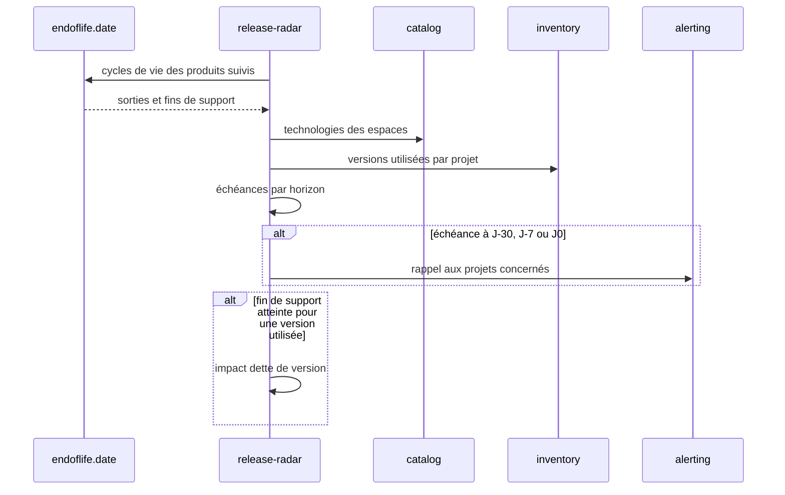

# Conception : tenir le référentiel des standards et le radar des sorties

<!-- Statuts : [EXIGENCE] [EXISTANT] [DÉCISION] [PROPOSITION] [QUESTION] (légende dans proposal.md). -->

**Niveau de conception** : Allégée : modules existants, une source externe déjà prévue, pas de nouveau cycle de vie complexe.

## Contexte technique

Les modules `catalog` et `releaseradar` ne contiennent qu'un `package-info.java`. L'inventaire vient de `inventaire-sbom` (INV-01). Motivation : voir `proposal.md`.

## Exigences couvertes

| Exigence | Section(s) de conception | Diagramme(s) |
|---|---|---|
| RAD-01 | Composants | Composants |
| RAD-02 | Composants | Composants |
| RAD-03 | Composants | DC-1 |
| RAD-04 | Composants | DC-1 |
| RAD-05 | Composants | DC-1 |
| RAD-06 | Composants | Composants |

## Objectifs et non-objectifs

**Objectifs :**
- référentiel par espace
- rappels et dette de version calculés sans IA

**Non-objectifs :**
- référentiel global imposé à tous

## Composants impactés, responsabilités et frontières

| Composant | Responsabilité dans ce changement | Ne doit pas | Statut |
|---|---|---|---|
| `catalog` | référentiel et historique des statuts | être modifié par l'IA | modifié |
| `release-radar` | échéances, rappels, dette de version | décider d'un statut | modifié |
| `alerting` | envoyer rappels et annonces | — | existant (proposé) |

## Modèle de domaine et invariants

Non applicable — conception allégée ; à préciser avec les tâches d'implémentation correspondantes.

## Traitements et interactions

### DC-1 — Tâche quotidienne du radar

- **Question** : comment les échéances deviennent-elles rappels et dette de version ?
- **Type** : UML séquence
- **Portée** : cible proposée
- **Exigences** : RAD-03, RAD-04, RAD-05

Le radar compare les calendriers publics aux versions réellement utilisées ; seules les échéances qui touchent un projet produisent un rappel.

## États et transitions

Non applicable — conception allégée ; à préciser avec les tâches d'implémentation correspondantes.

## Contrats d'interface

Non applicable — conception allégée ; à préciser avec les tâches d'implémentation correspondantes.

## Persistance et intégrité

Non applicable — conception allégée ; à préciser avec les tâches d'implémentation correspondantes.

## Transactions, concurrence et idempotence

Non applicable — conception allégée ; à préciser avec les tâches d'implémentation correspondantes.

## Sécurité et isolation

Modification réservée aux administrateurs d'espace (ACC-03) ; suggestions de l'IA sans effet direct.

## Gestion des erreurs et reprise

Non applicable — conception allégée ; à préciser avec les tâches d'implémentation correspondantes.

## Observabilité

Compteurs agrégés et journaux d'audit selon arc42 §8.6 ; aucun suivi individuel des utilisateurs.

## Performance et stratégie de mesure

[QUESTION] Aucune cible propre à ce changement dans les sources ; la cible de consultation de arc42 §10 (Q-05) s'applique quand elle est pertinente.

## Compatibilité, migration et retour arrière

Non applicable — aucune donnée ni aucun contrat existants.

## Décisions, alternatives et compromis

### D1 — Référentiel par espace

- **Statut** : [PROPOSITION]
- **Choix** : chaque espace tient ses standards
- **Justification** : produit ouvert
- **Alternatives écartées** : référentiel global — inadapté
- **Compromis** : pas de standard commun par défaut (Q-3)
- **ADR** : non : découle d'ADR-0025

## Risques

- Calendrier public incomplet → source signalée, saisie manuelle possible d'une échéance.

## Écarts code / tests / specs / documentation

Aucun écart constaté.

## Stratégie de vérification

| Exigence / scénario | Niveau de test | Moyen de preuve | État |
|---|---|---|---|
| RAD-01-S1, RAD-01-S2 | intégration API | validation des champs | à écrire |
| RAD-02-S1, RAD-02-S2 | intégration | rôles et suggestion | à écrire |
| RAD-03-S1 | intégration | horizons | à écrire |
| RAD-04-S1 | intégration | horloge simulée | à écrire |
| RAD-05-S1 | intégration | inventaire de test | à écrire |
| RAD-06-S1 | intégration | annonce | à écrire |

## Documentation durable impactée

- `/docs/specifications/radar-standards.md`, registre `/docs/specifications/README.md`
- arc42 §8 (statuts du référentiel)

## Questions ouvertes

Aucune autre que celles de la proposition.
