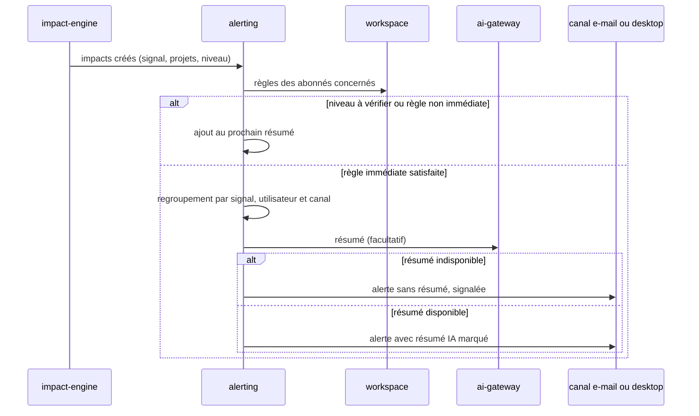

# Conception : diffuser les alertes ciblées et les résumés périodiques

<!-- Statuts : [EXIGENCE] [EXISTANT] [DÉCISION] [PROPOSITION] [QUESTION] (légende dans proposal.md). -->

**Niveau de conception** : Allégée : traitement asynchrone dans un module existant, sans nouvelle dépendance structurante hors du serveur de messagerie.

## Contexte technique

Aucun envoi n'existe ; le module `alerting` ne contient qu'un `package-info.java`. Dépend de `correlation-impact` (impacts et niveaux) et de `abonnements-veille` (règles). Motivation : voir `proposal.md`.

## Exigences couvertes

| Exigence | Section(s) de conception | Diagramme(s) |
|---|---|---|
| ALR-01 | Composants | DC-1 |
| ALR-02 | Composants | DC-1 |
| ALR-03 | Composants | DC-1 |
| ALR-04 | Composants | DC-1 |
| ALR-05 | Composants | DC-1 |
| ALR-06 | Composants | DC-1 |

## Objectifs et non-objectifs

**Objectifs :**
- limiter les alertes immédiates aux impacts établis
- ne jamais bloquer une alerte pour une raison d'IA

**Non-objectifs :**
- choisir le serveur d'e-mails (Q-1)
- intégrer une messagerie d'équipe (Q-2)

## Composants impactés, responsabilités et frontières

| Composant | Responsabilité dans ce changement | Ne doit pas | Statut |
|---|---|---|---|
| `alerting` | évaluer les règles, regrouper, planifier, envoyer | décider d'un impact ou accorder un droit | modifié |
| `impact-engine` | publier les impacts créés avec leur niveau | envoyer des messages | modifié |
| `workspace` | fournir les règles (abonnements) et destinataires | — | existant (proposé) |

## Modèle de domaine et invariants

Non applicable — conception allégée ; à préciser avec les tâches d'implémentation correspondantes.

## Traitements et interactions

### DC-1 — Du nouvel impact à l'alerte

- **Question** : comment un impact devient-il une alerte ou une ligne de résumé ?
- **Type** : UML séquence
- **Portée** : cible proposée
- **Exigences** : ALR-01, ALR-02, ALR-03, ALR-04, ALR-05, ALR-06

Le résumé IA est demandé mais jamais attendu indéfiniment : son absence est signalée et l'alerte part quand même.

## États et transitions

Non applicable — conception allégée ; à préciser avec les tâches d'implémentation correspondantes.

## Contrats d'interface

Non applicable — conception allégée ; à préciser avec les tâches d'implémentation correspondantes.

## Persistance et intégrité

Non applicable — conception allégée ; à préciser avec les tâches d'implémentation correspondantes.

## Transactions, concurrence et idempotence

Clé d'idempotence d'une alerte : (signal, utilisateur, canal) ; un rejeu des impacts ne renvoie pas une alerte déjà envoyée.

## Sécurité et isolation

Chaque message est construit pour un destinataire à partir des seules données autorisées (ACC-04) ; aucun secret dans les gabarits.

## Gestion des erreurs et reprise

Échec d'envoi : nouvelles tentatives bornées puis état « en échec » visible ; l'alerte reste consultable dans Argos.

## Observabilité

Compteurs agrégés et journaux d'audit selon arc42 §8.6 ; aucun suivi individuel des utilisateurs.

## Performance et stratégie de mesure

[QUESTION] Aucune cible propre à ce changement dans les sources ; la cible de consultation de arc42 §10 (Q-05) s'applique quand elle est pertinente.

## Compatibilité, migration et retour arrière

Non applicable — aucune donnée ni aucun contrat existants.

## Décisions, alternatives et compromis

### D1 — Alerte immédiate réservée aux impacts exact et probable

- **Statut** : [PROPOSITION]
- **Choix** : « à vérifier » ne déclenche jamais d'alerte immédiate
- **Justification** : réduire le bruit, premier risque produit
- **Alternatives écartées** : toutes correspondances — trop d'alertes
- **Compromis** : un article important sans identifiant structuré attend le résumé
- **ADR** : ADR-0013 (Proposé)

### D2 — Idempotence par signal, utilisateur et canal

- **Statut** : [PROPOSITION]
- **Choix** : clé unique d'alerte
- **Justification** : pas de doublon en cas de rejeu ou de plusieurs règles
- **Alternatives écartées** : par règle — doublons
- **Compromis** : —
- **ADR** : non : décision locale

## Risques

- Bruit malgré les règles → mesure du taux de pertinence (baseline v2.3 §6).
- Réputation d'envoi d'un serveur domestique → relais SMTP authentifié (Q-1).

## Écarts code / tests / specs / documentation

Aucun écart constaté.

## Stratégie de vérification

| Exigence / scénario | Niveau de test | Moyen de preuve | État |
|---|---|---|---|
| ALR-01-S1, ALR-01-S2 | intégration | règles et impacts de test | à écrire |
| ALR-02-S1 | intégration | impact à vérifier | à écrire |
| ALR-03-S1 | intégration | trois projets, une alerte | à écrire |
| ALR-04-S1, ALR-04-S2 | intégration | horloge simulée | à écrire |
| ALR-05-S1 | intégration | ai-gateway simulé au plafond ; QS-10 | à écrire |
| ALR-06-S1, ALR-06-S2 | intégration | serveur SMTP de test | à écrire |

## Documentation durable impactée

- `/docs/specifications/alertes-digests.md`, registre `/docs/specifications/README.md`
- arc42 §6.1

## Questions ouvertes

Aucune autre que celles de la proposition.
