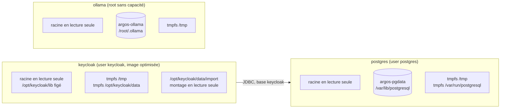
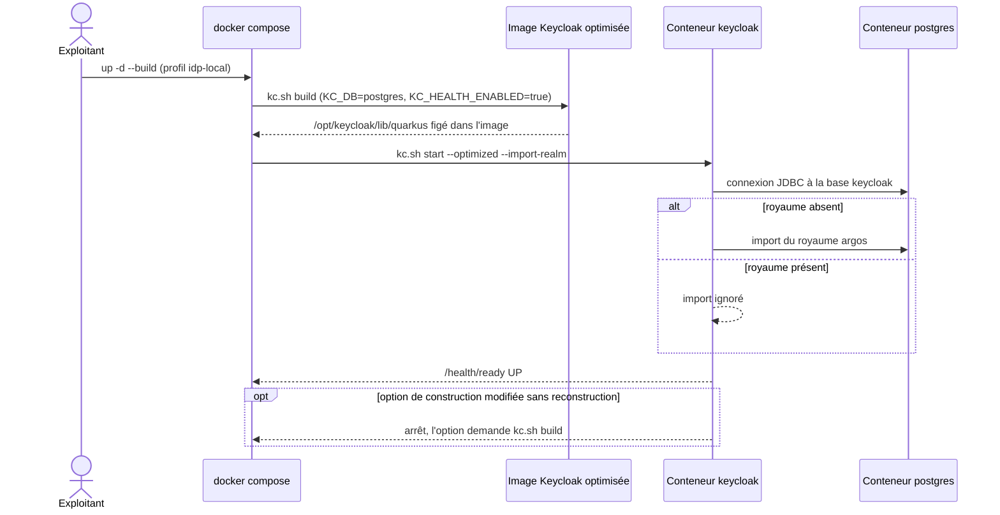

# Conception : durcir les conteneurs de service

<!-- Statuts : [EXIGENCE] [EXISTANT] [DÉCISION] [PROPOSITION] [QUESTION]
     légende : /docs/specifications/README.md#statuts-des-informations. -->

**Niveau de conception** : complète — changement de sécurité sur trois images, une image Keycloak construite localement et la
reprise d'un volume PostgreSQL existant à garantir.

## Contexte technique

`compose.yaml` déclare quatre services ; seul `argos` reçoit le durcissement d'EXP-12 (PR #44). Les services `postgres`
(`postgres:18`), `keycloak` (`quay.io/keycloak/keycloak:26.7.4`, profil `idp-local`) et `ollama` (`ollama/ollama:0.12.6`,
profil `ia`) n'ont ni `read_only`, ni `cap_drop`, ni `security_opt` [EXISTANT — `/compose.yaml`].

Relevé des images [EXISTANT — `docker image inspect`, 2026-11-24] :

| Image | Utilisateur par défaut | Point d'entrée | Données |
|---|---|---|---|
| `postgres:18` | `root`, puis bascule sur `postgres` (999) par `gosu` | `docker-entrypoint.sh` | `PGDATA=/var/lib/postgresql/18/docker` (volume `argos-pgdata` sur `/var/lib/postgresql`) |
| `keycloak:26.7.4` | `keycloak` (1000, groupe 0) | `/opt/keycloak/bin/kc.sh` | base `keycloak` dans PostgreSQL ; royaume monté en lecture seule sous `/opt/keycloak/data/import` |
| `ollama:0.12.6` | `root` | `/bin/ollama serve` | volume `argos-ollama` sur `/root/.ollama` (clé `id_ed25519`, modèles) |

Essais sur une pile isolée (`docker compose -p essai-durcissement`, Docker 29.9.3, aucun port publié, mots de passe d'essai,
pile démontée et image d'essai supprimée ensuite ; ni l'étiquette `argos:local` ni les conteneurs `argos-*` ne sont touchés).
Socle commun à chaque essai : `read_only: true`, `cap_drop: [ALL]`, `security_opt: [no-new-privileges:true]`.
[EXISTANT — essai du 2026-11-24]

| Service et variante | Résultat |
|---|---|
| `postgres`, `root`, aucune capacité | échec : `mkdir: cannot create directory '/var/lib/postgresql/18': Permission denied` |
| `postgres`, `root`, `CHOWN SETUID SETGID FOWNER DAC_OVERRIDE` | démarrage et redémarrage sains |
| `postgres`, `root`, sans `DAC_OVERRIDE`, `CHOWN`, `SETUID` ou `SETGID` (un à la fois) | échec dans chaque cas (`mkdir`, `chown`, bascule `gosu`) |
| `postgres`, `root`, sans `FOWNER` | sain ; seul un `chmod` non bloquant du point d'entrée échoue |
| `postgres`, `user: postgres`, aucune capacité, tmpfs `/tmp` et `/var/run/postgresql` | initialisation, `initialiser-bases.sh`, redémarrage, `pg_dump` et recréation de base par `exec` réussis |
| idem, sur un volume créé par la configuration non durcie | table témoin relue à l'identique |
| `ollama`, `root`, aucune capacité, tmpfs `/tmp` | `ollama pull all-minilm` puis `POST /api/embed` : HTTP 200 |
| `ollama` sans tmpfs `/tmp` | service fonctionnel, mais détection GPU en erreur (`open /tmp/….bin: read-only file system`) |
| `keycloak` officiel, `start --import-realm` | échec : `FileSystemException: /opt/keycloak/lib/quarkus/transformed-bytecode.jar: Read-only file system` |
| `keycloak` officiel, tmpfs sur `/opt/keycloak/lib/quarkus` | échec : fichiers de construction de l'image masqués |
| `keycloak` optimisé (`kc.sh build`), `start --optimized --import-realm`, tmpfs `/tmp` seul | démarrage en 34 s, avertissements `ARJUNA048006` (journal des transactions non inscriptible) |
| idem, tmpfs `/tmp` et `/opt/keycloak/data` | démarrage en 4,5 s, royaume `argos` importé, `/health/ready` à `UP` |

## Exigences couvertes

| Exigence | Section(s) de conception | Diagramme(s) |
|---|---|---|
| EXP-16 | D1 à D4 ; Compatibilité, migration et retour arrière | DC-1, DC-2 |

## Objectifs et non-objectifs

**Objectifs :**
- Appliquer à `postgres`, `keycloak` et `ollama` le même socle que `argos`, sans capacité réajoutée.
- Déclarer pour chaque service les seuls emplacements inscriptibles : volume de données et tmpfs.
- Reprendre les volumes existants sans migration manuelle.

**Non-objectifs :**
- Changer l'utilisateur d'exécution d'Ollama (voir proposal.md, Exclu).
- Borner la taille des tmpfs : Q-2.
- Durcir les conteneurs des tests (Dev Services, pile e2e).

## Composants impactés, responsabilités et frontières

| Composant | Responsabilité dans ce changement | Ne doit pas | Statut |
|---|---|---|---|
| PostgreSQL | stocker les bases sous l'utilisateur `postgres`, sans capacité | écrire hors de `/var/lib/postgresql`, `/var/run/postgresql`, `/tmp` | modifié |
| Keycloak auto-hébergé | démarrer depuis une image construite d'avance | reconstruire Quarkus au démarrage | modifié |
| Ollama, modèle d'IA local | servir le modèle depuis son volume | écrire hors de `/root/.ollama` et `/tmp` | modifié |
| Image Keycloak optimisée (`deploiement/keycloak/Dockerfile`) | figer les options de construction (`KC_DB`, `KC_HEALTH_ENABLED`) | embarquer secret ou royaume | nouveau |

### DC-1 — Emplacements inscriptibles par conteneur

Question : où chaque conteneur peut-il encore écrire une fois durci ? Type : organigramme (flowchart). Vue cible.
Exigence : EXP-16.

Chaque conteneur combine `read_only: true`, `cap_drop: [ALL]` et `no-new-privileges:true`. Les données durables restent dans
les volumes existants ou dans la base `keycloak` ; tout le reste est perdu au redémarrage (EXP-16-S6). Le montage du royaume
reste un fichier en lecture seule, monté par-dessus le tmpfs de `/opt/keycloak/data`.

## Modèle de domaine et invariants

Non applicable — aucun modèle métier ; invariants d'exploitation :

- INV-1 : aucun des trois services ne déclare `cap_add`.
- INV-2 : tout chemin écrit à l'exécution est un volume nommé, un tmpfs ou rien.

## Traitements et interactions

### DC-2 — Construction et démarrage de Keycloak

Question : comment Keycloak démarre-t-il sans écrire dans son installation ? Type : UML, diagramme de séquence. Vue cible.
Exigence : EXP-16 (S1, S3).

Les options de construction (`KC_DB`, `KC_HEALTH_ENABLED`) sont figées dans l'image ; les options d'exécution (adresse,
mots de passe, pool) restent dans `compose.yaml`. Keycloak refuse `--optimized` si une option de construction diffère de
l'image : l'erreur est visible au démarrage au lieu d'une reconstruction silencieuse.

## États et transitions

Non applicable — aucun cycle de vie nouveau.

## Contrats d'interface

Non applicable — ports, réseau et variables inchangés.

## Persistance et intégrité

Aucun changement de schéma. `argos-pgdata` reste monté sur `/var/lib/postgresql` ; les fichiers créés par le point d'entrée
de l'image appartiennent déjà à `postgres` (999), ce qui rend la reprise sans capacité possible (essai : table témoin relue).

## Transactions, concurrence et idempotence

Le journal des transactions de Keycloak (`/opt/keycloak/data/transaction-logs`) passe en tmpfs. Keycloak n'emploie pas de
transactions XA par défaut ; ce journal ne sert qu'à leur reprise, sa perte au redémarrage n'efface aucune donnée.
[PROPOSITION — à confirmer par la documentation de Keycloak lors de la tâche 3.1]

## Sécurité et isolation

- Racine en lecture seule : un processus compromis ne peut ni modifier les binaires ni déposer un exécutable persistant.
- `cap_drop: [ALL]` sans réajout : `postgres` n'a plus besoin de `CHOWN`, `SETUID`, `SETGID`, `DAC_OVERRIDE` puisqu'il ne
  démarre plus sous `root`.
- `no-new-privileges` : un binaire setuid de l'image n'élève plus les droits.
- Limite : Ollama reste `root` dans le conteneur ; sans capacité ni élévation, `root` n'écrit que dans ce que `root` possède
  et qui n'est pas en lecture seule, c'est-à-dire son volume et `/tmp`.

## Gestion des erreurs et reprise

- Un chemin écrit oublié fait échouer le démarrage avec `Read-only file system` dans les journaux du conteneur ; le contrôle de
  santé existant le rend visible (`unhealthy` ou redémarrages).
- Reconstruction de Keycloak oubliée après un changement de version : `docker compose up --build` reconstruit ; sans `--build`,
  l'image précédente reste servie (comportement de Compose, documenté dans le guide).

## Observabilité

Aucun ajout : journaux Docker et contrôles de santé existants. Les avertissements `ARJUNA048006` disparaissent avec le tmpfs
`/opt/keycloak/data`.

## Performance et stratégie de mesure

Démarrage de Keycloak mesuré sur le PC : 4,5 s avec l'image optimisée et le tmpfs, contre 34 s avec le seul tmpfs `/tmp`
[EXISTANT — essai du 2026-11-24]. La durée sur le NAS est à relever (tâche 4.2). La construction de l'image se fait une fois
par version.

## Compatibilité, migration et retour arrière

- PostgreSQL : volume repris tel quel (EXP-16-S4). Les scripts de sauvegarde et de restauration utilisent
  `docker compose exec postgres`, qui s'exécute désormais sous `postgres` ; `psql` et `pg_dump` passent par le socket local
  sous `POSTGRES_USER` (essai : `pg_dump` et recréation de base réussis).
- Keycloak : aucune donnée locale ; l'image optimisée se construit au premier `up --build`.
- Ollama : volume repris, propriétaire inchangé.
- Retour arrière : retirer le fragment de durcissement et `user`, rétablir l'image officielle de Keycloak ; aucune donnée à
  convertir.
- Ordre : après la fusion de la PR #44, qui introduit le durcissement d'`argos`, le point d'entrée de garde de `keycloak`
  (EXP-08) et les journaux bornés ; le point d'entrée de garde lance alors `kc.sh start --optimized --import-realm`.

## Décisions, alternatives et compromis

### D1 — Fragment commun de durcissement

- **Statut** : [PROPOSITION]
- **Choix** : un fragment YAML `x-durcissement` (`read_only`, `cap_drop`, `security_opt`) fusionné dans `argos`, `postgres`,
  `keycloak` et `ollama`, comme `x-journaux` de la PR #44 ; les `tmpfs` restent propres à chaque service.
- **Justification** : une seule définition, impossible à oublier pour un service ajouté.
- **Alternatives écartées** : répéter les trois clés par service — divergence possible.
- **Compromis** : une fusion YAML de plus à lire.
- **ADR** : non : décision locale.

### D2 — PostgreSQL sous l'utilisateur `postgres`, sans capacité

- **Statut** : [PROPOSITION]
- **Choix** : `user: postgres`, tmpfs `/tmp` et `/var/run/postgresql`.
- **Justification** : l'image accepte de démarrer sous un utilisateur non `root` lorsque `PGDATA` lui appartient ; c'est le
  cas d'un volume neuf comme d'un volume créé par l'image sous `root` (essai). Aucune capacité n'est alors nécessaire.
- **Alternatives écartées** : `root` avec `cap_add: [CHOWN, SETUID, SETGID, DAC_OVERRIDE]` (minimum mesuré, `FOWNER` en
  plus pour un `chmod`) — quatre capacités larges, dont `DAC_OVERRIDE`, pour un travail fait une fois à l'initialisation.
- **Compromis** : un volume dont les fichiers n'appartiendraient pas à 999 (copie manuelle) ne démarre plus ; le guide
  donne la commande de reprise (`chown` depuis un conteneur ponctuel).
- **ADR** : non : décision locale.

### D3 — Keycloak depuis une image optimisée construite localement

- **Statut** : [PROPOSITION] — soumise au porteur (Q-1 de proposal.md)
- **Choix** : `deploiement/keycloak/Dockerfile` à deux étapes : `FROM quay.io/keycloak/keycloak:${VERSION_KEYCLOAK}`,
  `ENV KC_DB=postgres KC_HEALTH_ENABLED=true`, `RUN kc.sh build`, puis copie de `/opt/keycloak` dans une image finale de même
  base. Service `keycloak` : `build` avec l'argument `VERSION_KEYCLOAK: ${ARGOS_KEYCLOAK_VERSION:-26.7.4}`, image
  `argos-keycloak:${ARGOS_KEYCLOAK_VERSION:-26.7.4}`, démarrage `start --optimized --import-realm`, tmpfs `/tmp` et
  `/opt/keycloak/data` (`uid=1000,gid=0,mode=0770`).
- **Justification** : l'image officielle reconstruit Quarkus dans `/opt/keycloak/lib/quarkus` à chaque `start` dès qu'une
  option de construction diffère de ses valeurs par défaut, ce qui échoue en lecture seule (essai). L'image optimisée répond
  aussi à Q-8 de la fiche (démarrage plus court).
- **Alternatives écartées** : tmpfs sur `/opt/keycloak/lib/quarkus` — échec mesuré ; volume nommé sur ce chemin — garde les
  fichiers d'une ancienne version après une mise à jour d'image ; `keycloak` sans `read_only` (repli si Q-1 est refusée) —
  garde `cap_drop` et `no-new-privileges`, mais pas EXP-16-S1 pour ce service.
- **Compromis** : une construction locale par version, y compris sur le NAS ; Renovate doit suivre la version dans
  l'argument de construction au lieu de l'image du service.
- **ADR** : ajout d'une conséquence à ADR-0027 (Accepté) ; pas de nouvel ADR.

### D4 — Ollama sous `root`, sans capacité

- **Statut** : [PROPOSITION]
- **Choix** : utilisateur de l'image conservé, tmpfs `/tmp`, aucune capacité.
- **Justification** : `root` sans `DAC_OVERRIDE` écrit encore dans son volume, qui lui appartient (essai : téléchargement et
  requête réussis) ; le tmpfs `/tmp` évite l'erreur de détection GPU.
- **Alternatives écartées** : utilisateur non `root` — reprise du volume existant par `chown` et `HOME` à déplacer, pour un gain
  faible une fois capacités et élévation retirées.
- **Compromis** : un processus compromis reste uid 0 dans le conteneur, cantonné à son volume et à `/tmp`.
- **ADR** : non : décision locale.

## Risques

- Une version future d'une image écrit un nouveau chemin → démarrage en échec visible ; Renovate propose les mises à jour une
  à une et la CI construit l'assemblage (tâche 2.3).
- Contenu des tmpfs compté dans `mem_limit` → Q-2 ; volumes observés faibles (cache Vert.x, socket).
- Le registre `/docs/architecture/risks/register.md` ne porte pas de ligne dédiée au durcissement ; aucune ligne n'est ajoutée.

## Écarts code / tests / specs / documentation

Voir proposal.md, Écarts constatés (lien d'audit absent, fiche de `main` en retard sur les PR #44 et #47, Q-8 ouverte).

## Stratégie de vérification

| Exigence / scénario | Niveau de test | Moyen de preuve | État |
|---|---|---|---|
| EXP-16-S1 | commande | `docker inspect` des trois conteneurs (`ReadonlyRootfs`, `CapDrop`, `CapAdd`, `SecurityOpt`) | à exécuter |
| EXP-16-S2 | commande | `docker compose exec <service> touch` dans `/etc`, `/usr`, `/opt/keycloak/conf` puis dans le volume et `/tmp` | à exécuter |
| EXP-16-S3 | commande | `docker compose ps` (santé), royaume `argos` présent, `ollama pull` puis requête | à exécuter |
| EXP-16-S4 | commande | volume créé sans durcissement, table témoin, redémarrage durci, lecture | exécuté sur pile isolée le 2026-11-24 ; à rejouer sur l'assemblage final |
| EXP-16-S5 | intégration | `scripts/essai-sauvegarde-restauration.sh` contre la base durcie | à exécuter |
| EXP-16-S6 | commande | `docker compose up -d --force-recreate`, puis royaume, comptes et modèle présents, tmpfs vides | à exécuter |
| INV-1 | revue automatisée | `docker compose config` sans `cap_add` sur les trois services (contrôle de `scripts/verifier-configuration.mjs`) | à écrire |

## Documentation durable impactée

- `/docs/specifications/exploitation-plateforme.md` : EXP-16, critère d'acceptation, Q-7 renvoyée vers ce changement.
- `/docs/specifications/README.md` : colonne Changement de `exploitation-plateforme`.
- `/docs/deploiement/synology-et-pc.md` : construction de l'image Keycloak, reprise d'un volume PostgreSQL.
- arc42 §7 (vue de déploiement) et §8.3 (sécurité) ; diagrammes D-11 et D-12 si leurs notes citent le durcissement ;
  inventaire `/docs/architecture/diagrams/README.md`.
- ADR-0027 : conséquence « image construite localement ».

## Questions ouvertes

- Q-2 de proposal.md (taille des tmpfs) : n'affecte ni EXP-16 ni le découpage.
- Suivi par Renovate de `ARG VERSION_KEYCLOAK` ou de l'argument de construction dans `compose.yaml` : mécanisme exact à choisir
  à la tâche 3.2 (gestionnaire `dockerfile` ou expression régulière existante étendue).
