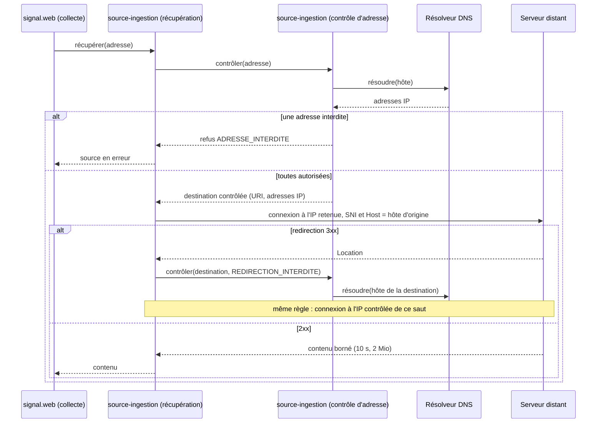

# Conception : épingler l'adresse validée de la veille web

**Niveau de conception** : allégée — un composant (`source-ingestion`), un flux (récupération d'une source), sans contrat ni donnée nouvelle ; seule la connexion épinglée en HTTPS demande un choix argumenté (D1).

## Contexte technique

- [EXISTANT] `GardeAdresses.verifier(URI, Motif)` résout l'hôte par son `Resolveur` (`GardeAdresses.java:103`), refuse si une adresse est interdite, puis **renvoie l'URI**, sans les adresses contrôlées (`:115`). Les couples `hôte:port` de `argos.veille-web.exceptions` court-circuitent le contrôle (`:95-97`).
- [EXISTANT] `RecuperateurWeb.recuperer(URI)` revérifie l'adresse (`:89`), envoie la requête par son `Transport` (`:91`), et, sur une redirection, vérifie la destination (`:100`) avant de boucler. Le transport de production est un `java.net.http.HttpClient` sans suivi automatique de redirection (`:180-189`) : il résout le nom lui-même, d'où la seconde résolution.
- [EXISTANT] Socle Java 17 (`argos-server/pom.xml:16`) : le fournisseur de résolution enfichable du JDK (JEP 418) n'existe qu'à partir de Java 18 et serait global au processus ; `java.net.http.HttpClient` n'offre aucun point d'injection de résolution.
- [EXISTANT] Les tests existants (`argos-server/src/test/java/io/argos/ingestion/web/GardeAdressesTest.java`, `RecuperateurWebTest.java`) remplacent le résolveur et le transport ; aucun ne simule un résolveur qui change de réponse.

Motivation : proposal.md.

## Exigences couvertes

| Exigence | Section(s) de conception | Diagramme(s) |
|---|---|---|
| WEB-07 | Traitements et interactions ; D1, D2, D3 ; Sécurité et isolation | DC-1 |
| WEB-03 (inchangée, préservée) | D2 (le contrôle reste celui de WEB-03) | DC-1 |

## Objectifs et non-objectifs

**Objectifs :**
- Une seule résolution par saut (adresse saisie, puis chaque redirection) ; la connexion vise une adresse de cette résolution.
- Vérification TLS inchangée dans son résultat : certificat validé pour le nom d'hôte.
- Tests sans réseau : résolveur simulé, serveur HTTP(S) local.

**Non-objectifs :**
- Filtrage de sortie au niveau réseau (proposal.md, Exclu, Q-2).
- Modification des plages refusées, des ports ou des bornes (ADR-0028).

## Composants impactés, responsabilités et frontières

| Composant | Responsabilité dans ce changement | Ne doit pas | Statut |
|---|---|---|---|
| source-ingestion (`io.argos.ingestion.web`) | résoudre une fois, contrôler, transmettre au transport l'adresse IP retenue ; transport qui se connecte à cette adresse avec le nom d'hôte d'origine | résoudre un nom dans le transport ; accepter un certificat sur la seule adresse IP | modifié |
| signal (`io.argos.signal.web`) | appelle la récupération comme aujourd'hui | — | inchangé |

## Modèle de domaine et invariants

Le résultat du contrôle devient une **destination contrôlée** : l'URI d'origine (schéma, nom d'hôte, port, chemin) et la ou les adresses IP autorisées issues de la résolution. Nouveau concept interne, non exposé.

- I-1 : toute connexion ouverte par le transport de production vise une adresse IP d'une destination contrôlée.
- I-2 : le transport de production ne fait aucune résolution DNS (vérifiable par un test d'architecture ou par un résolveur de test qui échoue au second appel).
- I-3 : pour un couple `hôte:port` exempté (`argos.veille-web.exceptions`), le comportement actuel est conservé (pas de contrôle de plage) ; la connexion vise néanmoins l'adresse issue de l'unique résolution.

## Traitements et interactions

**DC-1** — Question : à quelle adresse se connecte une récupération, avec et sans redirection ? Type : UML sequenceDiagram. Statut : cible ([PROPOSITION]). Exigences : WEB-07, WEB-03.

Explication : la flèche « connexion à l'IP retenue » remplace la seconde résolution faite aujourd'hui par le client HTTP. Le résolveur n'est appelé qu'une fois par saut ; un rebinding entre le contrôle et la connexion n'a donc plus d'effet (WEB-07-S1, S2). Le refus d'une destination reste celui de WEB-03 (WEB-07-S3).

## États et transitions

Non applicable — l'état d'une source (`EN_ERREUR`, motif, attente) est inchangé.

## Contrats d'interface

Non applicable — aucune opération REST ni outil MCP modifié ; les motifs de refus et les messages restent ceux d'arc42 §8.3.

## Persistance et intégrité

Non applicable — aucune donnée.

## Transactions, concurrence et idempotence

Non applicable — la collecte d'une source reste sérialisée par le verrou consultatif existant (arc42 §8.3, « planification »).

## Sécurité et isolation

- La fenêtre de rebinding entre le contrôle et la connexion est fermée (R-12).
- La vérification du certificat garde l'identification de l'hôte par son nom (algorithme d'identification de point de terminaison HTTPS) ; l'adresse IP ne sert qu'à la connexion TCP.
- Les messages de refus ne nomment toujours ni hôte ni adresse IP ; le journal applicatif nomme l'adresse retenue.
- Le contenu reçu reste une donnée non fiable (WEB-04, inchangé).

## Gestion des erreurs et reprise

Une erreur de connexion ou de négociation TLS (certificat non conforme au nom) termine la récupération comme une erreur de transport aujourd'hui : la source passe `EN_ERREUR` avec son motif, la tentative suivante suit l'attente progressive existante. Plusieurs adresses autorisées : voir D3.

## Observabilité

Journal applicatif : adresse IP retenue pour chaque saut, au niveau de détail existant des refus. Aucune métrique nouvelle.

## Performance et stratégie de mesure

Non applicable — une résolution par saut au lieu de deux ; aucune cible de performance n'est attachée à la veille web.

## Compatibilité, migration et retour arrière

Aucune migration. Retour arrière : revenir au transport précédent (commit de la tâche 2.x) ; aucun état persistant n'en dépend.

## Décisions, alternatives et compromis

### D1 — Moyen de connexion à l'adresse épinglée

- **Statut** : [PROPOSITION]
- **Choix** : transport de production qui ouvre la connexion TCP vers l'adresse IP contrôlée et porte le nom d'hôte d'origine pour SNI, l'en-tête `Host` et la vérification du certificat, en réutilisant un client HTTP déjà présent dans la pile Quarkus (client Vert.x : le serveur cible et l'en-tête `Host` se règlent séparément) plutôt qu'une dépendance nouvelle.
- **Justification** : aucune dépendance nouvelle (ADR-0021) ; contrôle explicite de l'adresse de connexion ; compatible Java 17.
- **Alternatives écartées** :
  - Apache HttpClient 5 (`DnsResolver`) ou OkHttp (`Dns`), Apache-2.0 — résolveur injectable propre, mais dépendance nouvelle à justifier (ADR-0021) ; reste l'option de repli si le client Vert.x ne permet pas la vérification du nom avec une connexion par IP.
  - Socket et `SSLSocket` écrits à la main (SNI, identification HTTPS) — aucune dépendance, mais client HTTP/1.1 à maintenir (en-têtes, découpage, compression).
  - Fournisseur de résolution du JDK (JEP 418) — Java 18 et plus, global au processus : hors socle.
  - Réduire le cache DNS de la JVM ou le fixer à « jamais » — réduit ou déplace la fenêtre, ne la ferme pas, et touche tous les clients du processus.
- **Compromis** : un transport à tester en HTTP et en HTTPS (serveur TLS local avec certificat de test) ; le comportement des délais (`argos.veille-web.delai`, lecture comprise) doit être reproduit à l'identique.
- **ADR** : non tant qu'aucune dépendance n'est ajoutée (décision locale) ; candidat ADR (Proposé) si l'option de repli ajoute une bibliothèque. Dans tous les cas, ADR-0028 (Accepté) voit son « risque résiduel » devenir caduc : mise à jour soumise au porteur du projet (tâche 3.2, Q-3).

### D2 — Le contrôle renvoie les adresses, le transport ne résout pas

- **Statut** : [PROPOSITION]
- **Choix** : le contrôle d'adresse renvoie une destination contrôlée (URI et adresses IP) ; le transport reçoit cette destination et n'accepte pas un nom seul.
- **Justification** : rend I-1 et I-2 vérifiables par le type ; la règle de WEB-03 reste écrite à un seul endroit.
- **Alternatives écartées** : un cache de résolution partagé entre le contrôle et le transport — couplage implicite, invalidation délicate, et toujours une seconde résolution logique.
- **Compromis** : signature interne du transport modifiée ; les doublures de test sont adaptées.
- **ADR** : non : décision locale.

### D3 — Plusieurs adresses autorisées

- **Statut** : [PROPOSITION] (valeur par défaut révisable, [QUESTION] Q-1 de la proposition)
- **Choix** : essayer les adresses contrôlées dans l'ordre de la résolution, sans nouvelle résolution, dans la limite du délai global de la récupération.
- **Justification** : reproduit le comportement d'un client HTTP usuel face à un hôte à plusieurs adresses, sans sortir de l'ensemble contrôlé.
- **Alternatives écartées** : première adresse seulement — plus simple, mais un hôte en double pile IPv4/IPv6 sans route IPv6 échouerait systématiquement.
- **Compromis** : un test de plus (première adresse injoignable).
- **ADR** : non : décision locale.

## Risques

- [Le client retenu ne permet pas de séparer adresse de connexion et nom vérifié] → option de repli de D1, à trancher avant la tâche 2.1 ; R-12 dans `/docs/architecture/risks/register.md`.
- [Régression TLS : certificat accepté sur l'IP] → WEB-07-S4 couvre le cas du certificat non conforme.
- [Différence de comportement des délais] → les tests existants de `RecuperateurWebTest` (délai, taille, serveur muet) passent sur le nouveau transport.

## Écarts code / tests / specs / documentation

- La fiche `veille-rss-web` décrit WEB-03 comme [EXISTANT] complet, alors qu'ADR-0028 et arc42 §8.3 consignent le risque résiduel : la fiche sera alignée (tâche 3.1).
- Javadoc de `RecuperateurWeb.recuperer(URI)` (« elle est revérifiée, la résolution DNS peut avoir changé ») : à réécrire, la revérification ne suffit pas tant que le transport résout de nouveau.

## Stratégie de vérification

| Exigence / scénario | Niveau de test | Moyen de preuve | État |
|---|---|---|---|
| WEB-07-S1 | unitaire | résolveur simulé qui change de réponse, serveur HTTP local ; `RecuperateurWebTest` (ou classe dédiée au rebinding) | à écrire |
| WEB-07-S2 | unitaire | idem, avec une redirection | à écrire |
| WEB-07-S3 | unitaire | redirection vers une adresse privée dès le contrôle | à écrire (complète le test existant de WEB-03-S2) |
| WEB-07-S4 | intégration locale | serveur HTTPS local, certificat de test pour un nom, puis certificat pour un autre nom | à écrire |
| I-2 | unitaire | résolveur de test qui échoue au second appel pour un même hôte | à écrire |

## Documentation durable impactée

- `/docs/specifications/veille-rss-web.md` (WEB-07, règles, critères d'acceptation, écart, traçabilité) et `/docs/specifications/README.md`.
- arc42 §8.3 (contrôle SSRF, « Risque résiduel »).
- D-12 (`/docs/architecture/diagrams/d-12-frontieres-confiance.md`) si le contrôle du franchissement vers Internet y mentionne la résolution ; inventaire `/docs/architecture/diagrams/README.md` si le diagramme change de portée.
- `/docs/architecture/risks/register.md` (R-12) ; ADR-0028 (mise à jour soumise au porteur du projet).

## Questions ouvertes

- Q-1 et Q-3 de la proposition : n'affectent ni les specs ni le découpage en tâches.
