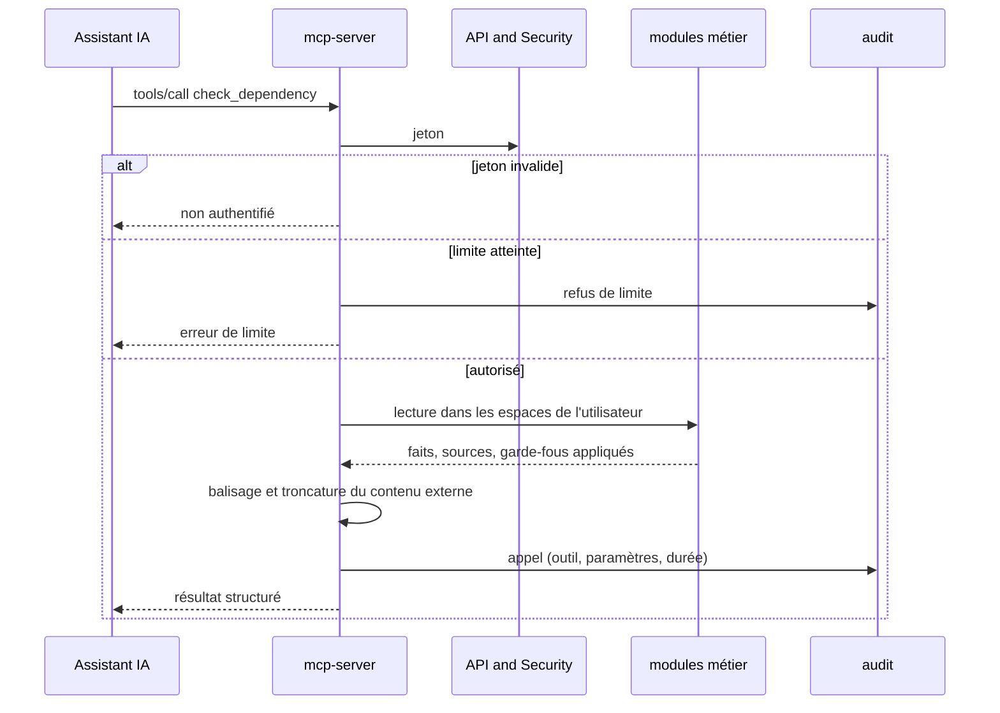

# Conception : exposer Argos aux assistants IA par un serveur MCP en lecture seule

<!-- Statuts : [EXIGENCE] [EXISTANT] [DÉCISION] [PROPOSITION] [QUESTION] (légende : /docs/specifications/README.md#statuts-des-informations). -->

**Niveau de conception** : Complète : nouvelle interface externe exposée aux assistants IA, avec des enjeux d'authentification et d'injection d'instructions.

## Contexte technique

Le module `io.argos.mcp` porte le serveur ; l'extension `io.quarkiverse.mcp:quarkus-mcp-server-http` 2.0.4 (Apache-2.0, comme ses dépendances `quarkus-mcp-server-core`, `quarkus-mcp-server-sse-client`, `org.mcpjava:mcp-server-api` et `com.github.victools:jsonschema-generator`) prend en charge la spécification MCP 2026-07-28 sans état et s'exécute sur Quarkus 3.40.1.2 (extension déclarée pour Quarkus 3.33 et suivants). Le référentiel des standards, le calendrier des sorties et les fiches réglementaires ne sont pas encore livrés : le serveur les lit par trois points d'extension en lecture (`catalog.standard.ReferentielStandards`, `releaseradar.CalendrierSorties`, `regintel.FichesReglementaires`), vides par défaut [PROPOSITION]. Motivation : voir `proposal.md`.

## Exigences couvertes

| Exigence | Section(s) de conception | Diagramme(s) |
|---|---|---|
| MCP-01 | Composants | D1 |
| MCP-02 | Composants | DC-1 |
| MCP-03 | Composants | DC-1 |
| MCP-04 | Composants | DC-1 |
| MCP-05 | Composants | DC-1 |
| MCP-06 | Composants | DC-1 |
| MCP-07 | Composants | DC-1 |

## Objectifs et non-objectifs

**Objectifs :**
- mêmes règles d'accès que l'API REST
- aucune possibilité d'écriture

**Non-objectifs :**
- prompts MCP partagés
- outils d'écriture

## Composants impactés, responsabilités et frontières

| Composant | Responsabilité dans ce changement | Ne doit pas | Statut |
|---|---|---|---|
| `mcp-server` | déclarer les outils, valider entrées et sorties, baliser le contenu externe | modifier le domaine | modifié |
| `API & Security` | authentifier et établir l'espace courant | — | modifié |
| `audit` | journal des appels | — | modifié |

## Modèle de domaine et invariants

Non applicable — conception allégée ; à préciser avec les tâches d'implémentation correspondantes.

## Traitements et interactions

### DC-1 — Appel d'un outil MCP

- **Question** : comment un appel d'outil est-il authentifié, limité et filtré ?
- **Type** : UML séquence
- **Portée** : cible proposée
- **Exigences** : MCP-02, MCP-03, MCP-04, MCP-05, MCP-06, MCP-07

Chaque appel passe par la même authentification que le portail ; le contenu externe est séparé des champs produits par Argos.

## États et transitions

Non applicable — conception allégée ; à préciser avec les tâches d'implémentation correspondantes.

## Contrats d'interface

Un schéma d'entrée et de sortie par outil, versionné avec le code ; transport `POST /mcp` Streamable HTTP ; erreurs MCP standard (outil inconnu, paramètres invalides, non autorisé, limite).

## Persistance et intégrité

Non applicable — conception allégée ; à préciser avec les tâches d'implémentation correspondantes.

## Transactions, concurrence et idempotence

Non applicable — conception allégée ; à préciser avec les tâches d'implémentation correspondantes.

## Sécurité et isolation

Lecture seule par construction ; jeton de courte durée (Q-3) ; contenu externe marqué et tronqué (R-11) ; aucune réponse hors périmètre (ACC-04) ; limitation de débit.

## Gestion des erreurs et reprise

Paramètres invalides : erreur explicite sans appel métier ; module indisponible : erreur sans donnée partielle.

## Observabilité

Compteurs agrégés et journaux d'audit selon arc42 §8.6 ; aucun suivi individuel des utilisateurs.

## Performance et stratégie de mesure

[QUESTION] Aucune cible propre à ce changement dans les sources ; la cible de consultation de arc42 §10 (Q-05) s'applique quand elle est pertinente.

## Compatibilité, migration et retour arrière

Non applicable — aucune donnée ni aucun contrat existants.

## Décisions, alternatives et compromis

### D1 — Serveur MCP intégré au monolithe

- **Statut** : [PROPOSITION]
- **Choix** : module `mcp-server` dans `argos-server`
- **Justification** : réutilise authentification et cloisonnement
- **Alternatives écartées** : serveur séparé — duplication des contrôles
- **Compromis** : le monolithe porte un protocole de plus
- **ADR** : ADR-0014 (Proposé)

### D2 — Séparation des champs externes

- **Statut** : [PROPOSITION]
- **Choix** : champ dédié, marqué et tronqué
- **Justification** : limiter l'injection indirecte dans l'agent du développeur
- **Alternatives écartées** : texte libre fusionné — risque d'injection
- **Compromis** : réponses plus verbeuses
- **ADR** : non : décision locale

## Risques

- Injection indirecte d'instructions (R-11) → balisage, troncature, tests dédiés.
- Évolution rapide du protocole MCP → tests de contrat, version de l'extension suivie par Argos lui-même.

## Écarts code / tests / specs / documentation

- `quarkus.mcp.server.supported-protocol-versions` n'existe pas dans l'extension 2.0.4 : le serveur annonce les versions 2026-07-28 à 2024-11-05 et ouvre une session sur un `initialize` en version 2025-06-18, contrairement à l'interprétation « 2026-07-28 seulement » de la fiche ; l'authentification par jeton reste exigée à chaque requête. Constaté par le parcours protocolaire `e2e/mcp/parcours-mcp.spec.ts` (2026-11-18).

## Stratégie de vérification

| Exigence / scénario | Niveau de test | Moyen de preuve | État |
|---|---|---|---|
| MCP-01-S1, MCP-01-S2 | contrat MCP | liste et appel inconnu | `ContratOutilsMcpTest`, passe |
| MCP-02-S1, MCP-02-S2 | intégration | données de test, référentiel simulé | `OutilsConsultationMcpTest`, passe |
| MCP-03-S1 | intégration | sans jeton | `AuthentificationMcpTest`, passe |
| MCP-04-S1 | intégration | inter-espaces, RLS sous `argos_app` | `CloisonnementMcpTest`, passe |
| MCP-05-S1 | intégration | texte piégé | `ContenuExterneMcpTest`, passe |
| MCP-06-S1 | intégration | limite basse de test | `LimiteDebitMcpTest`, passe |
| MCP-07-S1 | intégration | fiche non validée, fiches réelles de `suivre-veille-reglementaire` | `ReglementaireMcpTest`, passe |
| MCP-02-S1, MCP-03-S1, MCP-04-S1, MCP-05 (tâche 5.2, partie protocole) | bout en bout, protocole | client MCP configuré par `e2e/donnees/mcp.json`, jeton par flux d'appareil, avis de test fictif, pile réelle | `e2e/mcp/parcours-mcp.spec.ts`, passe |
| Tâche 5.2 avec Claude Code réel | bout en bout, manuel | procédure de la fiche `serveur-mcp` | non exécutée |

## Documentation durable impactée

- `/docs/specifications/serveur-mcp.md`, registre `/docs/specifications/README.md`
- arc42 §5.3
- configuration `.mcp.json` d'exemple dans le guide de déploiement

## Questions ouvertes

Aucune autre que celles de la proposition.
