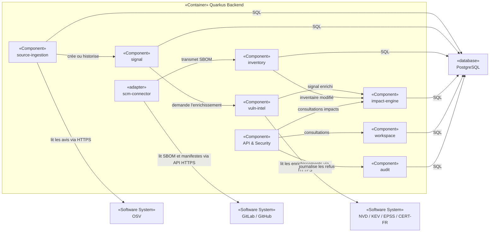
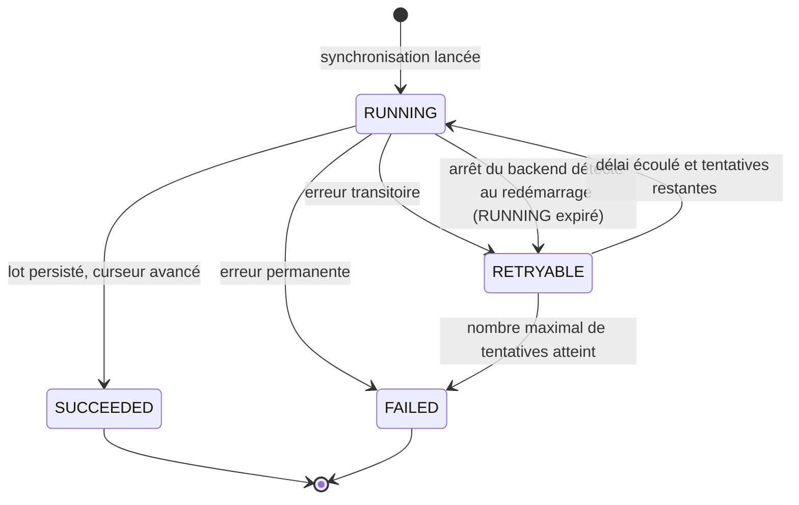
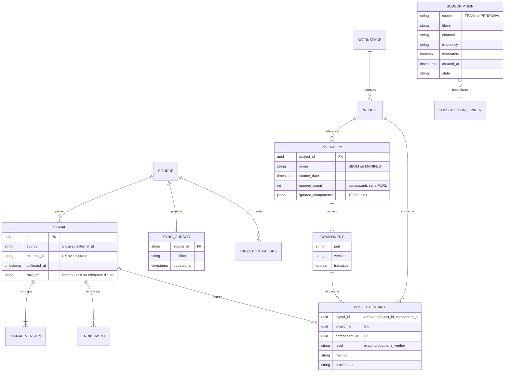

# Conception : formaliser la chaîne sécurité du POC et la personnalisation de la veille

<!-- Statuts : [EXIGENCE] [EXISTANT] [DÉCISION] [PROPOSITION] [QUESTION]. -->

**Niveau de conception** : complète — quatre modules du monolithe, modèle de données nouveau, cloisonnement de sécurité et reprise sur erreur (voir proposal.md, « Conception requise »). Aucune décision de cette conception n'est acceptée : toutes sont [PROPOSITION] tant que les ADR sources restent « Proposé ».

## Contexte technique

- [EXISTANT] Le socle `argos-server/` (Quarkus 3.40, Flyway provisoire) porte l'implémentation de ce lot : migrations `V3__collecte_avis_securite.sql` à `V6__abonnements_veille.sql` (après `V2__comptes_et_acces.sql` du changement gerer-comptes-et-acces, qui crée les tables `compte`, `espace` et `refus_acces`), paquets `io.argos.<module>` et tests d'intégration sur PostgreSQL réel (voir tasks.md, matrice de traçabilité).
- [DÉCISION] Java 17+, Quarkus, Vue.js 3, PostgreSQL (ADR-0019, ADR-0002 acceptés) ; REST + OpenAPI.
- [PROPOSITION] Monolithe modulaire aux frontières vérifiées par ArchUnit (ADR-0001) ; modèle canonique (ADR-0003) ; aucun broker au MVP (arc42 §8.9).
- Motivation : voir proposal.md, « Why — Pourquoi ».

## Exigences couvertes

| Exigence | Section(s) de conception | Diagramme(s) |
|---|---|---|
| COL-01, COL-02 | Traitements ; Persistance | DF-COL-1, DF-COL-2, DC-2 |
| COL-03 | Transactions, concurrence et idempotence | DF-COL-2 |
| COL-04 | Traitements ; Gestion des erreurs | DF-COL-1 |
| COL-05, COL-06, COL-07 | Gestion des erreurs et reprise ; États | DF-COL-1, DF-COL-3, DC-3 |
| COL-08 | Gestion des erreurs et reprise | DF-COL-2 |
| INV-01 à INV-05 | Traitements ; Persistance ; Décision D6 (INV-01-S3) | DF-INV-1, DF-INV-2, DC-2 |
| INV-06 | Contrats d'interface ; Sécurité et isolation ; Décision D7 | DF-INV-3 |
| COR-01, COR-02, COR-06, COR-07 | Traitements ; Transactions ; Décision D5 (COR-01-S5) | DF-COR-1, DF-COR-2, DF-COR-3 |
| COR-03 | Persistance (provenance) ; Observabilité | DF-COR-1, DC-2 |
| COR-04, COR-05 | Décision D3 | DF-COR-2 |
| COR-08, ABO-05 | Sécurité et isolation | DF-ABO-2 |
| ABO-01 à ABO-04 | Contrats d'interface ; Persistance | DF-ABO-1 |

Les diagrammes `DF-*` sont des vues métier maintenues dans les fiches `/docs/specifications/` ; les diagrammes `DC-*` ci-dessous sont des vues de conception interne.

## Objectifs et non-objectifs

**Objectifs :**
- répartir les exigences entre les composants de arc42 §5 sans créer de nouveau module ;
- fixer les invariants testables (unicité, provenance, curseur) avant l'implémentation ;
- isoler les décisions qui exigent un arbitrage.

**Non-objectifs :**
- fixer les chemins d'API, les noms de tables ou l'outil de migration (Flyway ou Liquibase : question ouverte de `docs/architecture/README.md`) ;
- concevoir l'alerting, l'AI Gateway ou le serveur MCP (lots ultérieurs).

## Composants impactés, responsabilités et frontières

| Composant | Responsabilité dans ce changement | Ne doit pas | Statut |
|---|---|---|---|
| `source-ingestion` | synchroniser OSV, gérer curseur, retry, état de source, zone d'échec ; normaliser | connaître les règles de corrélation | à créer |
| `signal` | porter le signal normalisé, son historique et sa provenance | dépendre du format OSV | à créer |
| `vuln-intel` | enrichir (NVD, KEV, EPSS, CERT-FR), dédupliquer par alias | bloquer l'enregistrement d'un signal | à créer |
| `scm-connector` | récupérer SBOM et manifestes des dépôts | injecter des payloads GitLab/GitHub dans le domaine | à créer |
| `inventory` | valider et importer SBOM, repli manifestes, âge | calculer l'impact | à créer |
| `impact-engine` | corrélation déterministe, niveau, provenance, idempotence | déléguer la décision au LLM | à créer |
| `workspace` | abonnements `TEAM`/`PERSONAL`, restitution filtrée | confondre préférence et autorisation | à créer |
| `API & Security` | authentification, autorisation, journalisation des refus | contenir les règles métier | à créer |
| `audit` | conserver payloads bruts, refus d'accès | — | à créer |

### DC-1 — Frontières des composants du lot

- **Question** : quelles dépendances entre composants le lot introduit-il ?
- **Type** : vue de composants à stéréotypes C4 (flowchart), sous-ensemble de D-04
- **Portée** : cible proposée
- **Exigences** : toutes

Les relations respectent arc42 §5.5 : les adapters externes dépendent des ports, le domaine ne dépend d'aucun SDK, les contrôleurs ne parlent pas à la base. L'arc D-04 `SCM --> INVENTORY` est repris tel quel ; `SIG --> VULN` reprend `SIGNAL --> VULN`.

## Modèle de domaine et invariants

Le modèle conceptuel est DF-COR-1 (corrélation) et DF-ABO-1 (abonnements). Invariants testables :

- **INV-D1** : (source, identifiant externe) identifie au plus un signal (COL-03).
- **INV-D2** : tout signal a une provenance complète ; toute version d'avis est rattachée à un signal (COL-02, COL-03).
- **INV-D3** : (signal, projet, composant) identifie au plus un impact (COR-07).
- **INV-D4** : tout impact référence un signal, un projet, un composant, un niveau et une méthode (COR-02, COR-03).
- **INV-D5** : le curseur persisté d'une source ne dépasse jamais le dernier avis enregistré durablement (COL-05).
- **INV-D6** : un abonnement a exactement une portée et un propriétaire du type correspondant (ABO-01, ABO-02).
- **INV-D7** : aucune table d'autorisation n'est lue ni écrite par le module `workspace` lors de la gestion des abonnements (ABO-05).

## Traitements et interactions

- Collecte et enrichissement : DF-COL-1, décision par avis : DF-COL-2.
- Import SBOM : DF-INV-1 ; origine de l'inventaire : DF-INV-2.
- Corrélation : DF-COR-2 ; niveau : DF-COR-3.
- Restitution de la veille : DF-ABO-2.
- Ces vues nomment leurs participants comme les composants de §5, à l'image des diagrammes d'arc42 §6.

## États et transitions

- État de synchronisation d'une source : DF-COL-3 (`DEGRADED` documenté ; `Nominale` et `En échec` proposés).
- État d'un traitement de synchronisation, repris de arc42 §6.4 :

### DC-3 — Traitement de synchronisation et reprise

- **Question** : comment un traitement interrompu par un arrêt du backend est-il repris ?
- **Type** : UML états (stateDiagram-v2)
- **Portée** : cible proposée ; `RUNNING` et `RETRYABLE` viennent de arc42 §6.4, `SUCCEEDED` et `FAILED` sont proposés par ce changement
- **Exigences** : COL-05, COL-06

Au redémarrage, les traitements `RUNNING` expirés sont reclassés `RETRYABLE` (arc42 §6.4) et reprennent depuis le curseur persisté, ce qui garantit COL-05-S2. La durée d'expiration est le paramètre d'exploitation `argos.ingestion.running-expiry` (30 minutes par défaut).

## Contrats d'interface

Le contrat REST est décrit en OpenAPI générée par Quarkus (ADR-0019), sous `/api/v1`. Opérations réalisées [PROPOSITION] :

| Opération | Autorisation | Erreurs observables exigées | Exigences |
|---|---|---|---|
| Consulter un signal et sa provenance | utilisateur authentifié | — | COL-02-S1 |
| Consulter l'état des sources | rôle `OPS` | — | COL-07-S1 |
| Consulter l'inventaire d'un projet, son âge et les composants ignorés faute de PURL | utilisateur autorisé sur le projet | — | INV-01-S3, INV-02-S1, INV-03 |
| Consulter la synthèse de l'inventaire d'un projet sans la liste des composants (`GET /api/v1/projects/{projectId}/inventory/summary`) | utilisateur autorisé sur le projet | refus sans divulgation, journalisé | INV-01-S3, INV-03, INV-06-S4 |
| Lister les projets visibles (`GET /api/v1/projects`, liste paginée, arc42 §8.10) | utilisateur authentifié ; liste limitée par la RLS de `project` | paramètre de pagination non entier (400) | INV-06-S1 |
| Consulter les composants inventoriés d'un projet (`GET /api/v1/projects/{projectId}/inventory/components`, liste paginée) | utilisateur autorisé sur le projet | refus sans divulgation, journalisé ; paramètre de pagination non entier (400) | INV-06-S2, INV-06-S3 |
| Consulter les impacts d'un signal (liste paginée, arc42 §8.10) | filtrée par espace | paramètre de pagination non entier (400) | COR-08-S1 |
| Consulter un impact | utilisateur autorisé sur le projet | refus sans divulgation, journalisé | COR-03-S1, COR-08-S2 |
| Créer un abonnement | `PERSONAL` : l'appelant ; `TEAM` : administrateur de l'espace (Q-5, ABO-06) | refus nommant l'attribut manquant (400) ; refus journalisé (403) | ABO-01-S1, ABO-02, ABO-06 |
| Consulter sa veille | utilisateur authentifié | — | ABO-03, ABO-04, ABO-05 |

Un accès à une ressource d'un autre espace reçoit la même réponse 404 qu'une ressource inexistante, sans contenu, et il est journalisé (COR-08-S2) ; ce choix répond provisoirement à Q-D1. L'appelant est établi depuis le jeton OIDC et les appartenances aux espaces du changement gerer-comptes-et-acces (`OidcCallerResolver`) ; sans jeton valide, toute consultation reçoit 401. Les refus sont journalisés dans la table unique `refus_acces`.

## Persistance et intégrité

### DC-2 — Modèle de persistance proposé

- **Question** : quelles entités et contraintes d'unicité portent les invariants INV-D1 à INV-D6 ?
- **Type** : modèle entité-association (erDiagram), pas un diagramme UML
- **Portée** : cible proposée ; noms de travail, aucun schéma SQL n'existe
- **Exigences** : COL-02, COL-03, COL-05, COL-08, INV-01, INV-04, COR-03, COR-07, ABO-02

Contraintes proposées : unicité (source, external_id) pour INV-D1 et (signal_id, project_id, component_id) pour INV-D3 ; clés étrangères non nulles sur `PROJECT_IMPACT` pour INV-D4 ; `PROJECT_IMPACT` porte la politique RLS de l'espace du projet (ADR-0016). `SUBSCRIPTION_OWNER` représente l'alternative équipe ou utilisateur ; sa réalisation (deux colonnes exclusives ou table d'association) est laissée à l'implémentation. Migrations : outil non choisi [QUESTION, ADR à venir].

## Transactions, concurrence et idempotence

- Collecte : enregistrement des signaux d'un lot et avancement du curseur dans la même transaction, ou curseur avancé après validation de la transaction des signaux (INV-D5). Les deux options satisfont COL-05 ; choix à l'implémentation.
- Idempotence : contrainte d'unicité + insertion conditionnelle (« insérer si absent ») pour signaux et impacts ; la contrainte de base est l'arbitre en cas de collectes concurrentes (COL-03-S3), pas un verrou applicatif.
- Ordre : une version plus ancienne reçue après une plus récente ne remplace pas la version courante [PROPOSITION] — règle de comparaison liée à Q-COL-2.

## Sécurité et isolation

- Signaux globaux ; impacts, inventaires, abonnements et vues rattachés à un espace (ADR-0016).
- Double contrôle : vérification d'espace dans les services, RLS en base comme garde-fou ; traitements batch (collecte, import, corrélation, contrôle d'intégrité) sous l'utilisateur de connexion, propriétaire des tables, les consultations sous le rôle applicatif `argos_app` avec le compte de l'appelant (ADR-0016, conséquences négatives ; arc42 §8.1).
- Liste des projets visibles (INV-06, D7) : la RLS de `project` est le seul filtre de la liste ; aucune condition d'espace n'est ajoutée dans la requête, ce que vérifie `chain/ConsultationInventaireTest#rlsGardeFouSurLaListeDesProjetsEtLesComposants`.
- Abonnements : le module `workspace` ne lit ni n'écrit les rôles (INV-D7) ; la restitution passe par les mêmes requêtes RLS que les autres consultations (DF-ABO-2).
- Entrées externes (avis, SBOM, manifestes) traitées comme données non fiables : validation de structure, taille maximale configurable (`argos.inventory.max-document-bytes`, 20 Mio par défaut), aucune redirection ni URL issue d'un avis ou d'un flux suivie (risque SSRF R-12).
- Aucun appel IA dans ce lot ; toute analyse future passe par `ai-gateway` et sa politique de classification (arc42 §8.3).

## Gestion des erreurs et reprise

- Erreurs transitoires : timeout, 429, 5xx → `RETRYABLE`, délai croissant avec gigue (arc42 §8.5), `Retry-After` prioritaire.
- Erreurs permanentes : 401, 403, 400 → `FAILED`, événement d'exploitation.
- Seuil d'échec → source `DEGRADED` (DF-COL-3). Valeurs : Q-4.
- Avis non normalisable → `INGESTION_FAILURE` avec motif et provenance ; rejeu contrôlé possible après correction (arc42 §8.5, « replay contrôlé »).
- Indisponibilité d'une source d'enrichissement : signal conservé, enrichissement retenté au prochain cycle [PROPOSITION].

## Observabilité

Métriques Micrometer / OpenTelemetry (arc42 §8.6) : fraîcheur par source, nombre de tentatives et d'échecs, sources `DEGRADED`, avis mis à l'écart, signaux créés/historisés, impacts créés par niveau, refus d'accès. Corrélation des journaux par identifiant de synchronisation et identifiant de signal. Aucun secret ni jeton dans les journaux (QS-09).

## Performance et stratégie de mesure

- Consultation : API p95 < 500 ms hors appels externes et IA (arc42 §8.10, cible initiale [PROPOSITION]) — mesure par test de charge (QS-06).
- Délai publication source → signal (« < 1 h », ADR-0010) : cible de qualité mesurée pendant le POC, sans être un critère d'acceptation ([DÉCISION] Q-6 — porteur du projet, 2026-11-18). « Projets touchés < 5 min » : cible non validée, à mesurer pendant le POC sans en faire un critère d'acceptation.
- Volumétrie d'avis et de projets : non documentée [QUESTION, arc42 §10.4].

## Compatibilité, migration et retour arrière

Non applicable — aucune donnée ni aucun contrat existant à migrer. Le retour arrière d'une future livraison se limite au retrait des migrations du lot ; la stratégie dépend de l'outil de migration choisi. La migration V17 (décision D6) ajoute à `inventory` deux colonnes dotées d'une valeur par défaut : un inventaire importé avant elle signale zéro composant ignoré jusqu'à son prochain import ; les champs ajoutés à la réponse de l'API d'inventaire laissent les champs existants inchangés.

## Décisions, alternatives et compromis

### D1 — Signal normalisé distinct des versions d'avis

- **Statut** : [PROPOSITION]
- **Choix** : un signal logique par (source, identifiant externe) et une table d'historique des versions.
- **Justification** : satisfait l'idempotence (COL-03-S1) et l'historisation (COL-03-S2) avec une contrainte d'unicité simple.
- **Alternatives écartées** : un enregistrement par collecte (duplication logique, contraire à Q-03) ; écrasement sans historique (perte de traçabilité, contraire à baseline v2.3 §4).
- **Compromis** : volume d'historique à purger selon une politique de rétention non définie.
- **ADR** : non — décision locale, cohérente avec ADR-0003.

### D2 — Inventaire de référence remplacé à chaque SBOM

- **Statut** : [PROPOSITION]
- **Choix** : un inventaire de référence par projet, remplacé en bloc ; l'origine (`SBOM`, `MANIFEST`) et la date de la source sont des attributs de l'inventaire.
- **Justification** : la corrélation n'a besoin que de l'état courant (COR-01) ; l'âge et l'origine alimentent COR-06 et INV-03.
- **Alternatives écartées** : inventaire versionné par SBOM (utile pour l'historique, non exigé) ; fusion incrémentale (risque de composants fantômes).
- **Compromis** : pas d'historique d'inventaire ; à reconsidérer si un besoin d'audit apparaît.
- **ADR** : non — décision locale.

### D3 — Analyse IA après l'enregistrement des impacts déterministes

- **Statut** : [PROPOSITION]
- **Choix** : `impact-engine` enregistre les impacts déterministes avant toute sollicitation de `ai-gateway`.
- **Justification** : rend COR-05 vrai par construction et applique COR-04.
- **Alternatives écartées** : appel IA dans la même transaction (panne IA bloquante) ; IA en premier (contraire à ADR-0013).
- **Compromis** : la suggestion IA arrive après coup ; aucune alerte critique n'en dépend.
- **ADR** : déjà couvert par ADR-0013 (Proposé).

### D4 — Aucun nouvel ADR pour ce lot

- **Statut** : [PROPOSITION]
- **Choix** : s'appuyer sur ADR-0010, 0011, 0013, 0016 (Proposés) ; signaler comme candidats à ADR, hors de ce changement, le mécanisme de planification/jobs et l'outil de migration (arc42 §9.3, points 1 et 3).
- **ADR** : candidats signalés, rédigés hors de ce changement : ADR-0031 (planification) et ADR-0032 (migrations Flyway), Acceptés ([DÉCISION] — porteur du projet, 2026-11-18).

### D5 — Ordre des versions Maven

- **Statut** : [DÉCISION] du porteur du projet, 2026-11-18 (écart E-1 du jeu de référence, question Q-COR-3 de la fiche `correlation-impact`), **révisée** par la décision E3 du porteur du projet, 2026-11-19 (« Révision E3 » ci-dessous). Le texte du 2026-11-18 est conservé ci-dessous ; pour Maven, la révision E3 le remplace.
- **Choix (2026-11-18, remplacé pour Maven par la révision E3)** : pour l'écosystème Maven seulement, quand l'ordre générique de deux versions dépend d'un qualificatif inconnu (`jre`, `android`…), l'ordre de `ComparableVersion` de Maven tranche : un qualificatif inconnu suit la version publiée et `sp`, et les qualificatifs inconnus s'ordonnent entre eux par ordre lexical. L'algorithme est une adaptation de `ComparableVersion` (Maven Artifact 3.9.16, Apache-2.0) dans le dépôt (`io.argos.impact.MavenVersionOrder`), sans dépendance, avec attribution et texte de licence dans `argos-server/NOTICE` et `argos-server/licenses/Apache-2.0.txt` ; il reçoit les versions sans préfixe `v` ni métadonnées `+…`, et une version qui contient `_` reste `à vérifier`. L'ordre générique et ses qualificatifs connus (`dev`, `pre`, `preview`, `post`, `rev`, `r`, `a`, `b`, `c`, `m` sans chiffre compris) restent appliqués en premier : pour ces qualificatifs, l'ordre retenu diffère de `ComparableVersion`, et le mélange des deux ordres peut ne pas être transitif (`1.0-dev` < `1.0-alpha` < `1.0-abc` < `1.0-dev`) [PROPOSITION : application aux seuls qualificatifs inconnus de l'ordre générique, à trancher par le porteur du projet face à `ComparableVersion` intégral pour Maven]. Les autres écosystèmes gardent le niveau `à vérifier` pour une plage dont l'ordre dépend d'un qualificatif inconnu.
- **Justification (2026-11-18)** : les avis OSV de l'écosystème Maven expriment leurs bornes dans l'ordre de Maven ; `32.0.0-jre` suit la borne `32.0.0-android` et n'est pas affectée (COR-01-S5).
- **Alternatives écartées (2026-11-18)** : niveau `à vérifier` pour tout qualificatif inconnu (faux positif E-1) ; dépendance `maven-artifact` (Apache-2.0, ajoute `plexus-utils`) pour un algorithme court.
- **Compromis (2026-11-18)** : fidélité à `ComparableVersion` à maintenir ; elle est vérifiée par `MavenVersionOrderTest`. Code dérivé d'Apache-2.0, intégré selon ADR-0021 points 3 et 4 [PROPOSITION : adaptation attribuée plutôt que dépendance `maven-artifact` ou réécriture indépendante, à trancher par le porteur du projet].
- **ADR** : non — règle locale de comparaison, dans le cadre d'ADR-0013.

#### Révision E3 — 2026-11-19

- [DÉCISION — porteur du projet, 2026-11-19 ; E3] Ordre des versions Maven : pour l'écosystème Maven, toute comparaison passe par `org.apache.maven.artifact.versioning.ComparableVersion` de la bibliothèque `maven-artifact` (Apache-2.0, gratuite ; dernière version stable compatible Java 21) ; l'adaptation `MavenVersionOrder` et l'ordre mixte sont retirés ; les autres écosystèmes ne changent pas.
- **Nature** : révision du comportement de D5. Pour Maven, l'ordre générique ne s'applique plus en premier : un qualificatif que l'ordre générique connaît et que Maven ne connaît pas (`dev`, `pre`, `post`, `a` sans chiffre…) suit la version publiée (`1.0-dev` > `1.0`), comme dans `ComparableVersion`.
- **Choix** : pour l'écosystème Maven, toute comparaison de versions, bornes de plage comme versions énumérées, passe par `ComparableVersion` de `maven-artifact` 3.9.16, dernière version stable (Apache-2.0, compatible Java 17 et 21) ; l'ordre générique de `VersionComparator` ne s'applique pas à Maven. Un qualificatif inconnu de Maven (`jre`, `android`, `dev`, `pre`, `post`, `a` sans chiffre…) suit la version publiée et `sp`, et les qualificatifs inconnus s'ordonnent entre eux par ordre lexical. `ComparableVersion` reçoit les versions sans préfixe `v` ni métadonnées `+…`. Une version qui ne commence pas par un chiffre, ou qui contient un caractère autre qu'un chiffre, une lettre ASCII, `.` ou `-` (par exemple `_`), reste non interprétable : l'impact éventuel porte le niveau `à vérifier` (COR-02) [DÉCISION — porteur du projet, 2026-11-19 (F2) : les versions Maven atypiques, qui contiennent `_` ou `~` ou ne commencent pas par un chiffre, restent `à vérifier` ; `ComparableVersion` les ordonnerait, mais `_` et les autres caractères n'y sont pas des séparateurs]. Les autres écosystèmes gardent l'ordre générique et le niveau `à vérifier` pour une plage dont l'ordre dépend d'un qualificatif inconnu.
- **Justification** : les avis OSV de l'écosystème Maven expriment leurs bornes dans l'ordre de Maven ; `32.0.0-jre` suit la borne `32.0.0-android` et n'est pas affectée (COR-01-S5). Un ordre unique pour Maven est transitif.
- **Alternatives écartées** : adaptation de `ComparableVersion` dans les sources, appliquée après l'ordre générique (ordre mixte non transitif).
- **Compromis** : une dépendance de plus (`maven-artifact`, environ 60 Kio) ; sa dépendance `plexus-utils` est exclue, `ComparableVersion` ne l'utilise pas. Licence enregistrée dans `argos-server/pom.xml` et avis NOTICE reproduit dans `argos-server/NOTICE`, avec le texte de licence `argos-server/licenses/Apache-2.0.txt` (ADR-0021 points 4 et 6).

### D6 — Composants sans PURL signalés à l'import

- **Statut** : [DÉCISION] du porteur du projet, 2026-11-18 (écart E-2 du jeu de référence), **révisée** par la décision E4 du porteur du projet, 2026-11-19 (« Révision E4 » ci-dessous), pour la restitution du signalement. Le texte du 2026-11-18 est conservé ci-dessous.
- **Choix (2026-11-18 ; restitution révisée par E4)** : l'inventaire reste fondé sur le PURL (INV-01) ; un composant de SBOM sans PURL exploitable est écarté et signalé : nombre total et description (nom, groupe, version, motif `SANS_PURL` ou `PURL_INVALIDE`) des 100 premiers, dans l'inventaire restitué par `GET /api/v1/projects/{projectId}/inventory` (champs `ignoredCount` et `ignoredComponents`), seul canal exposé à l'utilisateur : `argos-ui` n'a pas de vue de l'inventaire, les outils MCP ne restituent pas le signalement et le résultat interne de l'import (`InventoryService.ImportResult`) n'est renvoyé par aucun point d'entrée [PROPOSITION : l'API suffit à rendre le signalement visible, à confirmer par le porteur du projet]. Le signalement est remplacé à chaque import (D2) et conservé dans les colonnes `ignored_count` et `ignored_components` de `inventory` (migration V17, ADR-0032), sous la RLS de la table.
- **Justification** : un composant ignoré en silence masque un faux négatif de la corrélation ; le signalement le rend visible sans créer de correspondance incertaine.
- **Alternatives écartées** : clé `à vérifier` déduite du groupe et du nom Maven (hors de la décision D6) ; table dédiée (aucune requête ne porte sur un composant ignoré isolé).
- **Compromis (2026-11-18 ; restitution révisée par E4)** : liste bornée à 100 entrées et champs bornés à 200 caractères [PROPOSITION] ; aucune vue de l'inventaire n'existe dans `argos-ui`, la restitution passe par l'API.
- **ADR** : non — décision locale.

#### Révision E4 — 2026-11-19

- [DÉCISION — porteur du projet, 2026-11-19 ; E4] Composants ignorés faute de PURL : ils sont affichés dans la vue d'inventaire d'`argos-ui` (web et desktop), à partir du champ déjà exposé par `GET /api/v1/projects/{id}/inventory`.
- **Choix** : `argos-ui` a une vue d'inventaire (`InventaireView`, adresses `/inventaire` et `/inventaire/{id}`, entrée « Inventaire » de la navigation, commune au portail web et au client desktop). Elle affiche, pour un projet des espaces de l'utilisateur, la synthèse de l'inventaire de référence (origine, date et âge de la source, obsolescence, date d'import, nombre de composants inventoriés) et la section « Composants ignorés » : nombre total, puis tableau (nom, groupe, version, motif) des composants listés par l'API, bornes reprises. Un projet sans inventaire est nommé comme tel. Les valeurs de la SBOM sont rendues comme texte. Le détail d'une alerte mène à la vue d'inventaire de chaque projet cité. Les outils MCP ne restituent toujours pas le signalement.
- **Compromis** : l'API n'expose pas la liste des projets de l'utilisateur ; la vue désigne donc le projet par son identifiant (saisi, ou suivi depuis le lien d'un projet cité par une alerte) [PROPOSITION : désignation par identifiant, sans nouveau point d'entrée de l'API ; une liste des projets visibles, par exemple `GET /api/v1/projects` sur `InventoryQueries.visibleProjects`, reste à décider par le porteur du projet]. La vue charge l'inventaire complet (`components` compris) pour en afficher le nombre de composants.
- Le compromis ci-dessus sur la désignation par identifiant est levé par la décision F1 (D7) : la vue propose la liste des projets visibles et garde la désignation par identifiant.
- Le compromis ci-dessus sur le chargement de l'inventaire complet est levé par la décision G5 (D7, révision G) : la vue lit la synthèse de l'inventaire et la page de composants affichée.

### D7 — Consultation de l'inventaire par projet : liste des projets et composants paginés

- **Statut** : [DÉCISION — porteur du projet, 2026-11-19 ; F1] Vue d'inventaire : nouveau point d'accès `GET /api/v1/projects` listant les projets visibles par l'utilisateur (sous RLS, adossé à `InventoryQueries.visibleProjects` ou équivalent existant), et liste de choix du projet dans la vue Inventaire d'`argos-ui` ; les liens depuis les alertes restent. [DÉCISION — porteur du projet, 2026-11-19 ; F5] Vue d'inventaire : liste paginée côté serveur des composants inventoriés d'un projet (nom, version, PURL, direct ou transitif), consultable dans la vue. Les modalités ci-dessous sont des [PROPOSITION].
- **Choix** :
  - `GET /api/v1/projects?page=&size=` renvoie `{items, page, size, total}`, chaque élément portant `id`, `workspaceId`, `workspaceName` et `name`. La requête (`InventoryQueries.projects`) ne filtre pas par espace : sous `argos_app`, la RLS de `project` limite la liste aux espaces dont l'appelant est membre ; le nom de l'espace vient d'une jointure externe sur `espace`, lue sous sa propre RLS. Tri : nom du projet, nom de l'espace, identifiant.
  - `GET /api/v1/projects/{projectId}/inventory/components?page=&size=` renvoie `{projectId, items, page, size, total}`, chaque élément portant `id`, `name` (clé du paquet sans le préfixe `pkg:<type>/`), `version`, `purl`, `packageKey` et `transitive` (`null` si inconnu). Tri : nom, version (absente en premier), identifiant ; l'ordre des noms et des versions est l'ordre alphabétique de la base, et non l'ordre des versions de l'écosystème. Un projet inconnu ou d'un autre espace reçoit 404, le second refus étant journalisé (`refus_acces`, motif `NON_MEMBRE`) comme pour `/inventory` ; un projet sans inventaire reçoit une page vide.
  - Pagination des deux listes : `page` à partir de 0 (négatif ramené à 0), `size` de 1 à 200 (défaut 50), une valeur hors bornes étant ramenée à la borne la plus proche, comme pour les impacts d'un signal (`ImpactQueries.forSignal`). `page` et `size` restitués sont les valeurs appliquées. Une valeur non entière (par exemple `page=abc`) est refusée par une réponse 400 (`DONNEE_INVALIDE`, attribut `page` ou `size`) ; un entier au-delà des bornes de `int` est saturé puis ramené à la borne.
  - `GET /api/v1/projects/{projectId}/inventory` reste inchangé, `components` compris : les clients actuels ne sont pas modifiés.
  - `argos-ui` : la vue d'inventaire propose une liste de choix (`<select>` étiqueté « Projet », libellé « nom du projet — nom de l'espace ») alimentée par la première page de 200 projets ; au-delà, un message l'indique et la désignation par identifiant (« Ou identifiant du projet ») reste disponible. La sélection ne change pas de contexte : le bouton « Afficher l'inventaire » mène à `/inventaire/{id}`. La section « Composants inventoriés » affiche un tableau à en-têtes (nom, version, PURL, dépendance) par pages de 20, une navigation « Page précédente » / « Page suivante » nommée, focalisable aux bornes (`aria-disabled`), la position « Page n sur m », une annonce dans la région live et le focus sur le tableau après un changement de page, l'état vide et les erreurs avec nouvelle tentative. Une page au-delà de la dernière (inventaire remplacé entre deux pages) est remplacée par la dernière.
- **Justification** : la RLS reste le garde-fou unique de la visibilité (ADR-0016) ; la décision F1 admet `InventoryQueries.visibleProjects` « ou équivalent existant » : `InventoryQueries.projects` reprend sa règle de visibilité (aucun filtre applicatif, RLS de `project` sous `argos_app` avec le compte de l'appelant) et y ajoute la jointure sur `espace`, le tri stable et la pagination ; elle est la seule requête de liste des projets visibles, partagée avec les outils MCP (révision G, décision G6) ; un sous-chemin `/components` ajoute la pagination sans changer la réponse de `/inventory` ; le ramenage aux bornes reprend la convention existante des listes paginées de l'API.
- **Alternatives écartées** : paramètres de pagination ajoutés à `/inventory` (réponse existante modifiée) ; refus 400 d'une taille hors bornes (convention différente des impacts d'un signal) ; pagination par curseur (volumes du POC compatibles avec un décalage) ; tri par ordre des versions de l'écosystème (règle métier de `impact-engine`, hors de la consultation).
- **Compromis** : la liste de choix ne présente que les 200 premiers projets ; le décompte et la page sont deux requêtes de la même connexion, sans instantané commun : un import concurrent peut décaler une page. La lecture de l'inventaire complet par la vue est levée par la révision G ci-dessous.
- **ADR** : non — décision locale, sans nouveau composant ni nouvelle technologie.

#### Révision G — 2026-11-19

- [DÉCISION — porteur du projet, 2026-11-19 ; G4] Toutes les listes paginées de l'API REST refusent un paramètre de pagination non entier par 400 `DONNEE_INVALIDE` (helper `io.argos.api.ParametresPagination`), contrat OpenAPI à jour.
- [DÉCISION — porteur du projet, 2026-11-19 ; G5] L'API fournit la synthèse d'inventaire d'un projet sans la liste des composants (nombres, date, source, composants ignorés faute de PURL) ; la vue Inventaire ne charge plus l'inventaire complet, seulement la synthèse et la page de composants affichée ; la dette consignée dans D7 est levée.
- [DÉCISION — porteur du projet, 2026-11-19 ; G6] Une seule requête de liste des projets visibles : les outils MCP passent par la requête paginée `InventoryQueries.projects` (ou son équivalent unifié) ; `visibleProjects` disparaît si plus rien ne l'utilise ; comportement des outils MCP inchangé pour l'appelant (cloisonnement, contenu), tests MCP verts.
- **Choix** :
  - G4 : `ParametresPagination` est public ; les paramètres `page`, `size` et `taille` des listes paginées (`GET /api/v1/projects`, `/inventory/components`, `/signals/{id}/impacts`, `/recherche`, `/vues/{id}/resultats`) et le paramètre `limite` des listes bornées (`/alertes`, `/veille-web/actualites`, `/reglementaire/fiches`) sont lus comme texte puis convertis par `ParametresPagination.entier` ; le contrat OpenAPI les déclare de type `integer` avec leur valeur par défaut et déclare la réponse 400. Les bornes propres à chaque liste sont conservées : ramenage aux bornes pour l'inventaire, les impacts, les alertes et les actualités ; refus 400 `CRITERE_INVALIDE` hors bornes pour la recherche et les vues ; refus 400 `DONNEE_INVALIDE` hors bornes pour les fiches. Pour une ressource désignée dans le chemin (signal, projet de l'inventaire, vue) ou un espace désigné en paramètre (actualités, fiches), le contrôle d'accès précède la lecture des paramètres : une ressource inconnue ou hors des espaces de l'appelant reçoit 404 même avec un paramètre non entier. `GET /api/v1/recherche` contrôle les projets filtrés avant de lire `page` et `taille` (décision H5, révision H ci-dessous).
  - G5 : `GET /api/v1/projects/{projectId}/inventory/summary` renvoie `{projectId, status, summary}` ; `status` vaut `AVAILABLE` ou `NO_SBOM`, `summary` (schéma `InventorySummary`) porte `projectId`, `origin`, `sourceDate`, `ageDays`, `obsolete`, `specVersion`, `importedAt`, `componentCount`, `ignoredCount` et `ignoredComponents`, mêmes valeurs que la réponse de `/inventory` hors liste des composants. Mêmes règles d'accès que `/inventory`. `GET /api/v1/projects/{projectId}/inventory` reste inchangé, `components` compris : aucun client n'est modifié hors de la vue d'inventaire, qui lit la synthèse et la page de composants affichée.
  - G6 : `io.argos.mcp.ProjetsVisibles` lit `InventoryQueries.projects` page après page (pages de 200, à la demande) ; `get_project_context` et `upcoming_releases` l'utilisent, restreints aux projets des espaces dont l'appelant est membre ; `InventoryQueries.visibleProjects` et `ProjectSummary` sont supprimés. Le résumé des projets de `get_project_context` (sans `project_id`) lit la synthèse de l'inventaire (`InventoryQueries.summary`), sans les composants ; le détail d'un projet lit toujours ses composants (au plus 500).
- **Justification** : un seul convertisseur des paramètres de pagination garde une réponse identique pour toutes les listes ; un sous-chemin `/summary` suit la convention des sous-ressources de l'inventaire (`/components`, `/failures`) et laisse inchangée la réponse de `/inventory` ; une seule requête de projets visibles garde une seule règle de visibilité (RLS de `project`, ADR-0016) pour l'API et le serveur MCP.
- **Alternatives écartées** : paramètre `?components=false` sur `/inventory` (même chemin, deux schémas de réponse) ; suppression de `components` dans `/inventory` (clients existants modifiés) ; méthode `InventoryQueries.project(id)` dédiée aux outils MCP (seconde requête de projets, contraire à G6).
- **Compromis (révision G)** : les outils MCP lisent les projets en plusieurs requêtes au-delà de 200 projets, sans instantané commun : un projet créé ou supprimé entre deux pages peut être omis ou lu deux fois ; les outils MCP restituent les projets dans l'ordre de l'API (nom du projet, nom de l'espace, identifiant) ; ces deux points sont acceptés par la décision H3 (révision H ci-dessous). Le paramètre `limite` des listes bornées est traité comme un paramètre de pagination au sens de G4 [PROPOSITION]. Les paramètres `jours` (activité) et `horizon` (recherche, radar), qui ne paginent pas, gardent leur conversion actuelle [PROPOSITION].
- **ADR** : non — décision locale, sans nouveau composant ni nouvelle technologie.

#### Révision H — 2026-11-19

- [DÉCISION — porteur du projet, 2026-11-19 ; H3] Outils MCP : l'ordre des projets de l'API (nom, espace, identifiant) et la lecture paginée sans instantané commun au-delà de 200 projets sont acceptés.
- [DÉCISION — porteur du projet, 2026-11-19 ; H5] `/recherche` : un projet filtré inconnu ou invisible reçoit 404 même avec un paramètre de pagination non entier (contrôle d'accès aux projets avant la conversion des paramètres) ; la réponse ne permet pas de distinguer un projet inexistant d'un projet d'un autre espace (même réponse que pour les autres ressources). Test d'intégration.
- **Choix** :
  - H3 : `io.argos.mcp.ProjetsVisibles` garde la lecture de G6 (pages de 200 de `InventoryQueries.projects`, ordre de l'API) ; aucun changement de code.
  - H5 : `TraductionCriteres.executer` reçoit `page` et `taille` sous forme de texte ; il valide d'abord les critères, dont le contrôle des projets filtrés, puis convertit la pagination par `ParametresPagination.entier` et applique les bornes (page ≥ 0, taille de 1 à 100). Un projet inconnu reçoit 404 `INTROUVABLE` « Ressource introuvable. » sans refus journalisé ; un projet d'un autre espace reçoit la même réponse, refus journalisé (`refus_acces`, motif `NON_MEMBRE`) ; un paramètre de pagination non entier ou hors bornes ne change pas cette réponse. Avec des projets visibles, la pagination est refusée comme en G4 (400 `DONNEE_INVALIDE` si non entière, 400 `CRITERE_INVALIDE` hors bornes). Le rappel d'une vue (`/vues/{id}/resultats`) suit le même ordre : vue de l'appelant, critères de la vue, pagination. Le contrat OpenAPI de `/recherche` décrit la réponse 404 et cet ordre.
- **Justification** : un seul ordre de contrôle pour toutes les ressources de l'API (ressource désignée, puis paramètres de pagination) ; la réponse 404 ne dépend que de la visibilité du projet ; la conversion reste confiée au convertisseur unique de G4.
- **Alternatives écartées** : contrôle séparé des projets dans `RechercheResource` avant l'appel de `TraductionCriteres` (deux lectures de l'espace de chaque projet) ; conversion conservée avant le contrôle (400 pour un projet inconnu, réponse différente des autres ressources).
- **Vérification** : `api/ParametresPaginationTest#rechercheControleLesProjetsAvantLaPagination` (projet inconnu et projet d'un autre espace avec `page=abc` : même corps 404, refus journalisé pour le second seulement ; taille non entière ou hors bornes : 404 ; projet visible : pagination contrôlée) et `#contratOpenApi`.
- **ADR** : non — décision locale, sans nouveau composant ni nouvelle technologie.

## Risques

- Plages de versions hétérogènes selon les écosystèmes → faux positifs/négatifs ; atténuation : jeu de référence (baseline v2.3 §6 critère 3), registre R-15.
- Rate limit des sources → retard de collecte ; atténuation : `Retry-After`, delta par curseur (R-14).
- Fuite inter-espaces par une requête oubliant le filtre → RLS en garde-fou, tests inter-espaces (R-17 pour la partie RAG, ADR-0016).
- SSRF via URL d'avis → aucune URL d'avis suivie automatiquement (R-12).

## Écarts code / tests / specs / documentation

- Code et tests alignés sur les scénarios : voir tasks.md, matrice de traçabilité.
- arc42 §6 / §5 : les participants des diagrammes d'arc42 §6 portent les noms des composants de §5 ([DÉCISION] — porteur du projet, 2026-11-18, tâche 6.1).
- Inventaire des diagrammes : D-05, D-11, D-12, D-13 annoncés mais absents — D-05 ajouté en arc42 §5.7 ; D-11, D-12 et D-13 marqués manquants.
- `F01`–`F16` cités par les ADR sans définition dans le dépôt (proposal.md, Q-1).

## Stratégie de vérification

| Exigence / scénario | Niveau de test | Moyen de preuve | État |
|---|---|---|---|
| COL-01 à COL-04, COL-08 | intégration (PostgreSQL réel) + contrat (réponses OSV/NVD enregistrées) | tests du module `source-ingestion` / `vuln-intel` | à écrire |
| COL-03-S3, COR-07 | intégration concurrente | test parallèle sur contrainte d'unicité | à écrire |
| COL-05, COL-06, COL-07 | résilience (simulation 429/5xx/timeout, arrêt forcé) | QS-03, QS-07 | à écrire |
| INV-01 à INV-05 | intégration avec SBOM CycloneDX de test | jeux de SBOM valides/invalides | à écrire |
| INV-06 | intégration REST + RLS ; IHM (`node --test`) ; E2E web et desktop | `chain/ConsultationInventaireTest`, `argos-ui/tests/inventaire-listes.test.mjs`, `e2e/tests/inventaire.spec.ts`, `e2e/desktop/inventaire.spec.ts` | passe le 2026-11-19 (tâche 3.8) |
| COR-01 à COR-06 | unitaire (règles) + jeu de référence annoté | précision/rappel (baseline v2.3 §6 critère 3) | `MatchRulesTest`, `CorrelationTest`, `JeuReferenceCorrelationTest` ; jeu composé mesuré le 2026-11-18, inventaires des projets pilotes à ajouter (tâches 4.7 et 7.1) |
| COR-08, ABO-05 | intégration inter-espaces REST + RLS | test ADR-0016 | à écrire |
| ABO-01 à ABO-04 | intégration API | tests du module `workspace` | à écrire |
| Frontières de modules | architecture | ArchUnit (ADR-0001) | à écrire |

## Documentation durable impactée

- `/docs/specifications/README.md` et les fiches `collecte-avis-securite`, `inventaire-sbom`, `correlation-impact`, `abonnements-veille` (créées avec ce changement, statut [PROPOSITION]).
- `/docs/architecture/arc42/05-vue-blocs.md` (D-05), `/docs/architecture/arc42/06-vue-execution.md` (correspondance), `/docs/architecture/diagrams/README.md`.
- Glossaire arc42 §12 : `Inventaire`, `Composant`, `Signal de sécurité` à ajouter lors de l'implémentation.

## Questions ouvertes

- Q-D1 : code HTTP d'un accès hors périmètre — 404 sans contenu retenu provisoirement, à confirmer.
- Durée d'expiration d'un traitement `RUNNING` — paramètre d'exploitation, 30 minutes par défaut, à valider.
- Taille maximale d'une SBOM ou d'un manifeste acceptée — paramètre de sécurité, 20 Mio par défaut, à valider.

Les questions qui changent ce qui sera construit (Q-2, Q-3, Q-4, Q-5, Q-7 de la proposition) sont traitées par le groupe 1 des tâches avant toute implémentation.
