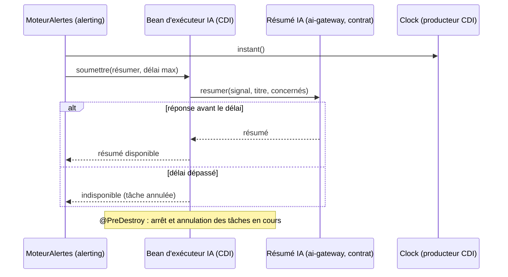

# Conception : injecter l'horloge et les exécuteurs

<!-- Statuts : [EXIGENCE] [EXISTANT] [DÉCISION] [PROPOSITION] [QUESTION] — légende : /docs/specifications/README.md#statuts-des-informations. -->

**Niveau de conception** : allégée — refactoring sans comportement nouveau ; seules les sections utiles sont remplies.

## Contexte technique

- Heure : 63 appels Java à `now()` (37 fichiers), 47 lignes `now()` SQL, aucun `Clock` ; horloges locales remplaçables dans `CollecteWeb` (`Supplier<Instant>`, `:81`) et `LimiteurDebit` (`LongSupplier`, `:31`) ; motif déjà présent « point d'entrée planifié → méthode recevant maintenant » (`MoteurAlertes.java:140` `evaluer(evenement, Instant.now())`, `RappelsRadar`) [EXISTANT — proposal.md, « Sources et preuves »].
- Fuseau : `argos.alerting.fuseau` (défaut `Europe/Paris`, `application.properties:65`), repris par `argos.ia.fuseau` (`:158`) et par les tâches planifiées (`timeZone = "{argos.alerting.fuseau}"`, ADR-0031) [EXISTANT].
- Exécuteurs : `MoteurAlertes.EXECUTEUR_IA` (`ThreadPoolExecutor(2, 2, ...)`, soumis `:321`), `SyntheseActivite.EXECUTEUR_IA` (`ThreadPoolExecutor(1, 2, ...)`, soumis `:91`), `RecuperateurWeb.MINUTERIE` (`newSingleThreadScheduledExecutor`, coupure d'un corps de réponse trop lent `:139`) ; tous `static final`, jamais arrêtés [EXISTANT].
- Tests concernés : voir proposal.md (quatre cas d'AUD-TST-06, plus `ImportPlanifieTest:326` et `StubServer:143`).

## Exigences couvertes

Non applicable — `skip_specs: true` ; constats traités : AUD-QUA-10, AUD-TST-06, AUD-QUA-11 (matrice de `tasks.md`). Les comportements temporels existants (expirations, fraîcheur, échéances, délais IA) restent ceux des specs principales, inchangés.

## Objectifs et non-objectifs

**Objectifs :**
- Une seule source de l'heure côté Java, remplaçable en test.
- Aucun test ne dort ni n'attend l'horloge réelle pour décider d'une assertion.
- Chaque fil créé par le serveur appartient à un bean CDI et s'arrête avec l'application.

**Non-objectifs :**
- Remplacer les `now()` SQL d'horodatage pur (Q-2).
- Modifier un délai, une fréquence ou une échéance.

## Composants impactés, responsabilités et frontières

| Composant | Responsabilité dans ce changement | Ne doit pas | Statut |
|---|---|---|---|
| Producteur d'horloge (nouveau, paquet transverse à choisir) | produire le `Clock` au fuseau configuré | dépendre d'un module métier | nouveau (technique) |
| alerting, project-intel | soumettre au bean d'exécuteur ; recevoir le `Clock` | posséder un exécuteur statique | modifié |
| source-ingestion (`RecuperateurWeb`) | minuterie de coupure fournie par un bean | — | modifié |
| catalog, mcp-server, workspace, API & Security, autres lecteurs de l'heure | `now(clock)` | appeler `now()` sans `Clock` | modifié |

Emplacement du producteur : il doit être accessible à tous les modules sans créer de dépendance interdite par `ModuleBoundariesTest`. Proposition : paquet de premier niveau technique (par exemple `io.argos.horloge`) ajouté à la table des frontières avec zéro dépendance et autorisé pour tous, ou producteur placé dans le futur noyau commun du changement `extraire-noyau-commun` s'il est fusionné avant [QUESTION] Q-5 (non bloquante pour le reste des tâches : l'injection d'un `java.time.Clock` ne dépend pas du paquet du producteur).

## Traitements et interactions

### DC-1 — Résumé IA d'une alerte avec exécuteur géré et horloge injectée

Question : qui possède l'exécuteur et où l'horloge intervient-elle dans l'attente bornée du résumé ? Type : UML sequenceDiagram. Vue cible (l'existant diffère par l'exécuteur statique et `Instant.now()`). Constats : AUD-QUA-10, AUD-QUA-11, AUD-TST-06.

L'attente reste bornée par `argos.alerting.resume-ia.delai-max` ; en test, le résumé simulé « lent » ne dort plus : il retourne un `Future` jamais complété (ou complété après le délai simulé), et l'assertion porte sur l'issue `INDISPONIBLE` sans mesurer l'horloge réelle. Le même motif sert `SyntheseActivite` (factorisation « soumettre, attendre avec délai, annuler »).

## Transactions, concurrence et idempotence

- Les fils des exécuteurs n'ouvrent pas de transaction aujourd'hui pour le résumé (appel du contrat de la passerelle) ; le bean conserve ce comportement. Si `ManagedExecutor` est retenu (Q-4), la propagation du contexte CDI ne doit pas propager de transaction (`propagated` limité au contexte CDI, `cleared` pour la transaction) [PROPOSITION].
- `DefenseEnProfondeurTest` : la soumission concurrente est observée par `pg_locks` / `pg_stat_activity.wait_event_type = 'Lock'` avec attente bornée (Awaitility), sur le modèle d'`ImportPlanifieTest` [PROPOSITION].

## Gestion des erreurs et reprise

À l'arrêt, `shutdownNow()` annule les résumés en cours : l'alerte est déjà enregistrée avec l'issue `INDISPONIBLE` si le résumé n'est pas arrivé (comportement actuel en cas de délai), aucune tâche n'est perdue sans trace au-delà de ce cas [PROPOSITION — à confirmer par lecture de `MoteurAlertes` à l'implémentation].

## Compatibilité, migration et retour arrière

Aucun contrat ni schéma modifié ; tailles d'exécuteur par défaut égales aux valeurs codées en dur (2/2, 1/2, 1) ; retour arrière par revert. La non-régression est prouvée par la suite existante (654 tests) et la couverture inchangée ou en hausse (seuil de `mettre-en-place-integration-continue`).

## Décisions, alternatives et compromis

### D1 — `java.time.Clock` produit par CDI

- **Statut** : [PROPOSITION] ; fuseau [QUESTION] Q-1
- **Choix** : `@Produces @ApplicationScoped Clock` = `Clock.system(ZoneId.of(argos.alerting.fuseau))` ; en test, un `Clock` réglable (bean alternatif ou `QuarkusMock`) ; `CollecteWeb` et `LimiteurDebit` dérivent leurs fournisseurs du `Clock` (`LimiteurDebit` garde une source monotone si elle mesure des durées : `System.nanoTime` n'est pas l'heure murale) [PROPOSITION].
- **Justification** : action d'AUD-QUA-10 ; type standard du JDK, aucune dépendance nouvelle.
- **Alternatives écartées** : `Supplier<Instant>` par classe (état actuel, dispersé) ; interface maison `Horloge` (réinvente `Clock`).
- **Compromis** : les classes non CDI (records, utilitaires statiques) reçoivent l'instant en paramètre au lieu du `Clock`.
- **ADR** : non : convention consignée dans arc42 §8.16.

### D2 — Garde de régression par test d'architecture

- **Statut** : [PROPOSITION]
- **Choix** : règle ArchUnit « aucune classe de production n'appelle `Instant.now()`, `LocalDate.now()`, `LocalDateTime.now()`, `OffsetDateTime.now()`, `ZonedDateTime.now()` sans argument, ni `System.currentTimeMillis()` », hors producteur du `Clock` ; règle « aucun `Thread.sleep` dans les tests » si Q-3 retient la conversion stricte.
- **Justification** : critère de sortie du sprint 4 (« une recherche … ne trouve que le producteur du Clock ») rendu exécutable.
- **Alternatives écartées** : `grep` dans le workflow (moins précis : commentaires, chaînes).
- **Compromis** : la règle doit autoriser explicitement le producteur.
- **ADR** : non.

### D3 — Exécuteurs possédés par des beans CDI

- **Statut** : [PROPOSITION] ; forme [QUESTION] Q-4
- **Choix** : un bean `@ApplicationScoped` par usage (résumé d'alerte, synthèse d'activité, minuterie de coupure web), créant son exécuteur à l'initialisation avec une taille configurable et l'arrêtant par `@PreDestroy` ; ou `ManagedExecutor` configuré par `@ManagedExecutorConfig` pour les deux exécuteurs IA.
- **Justification** : action d'AUD-QUA-11 ; arrêt propre, configuration, contexte CDI disponible si nécessaire.
- **Alternatives écartées** : exécuteur Vert.x/worker pool Quarkus partagé (un résumé lent occuperait les fils des requêtes) ; conserver les statiques avec un `shutdown hook` (hors cycle de vie CDI, rechargement à chaud non couvert).
- **Compromis** : trois petits beans ou une dépendance SmallRye déjà fournie par Quarkus (à vérifier dans le BOM).
- **ADR** : non : décision locale.

## Risques

- Oubli d'un `now()` → règle ArchUnit de D2.
- Changement involontaire d'un instant SQL (paramètre Java au lieu de `now()` de la transaction) → limité aux règles qui comparent déjà avec Java ; chaque remplacement couvert par un test existant ou ajouté.
- Contexte de sécurité ou RLS absent d'un fil géré différemment → tests d'isolation existants (`SubscriptionIsolationTest`, etc.) et tests d'alerte rejoués.

## Écarts code / tests / specs / documentation

Voir proposal.md, « Écarts constatés ».

## Stratégie de vérification

| Constat | Niveau de test | Moyen de preuve | État |
|---|---|---|---|
| AUD-QUA-10 | architecture (ArchUnit) | règle « aucun `now()` sans `Clock` » ; `grep -rnE "(Instant\|LocalDate\|LocalDateTime\|OffsetDateTime\|ZonedDateTime)\.now\(" argos-server/src/main/java` ne trouve que le producteur | à écrire |
| AUD-QUA-10 | intégration | tests existants d'expiration d'invitation, de fraîcheur, de radar verts avec un `Clock` réglé | à exécuter |
| AUD-TST-06 | intégration | `AlertesTest`, `DefenseEnProfondeurTest`, `CollecteWebTest`, `PasserelleIaTest` sans sommeil ni mesure de l'horloge réelle ; `grep -rn "Thread.sleep" argos-server/src/test/java` vide ou motivé (Q-3) | à écrire |
| AUD-QUA-11 | intégration | test : après arrêt de l'application (ou destruction du bean), l'exécuteur est arrêté ; `grep -rnE "static final .*Executor" argos-server/src/main/java` vide | à écrire |
| Non-régression | suite complète | `mvn -B -f argos-server/pom.xml clean verify` vert, couverture au moins égale | à exécuter |

## Documentation durable impactée

- arc42 §8.5 (exécuteurs gérés par CDI, arrêt, tailles configurables), §8.11 (tests du temps sans attente réelle, Awaitility), §8.16 (horloge injectée, aucun `now()` direct).
- arc42 §5 (paragraphe du socle) et table de `ModuleBoundariesTest` si un paquet technique du producteur est créé (Q-5).
- Glossaire arc42 §12 : entrée « horloge du serveur » si le terme est employé dans la documentation.

## Questions ouvertes

- Q-5 : paquet du producteur du `Clock` (paquet technique dédié ou noyau commun d'`extraire-noyau-commun`) — non bloquante.
- Awaitility (Apache-2.0) : vérifier sa présence dans le BOM Quarkus avant de l'ajouter en dépendance de test — non bloquante.
