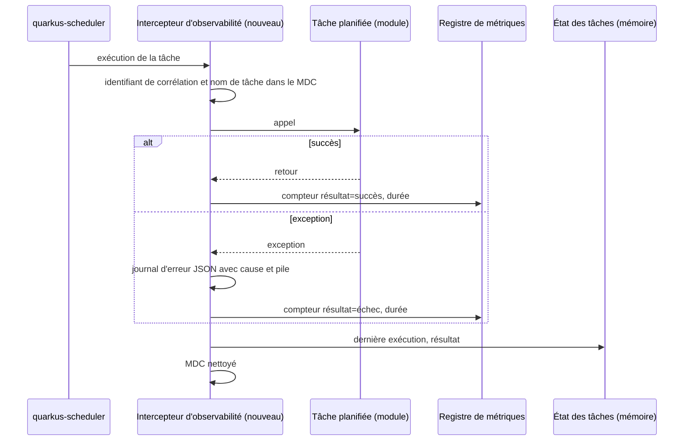
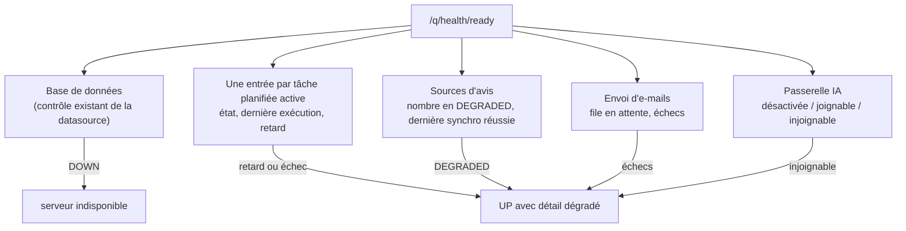

# Conception : instrumenter l'observabilité du serveur

<!-- Statuts : [EXIGENCE] [EXISTANT] [DÉCISION] [PROPOSITION] [QUESTION] (légende : /docs/specifications/README.md#statuts-des-informations). -->

**Niveau de conception** : complète — nouvelles dépendances, endpoint d'exploitation à protéger, conventions transverses (corrélation, nommage des métriques) qui touchent tous les modules.

## Contexte technique

- [EXISTANT] Extension `quarkus-smallrye-health` seule (`argos-server/pom.xml:61`) ; aucun contrôle applicatif (`@Readiness`, `@Liveness`) ; `/q/health` et `/q/health/*` publics (`application.properties:294`).
- [EXISTANT] Journaux texte par `LOG.*` (91 appels à `b142695` selon l'audit), aucun MDC, aucune clé `quarkus.log.*`.
- [EXISTANT] 13 tâches `@Scheduled` (`quarkus-scheduler`, ADR-0031, Accepté ; inventaire arc42 §8.5), sans chevauchement, désactivables par `off`.
- [EXISTANT] L'état `DEGRADED` d'une source est tenu par source-ingestion (`ingestion/SyncStore.java`, `ingestion/RetryPolicy.java`) et exposé par `api/SourceOperationsResource.java`.
- Motivation : proposal.md.

## Exigences couvertes

| Exigence | Section(s) de conception | Diagramme(s) |
|---|---|---|
| EXP-13 | D1, D2, « Sécurité et isolation » | DC-1 |
| EXP-14 | D3, D4 | DC-1 |
| EXP-15 | D5 | DC-2 |

## Objectifs et non-objectifs

**Objectifs :** voir et mesurer le serveur en production sans lire du texte libre ; disposer, avant les sprints 8 à 10, d'une référence chiffrée de la chaîne d'ingestion (durées et résultats des exécutions, état des sources).

**Non-objectifs :** traçage distribué (OpenTelemetry) ; pile de collecte et tableaux de bord (Q-3) ; seuils d'alerte d'exploitation.

## Composants impactés, responsabilités et frontières

| Composant | Responsabilité dans ce changement | Ne doit pas | Statut |
|---|---|---|---|
| API & Security | pose l'identifiant de corrélation de chaque requête ; protège `/q/metrics` | exposer les métriques à un anonyme | modifié |
| source-ingestion | publie l'état des sources (santé, métriques) | journaliser le contenu d'un avis privé | modifié |
| alerting | publie la taille de la file d'envoi et les échecs d'envoi | mettre une adresse e-mail en étiquette | modifié |
| ai-gateway | publie appels, refus et durée des appels à l'IA | journaliser un prompt contenant des données d'espace | modifié |
| mcp-server | identifiant de corrélation par appel d'outil | — | modifié |
| Tâches planifiées (tous modules) | corrélation, chronométrage et dernière exécution par tâche, via un mécanisme commun | dupliquer l'instrumentation dans chaque tâche | modifié |
| Observabilité (mécanisme transverse) | configuration JSON, registre de métriques, contrôles de santé | dépendre d'un module métier | nouveau concept transverse |

## Modèle de domaine et invariants

Non applicable — aucun modèle métier. Invariants testables :

- INV-1 : en production, toute ligne émise par le journal du serveur est un JSON valide (EXP-13).
- INV-2 : aucune étiquette de métrique n'a une cardinalité liée aux utilisateurs, comptes, projets ou avis (EXP-14-S3).
- INV-3 : seuls les contrôles de la base de données (et, s'ils existent, ceux des dépendances obligatoires) peuvent rendre `/q/health/ready` indisponible (EXP-15).

## Traitements et interactions

### DC-1 — Corrélation et mesure d'une exécution planifiée

Question : comment une exécution planifiée reçoit-elle un identifiant de corrélation et produit-elle ses journaux, ses métriques et son état de santé ? Type : UML séquence. État : cible ([PROPOSITION]). Exigences : EXP-13, EXP-14, EXP-15.

Le même mécanisme (filtre de requête) pose l'identifiant des requêtes HTTP et des appels MCP. L'intercepteur ne capture rien qu'il ne relance : il observe, l'isolation des erreurs relève de `isoler-erreurs-aux-frontieres`.

### DC-2 — Composition du contrôle de disponibilité

Question : quels contrôles composent `/q/health/ready` et lesquels peuvent le rendre indisponible ? Type : organigramme. État : cible ([PROPOSITION]). Exigences : EXP-15.

Les contrôles non bloquants restent `UP` et portent leur état dans les données du contrôle (`etat: degrade`, `derniere_execution`) ; seule la base renvoie `DOWN` (INV-3).

## États et transitions

Non applicable — l'état d'une source (`DEGRADED`) existe déjà ; il est seulement lu.

## Contrats d'interface

| Élément | Valeur |
|---|---|
| `/q/metrics` | format texte Prometheus ; accès selon Q-1 (port de gestion séparé non publié, ou rôle d'administration plateforme) ; refus d'un anonyme sur le port publié |
| `/q/health/ready` | réponse SmallRye Health existante, enrichie de contrôles nommés (nom de tâche, `sources`, `envoi-alertes`, `passerelle-ia`) ; reste public : ne restitue ni identifiant de source privée ni donnée d'espace |
| Nommage des métriques | préfixe `argos_` ; étiquettes bornées (`tache`, `resultat`, `source_type`, `canal`) ; aucune étiquette par compte, espace, projet ou avis |

## Persistance et intégrité

Non applicable — l'état des tâches est tenu en mémoire et repart à vide au redémarrage (le contrôle signale « jamais exécutée depuis le démarrage » sans échouer, sauf retard au-delà du seuil Q-2).

## Transactions, concurrence et idempotence

Le MDC est propre au fil d'exécution : l'intercepteur le pose et le nettoie autour de chaque exécution ; les traitements qui changent de fil (exécuteurs, appels asynchrones) doivent propager l'identifiant (à vérifier lors de la tâche 1.2 ; lié à AUD-QUA-11).

## Sécurité et isolation

- Journaux : pas de jeton, mot de passe, en-tête `Authorization` ni contenu de prompt ; les adresses e-mail sont absentes ou masquées (EXP-13-S4) — règle à appliquer aux 91 appels existants par revue et test.
- `/q/metrics` non public (EXP-14-S2) ; `/q/health/ready` reste public mais sans donnée d'espace.
- Dépendances : `quarkus-logging-json`, `quarkus-micrometer-registry-prometheus` (plateforme Quarkus, licence Apache-2.0 à confirmer par `mvn -P licences validate`, ADR-0021).

## Gestion des erreurs et reprise

L'instrumentation ne doit jamais faire échouer un traitement : une erreur d'enregistrement de métrique est ignorée et journalisée une fois.

## Observabilité

Objet du changement. Métriques retenues (issues d'arc42 §8.6 et de l'impact d'AUD-DEP-07) : exécutions et durées par tâche ; sources par état ; file d'envoi des alertes et échecs ; appels, refus et durées des appels IA ; métriques HTTP, JVM et pool fournies par l'extension. Métriques reportées : couverture SBOM, impacts détectés, coût IA en jetons ([QUESTION] : utiles avant ou après les sprints 8 à 10 ?).

## Performance et stratégie de mesure

Aucune cible chiffrée dans les sources. Contrôle : la campagne `npm --prefix e2e run test:performance` reste dans sa cible après instrumentation (PERF-01, p95 < 500 ms).

## Compatibilité, migration et retour arrière

- Journaux de production en JSON : l'exploitant qui lit `docker compose logs` voit du JSON ; le guide indique comment les lire. Profils `dev` et `test` en texte.
- Retour arrière : désactiver `quarkus.log.console.json` et le registre de métriques par configuration.

## Décisions, alternatives et compromis

### D1 — Journaux JSON par l'extension Quarkus, en production seulement

- **Statut** : [PROPOSITION]
- **Choix** : `quarkus-logging-json`, activée en `%prod`.
- **Alternatives écartées** : format texte enrichi — non exploitable par un outil ; journaux JSON partout — illisibles en développement.
- **ADR** : couvert par l'ADR candidat « pile d'observabilité » (D3).

### D2 — Identifiant de corrélation dans le MDC, posé par un filtre et un intercepteur communs

- **Statut** : [PROPOSITION]
- **Choix** : filtre HTTP (requêtes API et MCP) et intercepteur des méthodes `@Scheduled` ; identifiant créé par le serveur (Q-4 pour l'acceptation d'un en-tête entrant).
- **Alternatives écartées** : instrumentation manuelle de chaque tâche — 13 copies, oublis.
- **ADR** : non : convention à consigner dans arc42 §8.6.

### D3 — Micrometer avec registre Prometheus ; OpenTelemetry différé

- **Statut** : [PROPOSITION]
- **Choix** : `quarkus-micrometer-registry-prometheus`.
- **Justification** : action d'AUD-DEP-07 ; arc42 §8.6 cite Micrometer et OpenTelemetry.
- **Alternatives écartées** : OpenTelemetry pour métriques et traces dès maintenant — demande un collecteur absent sur le NAS.
- **Compromis** : un passage ultérieur à OpenTelemetry pour les traces ajoutera une seconde dépendance.
- **ADR** : candidat à un ADR (statut Proposé) : « Pile d'observabilité du serveur ».

### D4 — Protection de `/q/metrics`

- **Statut** : [QUESTION] (Q-1)
- **Option A** : interface de gestion Quarkus sur un port séparé, non publié par `compose.yaml` (lecture depuis le réseau du projet seulement).
- **Option B** : permission HTTP exigeant le rôle d'administration plateforme.
- **Compromis** : A est simple et sans jeton mais demande un collecteur dans le réseau du projet ; B permet la lecture à distance mais demande un jeton OIDC à un collecteur. Attention : avec A, `/q/health` passerait aussi sur le port de gestion, ce qui modifie le contrôle de santé du conteneur (EXP-09, `completer-configuration-conteneurs`).
- **ADR** : rattaché à l'ADR candidat de D3.

### D5 — Contrôles de santé non bloquants pour les dépendances facultatives

- **Statut** : [PROPOSITION]
- **Choix** : contrôles `@Readiness` qui restent `UP` avec un état détaillé pour tâches, sources, e-mails et IA ; seule la base rend `DOWN` (DC-2).
- **Justification** : action d'AUD-DEP-07 (« dégradé non bloquant ») ; un conteneur redémarré parce qu'une source externe est en panne n'apporterait rien.
- **Alternatives écartées** : contrôle `DOWN` sur source dégradée — redémarrages en boucle via EXP-09.
- **ADR** : non.

## Risques

- Cardinalité des métriques qui explose (étiquette par source ou par projet) → mémoire ; atténuation : INV-2, revue des étiquettes, test EXP-14-S3.
- Fuite de données dans les journaux JSON (champs ajoutés automatiquement, MDC) → atténuation : EXP-13-S4, revue des appels existants.
- Surcoût de l'intercepteur sur les tâches → négligeable attendu, vérifié par la campagne de performance (tâche 4.1).

## Écarts code / tests / specs / documentation

Repris de proposal.md : arc42 §8.5, §8.6 et §11 décrivent une observabilité qui n'existe pas. Traitement : tâche 3.2.

## Stratégie de vérification

| Exigence / scénario | Niveau de test | Moyen de preuve | État |
|---|---|---|---|
| EXP-13-S1, -S2 | intégration (`@QuarkusTest`, profil avec JSON activé) | capture des journaux, analyse JSON, identifiants comparés | à écrire |
| EXP-13-S3 | intégration | exception provoquée, pile présente | à écrire |
| EXP-13-S4 | intégration | requête avec jeton, recherche de la valeur dans les journaux | à écrire |
| EXP-14-S1 | intégration | tâche en échec puis lecture de `/q/metrics` | à écrire |
| EXP-14-S2 | intégration | appel anonyme refusé | à écrire |
| EXP-14-S3 | intégration et revue | alerte envoyée, étiquettes inspectées | à écrire |
| EXP-15-S1 à -S4 | intégration | source forcée en `DEGRADED`, tâche en retard (seuil réduit), tâche et IA désactivées, base arrêtée | à écrire |

## Documentation durable impactée

- `/docs/specifications/exploitation-plateforme.md` (EXP-13 à EXP-15, diagramme de santé).
- arc42 §8.5 (health/readiness), §8.6 (pile, conventions de corrélation et de nommage), §11 ; ADR candidat et index §9.
- `/docs/deploiement/synology-et-pc.md` (lire les journaux JSON, accéder aux métriques).

## Questions ouvertes

Q-1 à Q-4 de la proposition ; Q-1 est à trancher avant la tâche 2.2.
