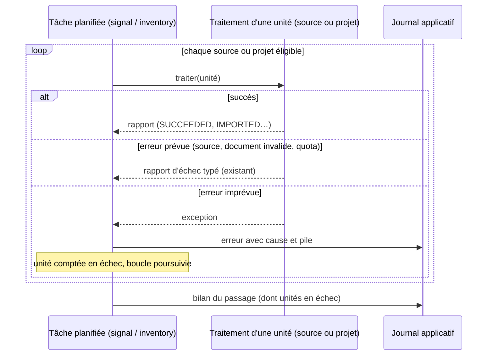
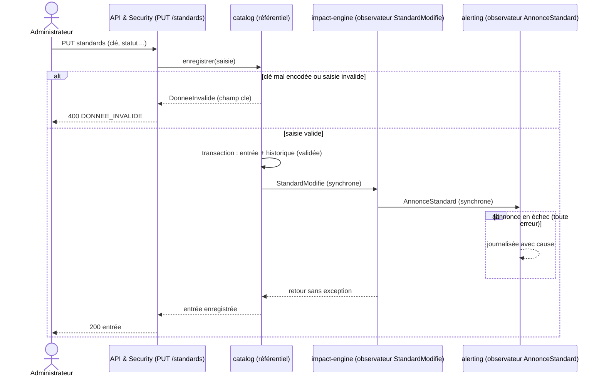
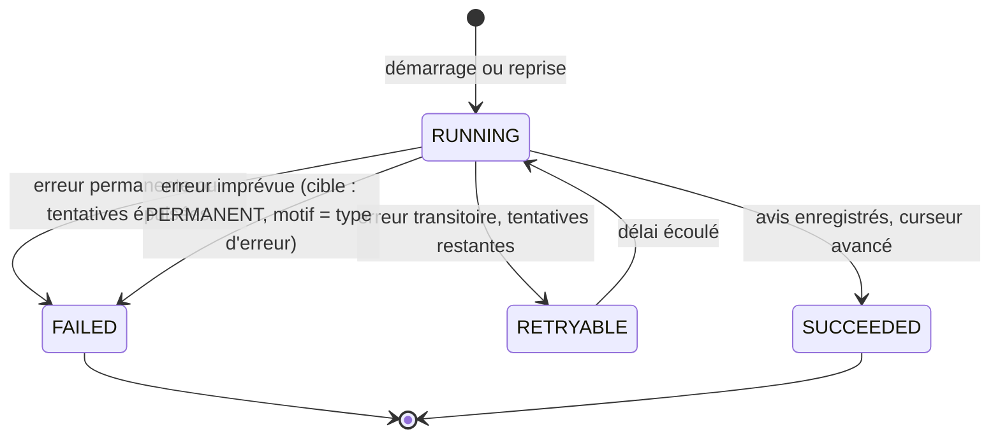

# Conception : isoler les erreurs imprévues aux frontières de traitement

**Niveau de conception** : complète — règle transverse à onze composants, qui modifie l'état visible des traitements planifiés et une réponse d'API ; elle doit être écrite une fois (arc42 §8) et vérifiée par frontière.

## Contexte technique

[EXISTANT, révision `b142695`] Une **frontière d'erreur** est ici le point où un traitement itère sur des unités indépendantes (source, projet, espace, produit, message) ou reçoit un événement d'un autre composant (observateur synchrone), ou bien rend une réponse à un client externe (garde MCP). Le lot 23 n'y capture plus que `IllegalStateException`, convention implicite « panne d'accès aux données » :

| Frontière | Composant (arc42 §5) | Preuve | Effet d'une autre erreur d'exécution |
|---|---|---|---|
| synchronisation d'une source (`synchronize`) | source-ingestion | `ingestion/SourceSynchronizer.java:95`, `:132` | sort de `synchronize`, traitement laissé `RUNNING`, aucun `FAILED` |
| passage planifié des sources | signal | `signal/SynchronisationPlanifiee.java:67` | interrompt le passage, sources suivantes non synchronisées |
| import planifié par projet, relance de recorrélation | inventory | `inventory/ImportPlanifie.java:66`, `:89` | interrompt le passage, projets suivants non importés |
| observateur `StandardModifie` | impact-engine | `impact/RadarProjets.java:198` (et `:110-134`) | remonte à `PUT /standards` après l'enregistrement (`catalog/standard/ReferentielEspace.java:101-104`, `:219`) |
| observateur `AnnonceStandard`, boucles par espace | alerting | `alerting/RappelsRadar.java:114-158` | idem ; boucle par espace interrompue |
| observateur `ImpactsRecorded`, envoi | alerting | `alerting/MoteurAlertes.java:141`, `alerting/EnvoiAlertes.java:121` | remonte à la corrélation (`CorrelationEngine.publish`) |
| cycles de vie, fiches réglementaires, activité | release-radar, reg-intel, project-intel | `releaseradar/CyclesDeVie.java:56`, `regintel/PreparationFiches.java:108`, `projectintel/CollecteActivite.java:110` | boucle interrompue |
| appel du fournisseur de modèle | ai-gateway | `aigateway/PasserelleIa.java:169-182` (seules `IOException`, `InterruptedException`) | sort de la passerelle au lieu d'un « modèle indisponible » |
| garde des outils | mcp-server | `mcp/GardeAppels.java:117-121` | erreur de protocole JSON-RPC (documentation quarkus-mcp-server, citée par le constat) ; aucun `Issue.ERREUR` |

Cause de données démontrée : `catalog/PackageKey.java:125-126` (`URLDecoder.decode`) lève `IllegalArgumentException` sur un `%` mal formé ; `parse` est appelé par `signal/SignalRecorder.java:307`, `inventory/CycloneDxParser.java:125`, `catalog/standard/SaisieStandard.java:40`, `mcp/Parametres.java:22`, `mcp/OutilsSecurite.java:291`, `signal/SignalQueries.java:244`.

Motivation : proposal.md.

## Exigences couvertes

| Exigence | Section(s) de conception | Diagramme(s) |
|---|---|---|
| COL-11 | D1, D2, D3 ; « Traitements et interactions » ; « États et transitions » | DC-1, DC-2 |
| INV-11 | D1, D2 ; « Traitements et interactions » | DC-1 |
| RAD-07 | D2, D4 ; « Contrats d'interface » | DC-3 |
| MCP-08 | D5 ; « Contrats d'interface » | — |
| (AUD-QUA-23, sans exigence) | D6 ; « Observabilité » | — |

## Objectifs et non-objectifs

**Objectifs :**
- Un filet unique et journalisé à chaque frontière ; captures précises conservées à l'intérieur.
- Le PURL mal encodé devient une donnée illisible, traitée selon la règle déjà en place à chaque entrée.
- Un test par frontière, avec une erreur imprévue simulée et, pour les entrées externes, le PURL `%zz`.
- La règle écrite dans arc42 §8.5.

**Non-objectifs :**
- Rendre asynchrones les observateurs (AUD-PER-02, sprint 8).
- Métriques et journaux structurés (`instrumenter-observabilite`).
- Requalifier les 147 `new IllegalStateException(` (Q-1 de la proposition).

## Composants impactés, responsabilités et frontières

| Composant | Responsabilité dans ce changement | Ne doit pas | Statut |
|---|---|---|---|
| catalog | décoder une clé de paquet sans lever d'erreur d'exécution sur un encodage invalide | décider du sort de la donnée (appartient à l'appelant) | modifié |
| source-ingestion | terminer une synchronisation en `FAILED`/`PERMANENT` sur toute erreur imprévue | laisser un traitement `RUNNING` | modifié |
| signal | isoler chaque source dans le passage planifié, consigner les sources en erreur au bilan | interrompre le passage | modifié |
| inventory | isoler chaque projet dans le passage, compter `enEchec` | interrompre le passage | modifié |
| impact-engine, alerting | filet journalisé dans les observateurs synchrones et les boucles par espace | propager une erreur à l'émetteur de l'événement | modifié |
| release-radar, reg-intel, project-intel | filet journalisé dans les boucles par produit, texte ou projet | interrompre la boucle | modifié |
| ai-gateway | traiter toute erreur du fournisseur comme « modèle indisponible » journalisé | propager l'erreur à l'appelant | modifié |
| mcp-server | répondre `INDISPONIBLE` et journaliser `Issue.ERREUR` pour toute erreur interne | renvoyer une erreur de protocole ou un détail interne | modifié |
| API & Security | inchangé si D2 suffit (la saisie lève `DonneeInvalide`) | — | inchangé |

## Modèle de domaine et invariants

Pas de modèle métier nouveau. Invariants testables :

- I-1 : à la fin d'un passage planifié (sources d'avis, imports, radar, cycles de vie, fiches, activité), chaque unité éligible a été tentée, quelle que soit l'erreur d'une autre unité.
- I-2 : aucune synchronisation de source ne reste `RUNNING` après le retour de `synchronize`, sauf attente de nouvelle tentative interrompue (comportement existant).
- I-3 : un observateur synchrone ne propage aucune erreur d'exécution à l'émetteur.
- I-4 : toute erreur capturée à une frontière est journalisée au niveau erreur avec l'exception en premier argument (pile et causes comprises).
- I-5 : le décodage d'une clé de paquet ne lève aucune erreur d'exécution pour une chaîne quelconque.

## Traitements et interactions

**DC-1** — Question : que devient un passage planifié quand une unité échoue sur une erreur imprévue ? Type : UML sequenceDiagram. Statut : cible ([PROPOSITION]). Exigences : COL-11, INV-11.

Explication : le filet est posé dans la boucle de la tâche planifiée ; pour une source d'avis, la synchronisation elle-même termine d'abord le traitement en `FAILED` (DC-2), de sorte que l'exception ne parvient à la boucle que si l'enregistrement de cet échec échoue aussi. Existant : la branche « erreur imprévue » sort de la boucle.

**DC-3** — Question : quand l'administrateur reçoit-il une erreur lors de l'enregistrement d'un standard ? Type : UML sequenceDiagram. Statut : cible ([PROPOSITION]). Exigences : RAD-07, RAD-01-S2, RAD-06.

Explication : la validation précède la transaction (RAD-07-S1, RAD-01-S2) ; l'annonce suit la validation de la transaction, donc toute erreur doit y être absorbée (RAD-07-S2). Existant : seule `IllegalStateException` est absorbée ; une `IllegalArgumentException` de décodage sort de la validation sans correspondance d'erreur.

## États et transitions

**DC-2** — Question : quel état prend une synchronisation de source sur une erreur imprévue ? Type : UML stateDiagram-v2. Statut : cible ([PROPOSITION]) ; transitions existantes conservées. Exigences : COL-11, COL-06, COL-07.

Explication : la transition « erreur imprévue » rétablit le comportement d'avant le lot 23 (capture `RuntimeException` menant à `FAILED`/`PERMANENT`, constat AUD-QUA-20). L'échec compte pour le seuil de `DEGRADED` (COL-07, COL-11-S3). Aujourd'hui, ce chemin laisse `RUNNING` jusqu'à l'expiration de 30 minutes.

## Contrats d'interface

| Élément | Valeur |
|---|---|
| Opération et chemin | `PUT /api/v1/radar/espaces/{espaceId}/standards` (`api/RadarResource.java:99-109`) |
| Authentification / autorisations | inchangées (administrateur de l'espace, RAD-02) |
| Erreur ajoutée | 400 `DONNEE_INVALIDE`, attribut `cle`, pour une clé mal encodée (au lieu d'une erreur serveur) ; message de `SaisieStandard` existant (« La clé doit être un PURL sans version… ») |
| Réponse après enregistrement | toujours 200 avec l'entrée, même si l'annonce échoue |
| Compatibilité | aucune rupture ; contrat OpenAPI à vérifier (réponse 400 déclarée) |

Outils MCP : résultat d'erreur d'outil (`isError`) dont le texte commence par `INDISPONIBLE` — code déjà défini par la fiche `serveur-mcp` ; aucun nouveau code.

## Persistance et intégrité

Non applicable — aucune migration. Les états `FAILED`/`PERMANENT` d'une synchronisation existent déjà.

## Transactions, concurrence et idempotence

- L'enregistrement d'un avis reste dans la transaction de la synchronisation (`SignalRecorder.record`, `MANDATORY`) : une erreur imprévue annule le lot en cours ; le curseur n'avance pas (COL-05).
- L'annonce d'un standard reste synchrone et postérieure à la validation de la transaction ; le filet n'introduit aucune transaction.
- Les verrous existants (synchronisation par source, imports sérialisés par projet, INV-08) sont inchangés ; le filet libère les ressources par les blocs `finally` existants (à vérifier par les tests de 2.x).

## Sécurité et isolation

- Les réponses (API, MCP) ne contiennent ni trace ni message d'exception interne ; le détail va au journal applicatif.
- Une donnée externe malveillante (PURL forgé) ne peut plus bloquer la collecte des autres sources ou projets : résistance au déni de service par donnée empoisonnée.
- Droits et RLS inchangés.

## Gestion des erreurs et reprise

Règle proposée pour arc42 §8.5 (tâche 6.1) :

1. À l'intérieur d'une unité de traitement, capturer précisément les erreurs prévues et les traduire en résultats typés (rejet, refus, source indisponible).
2. À chaque frontière (boucle sur des unités indépendantes, observateur synchrone, garde d'un protocole externe), capturer toute erreur d'exécution, la journaliser au niveau erreur avec l'exception en premier argument, compter l'unité en échec et poursuivre.
3. Une erreur d'une donnée externe ne doit jamais sortir d'un analyseur sous forme d'erreur d'exécution non typée.
4. `InterruptedException` rétablit l'indicateur d'interruption (existant) ; `Error` n'est pas capturée.
5. Un test par frontière simule une erreur imprévue autre que la panne d'accès aux données.

## Observabilité

- Journal : niveau erreur, exception en premier argument (I-4) ; message nommant l'unité (source, projet, espace) sans donnée personnelle.
- Bilans de passage : sources en erreur (`SynchronisationPlanifiee.Bilan`), `enEchec` (`ImportPlanifie.Bilan`) ; ces bilans seront exposés en métriques par `instrumenter-observabilite`.
- MCP : `Issue.ERREUR` au journal des appels (MCP-06).

## Performance et stratégie de mesure

Non applicable — aucun coût mesurable ajouté (une capture par unité).

## Compatibilité, migration et retour arrière

Aucune migration. Retour arrière par commit ; aucun état persistant nouveau. Les traitements restés `RUNNING` avant le déploiement expirent selon la règle existante (30 minutes).

## Décisions, alternatives et compromis

### D1 — Filet `RuntimeException` aux frontières, captures précises à l'intérieur

- **Statut** : [PROPOSITION]
- **Choix** : à chaque frontière du tableau « Contexte technique », capturer `RuntimeException` (et `QuarkusTransactionException` là où elle est déjà traitée), journaliser avec la cause, compter l'unité en échec ; ne pas toucher aux captures précises internes.
- **Justification** : isole les pannes sans masquer les erreurs à l'intérieur ; conforme à l'action du constat ; rétablit le comportement d'avant le lot 23 aux seuls endroits utiles.
- **Alternatives écartées** : revenir à `RuntimeException` partout (annule les gains du lot 23 : causes journalisées, interruptions rétablies) ; capturer `Exception`/`Throwable` (capture `Error`, contraire à la règle 4).
- **Compromis** : la frontière doit être identifiée explicitement ; règle écrite et test par frontière pour éviter une nouvelle régression.
- **ADR** : non : convention transverse écrite en arc42 §8.5 ; candidate ADR seulement si Q-1 retient un type de panne dédié.

### D2 — PURL mal encodé = PURL illisible

- **Statut** : [PROPOSITION]
- **Choix** : le décodage d'une clé de paquet renvoie « illisible » (vide) sur un encodage invalide ; chaque appelant applique sa règle existante : avis indexé par écosystème et nom (`SignalRecorder.toAffected`), composant écarté et signalé (`CycloneDxParser`, INV-01), `DonneeInvalide` 400 (`SaisieStandard`), `ParametreInvalide` (`Parametres` MCP).
- **Justification** : corrige la cause à la source, une seule fois ; aucun appelant nouveau à protéger ; aligne sur des règles déjà spécifiées.
- **Alternatives écartées** : refuser l'import du projet entier (texte du constat, Q-2) — plus sévère que la règle d'un PURL illisible et contraire à la décision D6 du 2026-11-18 ; correspondance `IllegalArgumentException` → 400 dans `GestionErreurs` — masquerait des défauts de programmation en erreurs de saisie.
- **Compromis** : un composant au PURL mal encodé n'apparaît pas dans l'inventaire (signalé comme écarté).
- **ADR** : non : décision locale.

### D3 — Erreur imprévue d'une synchronisation : `FAILED` / `PERMANENT`

- **Statut** : [PROPOSITION]
- **Choix** : dans `synchronize`, toute erreur d'exécution autre que les erreurs typées termine le traitement comme la panne d'accès aux données aujourd'hui (`SourceException` `PERMANENT`, motif = type d'erreur, tentative enregistrée, source en échec).
- **Justification** : visible, compté pour `DEGRADED`, pas de rejeu automatique d'une donnée qui échouera de même.
- **Alternatives écartées** : `RETRYABLE` — retenterait cinq fois une erreur déterministe ; mettre l'avis fautif à l'écart (COL-08) dans tous les cas — souhaitable quand l'erreur est attribuable à un avis, mais l'erreur imprévue peut ne pas l'être ; laissé à la frontière par avis existante (`AdvisoryRejectedException`).
- **Compromis** : une erreur imprévue sur un seul avis bloque la source jusqu'à correction (comme avant le lot 23), mais n'arrête plus les autres sources.
- **ADR** : non : décision locale.

### D4 — Annonce d'un standard : absorber toute erreur

- **Statut** : [PROPOSITION]
- **Choix** : les observateurs synchrones `StandardModifie` et `AnnonceStandard` appliquent D1.
- **Justification** : l'enregistrement est validé avant l'annonce ; une erreur renvoyée à ce stade ferait croire à un échec d'enregistrement.
- **Alternatives écartées** : observateur `AFTER_SUCCESS` ou asynchrone — change l'ordre et la sémantique des annonces, relève d'AUD-PER-02.
- **Compromis** : une annonce perdue n'est visible qu'au journal (pas de reprise) ; à reprendre avec l'observabilité.
- **ADR** : non : décision locale.

### D5 — Garde MCP : `INDISPONIBLE` pour toute erreur interne

- **Statut** : [PROPOSITION]
- **Choix** : la garde capture toute erreur d'exécution après les erreurs typées, journalise avec la cause, inscrit `Issue.ERREUR` et lève l'erreur d'outil `INDISPONIBLE` ; la Javadoc reprend la promesse générique.
- **Justification** : un seul point de passage pour tous les outils ; code déjà documenté.
- **Alternatives écartées** : annotation d'enveloppement des erreurs métier de l'extension MCP sur chaque outil — dispersée, et ne journalise pas `Issue.ERREUR`.
- **Compromis** : aucune distinction côté client entre panne de données et défaut ; elle reste au journal.
- **ADR** : non : décision locale (ADR-0014, Proposé, inchangé).

### D6 — Journaliser la cause avec sa pile (AUD-QUA-23)

- **Statut** : [PROPOSITION]
- **Choix** : passer la cause en premier argument du journal dans `MoteurAlertes` (résumé IA indisponible), comme `SyntheseActivite` et `CorrelationEngine` ; règle I-4 écrite en arc42 §8.5.
- **Justification** : diagnostic d'une panne du fournisseur IA avec pile et causes imbriquées.
- **Alternatives écartées** : aucune sérieuse.
- **Compromis** : journaux plus longs au niveau information.
- **ADR** : non.

## Risques

- [Un filet trop large masque un défaut] → journal au niveau erreur avec pile, comptage en échec, et bilans exposés par `instrumenter-observabilite`.
- [Frontière oubliée] → inventaire du tableau « Contexte technique » repris dans arc42 §8.5 ; test par frontière ; un test d'architecture peut vérifier que les méthodes `@Scheduled` et les observateurs synchrones capturent `RuntimeException` ([PROPOSITION], tâche 6.2).
- [Conflits avec `injecter-horloge-et-executeurs`] → intégration séquentielle dans le sprint 4.

## Écarts code / tests / specs / documentation

- Fiche `radar-standards` (`/docs/specifications/radar-standards.md:42`) : promet l'isolation par produit ou espace, que le code n'assure plus pour les erreurs autres que `IllegalStateException`.
- Javadoc `GardeAppels` (`:44-45`) restreinte aux pannes d'accès aux données, contre la fiche `serveur-mcp` (code générique).
- `chain/ResilienceTest.java:216-223` ne simule que `IllegalStateException`.
- Texte du constat (« projet refusé ») contre la règle d'un PURL illisible (D2, Q-2).

## Stratégie de vérification

| Exigence / scénario | Niveau de test | Moyen de preuve | État |
|---|---|---|---|
| COL-11-S1 | intégration (base jetable, sources simulées) | deux sources, la première avec un avis `pkg:npm/%zz@1.0.0` ; seconde synchronisée, première non `RUNNING` | à écrire |
| COL-11-S2 | intégration | erreur imprévue simulée à l'enregistrement d'un avis ; `FAILED`/`PERMANENT`, curseur inchangé, seconde source synchronisée (complète `chain/ResilienceTest`) | à écrire |
| COL-11-S3 | intégration | erreurs imprévues répétées jusqu'au seuil ; `DEGRADED` et événement d'exploitation | à écrire |
| INV-11-S1 | intégration (forges simulées) | SBOM avec PURL `%zz` ; composant écarté et signalé, projet suivant importé | à écrire |
| INV-11-S2 | intégration | erreur imprévue simulée pour un projet ; `Bilan.enEchec` = 1, projet suivant importé | à écrire |
| RAD-07-S1 | API (REST) | `PUT /standards` clé `pkg:maven/%zz/x` → 400, attribut `cle`, référentiel inchangé | à écrire |
| RAD-07-S2 | intégration | annonce qui échoue sur une erreur imprévue ; 200, entrée et historique persistés | à écrire |
| MCP-08-S1 | intégration MCP | panne d'accès aux données simulée ; `INDISPONIBLE`, `Issue.ERREUR` | à écrire |
| MCP-08-S2 | intégration MCP | erreur imprévue simulée ; `INDISPONIBLE`, pas d'erreur JSON-RPC, `Issue.ERREUR` | à écrire |
| I-5 | unitaire | décodage de clés mal encodées (`%zz`, `%`, `%e9%`) sans erreur d'exécution | à écrire |
| I-1, I-3 (autres frontières) | unitaire ou intégration | un test par frontière restante (alertes, radar quotidien, cycles de vie, fiches, activité, passerelle IA) | à écrire |

## Documentation durable impactée

- Fiches `/docs/specifications/collecte-avis-securite.md`, `/docs/specifications/inventaire-sbom.md`, `/docs/specifications/radar-standards.md`, `/docs/specifications/serveur-mcp.md` et registre `/docs/specifications/README.md`.
- arc42 §8.5 (`/docs/architecture/arc42/08-concepts-transverses.md`) : règle des frontières d'erreur et de journalisation de la cause, inventaire des frontières.
- Diagrammes : D-08 (erreur API/retry) et D-09 (redémarrage/reprise) d'arc42 §6 si la reprise d'une synchronisation y est décrite ; inventaire `/docs/architecture/diagrams/README.md` si leur portée change.

## Questions ouvertes

- Q-1 et Q-2 de la proposition : n'affectent ni l'approche ni le découpage en tâches (D1 et D2 fonctionnent quelle que soit la réponse).
