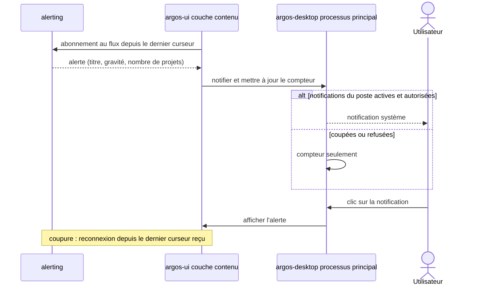

# Conception : notifier les alertes sur le poste de travail

<!-- Statuts : [EXIGENCE] [EXISTANT] [DÉCISION] [PROPOSITION] [QUESTION] (légende dans proposal.md). -->

**Niveau de conception** : Allégée : comportement local au client desktop, sur un contrat d'alertes défini par un autre change.

## Contexte technique

`argos-desktop/src/main.js` crée l'icône de zone de notification, masque la fenêtre à la fermeture et affiche une notification via le canal `argos:notify` [EXISTANT, non exécuté]. `argos-ui/src/platform.ts` appelle ce canal [EXISTANT]. Motivation : voir `proposal.md`.

## Exigences couvertes

| Exigence | Section(s) de conception | Diagramme(s) |
|---|---|---|
| NOT-01 | Composants | DC-1 |
| NOT-02 | Composants | DC-1 |
| NOT-03 | Composants | DC-1 |
| NOT-04 | Composants | DC-1 |
| NOT-05 | Composants | DC-1 |
| NOT-06 | Composants | DC-1 |

## Objectifs et non-objectifs

**Objectifs :**
- réutiliser le pont existant `window.argosDesktop`
- aucune perte d'alerte pendant une coupure

**Non-objectifs :**
- service en arrière-plan quand l'application est fermée (Q-1)

## Composants impactés, responsabilités et frontières

| Composant | Responsabilité dans ce changement | Ne doit pas | Statut |
|---|---|---|---|
| `argos-desktop` (processus principal) | notification système, compteur, ouverture au clic | appeler l'API ou filtrer des données | modifié |
| IHM `argos-ui` — couche contenu | recevoir le flux d'alertes et demander les notifications | afficher plus que le contenu minimal | modifié |
| `alerting` | fournir le flux d'alertes et la reprise depuis un curseur | — | défini par `diffuser-alertes-et-digests` |

## Modèle de domaine et invariants

Non applicable — conception allégée ; à préciser avec les tâches d'implémentation correspondantes.

## Traitements et interactions

### DC-1 — Alerte reçue par le client desktop

- **Question** : comment une alerte devient-elle une notification, y compris après une coupure ?
- **Type** : UML séquence
- **Portée** : cible proposée
- **Exigences** : NOT-01, NOT-02, NOT-03, NOT-04, NOT-05, NOT-06

Le curseur du dernier événement reçu permet de reprendre sans perte ni doublon après une coupure.

## États et transitions

Non applicable — conception allégée ; à préciser avec les tâches d'implémentation correspondantes.

## Contrats d'interface

Flux d'alertes : diffusion serveur vers client (Server-Sent Events) avec curseur de reprise, défini avec `diffuser-alertes-et-digests` ; pont `window.argosDesktop.notify` étendu d'un identifiant d'élément et d'un compteur.

## Persistance et intégrité

Non applicable — conception allégée ; à préciser avec les tâches d'implémentation correspondantes.

## Transactions, concurrence et idempotence

Non applicable — conception allégée ; à préciser avec les tâches d'implémentation correspondantes.

## Sécurité et isolation

Le pont n'expose que la notification et le compteur ; contenu limité par NOT-05 ; aucune donnée persistée sur le poste hors du cache de l'IHM.

## Gestion des erreurs et reprise

Coupure : état « hors ligne » visible, reconnexion avec attente croissante, reprise depuis le curseur.

## Observabilité

Compteurs agrégés et journaux d'audit selon arc42 §8.6 ; aucun suivi individuel des utilisateurs.

## Performance et stratégie de mesure

[QUESTION] Aucune cible propre à ce changement dans les sources ; la cible de consultation de arc42 §10 (Q-05) s'applique quand elle est pertinente.

## Compatibilité, migration et retour arrière

Non applicable — aucune donnée ni aucun contrat existants.

## Décisions, alternatives et compromis

### D1 — Flux serveur avec curseur

- **Statut** : [PROPOSITION]
- **Choix** : Server-Sent Events et curseur du dernier événement
- **Justification** : simple à traverser un reverse proxy, reprise native
- **Alternatives écartées** : interrogation périodique — délai et charge ; WebSocket — inutilement bidirectionnel
- **Compromis** : connexion longue à garder ouverte
- **ADR** : non : décision locale

### D2 — Contenu minimal

- **Statut** : [PROPOSITION]
- **Choix** : titre, gravité, nombre de projets
- **Justification** : écran verrouillé visible par des tiers
- **Alternatives écartées** : détail complet — fuite possible
- **Compromis** : un clic de plus pour le détail
- **ADR** : non : décision locale

## Risques

- Notifications désactivées par le système sans que l'utilisateur le sache → compteur toujours mis à jour (NOT-01-S2).

## Écarts code / tests / specs / documentation

Aucun écart constaté.

## Stratégie de vérification

| Exigence / scénario | Niveau de test | Moyen de preuve | État |
|---|---|---|---|
| NOT-01-S1, NOT-01-S2 | E2E desktop | Electron piloté (Playwright) | à écrire |
| NOT-02-S1 | E2E desktop | clic simulé | à écrire |
| NOT-03-S1 | E2E desktop | compteur | à écrire |
| NOT-04-S1 | intégration | préférence et canal e-mail | à écrire |
| NOT-05-S1 | unitaire | construction du texte | à écrire |
| NOT-06-S1 | E2E | serveur arrêté puis relancé | à écrire |

## Documentation durable impactée

- `/docs/specifications/notifications-poste.md`, registre `/docs/specifications/README.md`
- ADR-0022 (preuves de validation)

## Questions ouvertes

Aucune autre que celles de la proposition.
