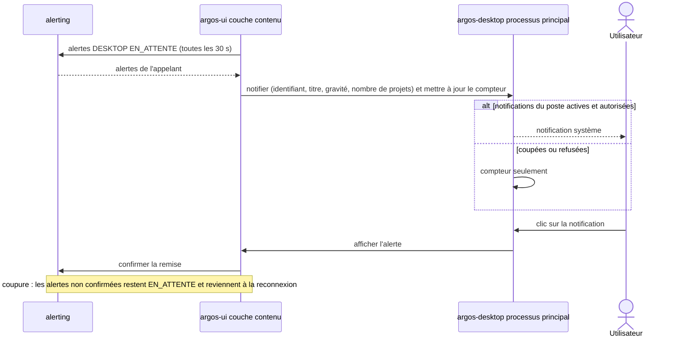

# Conception : notifier les alertes sur le poste de travail

<!-- Statuts : [EXIGENCE] [EXISTANT] [DÉCISION] [PROPOSITION] [QUESTION] (légende : /docs/specifications/README.md#statuts-des-informations). -->

**Niveau de conception** : Allégée : comportement local au client desktop, sur un contrat d'alertes défini par un autre change.

## Contexte technique

`argos-desktop/src/main.js` crée l'icône de zone de notification, masque la fenêtre à la fermeture et affiche une notification via le canal `argos:notify` [EXISTANT, non exécuté]. `argos-ui/src/platform.ts` appelle ce canal [EXISTANT]. Le serveur met à disposition les alertes `DESKTOP` par `GET /api/v1/alertes` et enregistre leur remise par `POST /api/v1/alertes/{id}/remise` [EXISTANT — `AlertesResource`, `alertes-digests`]. Motivation : voir `proposal.md`.

## Exigences couvertes

| Exigence | Section(s) de conception | Diagramme(s) |
|---|---|---|
| NOT-01 | Composants | DC-1 |
| NOT-02 | Composants | DC-1 |
| NOT-03 | Composants | DC-1 |
| NOT-04 | Composants | DC-1 |
| NOT-05 | Composants | DC-1 |
| NOT-06 | Composants | DC-1 |

## Objectifs et non-objectifs

**Objectifs :**
- réutiliser le pont existant `window.argosDesktop`
- aucune perte d'alerte pendant une coupure

**Non-objectifs :**
- service en arrière-plan quand l'application est fermée (Q-1)

## Composants impactés, responsabilités et frontières

| Composant | Responsabilité dans ce changement | Ne doit pas | Statut |
|---|---|---|---|
| `argos-desktop` (processus principal) | notification système, compteur, ouverture au clic | appeler l'API ou filtrer des données | modifié |
| IHM `argos-ui` — couche contenu | recevoir le flux d'alertes et demander les notifications | afficher plus que le contenu minimal | modifié |
| `alerting` | fournir les alertes `DESKTOP` en attente et enregistrer leur remise | — | inchangé (contrat de `diffuser-alertes-et-digests`) |

## Modèle de domaine et invariants

Non applicable — conception allégée ; à préciser avec les tâches d'implémentation correspondantes.

## Traitements et interactions

### DC-1 — Alerte reçue par le client desktop

- **Question** : comment une alerte devient-elle une notification, y compris après une coupure ?
- **Type** : UML séquence
- **Portée** : cible proposée
- **Exigences** : NOT-01, NOT-02, NOT-03, NOT-04, NOT-05, NOT-06

L'état `EN_ATTENTE` tient lieu de curseur : une alerte non confirmée revient à la lecture suivante, sans perte ; les identifiants déjà traités pendant la session évitent les doublons.

## États et transitions

Non applicable — conception allégée ; à préciser avec les tâches d'implémentation correspondantes.

## Contrats d'interface

Alertes : lecture périodique de `GET /api/v1/alertes?canal=DESKTOP&etat=EN_ATTENTE` puis `POST /api/v1/alertes/{id}/remise` (contrat existant, aucun changement côté serveur). Pont `window.argosDesktop` étendu de `notifyAlert` (identifiant, titre, gravité, nombre de projets), `setAlertCount`, `onOpenAlert`, `getSettings`, `setSettings` et `onSettingsChanged`.

## Persistance et intégrité

Aucune migration. Réglages du poste dans `reglages-poste.json` (dossier de données de l'application, écriture par fichier temporaire renommé) ; identifiants des alertes ouvertes dans la mémoire locale de l'IHM (500 au plus, sans contenu).

## Transactions, concurrence et idempotence

Non applicable — conception allégée ; à préciser avec les tâches d'implémentation correspondantes.

## Sécurité et isolation

Le pont n'expose que la notification et le compteur ; contenu limité par NOT-05 ; aucune donnée persistée sur le poste hors du cache de l'IHM.

## Gestion des erreurs et reprise

Coupure : état « hors ligne » visible, reconnexion avec attente croissante, reprise depuis le curseur.

## Observabilité

Compteurs agrégés et journaux d'audit selon arc42 §8.6 ; aucun suivi individuel des utilisateurs.

## Performance et stratégie de mesure

[QUESTION] Aucune cible propre à ce changement dans les sources ; la cible de consultation de arc42 §10 (Q-05) s'applique quand elle est pertinente.

## Compatibilité, migration et retour arrière

Non applicable — aucune donnée ni aucun contrat existants.

## Décisions, alternatives et compromis

### D1 — Lecture périodique du contrat existant

- **Statut** : [PROPOSITION]
- **Choix** : lecture des alertes `DESKTOP` `EN_ATTENTE` toutes les 30 s, puis confirmation de remise ; l'état `EN_ATTENTE` tient lieu de curseur
- **Justification** : le contrat de `diffuser-alertes-et-digests` existe déjà et garantit la reprise sans perte ; aucune modification du serveur ni connexion longue à maintenir derrière le reverse proxy
- **Alternatives écartées** : Server-Sent Events — nouveau contrat serveur et connexion longue pour un gain de délai non exigé ; WebSocket — inutilement bidirectionnel
- **Compromis** : délai de 30 s au plus entre l'enregistrement d'une alerte et sa notification ; une requête toutes les 30 s par poste
- **ADR** : non : décision locale

### D3 — Réglages gardés sur le poste

- **Statut** : [PROPOSITION]
- **Choix** : « notifications du poste » et « démarrage avec la session » dans un fichier du dossier de données de l'application, modifiables depuis la vue « Poste » de l'IHM et le menu de la zone de notification
- **Justification** : le réglage concerne un poste et non un compte ; aucun canal côté serveur n'est touché (NOT-04) ; aucune migration
- **Alternatives écartées** : préférence côté serveur — nouvelle table et nouveau contrat pour un réglage propre au poste
- **Compromis** : un utilisateur avec deux postes règle chacun séparément
- **ADR** : non : décision locale

### D2 — Contenu minimal

- **Statut** : [PROPOSITION]
- **Choix** : titre, gravité, nombre de projets
- **Justification** : écran verrouillé visible par des tiers
- **Alternatives écartées** : détail complet — fuite possible
- **Compromis** : un clic de plus pour le détail
- **ADR** : non : décision locale

## Risques

- Notifications désactivées par le système sans que l'utilisateur le sache → compteur toujours mis à jour (NOT-01-S2).

## Écarts code / tests / specs / documentation

Aucun écart constaté.

## Stratégie de vérification

| Exigence / scénario | Niveau de test | Moyen de preuve | État |
|---|---|---|---|
| NOT-01-S1, NOT-01-S2 | intégration (doublures Electron et serveur simulé) | `argos-desktop/test/poste.test.js`, `argos-ui/tests/alertes-poste.test.mjs` | passe |
| NOT-02-S1 | intégration (doublures Electron) | `argos-desktop/test/poste.test.js` | passe |
| NOT-03-S1 | intégration | `argos-desktop/test/poste.test.js`, `argos-ui/tests/alertes-poste.test.mjs` | passe |
| NOT-04-S1 | intégration | `argos-desktop/test/poste.test.js`, `argos-desktop/test/preferences.test.js` | passe |
| NOT-05-S1 | unitaire | `argos-desktop/test/notifications.test.js`, `argos-ui/tests/alertes-poste.test.mjs` | passe |
| NOT-06-S1 | intégration (serveur simulé : coupure puis retour) | `argos-ui/tests/alertes-poste.test.mjs` | passe |
| parcours 3.2 | E2E Electron réel | client desktop lancé contre un serveur local | non exécuté (binaire Electron absent) |

## Documentation durable impactée

- `/docs/specifications/notifications-poste.md`, registre `/docs/specifications/README.md`
- ADR-0022 (preuves de validation)

## Questions ouvertes

Aucune autre que celles de la proposition.
