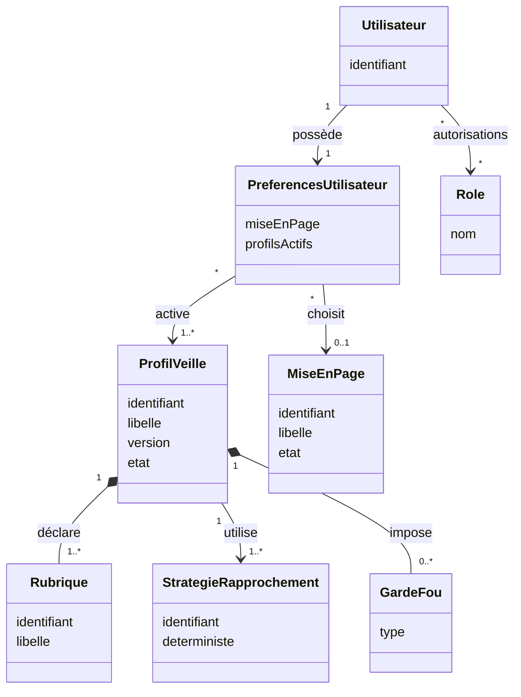
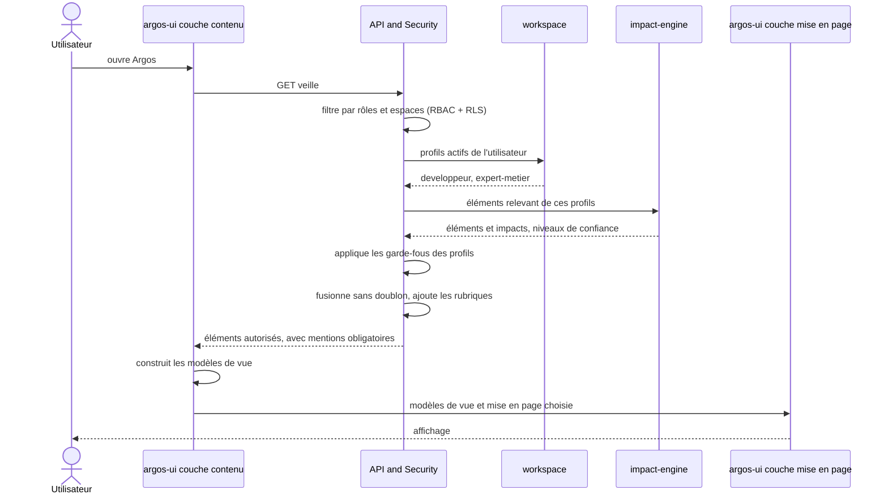

# Conception : personnaliser les profils de veille et la mise en page

<!-- Statuts : [EXIGENCE] [EXISTANT] [DÉCISION] [PROPOSITION] [QUESTION] (légende : /docs/specifications/README.md#statuts-des-informations). -->

**Niveau de conception** : allégée — règles fonctionnelles et responsabilités fixées ; schéma de données et API détaillés à concevoir avec les premières tâches d'implémentation.

## Contexte technique

Aucune implémentation métier [EXISTANT — `argos-server/src/main/java/io/argos/` ne contient que des `package-info.java` et `api/SystemInfoResource.java` ; `argos-ui/src/` ne contient qu'une page d'état]. Les frontières de modules sont vérifiées par `argos-server/src/test/java/io/argos/architecture/ModuleBoundariesTest.java` [EXISTANT — test non encore exécuté]. Motivation : voir `proposal.md`.

## Exigences couvertes

| Exigence | Section(s) de conception | Diagramme(s) |
|---|---|---|
| AFF-01, AFF-03, AFF-04 | Composants ; Modèle de domaine | DC-1 |
| AFF-02 | Traitements et interactions ; D1 | DC-2 |
| AFF-05 | Stratégie de vérification | — |
| PRF-01, PRF-03, PRF-04 | Composants ; Modèle de domaine ; D2 | DC-1 |
| PRF-02, PRF-05, PRF-06 | Traitements et interactions ; Sécurité et isolation | DC-2 |

## Objectifs et non-objectifs

**Objectifs :**
- séparer ce qu'un utilisateur voit (droits, profils, garde-fous) de la façon dont il le voit (mise en page) ;
- permettre l'ajout d'un profil ou d'une mise en page sans toucher aux existants.

**Non-objectifs :**
- concevoir les profils `artiste`, `comedien`, `politique` ;
- fixer le format exact du manifeste de profil (première tâche d'implémentation).

## Composants impactés, responsabilités et frontières

| Composant | Responsabilité dans ce changement | Ne doit pas | Statut |
|---|---|---|---|
| `catalog` | publier les profils (manifestes) et la liste des mises en page | connaître les préférences d'un utilisateur | modifié |
| `workspace` | enregistrer les profils actifs et la mise en page de chaque utilisateur ; profils proposés par une équipe | accorder un droit | modifié |
| `impact-engine` | exécuter les stratégies de rapprochement déclarées par les profils actifs | appeler l'IA pour décider d'un impact | modifié |
| `signal` | porter le noyau commun d'un signal et les rubriques ajoutées par un profil | interpréter les rubriques d'un profil | modifié |
| `API & Security` | exposer préférences et catalogue ; filtrer par droits puis par profils | appliquer une règle d'affichage | modifié |
| `mcp-server` | filtrer les réponses par profils actifs et garde-fous | contourner un garde-fou | modifié |
| IHM `argos-ui` — couche contenu | construire les modèles de vue à partir de l'API | dépendre d'une mise en page | nouveau |
| IHM `argos-ui` — couche mise en page | présenter les modèles de vue selon le style choisi | appeler l'API, filtrer ou omettre une mention obligatoire | nouveau |

## Modèle de domaine et invariants

### DC-1 — Profils, mises en page et préférences

- **Question** : quels concepts relient un utilisateur à ses profils et à sa mise en page, sans toucher à ses droits ?
- **Type** : UML classes
- **Portée** : cible proposée
- **Exigences** : AFF-01, AFF-03, AFF-04, PRF-01, PRF-03, PRF-04, PRF-05

Les préférences (profils, mise en page) et les rôles sont deux associations distinctes : aucune ne dérive de l'autre. Sans mise en page choisie, `classique` s'applique (cardinalité `0..1`).

Invariants :

- **INV-1** : un utilisateur a au moins un profil actif (PRF-01).
- **INV-2** : un profil actif ou une mise en page choisie est publié au catalogue, sinon la préférence est ignorée et le défaut s'applique (AFF-04).
- **INV-3** : aucune préférence ne modifie les rôles d'un utilisateur (PRF-05).

## Traitements et interactions

### DC-2 — Restitution de la veille d'un utilisateur

- **Question** : dans quel ordre droits, profils, garde-fous et mise en page s'appliquent-ils ?
- **Type** : UML séquence
- **Portée** : cible proposée
- **Exigences** : AFF-02, PRF-02, PRF-05, PRF-06

Les droits s'appliquent avant les profils, et les garde-fous avant la fusion : la couche mise en page ne reçoit que des éléments déjà autorisés, déjà filtrés et accompagnés de leurs mentions. Elle ne peut donc ni montrer un élément de plus, ni en retirer une mention (AFF-02).

[PROPOSITION] Décision Q-3 (PRF-02-S3, PRF-02-S4) : `API & Security` ajoute à la fusion les avis de sécurité retenus par les abonnements `PERSONAL` actifs de l'appelant (lus par `workspace`, critères interprétés comme pour `GET /api/v1/me/watch`), avec leurs projets concernés lus sous la RLS dans les seuls espaces de l'appelant. Un élément est restitué une fois ; il porte les rubriques des profils dont il relève et les abonnements qui l'ont retenu (champ `abonnements`). Les garde-fous des profils actifs qui rangent ses catégories s'appliquent aussi aux éléments des abonnements. Le socle `TEAM` n'entre pas dans cette veille.

## États et transitions

Non applicable — les cycles de vie de publication d'un profil ou d'une mise en page (brouillon, publié, retiré) seront modélisés avec la tâche du catalogue ; seul l'état « retiré » est utilisé par AFF-04.

## Contrats d'interface

[EXISTANT] Le contrat OpenAPI est généré par SmallRye OpenAPI (`/q/openapi`) et figé par `OpenApiContractTest`. Toutes les opérations exigent un utilisateur authentifié (401 sinon).

| Opération | Corps | Réponse | Refus |
|---|---|---|---|
| `GET /api/v1/catalogue/mises-en-page` | — | `MiseEnPageCatalogue[]` : identifiant, libellé, description, défaut | — |
| `GET /api/v1/catalogue/profils` | — | `ProfilCatalogue[]` : identifiant, libellé, description, version, rubriques, garde-fous | — |
| `GET /api/v1/preferences` | — | `PreferencesEffectives` | — |
| `PUT /api/v1/preferences/mise-en-page` | `ChoixMiseEnPage` | `PreferencesEffectives` | 400 `MISE_EN_PAGE_INCONNUE` |
| `PUT /api/v1/preferences/profils` | `ChoixProfils` (ensemble complet) | `PreferencesEffectives` | 400 `PROFIL_INCONNU`, 400 `AU_MOINS_UN_PROFIL` |

`PreferencesEffectives` donne la mise en page appliquée et la mise en page choisie, l'indicateur et le message de retrait (AFF-04-S2), les profils appliqués, l'indicateur « profils par défaut » et les profils enregistrés mais retirés. La confrontation au catalogue (INV-2) est faite par `api`, seul module autorisé à dépendre à la fois de `workspace` et de `catalog`.

## Persistance et intégrité

[EXISTANT] Les préférences sont la table `workspace_preference_utilisateur` (migration `V7__preferences_utilisateur.sql`) : une ligne par compte (`compte_id`, clé étrangère vers `compte`, identifiant relié au sujet OIDC), `mise_en_page` et `profils_actifs` à `NULL` tant qu'ils ne sont pas choisis, contrainte `workspace_preference_au_moins_un_profil` (INV-1). Sous le rôle applicatif `argos_app`, la RLS n'expose à un compte que ses propres préférences. La création d'un compte y enregistre le profil `developpeur` (événement `CompteCree`). Les manifestes de profils sont des ressources versionnées `catalog/profils/<identifiant>.json` du module `catalog`, validées au démarrage ; la liste des mises en page est la ressource `catalog/mises-en-page.json`. Les retraits sont des propriétés de configuration (`argos.catalogue.profils.retires`, `argos.catalogue.mises-en-page.retirees`).

## Transactions, concurrence et idempotence

Une modification de préférences est une opération idempotente qui remplace l'ensemble des profils actifs ou la mise en page ; la dernière écriture l'emporte.

## Sécurité et isolation

- les préférences ne figurent jamais dans les décisions d'autorisation (INV-3, PRF-05) ;
- un manifeste de profil est une donnée de configuration publiée par l'administrateur plateforme : il ne peut déclarer que des connecteurs et stratégies existants dans le code ;
- les garde-fous sont appliqués par le serveur, jamais par l'IHM (PRF-06).

## Gestion des erreurs et reprise

Mise en page ou profil inconnu : refus explicite (AFF-01-S2, PRF-01-S3). Mise en page retirée : défaut `classique` avec message (AFF-04-S2).

## Observabilité

Compteurs agrégés d'utilisateurs par profil et par mise en page ; aucun suivi individuel (dossier v2.4 §8.10).

## Performance et stratégie de mesure

[QUESTION] Aucune cible propre à ce changement ; la cible p95 < 500 ms du dossier v2.4 §10 s'applique à la restitution de la veille, à mesurer avec deux profils actifs.

## Compatibilité, migration et retour arrière

Non applicable — aucune donnée existante.

## Décisions, alternatives et compromis

### D1 — Deux couches dans l'IHM

- **Statut** : [PROPOSITION]
- **Choix** : couche contenu commune, couche mise en page par style.
- **Justification** : contenu et mentions identiques garantis par construction (AFF-02).
- **Alternatives écartées** : thèmes purement graphiques — ne permettent pas les structures maquettées ; une IHM par style — logique dupliquée.
- **Compromis** : chaque nouvel écran est décliné dans toutes les mises en page.
- **ADR** : ADR-0023 (Proposé).

### D2 — Profil = pack déclaratif et stratégies enfichables

- **Statut** : [PROPOSITION]
- **Choix** : manifeste de profil dans `catalog`, stratégies déterministes dans `impact-engine`.
- **Justification** : ajout d'un public sans toucher au cœur (PRF-04), rapprochement explicable (ADR-0013).
- **Alternatives écartées** : profils codés en dur ; une instance par public ; rapprochement confié à l'IA.
- **Compromis** : la taxonomie des signaux devient extensible.
- **ADR** : ADR-0024 (Proposé).

### D3 — Au moins un profil actif

- **Statut** : [PROPOSITION]
- **Choix** : refuser la désactivation du dernier profil.
- **Justification** : une veille vide n'a pas de sens et masquerait des alertes.
- **Alternatives écartées** : profil vide autorisé ; profil implicite caché.
- **Compromis** : —
- **ADR** : non : décision locale.

### D4 — Modèle de données commun et polices embarquées

- **Statut** : [PROPOSITION]
- **Choix** : un modèle typé unique `VeilleAffichee` (`argos-ui/src/mises-en-page/modele.ts`) reçu par les quatre mises en page et choisi par un sélecteur central (`MiseEnPage.vue`, repli `classique`) ; polices des maquettes embarquées par les paquets `@fontsource/*` (SIL OFL 1.1, sous-ensemble latin, feuilles sous licence MIT), servies par l'application.
- **Justification** : un seul contrat rend la comparaison des contenus automatique (AFF-02) ; l'absence de service de polices respecte la CSP du desktop (`font-src 'self'`) et le fonctionnement sans Internet (ADR-0022, ADR-0023 point 5). L'OFL est libre, gratuite et permet l'usage commercial ; elle ne s'applique qu'aux fichiers de police et ne touche pas la licence du code (ADR-0021 point 4).
- **Alternatives écartées** : polices système seules — ne rendent pas les maquettes ; chargement depuis Google Fonts — bloqué par la CSP et indisponible hors ligne ; un modèle par mise en page — contenus divergents.
- **Compromis** : environ 1,4 Mo de fichiers de police dans `dist/assets`, téléchargés seulement par la mise en page qui les emploie.
- **ADR** : non : application d'ADR-0023 point 5 et d'ADR-0021 point 6 (licences enregistrées dans `argos-ui/NOTICE`).
- **Raccordement de la veille réelle** : la couche contenu transpose la réponse de `GET /api/v1/me/veille` vers `VeilleAffichee` (`argos-ui/src/contenu/veille-affichee.ts`) ; chaque élément reçu donne un élément affiché, dans l'ordre reçu, avec toutes ses mentions (validation, garde-fous, « produit par l'IA », paternité de la source, origine profil ou abonnement personnel). L'union, le dédoublonnage, les garde-fous et les droits restent calculés par le serveur (arc42 §5.1).

### D5 — Couleurs en jetons contrôlés

- **Statut** : [PROPOSITION]
- **Choix** : chaque mise en page déclare sa palette (`palette.ts`) et les couples texte/fond qu'elle emploie ; ses feuilles de style n'utilisent que ces jetons. Les tests de l'IHM calculent chaque contraste (4,5:1 ou 3:1) et un banc Playwright mesure le contraste réellement rendu.
- **Justification** : AFF-05-S1 devient un contrôle exécuté à chaque construction : une palette sous le seuil fait échouer `npm --prefix argos-ui test`.
- **Alternatives écartées** : axe-core — licence MPL-2.0 (ADR-0021) ; revue manuelle seule — non reproductible.
- **Compromis** : la publication au catalogue du serveur reste une configuration distincte, non bloquée par ce contrôle.
- **ADR** : non : décision locale.

## Risques

- Multiplication des mises en page à maintenir → catalogue limité aux quatre initiales jusqu'à retour d'usage.
- Profils futurs grand public (produit ouvert, ADR-0025) → hébergement, comptes, licence et RGPD à traiter avant le premier pack hors entreprise.
- Profil politique : risque de partialité → garde-fous de neutralité obligatoires dans son futur pack (ADR-0024 point 7).

## Écarts code / tests / specs / documentation

La taxonomie fermée du dossier v2.4 §8.2 n'est pas versionnée dans `docs/architecture/` : à intégrer en arc42 §8 (tâche 4.1).

## Stratégie de vérification

| Exigence / scénario | Niveau de test | Moyen de preuve | État |
|---|---|---|---|
| AFF-01-S1, AFF-01-S2, AFF-04-S1, AFF-04-S2 | intégration API | tests des préférences | `PreferencesResourceTest`, `MiseEnPageRetireeTest`, `argos-ui/tests/resolution.test.mjs` |
| AFF-02-S1, AFF-02-S2 | E2E IHM | même jeu de données affiché dans les quatre mises en page, contenu comparé | rendu des quatre mises en page sur un même jeu comparé (`argos-ui/tests/mises-en-page.test.mjs`, banc `e2e/accessibilite/`) ; veille de `GET /api/v1/me/veille` transposée (`argos-ui/tests/veille-affichee.test.mjs`) ; E2E sur la veille réelle à écrire |
| AFF-03-S1 | E2E | préférence modifiée sur le web, lue par le desktop | E2E web `e2e/tests/affichage.spec.ts` ; partie desktop à exécuter |
| AFF-05-S1 | revue + tests IHM + navigateur | audit d'accessibilité par mise en page : palettes contrôlées (`argos-ui/tests/contrastes.test.mjs`), banc `e2e/accessibilite/` | réalisé le 2026-11-17 ([rapport](/docs/architecture/quality/audit-accessibilite-mises-en-page.md)) |
| PRF-01-S1 à PRF-01-S3 | intégration API | tests des préférences | `PreferencesResourceTest` |
| PRF-02-S1, PRF-02-S2 | intégration | veille d'un utilisateur à deux profils | `VeilleProfilsTest`, `UnionProfilsTest`, `ProfilDemonstrationTest` |
| PRF-02-S3, PRF-02-S4 | intégration | abonnements `PERSONAL` ajoutés à la veille, deux espaces | `VeilleAbonnementsPersonnelsTest` |
| PRF-03-S1, PRF-03-S2 | intégration | catalogue initial ; rapprochement `developpeur` | `CatalogueResourceTest`, `CatalogueProfilsTest`, `ProfilsDeVeilleTest`, `MatchRulesTest` |
| PRF-04-S1 | intégration | publication d'un profil de démonstration | `ProfilDemonstrationTest` |
| PRF-05-S1 | intégration | tests inter-espaces | `ProfilsDeVeilleTest#prf05S1ActivationDUnProfilSansDroitSurLesProjets`, `PreferencesIsolationTest` |
| PRF-06-S1, PRF-06-S2 | intégration + contrat MCP | fiche non validée invisible partout | `VeilleProfilsTest`, `ReglementaireMcpTest`, `UnionProfilsTest` |

## Documentation durable impactée

- `/docs/specifications/affichage-personnalise.md`, `/docs/specifications/profils-veille.md`, `/docs/specifications/README.md` ;
- arc42 §5 (responsabilités de `catalog`, `workspace`, IHM) et §8 (taxonomie extensible) ; glossaire (« profil de veille », « mise en page ») ;
- ADR-0023, ADR-0024.

## Questions ouvertes

Aucune autre que celles de la proposition.
