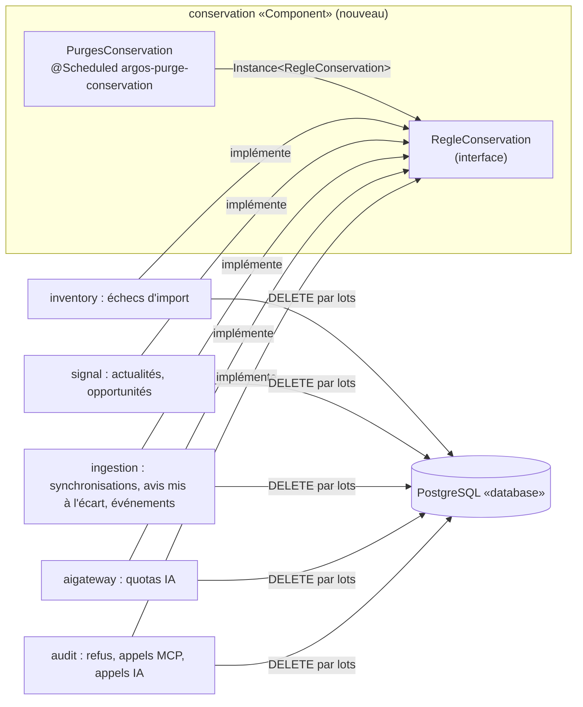
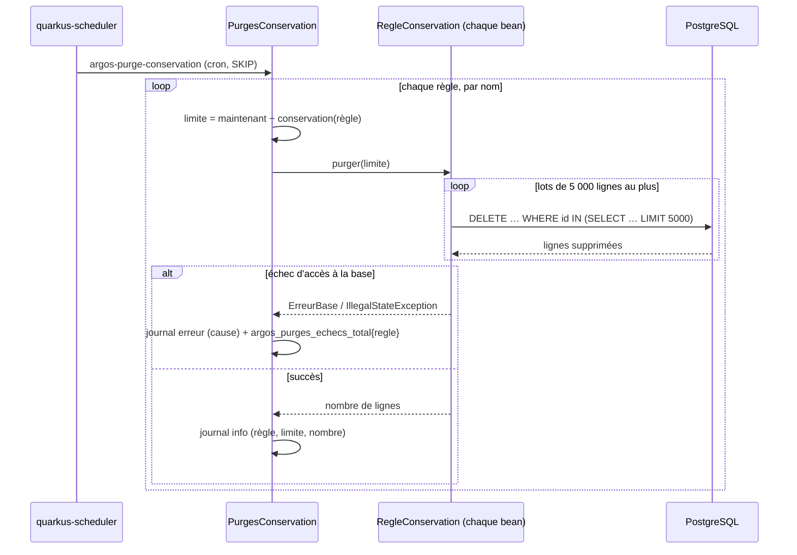
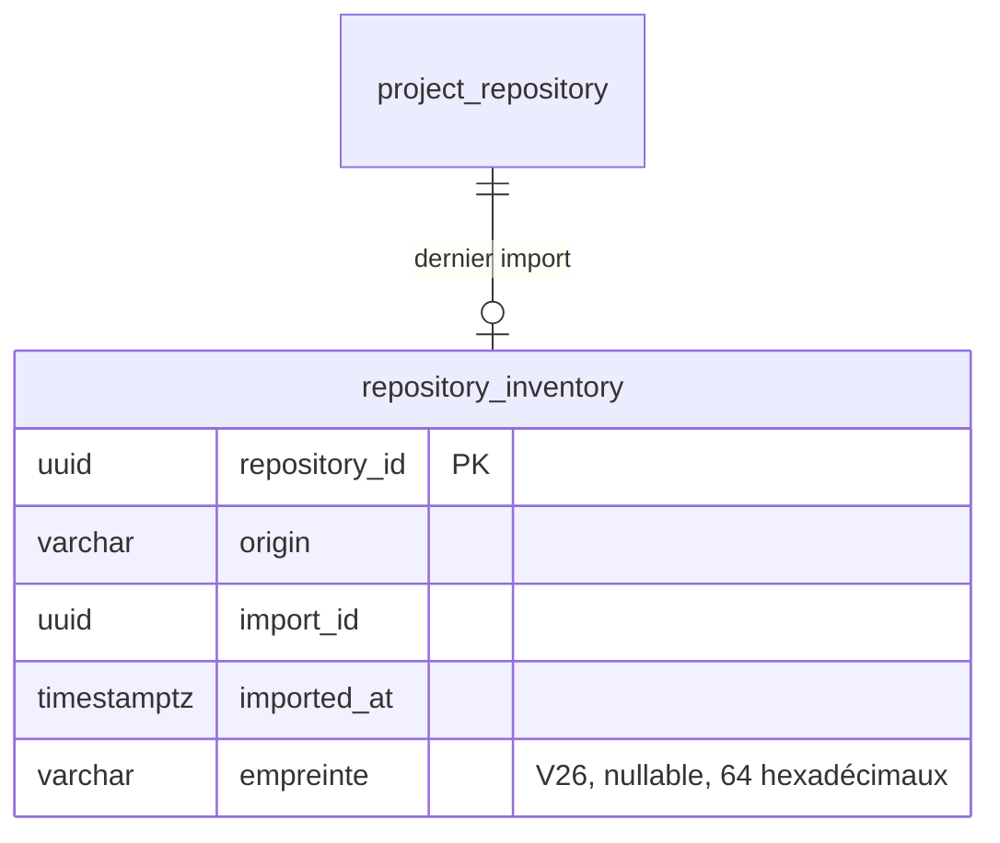

# Conception : Conserver les journaux pour une durée bornée, n'importer que l'inventaire modifié et paginer les listes

**Niveau de conception** : complète. Le changement ajoute un module technique transverse, crée une migration, change des contrats d'API et vise la performance (proposal.md, « Niveau de conception »).

## Contexte technique

- [EXISTANT] Une seule purge planifiée : `projectintel/PurgeActivite` (`argos-activite-purge`, 04:30, 13 mois). Aucune suppression sur `refus_acces`, `mcp_appel`, `ia_appel`, `ia_quota_jour`, `sync_run`, `sync_attempt`, `ingestion_failure`, `ops_event`, `inventory_import_failure`, `signal_version`, `actualite` ni `opportunite` (`grep -rn "DELETE FROM" argos-server/src/main/java`).
- [EXISTANT] Le journal des refus (`audit/JournalRefus`) écrit à chaque appel. `api/GestionErreurs.inscriptionRefusee` et `mcp/GardeAppels` l'appellent pour chaque requête d'un sujet sans compte. Le limiteur `commun.securite.LimiteurDebit` compte par compte, en mémoire, sur une fenêtre glissante d'une minute.
- [EXISTANT] `signal/opportunite/Opportunites.candidates` lit `date_limite IS NULL OR date_limite >= ?` sans borne. `CollecteOpportunites.lire` enregistre chaque élément de flux sans date limite. `recu_le` est la date de première collecte : l'upsert ne la modifie pas.
- [EXISTANT] `inventory/InventoryService.lire` marque `IMPORTED` toute SBOM ou tout jeu de manifestes lu. `InventoryStore.remplacer` réécrit ensuite les occurrences et publie `InventoryReplaced`, qui déclenche la recorrélation du projet. `ecrireOccurrences` exécute un `INSERT … RETURNING id` par composant.
- [EXISTANT] Trois formats de liste coexistent (proposal.md, « Sources et preuves »). Le plus répandu est `page`/`size` → `{items, page, size, total}`, 50 éléments par défaut et 200 au plus (`InventoryQueries.DEFAULT_PAGE_SIZE`, `MAX_PAGE_SIZE`).

## Exigences couvertes

| Exigence | Section(s) de conception | Diagramme(s) |
|---|---|---|
| EXP-17 | D1, D2, D3, D4 ; Traitements ; Gestion des erreurs | DC-1, DC-2 |
| ACC-15 | D7 | — |
| ART-08 | D5 | — |
| INV-14, INV-09 | D8, D9 ; Persistance | DC-3 |
| PERF-03 | D6 ; Contrats d'interface | — |

## Objectifs et non-objectifs

**Objectifs :**
- Une purge quotidienne unique, dont chaque module déclare les règles pour ses propres tables.
- Un import nocturne sans écriture pour un document inchangé, et une écriture par lot pour un document modifié.
- Un format de pagination unique, appliqué ici aux listes qui grandissent avec l'historique, et repris par le sprint 10.

**Non-objectifs :**
- Créer des index : AUD-PER-09 relève du sprint 10. Les besoins constatés sont signalés (Risques).
- Recorréler seulement les paquets modifiés : c'est le moteur de corrélation (sprint 10).
- Migrer `PurgeActivite` dans le nouveau mécanisme : sa durée est en mois et sa purge porte sur deux tables liées. Elle reste une tâche distincte, déjà conforme à ADR-0031.

## Composants impactés, responsabilités et frontières

| Composant | Responsabilité dans ce changement | Ne doit pas | Statut |
|---|---|---|---|
| `conservation` (module technique) | Contrat `RegleConservation`, tâche `PurgesConservation`, suppression par lots, métrique des échecs | Nommer une table ou dépendre d'un module métier | nouveau |
| `commun` | `Pagination`, `Page<T>` | Porter une règle métier | modifié |
| `audit` | Règles des journaux des refus, des appels MCP et des appels IA ; bornage du journal des refus | — | modifié |
| `aigateway` | Règle des compteurs de quotas journaliers | — | modifié |
| `ingestion` | Règles des synchronisations terminées, des avis mis à l'écart, des événements ; lectures paginées | Supprimer une synchronisation en cours ou à reprendre | modifié |
| `signal` | Règles des actualités et des opportunités ; âge maximal des opportunités ; façade paginée de l'exploitation | Supprimer une version d'avis (COL-03-S2) | modifié |
| `inventory` | Empreinte, conservation d'un document inchangé, écriture par lot, règle des échecs d'import, lectures paginées | Réécrire un composant inchangé | modifié |
| `impact` | Lecture paginée des impacts d'un projet (`ImpactQueries.forProject`) | Toucher à la corrélation | modifié |
| `api` | Lecture des paramètres `page`/`size`, opérations paginées | — | modifié |



**DC-1** — Organigramme à stéréotypes C4, cible. Question : qui connaît les tables purgées ? Exigence : EXP-17. Explication : le module `conservation` ne connaît que le contrat. Chaque module propriétaire de ses tables (arc42 §5.2.1) déclare une règle par bean CDI. La tâche les découvre par injection et ne nomme aucune table.

## Modèle de domaine et invariants

- **INV-1** Une règle de conservation porte un nom stable, unique (kebab-case), une durée réglable et une suppression qui ne retire que des lignes antérieures à la limite donnée.
- **INV-2** Une synchronisation `RUNNING` ou `RETRYABLE`, ou citée par un avis mis à l'écart, n'est jamais supprimée ; aucune version d'avis n'est supprimée.
- **INV-3** Après l'écriture d'un dépôt, son empreinte enregistrée est celle du document écrit. L'empreinte n'est comparée que pour une lecture depuis la forge.
- **INV-4** Une page vérifie `0 ≤ page`, `1 ≤ size ≤ 200`, `items.size() ≤ size` ; le tri se termine par l'identifiant.

## Traitements et interactions



**DC-2** — Diagramme de séquence UML, cible. Question : comment une règle en échec reste-t-elle isolée ? Exigences : EXP-17-S1, S4. Explication : chaque lot est une instruction autonome, validée hors transaction JTA. Un long nettoyage ne tient donc ni verrou ni connexion. Seules les erreurs d'accès à la base sont isolées. Toute autre exception remonte au planificateur, qui la journalise avec sa pile (`IntercepteurTaches`) : elle n'est pas absorbée.

```mermaid
sequenceDiagram
    participant Svc as InventoryService.lire
    participant Store as InventoryStore.remplacer
    participant Base as PostgreSQL
    Svc->>Svc: empreinte = SHA-256(version de lecture, nature, document)
    Svc->>Store: Remplacement(dépôt, …, empreinte, depuisForge = vrai)
    Store->>Base: pg_advisory_xact_lock(projet)
    Store->>Base: SELECT empreinte FROM repository_inventory WHERE repository_id = ?
    alt empreinte identique
        Store-->>Svc: dépôt conservé
        Note over Svc: résultat KEPT « document inchangé »
    else différente ou absente
        Store->>Base: en-tête (empreinte comprise)
        Store->>Base: INSERT component … SELECT FROM unnest(…) ON CONFLICT DO NOTHING
        Store->>Base: UPDATE component … FROM unnest(…) WHERE purl IS DISTINCT FROM …
        Store->>Base: DELETE occurrences du dépôt ; INSERT occurrences … SELECT … JOIN component
    end
    opt au moins un dépôt écrit
        Store->>Base: reconstituer (union, marqueur de recorrélation)
        Store-->>Store: InventoryReplaced (après validation)
    end
```

**DC-3** — Diagramme de séquence UML, cible. Question : quand l'import écrit-il et recorrèle-t-il ? Exigences : INV-14-S1, S2, S4 ; INV-09-S3. Explication : la comparaison se fait sous le verrou du projet. Un import manuel concurrent ne peut donc pas s'intercaler entre la lecture de l'empreinte et l'écriture. Si tous les dépôts du passage sont conservés, ni la reconstitution ni `InventoryReplaced` n'ont lieu.

## États et transitions

Non applicable : aucun cycle de vie nouveau. `StatutImport.KEPT` existe déjà ; il couvre aussi le document inchangé.

## Contrats d'interface

Le contrat exécutable reste `/q/openapi`. Format commun (ADR-0040, Proposé) :

| Élément | Valeur |
|---|---|
| Paramètres | `page` (entier ≥ 0, défaut 0 ; négatif → 0), `size` (défaut 50 ; ramené dans [1, 200]) ; non entier → 400 `DONNEE_INVALIDE`, `attribut` = nom du paramètre |
| Réponse | `{"items": [...], "page": 0, "size": 50, "total": 120}` ; une page peut porter des champs propres à la liste en plus des quatre champs communs (ex. `suivisRequis`, `message` des opportunités) |
| Tri | propre à chaque liste, terminé par l'identifiant |

| Opération | Avant | Après | Tri |
|---|---|---|---|
| `GET /api/v1/ops/sources/{id}/rejected` (exploitant) | tableau | page | `received_at` décroissant, `id` |
| `GET /api/v1/ops/sources/{id}/events` (exploitant) | tableau | page | `occurred_at` décroissant, `id` |
| `GET /api/v1/projects/{projectId}/inventory/failures` (membre) | tableau | page | `received_at` décroissant, `id` |
| `GET /api/v1/projects/{projectId}/impacts` (membre) | tableau | page, filtre `etat` conservé | `created_at`, `id` (ordre de `GET /signals/{id}/impacts`) |
| `GET /api/v1/projects/{projectId}/inventory` (membre) | `inventory.components` tableau | `inventory.components` page | clé de paquet, version (nulle en dernier), `id` |
| `GET /api/v1/profils/artiste/opportunites` (utilisateur du profil) | `{suivisRequis, message, items}` | mêmes champs + `page`, `size`, `total` | date limite la plus proche, titre, `id` |

`ProjectPage`, `ComponentPage` et la page d'impacts d'un signal gardent leur forme JSON, déjà conforme. Le type Java commun `Page<T>` est adopté par les nouvelles listes ; ces trois types existants restent en place, sans changement d'OpenAPI.

## Persistance et intégrité



Migration `V26__empreinte_dernier_import_depot.sql` : `ALTER TABLE repository_inventory ADD COLUMN empreinte varchar(64)`, contrôle de forme (`^[0-9a-f]{64}$`). Une ligne existante a une empreinte nulle : son premier passage réécrit l'inventaire et enregistre l'empreinte. Aucune autre table n'est modifiée. Aucun index n'est créé (périmètre du sprint 10).

## Transactions, concurrence et idempotence

- Purge : chaque lot est une instruction autonome, hors transaction JTA. Une suppression de lignes échues est idempotente. Deux instances la rejoueraient sans dommage (ADR-0031, instance unique).
- Import : comparaison et écriture sous le verrou consultatif transactionnel du projet, comme aujourd'hui. Le lot (`unnest`) s'appuie sur une dédoublonnage en Java par (`package_key`, version) : `ON CONFLICT` ne peut pas toucher deux fois la même ligne dans une instruction.
- Bornage des refus : compteur en mémoire de l'instance (ADR-0026, une seule instance), comme `LimiteurDebit`.

## Sécurité et isolation

- Les purges s'exécutent sous l'utilisateur de connexion, comme `PurgeActivite` et la collecte : les tables purgées ne sont pas lues sous `argos_app`. Aucune donnée n'est exposée.
- Bornage des refus : ACC-15 réduit le déni de service par stockage. La clé d'un sujet est une empreinte UUID de nom (`UUID.nameUUIDFromBytes`) : aucun sujet n'est gardé en clair en mémoire.
- Conservation : les sujets OIDC des journaux disparaissent passé la durée réglée (minimisation, AUD-SEC-03).

## Gestion des erreurs et reprise

- Purge : `ErreurBase` (traduction de `Jdbc`) et `IllegalStateException` (stores sans `Jdbc`) sont capturées par règle, journalisées au niveau erreur avec leur cause et comptées (`argos_purges_echecs_total{regle}`). Toute autre exception remonte au planificateur. Une purge manquée est rattrapée le lendemain : la limite est relative à l'instant d'exécution.
- Import : une erreur pendant l'écriture annule la transaction, comme aujourd'hui (INV-11).

## Observabilité

- Journal `INFO` par règle : nom, limite, lignes supprimées. Journal `ERROR` avec cause en cas d'échec.
- Métriques : `argos_purges_lignes_total{regle}` (compteur), `argos_purges_echecs_total{regle}` et `argos_refus_non_journalises_total`. Étiquettes bornées, fixées par le code.
- La tâche porte `@TacheObservee` : sa dernière exécution apparaît dans la santé des tâches (EXP-15).

## Performance et stratégie de mesure

- Aucune cible chiffrée nouvelle. Le critère est structurel : nombre d'instructions SQL de l'écriture d'inventaire indépendant du nombre de composants (test qui compte les instructions avec un import de 2 000 composants), et aucune écriture pour un document inchangé (test : `import_id` et `imported_at` inchangés, aucun `InventoryReplaced`).
- Purge par lots de 5 000 lignes (`argos.conservation.taille-lot`) : borne la durée de chaque instruction sur le NAS.

## Compatibilité, migration et retour arrière

- Ruptures d'API : voir proposal.md. Clients internes concernés : l'IHM (`argos-ui/src/api/artiste.ts`, opportunités), adaptée dans ce changement. Les autres opérations rendues paginées ne sont appelées ni par l'IHM ni par le desktop (`grep` dans `argos-ui/src` et `argos-desktop/src`).
- V26 est additive. Retour arrière : la colonne inutilisée par une version antérieure est ignorée.
- Les purges suppriment des données définitivement. La première exécution après déploiement retire tout l'historique antérieur aux durées par défaut. L'exploitant peut allonger une durée avant le déploiement (`ARGOS_CONSERVATION_*`).

## Décisions, alternatives et compromis

### D1 — Un module technique `conservation` et un contrat déclaré par chaque module

- **Statut** : [PROPOSITION]
- **Choix** : nouveau module transverse `io.argos.conservation`, sans dépendance métier : l'interface `RegleConservation` (`nom()`, `conservation()`, `purger(Instant limite)`) et la tâche planifiée unique `PurgesConservation`. Chaque module implémente une règle par table ou par groupe de tables liées.
- **Justification** : ADR-0037 interdit au noyau `commun` un nom de table et une dépendance vers `observabilite` (`@TacheObservee`). Le propriétaire de chaque table garde son SQL (arc42 §5.2.1). Une seule tâche, un seul horaire et une seule métrique. Le test de complétude devient possible (D4).
- **Alternatives écartées** : une tâche `@Scheduled` par module, sur le modèle de `PurgeActivite`. Elle multiplierait horaires et réglages par six, et rendrait le contrôle de complétude dispersé. Une purge centrale qui nommerait toutes les tables violerait la propriété des tables. Le partitionnement par date (`pg_partman`) demanderait une extension et des migrations lourdes.
- **Compromis** : un module de plus dans la liste fermée (`ModuleBoundariesTest`, arc42 §5).
- **ADR** : candidat ADR-0041 (Proposé).

### D2 — Suppression par lots hors transaction

- **Statut** : [PROPOSITION]
- **Choix** : `DELETE FROM t WHERE id IN (SELECT id FROM t WHERE <date> < ? AND <garde> LIMIT ?)`, répété tant qu'un lot est plein. L'utilitaire `SuppressionParLots` du module `conservation` porte la boucle ; la règle fournit le SQL. Taille par défaut : 5 000.
- **Justification** : borne la durée des verrous et la taille du WAL de chaque instruction sur le NAS.
- **Alternatives écartées** : une seule instruction, au risque d'un verrou long dès la première exécution sur un historique ancien.
- **Compromis** : un peu plus d'allers-retours.
- **ADR** : couvert par ADR-0041.

### D3 — Durées par défaut

- **Statut** : [PROPOSITION] (valeurs à confirmer par le porteur ; [QUESTION] dans proposal.md)
- **Choix** (`argos.conservation.<règle>`, variables `ARGOS_CONSERVATION_<RÈGLE>`, format ISO-8601) :

| Règle | Module | Tables | Date | Défaut |
|---|---|---|---|---|
| `refus-acces` | audit | `refus_acces` | `horodatage` | P180D |
| `appels-mcp` | audit | `mcp_appel` | `horodatage` | P180D |
| `appels-ia` | audit | `ia_appel` | `horodatage` | P180D |
| `quotas-ia` | aigateway | `ia_quota_jour` | `jour` | P90D |
| `synchronisations` | ingestion | `sync_attempt`, puis `sync_run` terminés (`SUCCEEDED`, `FAILED`) non cités par un avis mis à l'écart | `finished_at` | P90D |
| `avis-mis-a-l-ecart` | ingestion | `ingestion_failure` | `received_at` | P180D |
| `evenements-exploitation` | ingestion | `ops_event` | `occurred_at` | P180D |
| `echecs-import` | inventory | `inventory_import_failure` | `received_at` | P180D |
| `actualites` | signal | `actualite` (cascade sur ses citations et rapprochements) | `recu_le` | P365D |
| `opportunites` | signal | `opportunite` échues (D5) | échéance | P180D |

- **Justification** : 180 jours couvrent deux trimestres d'enquête sur un refus ou un appel, dans la fourchette suggérée par l'audit (90 jours à un an). 90 jours suffisent pour des compteurs journaliers et des tentatives. Un an pour les actualités, contenu de veille consulté par la recherche.
- **Alternatives écartées** : une durée unique pour toutes les tables, inadaptée à des contenus de nature différente.
- **Compromis** : les durées sont des choix d'exploitation, réglables sans recompiler.
- **ADR** : non : valeurs de configuration.

### D4 — Complétude vérifiée par un test

- **Statut** : [PROPOSITION]
- **Choix** : `ConservationCompleteTest` déclare la liste fermée des tables de journal, d'échec ou d'historique avec, pour chacune, la règle qui la purge ou la raison de son exclusion (alertes, historiques métier, activité purgée par `PurgeActivite`, état de collecte réglementaire). Toute nouvelle table du schéma absente de la liste fait échouer le test. Le test lit `pg_tables`, sur le modèle de `NettoyageBaseTest`.
- **Justification** : le critère de sortie « chaque table … a une purge » reste vrai après les migrations futures.
- **ADR** : couvert par ADR-0041.

### D5 — Échéance d'une opportunité

- **Statut** : [PROPOSITION]
- **Choix** : échéance = `date_limite` si elle existe, sinon `recu_le` + âge maximal (`argos.profil-artiste.opportunites.age-max`, P90D). La restitution exclut les opportunités échues (ART-08). La règle `opportunites` supprime celles dont l'échéance précède la limite de conservation.
- **Justification** : `recu_le` est la première collecte (l'upsert ne la change pas) ; un élément de flux n'a pas d'autre date fiable.
- **Alternatives écartées** : la date de publication du flux, non lue aujourd'hui (`LecteurFlux.ElementFlux` n'en porte pas). `modifie_le`, rafraîchie à chaque collecte, ferait vivre un élément tant qu'il reste dans le flux.
- **Compromis** : une opportunité encore publiée par sa source après sa purge est recollectée avec une nouvelle première collecte : sans date limite, elle redevient ouverte pour l'âge maximal (cas d'un flux qui garde des éléments plus de neuf mois) ; avec une date limite dépassée de plus que la durée de conservation, elle est réinsérée puis supprimée à chaque passage, sans jamais être restituée (ART-03-S2).
- **ADR** : non : décision locale.

### D6 — Format de pagination commun et périmètre

- **Statut** : [PROPOSITION]
- **Choix** : `page`/`size` → `{items, page, size, total}`, 50 par défaut, 200 au plus, tri terminé par l'identifiant (`commun.Pagination`, `commun.Page<T>`, `api.ParametresPagination.pagination`). Le format s'applique à toute liste dont la taille croît avec les données collectées, importées ou journalisées.
- **Justification** : c'est le format le plus répandu (projets, composants, impacts d'un signal) et celui que l'IHM sait lire (`PageImpactsApi`). Le total sert l'affichage « n sur N ». La pagination par décalage suffit pour des tables bornées par la conservation (EXP-17).
- **Alternatives écartées** : la pagination par curseur (clé de tri) : plus stable sous insertion, mais elle romprait les trois listes paginées existantes et l'IHM, pour un gain non mesuré sur des tables bornées. Le format `page`/`taille`/`elements` de la recherche, utilisé par une seule opération.
- **Compromis** : la recherche garde son format (`page`, `taille`, `elements`) [DÉCISION — porteur du projet, 2026-11-26] ; `/me/veille` sera alignée après la fusion de ce changement. Les listes bornées par `limite` (alertes, fiches, actualités) le gardent pour ce sprint [DÉCISION — porteur du projet, 2026-11-26, option 1] : elles sont déjà bornées, et les aligner touche le desktop, qui interroge `/alertes` en boucle. Écart consigné ci-dessous. Les listes bornées par la configuration ne sont pas paginées.
- **ADR** : candidat ADR-0040 (Proposé).

### D7 — Bornage du journal des refus dans `JournalRefus`

- **Statut** : [PROPOSITION]
- **Choix** : `JournalRefus.enregistrer` consulte un `LimiteurDebit` (`argos.audit.refus.par-minute`, 30 par défaut). La clé est le compte, sinon une empreinte du sujet, sinon une clé « anonyme » commune. Au-delà de la limite, la ligne n'est pas écrite et `argos_refus_non_journalises_total` est incrémenté. Tous les appelants (API, MCP) sont couverts sans modification.
- **Justification** : un seul point d'écriture. Le refus lui-même reste appliqué par l'appelant.
- **Alternatives écartées** : limiter en amont chaque requête d'un sujet sans compte (réponse 429). Cela changerait le contrat des refus et ne protège pas le journal MCP. Le limiteur au reverse proxy reste recommandé, hors du serveur.
- **ADR** : non : décision locale.

### D8 — Empreinte du document dans `repository_inventory`

- **Statut** : [PROPOSITION]
- **Choix** : SHA-256 en hexadécimal de « version de lecture | nature (`SBOM` ou `MANIFEST`) | contenu ». Pour des manifestes, le contenu est formé des chemins triés, chacun suivi de sa longueur et de son contenu. La version de lecture (`EmpreinteDocument.VERSION_LECTURE`) change quand l'analyse d'un document change de résultat. L'empreinte est enregistrée par tout import d'un dépôt. Elle n'est comparée que pour une lecture depuis la forge (passage planifié, relance).
- **Justification** : un import manuel exprime une intention ; il est toujours appliqué (INV-14-S3). La version de lecture évite qu'une amélioration de l'analyseur soit masquée par une empreinte inchangée.
- **Alternatives écartées** : comparer l'ensemble des composants analysés. Il faudrait les relire en base à chaque passage, pour un résultat équivalent.
- **ADR** : non : décision locale.

### D9 — Écriture par lot avec `unnest`

- **Statut** : [PROPOSITION]
- **Choix** : dédoublonnage en Java par (`package_key`, version). Puis trois instructions : insertion des nouveaux composants (`ON CONFLICT DO NOTHING`), mise à jour du PURL des seuls composants dont il change, insertion des occurrences par jointure sur `component`. Les tableaux sont passés par `createArrayOf`.
- **Justification** : `RETURNING` ne rend pas les lignes ignorées par `DO NOTHING` ou par un `DO UPDATE … WHERE` faux. La jointure relit les identifiants dans la même instruction. Un composant inchangé n'est pas réécrit : pas de version morte de ligne par nuit.
- **Alternatives écartées** : `addBatch` puis une relecture des identifiants par `= ANY`. C'est une instruction par composant côté pilote, réécrite en lot seulement avec `reWriteBatchedInserts`, et elle demande une relecture.
- **ADR** : non : décision locale.

## Risques

- [Index absents pour certaines purges] Aucune purge ne lit `project_impact`. La règle `actualites` filtre sur `actualite.recu_le`, qui n'a pas d'index (seul `coalesce(publie_le, recu_le)` est indexé). Les gardes de `synchronisations` lisent `ingestion_failure.run_id` et `sync_attempt.run_id`, sans index, sur des tables bornées par leur propre conservation. Un lot rempli s'arrête tôt ; seul le dernier lot parcourt la table. Ces index relèvent d'AUD-PER-09 (sprint 10) : ils sont signalés dans la PR, pas créés ici.
- [Suppression non désirée à la première exécution] → durées réglables avant déploiement ; journal des volumes supprimés par règle.
- [Ruptures d'API] → listées dans proposal.md ; l'IHM est adaptée ; OpenAPI régénéré.

## Écarts code / tests / specs / documentation

- Versions d'avis (`signal_version`) : non purgées. COL-03-S2 exige que la version précédente reste consultable. Le volume (`raw_content`) reste à borner par une décision du porteur qui modifierait cette exigence.
- Alertes et éléments de résumé (`alerte`, `resume_element`) : non purgés. L'idempotence d'une alerte immédiate repose sur la ligne elle-même (`alerte_immediate_uk`). La purger permettrait un second envoi si le signal est recorrélé. Il faudrait d'abord une clé d'idempotence séparée. Reporté : constat à rouvrir hors de ce sprint, qui ne touche pas au moteur d'alertes.
- Listes bornées par `limite` (`GET /api/v1/alertes`, `GET /api/v1/reglementaire/fiches`, `GET /api/v1/veille-web/actualites`) : bornées (200 au plus) mais pas au format commun de PERF-03 (D6, décision du porteur du 2026-11-26). Leur alignement, IHM et desktop compris, reste à planifier.
- `RappelsOpportunites` relit les opportunités pour chaque suiveur (AUD-PER-18, impact « N+1 par suiveur »). L'âge maximal borne le volume relu ; la lecture en une requête reste à faire.

## Stratégie de vérification

| Exigence / scénario | Niveau de test | Moyen de preuve | État |
|---|---|---|---|
| EXP-17-S1, S2 | intégration | `ConservationTest` : lignes échues et récentes de chaque règle ; durée réglée | à écrire |
| EXP-17-S3 | intégration | `ConservationTest` : synchronisation en cours ou citée par un avis mis à l'écart | à écrire |
| EXP-17-S4 | unitaire | `PurgesConservationTest` : une règle en échec, les autres exécutées, métrique incrémentée | à écrire |
| EXP-17-S5 | intégration | `ConservationTest` : opportunités échues | à écrire |
| EXP-17 (complétude) | architecture | `ConservationCompleteTest` | à écrire |
| ACC-15-S1, S2 | intégration | `JournalRefusBorneTest` | à écrire |
| ART-08-S1, S2 | intégration | `ProfilArtisteTest` (âge maximal) | à écrire |
| INV-14-S1 à S4, INV-09-S3 | intégration | `ImportInchangeTest` (empreinte, KEPT, aucune recorrélation, lot) | à écrire |
| PERF-03-S1 à S5 | intégration | `ListesPagineesTest` ; `ParametresPaginationTest` | à écrire |

## Documentation durable impactée

- `/docs/specifications/exploitation-plateforme.md`, `performance-api-mcp.md`, `comptes-acces.md`, `inventaire-sbom.md`, `profil-artiste.md`.
- arc42 §5 (module `conservation`, liste fermée), §8.10 (pagination), §8 (conservation), §9 (index des décisions), §12 (glossaire : règle de conservation).
- ADR-0040 (pagination) et ADR-0041 (conservation), au statut Proposé.
- `README.md` du serveur et `.env.example` : variables `ARGOS_CONSERVATION_*`, contrôlées par `scripts/verifier-configuration.mjs`.

## Questions ouvertes

- Durées de conservation par défaut (D3) et âge maximal des opportunités (D5) : proposées et réglables. Une autre valeur ne change ni les specs ni les tâches.
