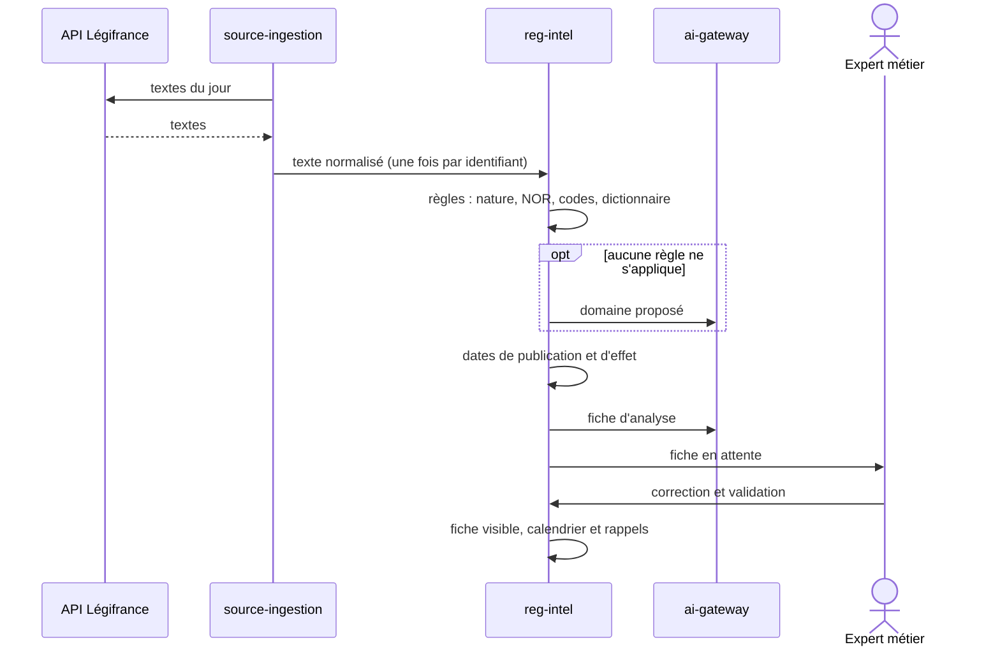
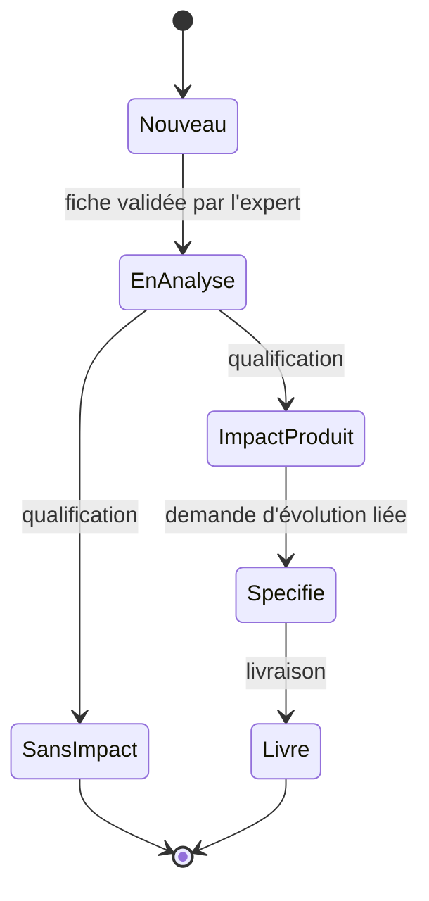

# Conception : suivre les évolutions réglementaires avec validation par un expert

<!-- Statuts : [EXIGENCE] [EXISTANT] [DÉCISION] [PROPOSITION] [QUESTION] (légende : /docs/specifications/README.md#statuts-des-informations). -->

**Niveau de conception** : Complète : nouveau cycle de vie (fiche), source externe à conditions d'usage, dépendance à la passerelle IA.

## Contexte technique

Le module `regintel` ne contient qu'un `package-info.java`. La fiche dépend de `passerelle-ia` (IAG-04, IAG-05) et la visibilité de `profils-veille` (PRF-06). Motivation : voir `proposal.md`.

## Exigences couvertes

| Exigence | Section(s) de conception | Diagramme(s) |
|---|---|---|
| REG-01 | Composants | DC-1 |
| REG-02 | Composants | DC-1 |
| REG-03 | Composants | DC-1 |
| REG-04 | Composants | DC-1 |
| REG-05 | Composants | DC-1, DC-2 |
| REG-06 | Composants | DC-2 |
| REG-07 | Composants | DC-1 |
| REG-08 | Composants | DC-2 |

## Objectifs et non-objectifs

**Objectifs :**
- qualification déterministe d'abord, IA en appoint marqué
- aucune diffusion avant validation

**Non-objectifs :**
- avis juridique
- sources réglementaires hors Journal officiel

## Composants impactés, responsabilités et frontières

| Composant | Responsabilité dans ce changement | Ne doit pas | Statut |
|---|---|---|---|
| `reg-intel` | qualifier, préparer les fiches, porter le cycle de vie et la validation | produire un avis juridique | modifié |
| `source-ingestion` | connecteur Légifrance, repli LEGI/JORF, idempotence | connaître les domaines | modifié |
| `catalog` | dictionnaire métier et domaines de l'espace | — | modifié |
| `ai-gateway` | fiche et proposition de domaine | décider de la validation | existant (proposé) |

## Modèle de domaine et invariants

Non applicable — conception allégée ; à préciser avec les tâches d'implémentation correspondantes.

## Traitements et interactions

### DC-1 — Du texte publié à la fiche validée

- **Question** : comment un texte officiel devient-il une fiche visible ?
- **Type** : UML séquence
- **Portée** : cible proposée
- **Exigences** : REG-01, REG-02, REG-03, REG-04, REG-05, REG-07

L'IA n'intervient que pour la fiche et pour un domaine incertain ; la diffusion attend la validation de l'expert.

## États et transitions

### DC-2 — Cycle de vie d'un texte

- **Question** : par quels états passe un texte jusqu'à la livraison ?
- **Type** : UML états
- **Portée** : cible proposée
- **Exigences** : REG-05, REG-06, REG-08

Toute autre transition est refusée (REG-06-S2).

## Contrats d'interface

Non applicable — conception allégée ; à préciser avec les tâches d'implémentation correspondantes.

## Persistance et intégrité

Tables des textes (identifiant officiel unique), des fiches et de leur historique de validation, du dictionnaire métier par espace.

## Transactions, concurrence et idempotence

Non applicable — conception allégée ; à préciser avec les tâches d'implémentation correspondantes.

## Sécurité et isolation

Fiche invisible hors experts avant validation (REG-05) ; textes externes traités comme données non fiables (R-11) ; mention « aucun avis juridique » sur chaque fiche.

## Gestion des erreurs et reprise

API indisponible : état dégradé de la source et reprise au jour manqué (REG-01-S2) ; repli sur les données ouvertes LEGI/JORF.

## Observabilité

Compteurs agrégés et journaux d'audit selon arc42 §8.6 ; aucun suivi individuel des utilisateurs.

## Performance et stratégie de mesure

[QUESTION] Aucune cible propre à ce changement dans les sources ; la cible de consultation de arc42 §10 (Q-05) s'applique quand elle est pertinente.

## Compatibilité, migration et retour arrière

Non applicable — aucune donnée ni aucun contrat existants.

## Décisions, alternatives et compromis

### D1 — Dictionnaire métier par espace

- **Statut** : [PROPOSITION]
- **Choix** : règles de rattachement configurées par chaque espace
- **Justification** : produit ouvert : chaque public a ses domaines
- **Alternatives écartées** : dictionnaire global — inadapté hors d'un éditeur
- **Compromis** : configuration initiale à fournir (Q-4)
- **ADR** : candidat à une mise à jour d'ADR-0018

### D2 — Validation obligatoire avant diffusion

- **Statut** : [PROPOSITION]
- **Choix** : fiche visible des seuls experts tant qu'elle n'est pas validée
- **Justification** : fiabilité d'une information à enjeu juridique
- **Alternatives écartées** : diffusion immédiate marquée IA — risque d'erreur diffusée
- **Compromis** : délai de diffusion
- **ADR** : ADR-0018 (Proposé)

## Risques

- Interprétation erronée d'un texte → validation obligatoire, lien vers le texte officiel.
- Conditions d'usage de l'API incompatibles avec un produit diffusé (Q-1) → repli sur les données ouvertes.

## Écarts code / tests / specs / documentation

Aucun écart constaté.

## Stratégie de vérification

| Exigence / scénario | Niveau de test | Moyen de preuve | État |
|---|---|---|---|
| REG-01-S1, REG-01-S2 | intégration | réponses Légifrance enregistrées | à écrire |
| REG-02-S1, REG-02-S2 | unitaire + intégration | dictionnaire de test | à écrire |
| REG-03-S1, REG-03-S2 | unitaire | textes de test | à écrire |
| REG-04-S1 | intégration | ai-gateway simulé | à écrire |
| REG-05-S1, REG-05-S2 | intégration | droits et visibilité | à écrire |
| REG-06-S1, REG-06-S2 | unitaire | machine à états | à écrire |
| REG-07-S1 | intégration | horloge simulée | à écrire |
| REG-08-S1 | intégration API | lien enregistré | à écrire |

## Documentation durable impactée

- `/docs/specifications/veille-reglementaire.md`, registre `/docs/specifications/README.md`
- arc42 §6
- ADR-0018 (mise à jour)

## Questions ouvertes

Aucune autre que celles de la proposition.
